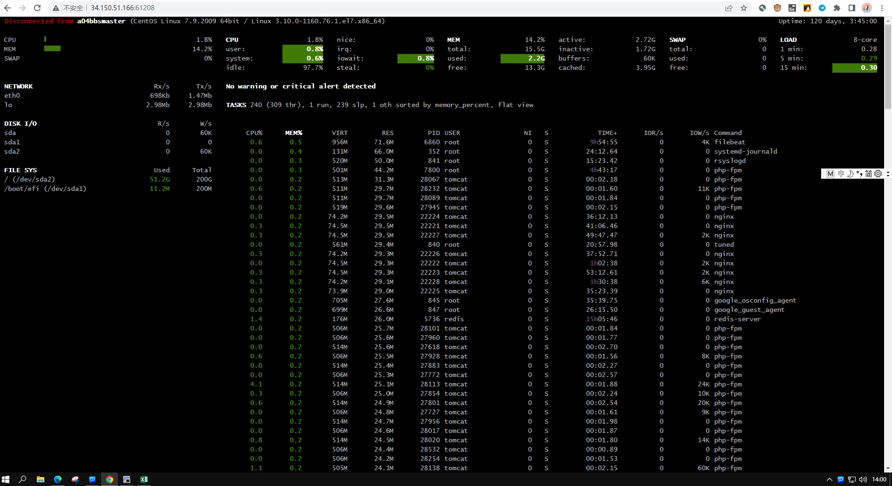

# 服务器监控 glances

**centos 安装监控**

```bash
yum -y install epel-release ; yum install -y screen glances python2-bottle.noarch
```

**docker启动** 展开源码

```bash
docker run -d --restart="always" --name glances -p 61208-61209:61208-61209 -e GLANCES_OPT="-w" -v /var/run/docker.sock:/var/run/docker.sock:ro --pid host docker.io/nicolargo/glances
```

**ubuntu debian 安装监控** 展开源码

```bash
apt install glances
```

**python 安装glances** 展开源码

```
pip3 install glances
pip3 install bottle
```

**其它linux系统设备安装** 展开源码

```bash
curl -L https://bit.ly/glances | /bin/bash
```

**linux虚拟终端后台常驻启动 （防火墙开61208）**

```
使用-R 创建虚拟终端：
screen -R glances

创建好虚拟终端后运行程序
glances -w

这个时候，我们按Ctrl+a，再按d，即可保持这个screen到后台并回到主终端

重新回到虚拟终端
screen -R glances
```

**windows启动glances**

```
powshell后台网页启动
glancesstart-job{glances -w}
```



**快捷键**

- a – 对进程自动排序
- c – 按 CPU 百分比对进程排序
- m – 按内存百分比对进程排序
- p – 按进程名字母顺序对进程排序
- i – 按读写频率（I/O）对进程排序
- d – 显示/隐藏磁盘 I/O 统计信息
- f – 显示/隐藏文件系统统计信息
- n – 显示/隐藏网络接口统计信息
- s – 显示/隐藏传感器统计信息
- y – 显示/隐藏硬盘温度统计信息
- l – 显示/隐藏日志（log）
- b – 切换网络 I/O 单位（Bytes/bits）
- w – 删除警告日志
- x – 删除警告和严重日志
- 1 – 切换全局 CPU 使用情况和每个 CPU 的使用情况
- h – 显示/隐藏这个帮助画面
- t – 以组合形式浏览网络 I/O
- u – 以累计形式浏览网络 I/O
- q – 退出（‘**ESC**‘ 和 ‘**Ctrl&C**‘ 也可以）
