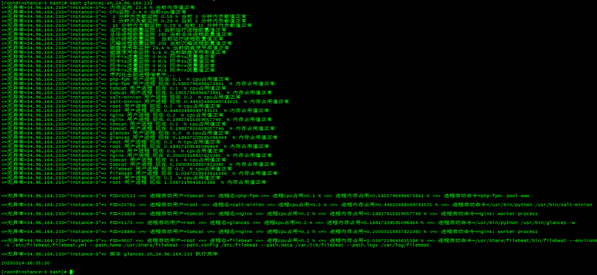

# glances 监控安装

**linux虚拟终端后台常驻启动 （防火墙开61208）**

```bash
yum -y install epel-release screen glances python2-bottle.noarch
使用-R 创建虚拟终端：
screen -R glances
创建好虚拟终端后运行程序
glances -w
这个时候，我们按Ctrl+a，再按d，即可保持glances后台常驻
```

****任意一台linux机器执行 bash glances.sh_34.96.164.233 就能看监控情况****


