# sysinfo 开源监控

sysinfo 使用 Python Flask 框架和 psutil 开发的一个中文版 Linux 服务器信息查看应用，可查看的信息包括系统、CPU、内存、硬盘、进程、网络、登录用户等，同时可查看并导出部分数据的图表。
<https://github.com/hypersport/sysinfo>

## 需要安装的 Python 包

- flask
- psutil
- netifaces

## 运行

1. 下载或使用 `git clone` 获取源代码
2. 进入目录执行 `python run.py` 启动应用
3. web 页面访问 [http://localhost:9468](http://localhost:9468/) ，修改 [auto-refresh.js](https://github.com/hypersport/sysinfo/blob/master/static/js/auto-refresh.js) 文件中的 `notRefresh` 可配置是否自动刷新。

## 运行截图

- 首页 / 系统信息
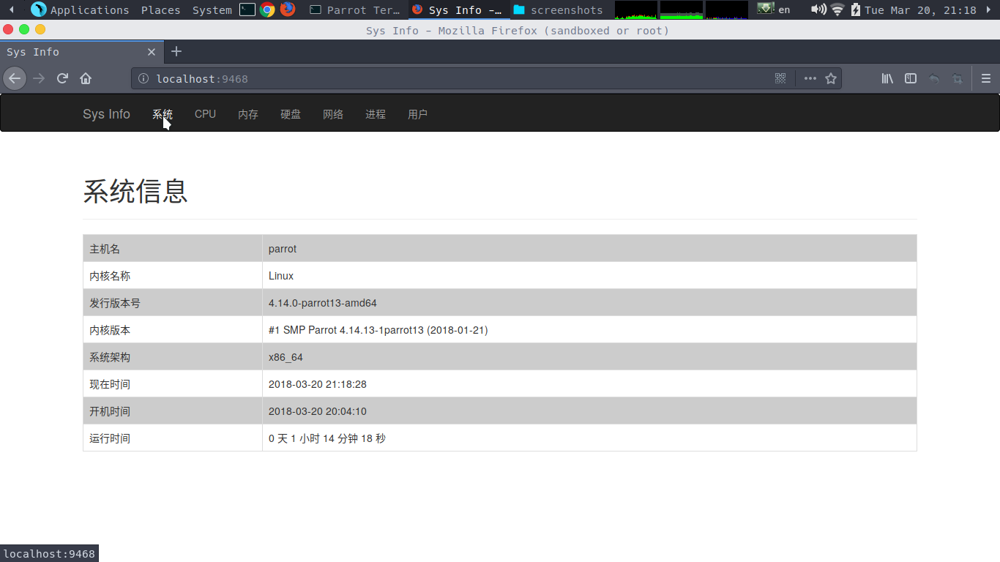
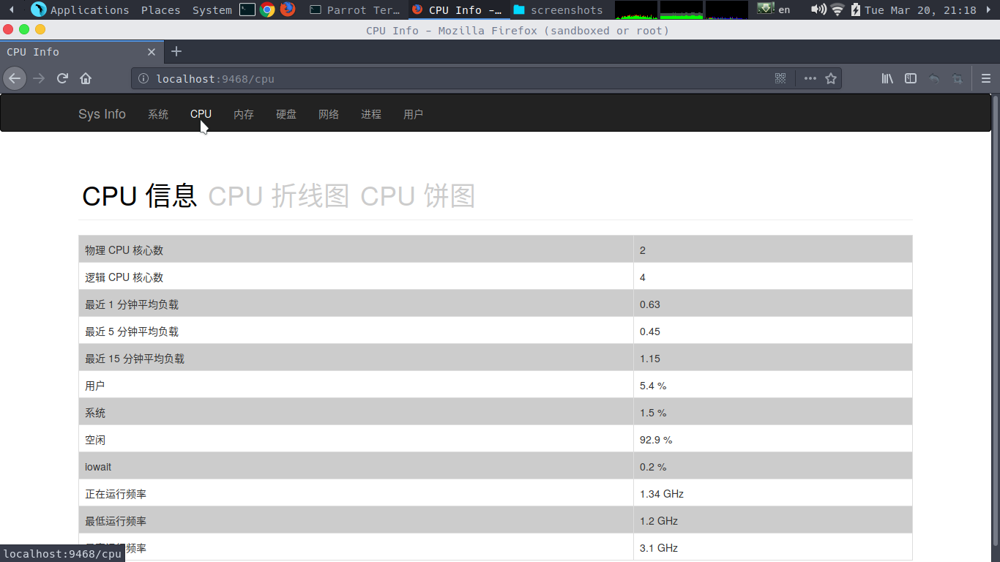
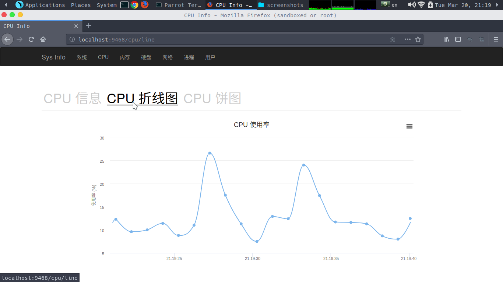
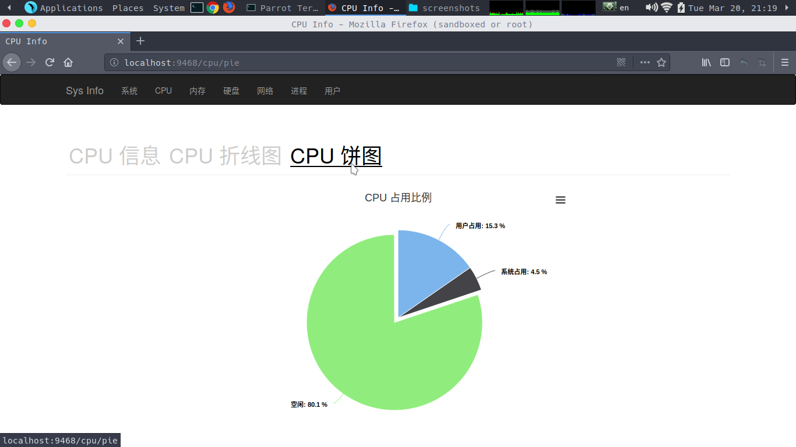

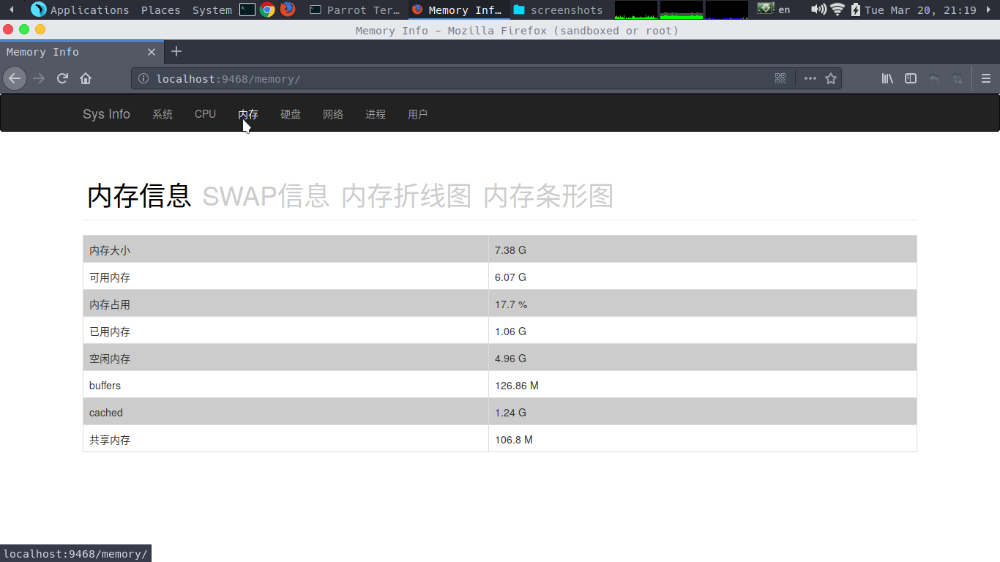
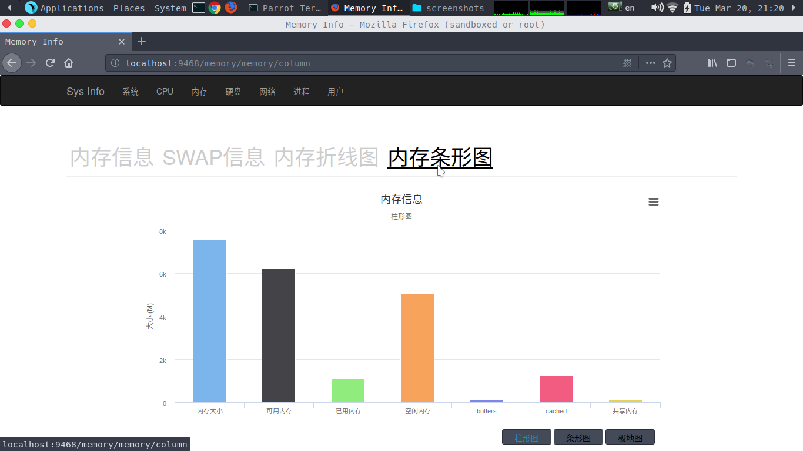

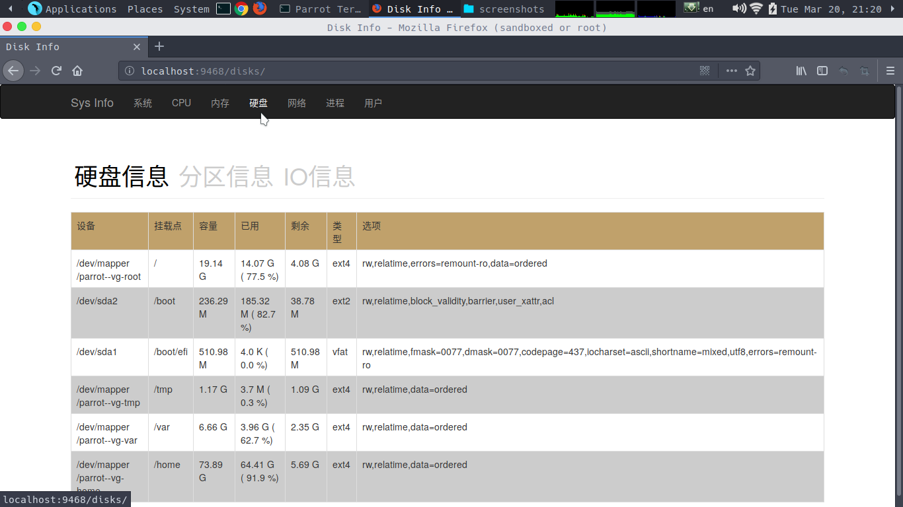
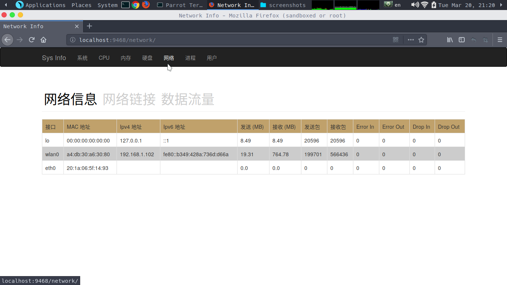
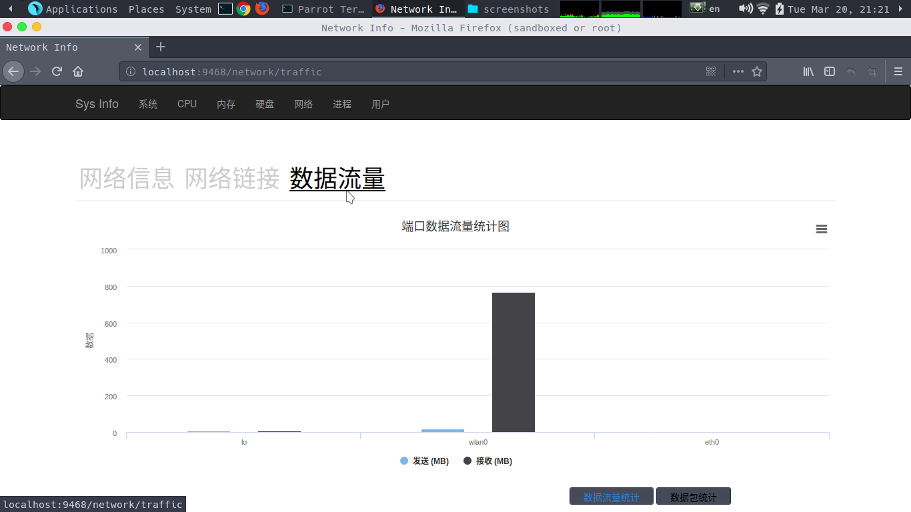
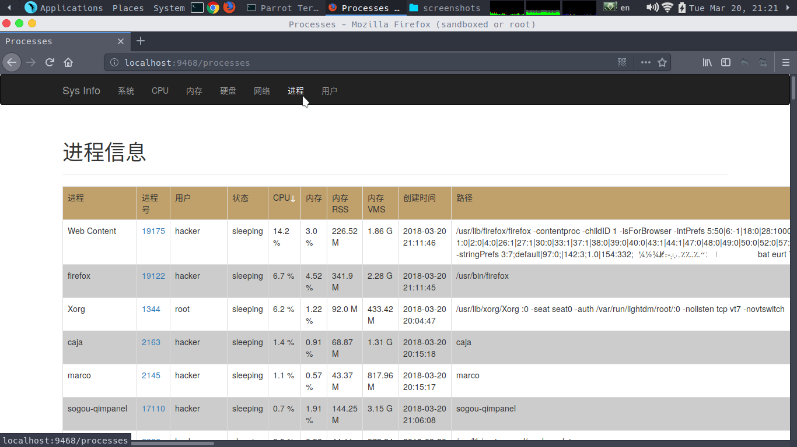
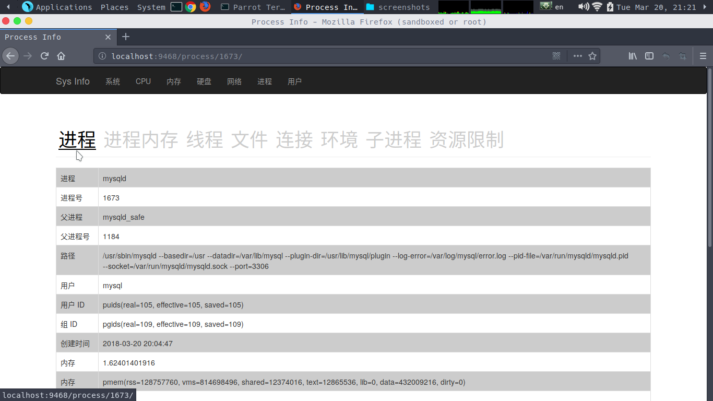
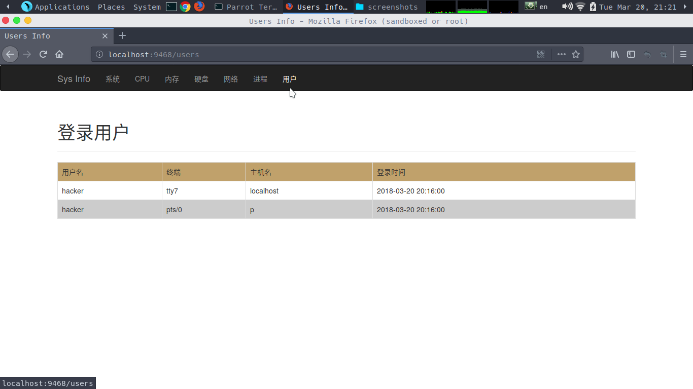
