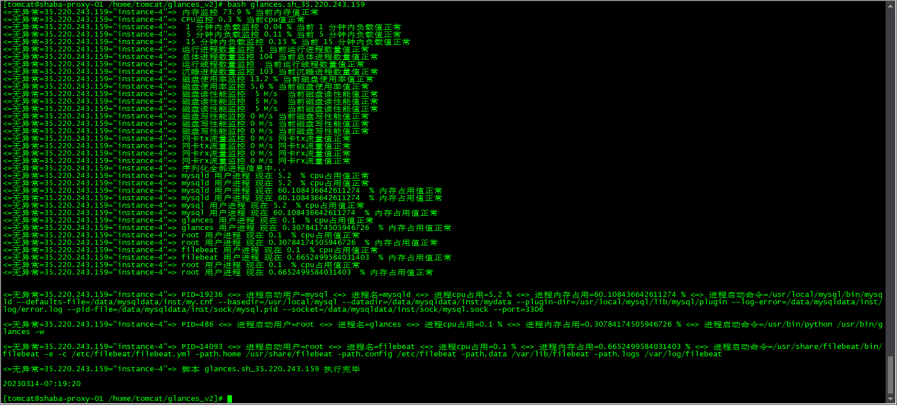

# glances 监控脚本

进飞机群 看报警效果  https://t.me/+7s0uoV4d83RjZTY1



**使用方法：

*/5  * * * * bash /usr/local/bash/glances.sh_35.220.243.159 >> /usr/local/bash/glances.sh_35.220.243.159.run.log**

*****/5  * * * * bash /usr/local/bash/glances.sh_34.96.164.233   >> /usr/local/bash/glances.sh_34.96.164.233.run.log****

 **然后按照服务器情况修改脚本内的监控阀值就是**

**glances.sh_35.220.243.159** 展开源码

```bash
#!/bin/bash
#远程服务端需要执行
#yum -y install epel-release screen glances python2-bottle.noarch
#使用-R 创建虚拟终端：    screen -R glances
#创建好虚拟终端后运行程序 glances -w
#然后按Ctrl+a，再按d，即可保持glances后台常驻

#脚本客户端
#yum -y install curl jq zip                              #脚本运行需要的命令
#bash glances.sh_35.220.243.159                          #脚本运行方法 加 ip 参数

ip='203.0.113.1' #glances.sh_35.220.243.159

#飞机报警接口配置
API="https://api.telegram.org/bot5581975233:AAH0IItRrom_bA_Qp7AvrKx2nFgPNJYpoXI"
GID="chat_id=-988223995"
MSG="${API}/sendMessage?${GID}&text=" #发送文本方法 curl -s $MAG"写要发送的语句就能发送到飞机群"
SF="$API/sendDocument?$GID -F document=@" #发送文件方法 curl -s $SF"xxx.zip"   就能发送文件到飞机群

tel_msg='04论坛服务器 @Ben_Bird @Ben_Bird_bot' #设置多个报警飞机联系人名字

set_mem=75.55 #设置系统总内存使用大于 75.55% 就报警
set_cpu=15.55 #设置系统总cpu使用大于  15.55% 就报警
set_min_1=0.55 #设置 1  分钟内负载大于 0.20% 就报警
set_min_5=0.55 #设置 5  分钟内负载大于 0.20% 就报警
set_min_15=0.55 #设置 15 分钟内负载大于 0.20% 就报警

set_processcount_running=3 #设置运行进程数量大于 50 就报警
set_processcount_total=150 #设置总体进程数量大于 50 就报警
set_processcount_thread=150 #设置运行线程数量大于 50 就报警
set_processcount_sleeping=150 #设置沉睡进程数量大于 50 就报警

set_fs=50.0 #设置 磁盘使用率大于 50.0% 就报警
set_disk_read_m=5 #设置 磁盘读速率大于 5M/s 就报警
set_disk_write_m=5 #设置 磁盘读速率大于 5M/s 就报警

set_tx=5 #设置单个网卡tx流量大于 5M/s 就报警
set_rx=5 #设置单个网卡rx流量大于 5M/s 就报警

#监控系统软件的进程cpu情况
#cat 203.0.113.1.txt | awk -F' <=> ' '{print $3}' | sort -n | uniq -c  | awk -F'=' '{print $2"_cpu=0.5"}'
cat > $ip.system.cpu.txt << EOF
glances_cpu=2
mysqld_cpu=50
acpid_cpu=0.5
agetty_cpu=0.5
auditd_cpu=0.5
bash_cpu=0.5
bioset_cpu=0.5
chronyd_cpu=0.5
crond_cpu=0.5
crypto_cpu=0.5
dbus-daemon_cpu=0.5
deferwq_cpu=0.5
dhclient_cpu=0.5
dio/sda2_cpu=0.5
edac-poller_cpu=0.5
filebeat_cpu=1.5
google_guest_agent_cpu=0.5
google_osconfig_agent_cpu=0.5
hwrng_cpu=0.5
ipv6_addrconf_cpu=0.5
irqbalance_cpu=0.5
kaluad_cpu=0.5
kauditd_cpu=0.5
kblockd_cpu=0.5
kdevtmpfs_cpu=0.5
khungtaskd_cpu=0.5
kintegrityd_cpu=0.5
kmpath_rdacd_cpu=0.5
kpsmoused_cpu=0.5
ksmd_cpu=0.5
ksoftirqd/0_cpu=0.5
ksoftirqd/1_cpu=0.5
ksoftirqd/2_cpu=0.5
ksoftirqd/3_cpu=0.5
kswapd0_cpu=0.5
kthreadd_cpu=0.5
kthrotld_cpu=0.5
kworker/0:0_cpu=0.5
kworker/0:0H_cpu=0.5
kworker/0:1_cpu=0.5
kworker/0:1H_cpu=0.5
kworker/0:2_cpu=0.5
kworker/1:0_cpu=0.5
kworker/1:0H_cpu=0.5
kworker/1:1_cpu=0.5
kworker/1:1H_cpu=0.5
kworker/1:2_cpu=0.5
kworker/2:0_cpu=0.5
kworker/2:0H_cpu=0.5
kworker/2:1_cpu=0.5
kworker/2:1H_cpu=0.5
kworker/2:2_cpu=0.5
kworker/3:0H_cpu=0.5
kworker/3:1_cpu=0.5
kworker/3:1H_cpu=0.5
kworker/3:2_cpu=0.5
kworker/u8:1_cpu=0.5
kworker/u8:2_cpu=0.5
lru-add-drain_cpu=0.5
md_cpu=0.5
migration/0_cpu=0.5
migration/1_cpu=0.5
migration/2_cpu=0.5
migration/3_cpu=0.5
mysqld_cpu=60
mysqld_safe_cpu=0.5
netns_cpu=0.5
NetworkManager_cpu=0.5
polkitd_cpu=0.5
rcu_bh_cpu=0.5
rcu_sched_cpu=0.5
rsyslogd_cpu=0.5
salt-minion_cpu=0.5
screen_cpu=0.5
scsi_eh_0_cpu=0.5
scsi_tmf_0_cpu=0.5
sshd_cpu=0.5
systemd_cpu=0.5
systemd-journald_cpu=0.5
systemd-logind_cpu=0.5
systemd-udevd_cpu=0.5
tuned_cpu=0.5
virtscsi-scan_cpu=0.5
watchdog/0_cpu=0.5
watchdog/1_cpu=0.5
watchdog/2_cpu=0.5
watchdog/3_cpu=0.5
watchdogd_cpu=0.5
writeback_cpu=0.5
xfsaild/sda2_cpu=0.5
xfsalloc_cpu=0.5
xfs-buf/sda2_cpu=0.5
xfs-cil/sda2_cpu=0.5
xfs-conv/sda2_cpu=0.5
xfs-data/sda2_cpu=0.5
xfs-eofblocks/s_cpu=0.5
xfs-log/sda2_cpu=0.5
xfs_mru_cache_cpu=0.5
xfs-reclaim/sda_cpu=0.5
EOF
#监控系统软件的进程mem情况
#cat 203.0.113.1.txt | awk -F' <=> ' '{print $3}' | sort -n | uniq -c  | awk -F'=' '{print $2"_mem=0.5"}'
cat > $ip.system.mem.txt << EOF
glances_mem=2
mysqld_mem=65
acpid_mem=0.5
agetty_mem=0.5
auditd_mem=0.5
bash_mem=0.5
bioset_mem=0.5
chronyd_mem=0.5
crond_mem=0.5
crypto_mem=0.5
dbus-daemon_mem=0.5
deferwq_mem=0.5
dhclient_mem=0.5
dio/sda2_mem=0.5
edac-poller_mem=0.5
filebeat_mem=1.5
google_guest_agent_mem=0.5
google_osconfig_agent_mem=0.5
hwrng_mem=0.5
ipv6_addrconf_mem=0.5
irqbalance_mem=0.5
kaluad_mem=0.5
kauditd_mem=0.5
kblockd_mem=0.5
kdevtmpfs_mem=0.5
khungtaskd_mem=0.5
kintegrityd_mem=0.5
kmpath_rdacd_mem=0.5
kpsmoused_mem=0.5
ksmd_mem=0.5
ksoftirqd/0_mem=0.5
ksoftirqd/1_mem=0.5
ksoftirqd/2_mem=0.5
ksoftirqd/3_mem=0.5
kswapd0_mem=0.5
kthreadd_mem=0.5
kthrotld_mem=0.5
kworker/0:0_mem=0.5
kworker/0:0H_mem=0.5
kworker/0:1_mem=0.5
kworker/0:1H_mem=0.5
kworker/0:2_mem=0.5
kworker/1:0_mem=0.5
kworker/1:0H_mem=0.5
kworker/1:1_mem=0.5
kworker/1:1H_mem=0.5
kworker/1:2_mem=0.5
kworker/2:0_mem=0.5
kworker/2:0H_mem=0.5
kworker/2:1_mem=0.5
kworker/2:1H_mem=0.5
kworker/2:2_mem=0.5
kworker/3:0H_mem=0.5
kworker/3:1_mem=0.5
kworker/3:1H_mem=0.5
kworker/3:2_mem=0.5
kworker/u8:1_mem=0.5
kworker/u8:2_mem=0.5
lru-add-drain_mem=0.5
md_mem=0.5
migration/0_mem=0.5
migration/1_mem=0.5
migration/2_mem=0.5
migration/3_mem=0.5
mysqld_mem=65
mysqld_safe_mem=0.5
netns_mem=0.5
NetworkManager_mem=0.5
polkitd_mem=0.5
rcu_bh_mem=0.5
rcu_sched_mem=0.5
rsyslogd_mem=0.5
salt-minion_mem=0.5
screen_mem=0.5
scsi_eh_0_mem=0.5
scsi_tmf_0_mem=0.5
sshd_mem=0.5
systemd_mem=0.5
systemd-journald_mem=0.5
systemd-logind_mem=0.5
systemd-udevd_mem=0.5
tuned_mem=0.5
virtscsi-scan_mem=0.5
watchdog/0_mem=0.5
watchdog/1_mem=0.5
watchdog/2_mem=0.5
watchdog/3_mem=0.5
watchdogd_mem=0.5
writeback_mem=0.5
xfsaild/sda2_mem=0.5
xfsalloc_mem=0.5
xfs-buf/sda2_mem=0.5
xfs-cil/sda2_mem=0.5
xfs-conv/sda2_mem=0.5
xfs-data/sda2_mem=0.5
xfs-eofblocks/s_mem=0.5
xfs-log/sda2_mem=0.5
xfs_mru_cache_mem=0.5
xfs-reclaim/sda_mem=0.5
EOF

#监控常见系统用户的进程情况
#cat /etc/passwd | awk -F':' '{print $1"_cpu=0.5"}'
cat > $ip.cpu.txt << EOF
root_cpu=50
bin_cpu=0.5
daemon_cpu=0.5
adm_cpu=0.5
lp_cpu=0.5
sync_cpu=0.5
shutdown_cpu=0.5
halt_cpu=0.5
mail_cpu=0.5
operator_cpu=0.5
games_cpu=0.5
ftp_cpu=0.5
nobody_cpu=0.5
systemd-network_cpu=0.5
dbus_cpu=0.5
polkitd_cpu=0.5
sshd_cpu=0.5
postfix_cpu=0.5
chrony_cpu=0.5
westedgetech04_cpu=0.5
tomcat_cpu=0.5
mysql_cpu=60
ntp_cpu=0.5
EOF
#cat /etc/passwd | awk -F':' '{print $1"_mem=0.5"}'
cat > $ip.mem.txt << EOF
root_mem=50
bin_mem=0.5
daemon_mem=0.5
adm_mem=0.5
lp_mem=0.5
sync_mem=0.5
shutdown_mem=0.5
halt_mem=0.5
mail_mem=0.5
operator_mem=0.5
games_mem=0.5
ftp_mem=0.5
nobody_mem=0.5
systemd-network_mem=0.5
dbus_mem=0.5
polkitd_mem=0.5
sshd_mem=0.5
postfix_mem=0.5
chrony_mem=0.5
westedgetech04_mem=0.5
tomcat_mem=0.5
mysql_mem=65
ntp_mem=0.5
EOF

#备份时间格式
DATE="`date +'%Y%m%d-%H:%M:%S'`"

#下班时间报警特定进程（后续开发数组值匹配函数）
#set_p_check_time=(19 20 21 22 23 0 1 2 3 4 5 6 7 8 9)    #设置下班时间

##############################################################################################################################################
#逻辑代码部分

#获取服务器全部监控数据
timeout 3 curl -s $ip:61208/api/2/all > $ip.json || echo "无法获取监控数据 $ip:61208/api/2/all `rm -f $ip.json`"
if [[ "`md5sum $ip.json | awk '{print $1}'`" = '68b329da9893e34099c7d8ad5cb9c940' ]];then curl -s $MSG"无法获取监控数据 $ip:61208/api/2/all 程序自动退出 $tel_msg";exit ;fi

host_name=`cat $ip.json | jq ".system.hostname"`
uptime=`cat $ip.json | jq ".uptime"`

#内存报警
now_mem=`cat $ip.json | jq ".quicklook.mem"`
y_or_n=`echo $set_mem $now_mem | awk '{if($1 > $2) print 1; else print 0;}'` #内存百分比(浮点数比较大小)
if [ $y_or_n -eq 1 ];then
 echo "<=无异常=$ip=$host_name=> 内存监控 $now_mem % 当前内存值正常"
else
 echo "报警内存值 $set_mem % <= $now_mem % 当前内存值"
 curl -s $MSG"$host_name 服务器 $ip:61208 已运行 $uptime 现在 内存超过设定阀值 $set_mem% 当前内存值 $now_mem%  $tel_msg" &
fi

#CPU报警
now_cpu=`cat $ip.json | jq ".quicklook.cpu"`
y_or_n=`echo $set_cpu $now_cpu | awk '{if($1 > $2) print 1; else print 0;}'` #cpu百分比(浮点数比较大小)
if [ $y_or_n -eq 1 ];then
 echo "<=无异常=$ip=$host_name=> CPU监控 $now_cpu % 当前cpu值正常"
else
 echo "报警cpu值 $set_cpu % <= $now_cpu % 当前cpu值"
 curl -s $MSG"$host_name 服务器 $ip:61208 已运行 $uptime 现在 cpu超过设定阀值 $set_cpu% 当前cpu值 $now_cpu%  $tel_msg" &
fi

# 1 分钟内负载报警
now_min_1=`cat $ip.json | jq ".load.min1"`
y_or_n=`echo $set_min_1 $now_min_1 | awk '{if($1 > $2) print 1; else print 0;}'`
if [ $y_or_n -eq 1 ];then
 echo "<=无异常=$ip=$host_name=>  1 分钟内负载监控 $now_min_1 % 当前 1 分钟内负载值正常"
else
 echo "报警 1 分钟内负载值 $set_min_1 % <= $now_min_1 % 当前 1 分钟内负载"
 curl -s $MSG"$host_name 服务器 $ip:61208 已运行 $uptime 现在 1 分钟内负载超过设定阀值 $set_min_1% 当前 1 分钟内负载值 $now_min_1%  $tel_msg" &
fi

# 5 分钟内负载报警
now_min_5=`cat $ip.json | jq ".load.min5"`
y_or_n=`echo $set_min_5 $now_min_5 | awk '{if($1 > $2) print 1; else print 0;}'`
if [ $y_or_n -eq 1 ];then
 echo "<=无异常=$ip=$host_name=>  5 分钟内负载监控 $now_min_5 % 当前 5 分钟内负载值正常"
else
 echo "报警 5 分钟内负载值 $set_min_5 % <= $now_min_5 % 当前 5 分钟内负载"
 curl -s $MSG"$host_name 服务器 $ip:61208 已运行 $uptime 现在 5 分钟内负载超过设定阀值 $set_min_5% 当前 5 分钟内负载值 $now_min_5%  $tel_msg" &
fi

# 15 分钟内负载报警
now_min_15=`cat $ip.json | jq ".load.min15"`
y_or_n=`echo $set_min_15 $now_min_15 | awk '{if($1 > $2) print 1; else print 0;}'`
if [ $y_or_n -eq 1 ];then
 echo "<=无异常=$ip=$host_name=>  15 分钟内负载监控 $now_min_15 % 当前 15 分钟内负载值正常"
else
 echo "报警 15 分钟内负载值 $set_min_15 % <= $now_min_15 % 当前 15 分钟内负载"
 curl -s $MSG"$host_name 服务器 $ip:61208 已运行 $uptime 现在 15 分钟内负载超过设定阀值 $set_min_15% 当前 15 分钟内负载值 $now_min_15%  $tel_msg" &
fi

#运行进程数量报警
now_processcount_running=`cat $ip.json | jq ".processcount.running"`
y_or_n=`echo $set_processcount_running $now_processcount_running | awk '{if($1 > $2) print 1; else print 0;}'` #cpu百分比(浮点数比较大小)
if [ $y_or_n -eq 1 ];then
 echo "<=无异常=$ip=$host_name=> 运行进程数量监控 $now_processcount_running 当前运行进程数量值正常"
else
 echo "报警 运行进程数量值 $set_processcount_running <= $now_processcount_running 当前运行进程数量"
 curl -s $MSG"$host_name 服务器 $ip:61208 已运行 $uptime 现在 运行进程数量超过设定阀值 $set_processcount_running 当前运行进程数量值 $now_processcount_running $tel_msg" &
fi

#总体进程数量报警
now_processcount_total=`cat $ip.json | jq ".processcount.total"`
y_or_n=`echo $set_processcount_total $now_processcount_total | awk '{if($1 > $2) print 1; else print 0;}'` #cpu百分比(浮点数比较大小)
if [ $y_or_n -eq 1 ];then
 echo "<=无异常=$ip=$host_name=> 总体进程数量监控 $now_processcount_total 当前总体进程数量值正常"
else
 echo "报警 总体进程数量值 $set_processcount_total <= $now_processcount_total 当前总体进程数量"
 curl -s $MSG"$host_name 服务器 $ip:61208 已运行 $uptime 现在 总体进程数量超过设定阀值 $set_processcount_total 当前总体进程数量值 $now_processcount_total $tel_msg" &
fi

#运行线程数量报警
set_processcount_thread=`cat $ip.json | jq ".processcount.thread"`
y_or_n=`echo $set_processcount_thread $now_processcount_thread | awk '{if($1 > $2) print 1; else print 0;}'` #cpu百分比(浮点数比较大小)
if [ $y_or_n -eq 1 ];then
 echo "<=无异常=$ip=$host_name=> 运行线程数量监控 $now_processcount_thread 当前运行线程数量值正常"
else
 echo "报警 运行线程数量值 $set_processcount_thread <= $now_processcount_thread 当前运行线程数量"
 curl -s $MSG"$host_name 服务器 $ip:61208 已运行 $uptime 现在 运行线程数量超过设定阀值 $set_processcount_thread 当前运行线程数量值 $now_processcount_thread $tel_msg" &
fi

#沉睡进程数量报警
now_processcount_sleeping=`cat $ip.json | jq ".processcount.sleeping"`
y_or_n=`echo $set_processcount_sleeping $now_processcount_sleeping | awk '{if($1 > $2) print 1; else print 0;}'` #cpu百分比(浮点数比较大小)
if [ $y_or_n -eq 1 ];then
 echo "<=无异常=$ip=$host_name=> 沉睡进程数量监控 $now_processcount_sleeping 当前沉睡进程数量值正常"
else
 echo "报警 沉睡进程数量值 $set_processcount_sleeping <= $now_processcount_sleeping 当前沉睡进程数量"
 curl -s $MSG"$host_name 服务器 $ip:61208 已运行 $uptime 现在 沉睡进程数量超过设定阀值 $set_processcount_sleeping 当前沉睡进程数量值 $now_processcount_sleeping $tel_msg" &
fi

#磁盘使用率监控
index_fs=`cat $ip.json | jq ".fs | length-1"`
if [[ "$index_fs" != '8' ]];then
 for i in `seq 0 $index_fs`;do
 now_fs=`cat $ip.json | jq ".fs[$i].percent"`
 y_or_n=`echo $set_fs $now_fs | awk '{if($1 > $2) print 1; else print 0;}'`
 if [ $y_or_n -eq 1 ];then
 echo "<=无异常=$ip=$host_name=> 磁盘使用率监控 $now_fs % 当前磁盘使用率值正常"
 else
 echo "报警磁盘使用率 $set_fs % <= $now_fs % 当前磁盘使用率"
 mnt_point=`cat $ip.json | jq ".fs[$i].mnt_point"`
 fs_type=`cat $ip.json | jq ".fs[$i].fs_type"`
 device_name=`cat $ip.json | jq ".fs[$i].device_name"`
 curl -s $MSG"$host_name 服务器 $ip:61208 已运行 $uptime 现在磁盘使用率超过设定阀值 $set_fs% 当前磁盘使用率 $now_fs% 磁盘挂载位置 $mnt_point 磁盘文件系统 $fs_type 磁盘名 $device_name $tel_msg" &
 fi
 done
else
 curl -s $MSG"$host_name 服务器 $ip:61208 已运行 $uptime 现在 只有一块磁盘 请注意备份磁盘空间 $tel_msg" &
fi

#磁盘读性能监控
index_diskio=`cat $ip.json | jq ".diskio | length-1"`
if [[ "$index_diskio" != '5' ]];then
for i in `seq 0 $index_diskio`;do
 now_disk_read_bytes=`cat $ip.json | jq ".diskio[$i].read_bytes"`
 now_disk_read_m=`expr $now_disk_read_bytes / 1024 / 1024 / 1024`
 y_or_n=`echo $set_disk_read_m $now_disk_read_m | awk '{if($1 > $2) print 1; else print 0;}'`
 if [ $y_or_n -eq 1 ]
 then
 echo "<=无异常=$ip=$host_name=> 磁盘读性能监控  $set_disk_read_m M/s  当前磁盘读性能值正常"
 else
 echo "报警磁盘使用率 $set_disk_read_m 比特每秒 <=  $set_disk_read_m M/s  当前磁盘使用率"
 time_since_update=`cat $ip.json | jq ".diskio[$i].time_since_update" | awk -F'.' | awk '{print $1}'"`
            disk_name=`cat $ip.json | jq ".diskio[$i].disk_name"`
            curl -s $MSG"$host_name 服务器 $ip:61208 已运行 $uptime 现在磁盘读(w)性能超过设定阀值 $set_disk_read_m M/s 当前磁盘读(w)性能 $now_disk_read_m M/s 磁盘使用时间 $time_since_update 磁盘名 $disk_name $tel_msg" &
        fi
    done
else
    curl -s $MSG"$host_name 服务器 $ip:61208 已运行 $uptime 现在 只有一块磁盘 请注意备份磁盘空间 $tel_msg" &
fi

#磁盘写性能监控
index_diskio=`cat $ip.json | jq ".diskio | length-1"`
if [[ "$index_diskio" != '5' ]];then
for i in `seq 0 $index_diskio`;do
    now_disk_write_bytes=`cat $ip.json | jq ".diskio[$i].write_bytes"`
    now_disk_write_m=`expr $now_disk_write_bytes / 1024 / 1024 / 1024`
    y_or_n=`echo $set_disk_write_m $now_disk_write_m | awk '{if($1 > $2) print 1; else print 0;}'`
        if [ $y_or_n -eq 1 ]
        then
            echo "<=无异常=$ip=$host_name=> 磁盘写性能监控 $now_disk_write_m M/s 当前磁盘写性能值正常"
        else
            echo "报警磁盘使用率 $set_disk_write_m M/s <= $now_disk_write_m M/s 当前磁盘使用率"
            time_since_update=`cat $ip.json | jq ".diskio[$i].time_since_update" | awk -F'.' | awk '{print $1}'`
                    disk_name=`cat $ip.json | jq ".diskio[$i].disk_name"`
            curl -s $MSG"$host_name 服务器 $ip:61208 已运行 $uptime 现在磁盘读(w)性能超过设定阀值 $set_disk_write_m M/s 当前磁盘读(w)性能 $now_disk_write_m M/s 磁盘使用时间 $time_since_update 磁盘名 $disk_name $tel_msg" &
        fi
    done
else
    curl -s $MSG"$host_name 服务器 $ip:61208 已运行 $uptime 现在 只有一块磁盘 请注意备份磁盘空间 $tel_msg" &
fi

#网卡tx流量监控
index_network=`cat $ip.json | jq ".network | length-1"`
if [[ "$index_network" != '9' ]];then
for i in `seq 0 $index_network`;do
    glance_tx=`cat $ip.json | jq ".network[$i].tx"`
    now_tx=`expr $glance_tx / 1024 / 1024 / 1024`
    y_or_n=`echo $set_tx $now_tx | awk '{if($1 > $2) print 1; else print 0;}'`
        if [ $y_or_n -eq 1 ]
        then
            echo "<=无异常=$ip=$host_name=> 网卡tx流量监控 $now_tx M/s 网卡tx流量值正常"
        else
            echo "报警 $interface_name 网卡tx流量 $set_tx M/s <= $now_tx M/s 网卡tx流量"
            interface_name=`cat $ip.json | jq ".network[$i].interface_name"`
            curl -s $MSG"$host_name 服务器 $ip:61208 已运行 $uptime 现在 $interface_name 网卡tx流量超过设定阀值 $set_tx M/s 当前 $interface_name 网卡tx流量 $now_tx M/s $tel_msg" &
        fi
    done
else
    curl -s $MSG"$host_name 服务器 $ip:61208 已运行 $uptime 现在 只有一张网卡 请注意冗余多线路网卡来容灾 $tel_msg" &
fi

#网卡rx流量监控
index_network=`cat $ip.json | jq ".network | length-1"`
if [[ "$index_network" != '9' ]];then
for i in `seq 0 $index_network`;do
    glance_rx=`cat $ip.json | jq ".network[$i].rx"`
    now_rx=`expr $glance_rx / 1024 / 1024 / 1024`
    y_or_n=`echo $set_rx $now_rx | awk '{if($1 > $2) print 1; else print 0;}'`
        if [ $y_or_n -eq 1 ]
        then
            echo "<=无异常=$ip=$host_name=> 网卡rx流量监控 $now_rx M/s 网卡rx流量值正常"
        else
            echo "报警 $interface_name 网卡tx流量 $set_rx M/s <= $now_rx M/s 网卡rx流量"
            interface_name=`cat $ip.json | jq ".network[$i].interface_name"`
            curl -s $MSG"$host_name 服务器 $ip:61208 已运行 $uptime 现在 $interface_name 网卡rx流量超过设定阀值 $set_rx M/s 当前 $interface_name 网卡rx流量 $now_rx M/s $tel_msg" &
        fi
    done
else
    curl -s $MSG"$host_name 服务器 $ip:61208 已运行 $uptime 现在 只有一张网卡 请注意冗余多线路网卡来容灾 $tel_msg" &
fi

#列出全部进程信息方便监控
echo "<=无异常=$ip=$host_name=> 序列化全部进程信息中..."
echo > $ip.processlist_all.txt
index_processlist=`cat $ip.json | jq ".processlist | length-1"`
    for i in `seq 0 $index_processlist`;do
    i_username=`         cat $ip.json | jq ".processlist[$i].username"`
#   i_status=`           cat $ip.json | jq ".processlist[$i].status"`
#   i_cpu_times_0=`      cat $ip.json | jq ".processlist[$i].cpu_times[0]"`
#   i_cpu_times_1=`      cat $ip.json | jq ".processlist[$i].cpu_times[1]"`
#   i_cpu_times_2=`      cat $ip.json | jq ".processlist[$i].cpu_times[2]"`
#   i_cpu_times_3=`      cat $ip.json | jq ".processlist[$i].cpu_times[3]"`
#   i_cpu_times_4=`      cat $ip.json | jq ".processlist[$i].cpu_times[4]"`
    i_name=`             cat $ip.json | jq ".processlist[$i].name"`
#   i_mandatory_stats=`  cat $ip.json | jq ".processlist[$i].mandatory_stats"`
    i_cmdline=`          cat $ip.json | jq ".processlist[$i].cmdline"`
#   i_standard_stats=`   cat $ip.json | jq ".processlist[$i].standard_stats"`
    i_cpu_percent=`      cat $ip.json | jq ".processlist[$i].cpu_percent"`
    i_pid=`              cat $ip.json | jq ".processlist[$i].pid"`
#   i_io_counters_0=`    cat $ip.json | jq ".processlist[$i].io_counters[0]"`
#   i_io_counters_1=`    cat $ip.json | jq ".processlist[$i].io_counters[1]"`
#   i_io_counters_2=`    cat $ip.json | jq ".processlist[$i].io_counters[2]"`
#   i_io_counters_3=`    cat $ip.json | jq ".processlist[$i].io_counters[3]"`
#   i_io_counters_4=`    cat $ip.json | jq ".processlist[$i].io_counters[4]"`
    i_memory_percent=`   cat $ip.json | jq ".processlist[$i].memory_percent"`
#   i_memory_info_0=`    cat $ip.json | jq ".processlist[$i].memory_info[0]"`
#   i_memory_info_1=`    cat $ip.json | jq ".processlist[$i].memory_info[1]"`
#   i_memory_info_2=`    cat $ip.json | jq ".processlist[$i].memory_info[2]"`
#   i_memory_info_3=`    cat $ip.json | jq ".processlist[$i].memory_info[3]"`
#   i_memory_info_4=`    cat $ip.json | jq ".processlist[$i].memory_info[4]"`
#   i_memory_info_5=`    cat $ip.json | jq ".processlist[$i].memory_info[5]"`
#   i_memory_info_6=`    cat $ip.json | jq ".processlist[$i].memory_info[6]"`
#   i_time_since_update=`cat $ip.json | jq ".processlist[$i].time_since_update"`
#   i_nice=`             cat $ip.json | jq ".processlist[$i].nice"`

        echo "PID=$i_pid <=> 进程启动用户=$i_username <=> 进程名=$i_name <=> 进程cpu占用=$i_cpu_percent % <=> 进程内存占用=$i_memory_percent % <=> 进程启动命令=$i_cmdline" | sed "s/\"//g" >> $ip.txt

done

cat $ip.txt | grep -v '进程cpu占用=0 %' | grep -v '进程内存占用=0 %' > $ip.cpu.mem.txt

cat $ip.cpu.mem.txt | while read line; do

p_a=`echo $line | awk -F' <=> ' '{print $1}' | awk -F'=' '{print $2}'`
p_b=`echo $line | awk -F' <=> ' '{print $2}' | awk -F'=' '{print $2}'`
p_c=`echo $line | awk -F' <=> ' '{print $3}' | awk -F'=' '{print $2}'`
p_d=`echo $line | awk -F' <=> ' '{print $4}' | awk -F'=' '{print $2}' | sed "s/%//g"`
p_e=`echo $line | awk -F' <=> ' '{print $5}' | awk -F'=' '{print $2}' | sed "s/%//g"`
p_f=`echo $line | awk -F' <=> ' '{print $6}' | awk -F'=' '{print $2}'`

    cat $ip.system.cpu.txt | while read ben; do
        user=`echo $ben | awk -F'=' '{print $1}' | sed "s/_cpu//g"`
         cpu=`echo $ben | awk -F'=' '{print $2}'`
        text=$line

            if [[ "$p_c" == "$user" ]];then
                    set_p_cpu_percent=$cpu
                    now_p_cpu_percent=$p_d

                    y_or_n=`echo $set_p_cpu_percent $now_p_cpu_percent | awk '{if($1 > $2) print 1; else print 0;}'`
                if [ $y_or_n -eq 1 ]
                then
                    echo "<=无异常=$ip=$host_name=> $user 用户进程 现在 $now_p_cpu_percent % cpu占用值正常"
                else
                    echo        "$user 用户 现在 $now_p_cpu_percent % cpu占用 报警 超过预警值 $set_p_cpu_percent % =服务器信息= $host_name 服务器 $ip:61208 已运行 $uptime =详细日志= $text =报警联系人= $tel_msg"
                    curl -s $MSG"$user 用户 现在 $now_p_cpu_percent % cpu占用 报警 超过预警值 $set_p_cpu_percent % =服务器信息= $host_name 服务器 $ip:61208 已运行 $uptime =详细日志= $text =报警联系人= $tel_msg" &
                fi
            fi
    done

    cat $ip.system.mem.txt | while read ben; do
        user=`echo $ben | awk -F'=' '{print $1}' | sed "s/_mem//g"`
         mem=`echo $ben | awk -F'=' '{print $2}'`
        text=$line

            if [[ "$p_c" == "$user" ]];then
                    set_p_mem_percent=$mem
                    now_p_mem_percent=$p_e

                    y_or_n=`echo $set_p_mem_percent $now_p_mem_percent | awk '{if($1 > $2) print 1; else print 0;}'`
                if [ $y_or_n -eq 1 ]
                then
                    echo "<=无异常=$ip=$host_name=> $user 用户进程 现在 $now_p_mem_percent % 内存占用值正常"
                else
                    echo        "$user 用户 现在 $now_p_mem_percent % 内存占用 报警 超过预警值 $set_p_mem_percent % =服务器信息= $host_name 服务器 $ip:61208 已运行 $uptime =详细日志= $text =报警联系人= $tel_msg"
                    curl -s $MSG"$user 用户 现在 $now_p_mem_percent % 内存占用 报警 超过预警值 $set_p_mem_percent % =服务器信息= $host_name 服务器 $ip:61208 已运行 $uptime =详细日志= $text =报警联系人= $tel_msg" &
                fi
            fi
    done

    cat $ip.cpu.txt | while read ben; do
        user=`echo $ben | awk -F'=' '{print $1}' | sed "s/_cpu//g"`
         cpu=`echo $ben | awk -F'=' '{print $2}'`
        text=$line

            if [[ "$p_b" == "$user" ]];then
                    set_p_cpu_percent=$cpu
                    now_p_cpu_percent=$p_d

                    y_or_n=`echo $set_p_cpu_percent $now_p_cpu_percent | awk '{if($1 > $2) print 1; else print 0;}'`
                if [ $y_or_n -eq 1 ]
                then
                    echo "<=无异常=$ip=$host_name=> $user 用户进程 现在 $now_p_cpu_percent % cpu占用值正常"
                else
                    echo        "$user 用户 现在 $now_p_cpu_percent % cpu占用 报警 超过预警值 $set_p_cpu_percent % =服务器信息= $host_name 服务器 $ip:61208 已运行 $uptime =详细日志= $text =报警联系人= $tel_msg"
                    curl -s $MSG"$user 用户 现在 $now_p_cpu_percent % cpu占用 报警 超过预警值 $set_p_cpu_percent % =服务器信息= $host_name 服务器 $ip:61208 已运行 $uptime =详细日志= $text =报警联系人= $tel_msg" &
                fi
            fi
    done

    cat $ip.mem.txt | while read ben; do
        user=`echo $ben | awk -F'=' '{print $1}' | sed "s/_mem//g"`
         mem=`echo $ben | awk -F'=' '{print $2}'`
        text=$line

            if [[ "$p_b" == "$user" ]];then
                    set_p_mem_percent=$mem
                    now_p_mem_percent=$p_e

                    y_or_n=`echo $set_p_mem_percent $now_p_mem_percent | awk '{if($1 > $2) print 1; else print 0;}'`
                if [ $y_or_n -eq 1 ]
                then
                    echo "<=无异常=$ip=$host_name=> $user 用户进程 现在 $now_p_mem_percent % 内存占用值正常"
                else
                    echo        "$user 用户 现在 $now_p_mem_percent % 内存占用 报警 超过预警值 $set_p_mem_percent % =服务器信息= $host_name 服务器 $ip:61208 已运行 $uptime =详细日志= $text =报警联系人= $tel_msg"
                    curl -s $MSG"$user 用户 现在 $now_p_mem_percent % 内存占用 报警 超过预警值 $set_p_mem_percent % =服务器信息= $host_name 服务器 $ip:61208 已运行 $uptime =详细日志= $text =报警联系人= $tel_msg" &
                fi
            fi
    done
done

#垃圾清理
echo " "
cat $ip.cpu.mem.txt | while read line; do echo "";echo "<=无异常=$ip=$host_name=> $line";done
echo " "
cat   $ip.json | jq > $ip.json.txt
rm -f $ip.json
rm -f $ip.system.mem.txt
rm -f $ip.system.cpu.txt
rm -f $ip.processlist_all.txt
rm -f $ip.json.txt
rm -f $ip.cpu.mem.txt
rm -f $ip.cpu.txt
rm -f $ip.mem.txt
rm -f $ip.txt
echo "<=无异常=$ip=$host_name=> 脚本 $0 执行完毕"
echo " "
echo "$DATE"
echo " "
```

**glances.sh_34.96.164.233** 展开源码

```bash
#!/bin/bash
#远程服务端需要执行
#yum -y install epel-release screen glances python2-bottle.noarch
#使用-R 创建虚拟终端：    screen -R glances
#创建好虚拟终端后运行程序 glances -w
#然后按Ctrl+a，再按d，即可保持glances后台常驻

#脚本客户端
#yum -y install curl jq zip                              #脚本运行需要的命令
#bash glances.sh_34.96.164.233                           #脚本运行方法 加 ip 参数

ip='203.0.113.1' #glances.sh_34.96.164.233

#飞机报警接口配置
API="https://api.telegram.org/bot5581975233:AAH0IItRrom_bA_Qp7AvrKx2nFgPNJYpoXI"
GID="chat_id=-988223995"
MSG="${API}/sendMessage?${GID}&text=" #发送文本方法 curl -s $MAG"写要发送的语句就能发送到飞机群"
SF="$API/sendDocument?$GID -F document=@" #发送文件方法 curl -s $SF"xxx.zip"   就能发送文件到飞机群

tel_msg='04论坛服务器 @Ben_Bird @Ben_Bird_bot' #设置多个报警飞机联系人名字

set_mem=75.55 #设置系统总内存使用大于 75.55% 就报警
set_cpu=15.55 #设置系统总cpu使用大于  15.55% 就报警
set_min_1=1.55 #设置 1  分钟内负载大于 0.20% 就报警
set_min_5=1.55 #设置 5  分钟内负载大于 0.20% 就报警
set_min_15=1.55 #设置 15 分钟内负载大于 0.20% 就报警

set_processcount_running=3 #设置运行进程数量大于 50 就报警
set_processcount_total=300 #设置总体进程数量大于 50 就报警
set_processcount_thread=150 #设置运行线程数量大于 50 就报警
set_processcount_sleeping=300 #设置沉睡进程数量大于 50 就报警

set_fs=50.0 #设置 磁盘使用率大于 50.0% 就报警
set_disk_read_m=10 #设置 磁盘读速率大于 5M/s 就报警
set_disk_write_m=10 #设置 磁盘读速率大于 5M/s 就报警

set_tx=5 #设置单个网卡tx流量大于 5M/s 就报警
set_rx=5 #设置单个网卡rx流量大于 5M/s 就报警

#监控系统软件的进程cpu情况
#cat 203.0.113.1.txt | awk -F' <=> ' '{print $3}' | sort -n | uniq -c  | awk -F'=' '{print $2"_cpu=0.5"}'
cat > $ip.system.cpu.txt << EOF
acpid_cpu=0.5
acpi_thermal_pm_cpu=0.5
agetty_cpu=0.5
auditd_cpu=0.5
bash_cpu=0.5
blkcg_punt_bio_cpu=0.5
charger_manager_cpu=0.5
chronyd_cpu=0.5
cpuhp/0_cpu=0.5
cpuhp/1_cpu=0.5
cpuhp/2_cpu=0.5
cpuhp/3_cpu=0.5
cpuhp/4_cpu=0.5
cpuhp/5_cpu=0.5
cpuhp/6_cpu=0.5
cpuhp/7_cpu=0.5
crond_cpu=0.5
cryptd_cpu=0.5
dbus-daemon_cpu=0.5
devfreq_wq_cpu=0.5
dhclient_cpu=0.5
edac-poller_cpu=0.5
filebeat_cpu=2.5
glances_cpu=2.5
google_guest_agent_cpu=0.5
google_osconfig_agent_cpu=0.5
gssproxy_cpu=0.5
hwrng_cpu=0.5
inet_frag_wq_cpu=0.5
ipv6_addrconf_cpu=0.5
kaluad_cpu=0.5
kauditd_cpu=0.5
kblockd_cpu=0.5
kcompactd0_cpu=0.5
kdevtmpfs_cpu=0.5
khugepaged_cpu=0.5
khungtaskd_cpu=0.5
kintegrityd_cpu=0.5
kmpath_rdacd_cpu=0.5
ksmd_cpu=0.5
ksoftirqd/0_cpu=0.5
ksoftirqd/1_cpu=0.5
ksoftirqd/2_cpu=0.5
ksoftirqd/3_cpu=0.5
ksoftirqd/4_cpu=0.5
ksoftirqd/5_cpu=0.5
ksoftirqd/6_cpu=0.5
ksoftirqd/7_cpu=0.5
kstrp_cpu=0.5
kswapd0_cpu=0.5
kthreadd_cpu=0.5
kthrotld_cpu=0.5
kworker/0:0-events_power_efficient_cpu=0.5
kworker/0:0H-events_highpri_cpu=0.5
kworker/0:1H-kblockd_cpu=0.5
kworker/0:1-mm_percpu_wq_cpu=0.5
kworker/0:2-events_cpu=0.5
kworker/1:0_cpu=0.5
kworker/1:0H-events_highpri_cpu=0.5
kworker/1:1-events_cpu=0.5
kworker/1:1H-kblockd_cpu=0.5
kworker/1:2-mm_percpu_wq_cpu=0.5
kworker/2:0-cgroup_pidlist_destroy_cpu=0.5
kworker/2:0H-events_highpri_cpu=0.5
kworker/2:1H-kblockd_cpu=0.5
kworker/2:1-mm_percpu_wq_cpu=0.5
kworker/3:0H-events_highpri_cpu=0.5
kworker/3:0-mm_percpu_wq_cpu=0.5
kworker/3:1H-kblockd_cpu=0.5
kworker/3:2-cgroup_pidlist_destroy_cpu=0.5
kworker/4:0H-events_highpri_cpu=0.5
kworker/4:0-mm_percpu_wq_cpu=0.5
kworker/4:1-cgroup_destroy_cpu=0.5
kworker/4:1H-kblockd_cpu=0.5
kworker/5:0-events_cpu=0.5
kworker/5:0H-kblockd_cpu=0.5
kworker/5:1H-kblockd_cpu=0.5
kworker/5:2-mm_percpu_wq_cpu=0.5
kworker/6:0H-kblockd_cpu=0.5
kworker/6:0-mm_percpu_wq_cpu=0.5
kworker/6:1H-kblockd_cpu=0.5
kworker/6:2-cgroup_pidlist_destroy_cpu=0.5
kworker/6:3-cgroup_pidlist_destroy_cpu=0.5
kworker/7:0-cgroup_pidlist_destroy_cpu=0.5
kworker/7:0H-events_highpri_cpu=0.5
kworker/7:1H-xfs-log/sda2_cpu=0.5
kworker/7:1-mm_percpu_wq_cpu=0.5
kworker/u16:0-nfsiod_cpu=0.5
kworker/u16:1-nfsiod_cpu=0.5
kworker/u16:2-rpciod_cpu=0.5
kworker/u16:4-flush-0:46_cpu=0.5
kworker/u17:0-xprtiod_cpu=0.5
kworker/u17:1-xprtiod_cpu=0.5
kworker/u17:2-xprtiod_cpu=0.5
lockd_cpu=0.5
master_cpu=0.5
md_cpu=0.5
migration/0_cpu=0.5
migration/1_cpu=0.5
migration/2_cpu=0.5
migration/3_cpu=0.5
migration/4_cpu=0.5
migration/5_cpu=0.5
migration/6_cpu=0.5
migration/7_cpu=0.5
mld_cpu=0.5
mm_percpu_wq_cpu=0.5
mysqld_cpu=0.5
netns_cpu=0.5
NetworkManager_cpu=0.5
nfit_cpu=0.5
nfsiod_cpu=0.5
nginx_cpu=0.5
oom_reaper_cpu=0.5
php-fpm_cpu=1.5
pickup_cpu=0.5
polkitd_cpu=0.5
qmgr_cpu=0.5
rcu_gp_cpu=0.5
rcu_par_gp_cpu=0.5
rcu_sched_cpu=0.5
rcu_tasks_rude__cpu=0.5
rcu_tasks_trace_cpu=0.5
rpcbind_cpu=0.5
rpciod_cpu=0.5
rpc.statd_cpu=0.5
rsyslogd_cpu=0.5
salt-minion_cpu=0.5
screen_cpu=0.5
scsi_eh_0_cpu=0.5
scsi_tmf_0_cpu=0.5
sshd_cpu=0.5
su_cpu=0.5
systemd_cpu=0.5
systemd-journald_cpu=0.5
systemd-logind_cpu=0.5
systemd-udevd_cpu=0.5
tpm_dev_wq_cpu=0.5
tuned_cpu=0.5
watchdogd_cpu=0.5
wazuh-agentd_cpu=0.5
wazuh-execd_cpu=0.5
wazuh-logcollector_cpu=0.5
wazuh-modulesd_cpu=0.5
wazuh-syscheckd_cpu=0.5
writeback_cpu=0.5
xfsaild/sda2_cpu=0.5
xfsalloc_cpu=0.5
xfs-buf/sda2_cpu=0.5
xfs-cil/sda2_cpu=0.5
xfs-conv/sda2_cpu=0.5
xfs-gc/sda2_cpu=0.5
xfs-log/sda2_cpu=0.5
xfs_mru_cache_cpu=0.5
xfs-reclaim/sda_cpu=0.5
xprtiod_cpu=0.5
zswap-shrink_cpu=0.5
EOF
#监控系统软件的进程mem情况
#cat 203.0.113.1.txt | awk -F' <=> ' '{print $3}' | sort -n | uniq -c  | awk -F'=' '{print $2"_mem=0.5"}'
cat > $ip.system.mem.txt << EOF
acpid_mem=0.5
acpi_thermal_pm_mem=0.5
agetty_mem=0.5
auditd_mem=0.5
bash_mem=0.5
blkcg_punt_bio_mem=0.5
charger_manager_mem=0.5
chronyd_mem=0.5
cpuhp/0_mem=0.5
cpuhp/1_mem=0.5
cpuhp/2_mem=0.5
cpuhp/3_mem=0.5
cpuhp/4_mem=0.5
cpuhp/5_mem=0.5
cpuhp/6_mem=0.5
cpuhp/7_mem=0.5
crond_mem=0.5
cryptd_mem=0.5
dbus-daemon_mem=0.5
devfreq_wq_mem=0.5
dhclient_mem=0.5
edac-poller_mem=0.5
filebeat_mem=2.5
glances_mem=2.5
google_guest_agent_mem=0.5
google_osconfig_agent_mem=0.5
gssproxy_mem=0.5
hwrng_mem=0.5
inet_frag_wq_mem=0.5
ipv6_addrconf_mem=0.5
kaluad_mem=0.5
kauditd_mem=0.5
kblockd_mem=0.5
kcompactd0_mem=0.5
kdevtmpfs_mem=0.5
khugepaged_mem=0.5
khungtaskd_mem=0.5
kintegrityd_mem=0.5
kmpath_rdacd_mem=0.5
ksmd_mem=0.5
ksoftirqd/0_mem=0.5
ksoftirqd/1_mem=0.5
ksoftirqd/2_mem=0.5
ksoftirqd/3_mem=0.5
ksoftirqd/4_mem=0.5
ksoftirqd/5_mem=0.5
ksoftirqd/6_mem=0.5
ksoftirqd/7_mem=0.5
kstrp_mem=0.5
kswapd0_mem=0.5
kthreadd_mem=0.5
kthrotld_mem=0.5
kworker/0:0-events_power_efficient_mem=0.5
kworker/0:0H-events_highpri_mem=0.5
kworker/0:1H-kblockd_mem=0.5
kworker/0:1-mm_percpu_wq_mem=0.5
kworker/0:2-events_mem=0.5
kworker/1:0_mem=0.5
kworker/1:0H-events_highpri_mem=0.5
kworker/1:1-events_mem=0.5
kworker/1:1H-kblockd_mem=0.5
kworker/1:2-mm_percpu_wq_mem=0.5
kworker/2:0-cgroup_pidlist_destroy_mem=0.5
kworker/2:0H-events_highpri_mem=0.5
kworker/2:1H-kblockd_mem=0.5
kworker/2:1-mm_percpu_wq_mem=0.5
kworker/3:0H-events_highpri_mem=0.5
kworker/3:0-mm_percpu_wq_mem=0.5
kworker/3:1H-kblockd_mem=0.5
kworker/3:2-cgroup_pidlist_destroy_mem=0.5
kworker/4:0H-events_highpri_mem=0.5
kworker/4:0-mm_percpu_wq_mem=0.5
kworker/4:1-cgroup_destroy_mem=0.5
kworker/4:1H-kblockd_mem=0.5
kworker/5:0-events_mem=0.5
kworker/5:0H-kblockd_mem=0.5
kworker/5:1H-kblockd_mem=0.5
kworker/5:2-mm_percpu_wq_mem=0.5
kworker/6:0H-kblockd_mem=0.5
kworker/6:0-mm_percpu_wq_mem=0.5
kworker/6:1H-kblockd_mem=0.5
kworker/6:2-cgroup_pidlist_destroy_mem=0.5
kworker/6:3-cgroup_pidlist_destroy_mem=0.5
kworker/7:0-cgroup_pidlist_destroy_mem=0.5
kworker/7:0H-events_highpri_mem=0.5
kworker/7:1H-xfs-log/sda2_mem=0.5
kworker/7:1-mm_percpu_wq_mem=0.5
kworker/u16:0-nfsiod_mem=0.5
kworker/u16:1-nfsiod_mem=0.5
kworker/u16:2-rpciod_mem=0.5
kworker/u16:4-flush-0:46_mem=0.5
kworker/u17:0-xprtiod_mem=0.5
kworker/u17:1-xprtiod_mem=0.5
kworker/u17:2-xprtiod_mem=0.5
lockd_mem=0.5
master_mem=0.5
md_mem=0.5
migration/0_mem=0.5
migration/1_mem=0.5
migration/2_mem=0.5
migration/3_mem=0.5
migration/4_mem=0.5
migration/5_mem=0.5
migration/6_mem=0.5
migration/7_mem=0.5
mld_mem=0.5
mm_percpu_wq_mem=0.5
mysqld_mem=0.5
netns_mem=0.5
NetworkManager_mem=0.5
nfit_mem=0.5
nfsiod_mem=0.5
nginx_mem=0.5
oom_reaper_mem=0.5
php-fpm_mem=1.5
pickup_mem=0.5
polkitd_mem=0.5
qmgr_mem=0.5
rcu_gp_mem=0.5
rcu_par_gp_mem=0.5
rcu_sched_mem=0.5
rcu_tasks_rude__mem=0.5
rcu_tasks_trace_mem=0.5
rpcbind_mem=0.5
rpciod_mem=0.5
rpc.statd_mem=0.5
rsyslogd_mem=0.5
salt-minion_mem=0.5
screen_mem=0.5
scsi_eh_0_mem=0.5
scsi_tmf_0_mem=0.5
sshd_mem=0.5
su_mem=0.5
systemd_mem=0.5
systemd-journald_mem=0.5
systemd-logind_mem=0.5
systemd-udevd_mem=0.5
tpm_dev_wq_mem=0.5
tuned_mem=0.5
watchdogd_mem=0.5
wazuh-agentd_mem=0.5
wazuh-execd_mem=0.5
wazuh-logcollector_mem=0.5
wazuh-modulesd_mem=0.5
wazuh-syscheckd_mem=0.5
writeback_mem=0.5
xfsaild/sda2_mem=0.5
xfsalloc_mem=0.5
xfs-buf/sda2_mem=0.5
xfs-cil/sda2_mem=0.5
xfs-conv/sda2_mem=0.5
xfs-gc/sda2_mem=0.5
xfs-log/sda2_mem=0.5
xfs_mru_cache_mem=0.5
xfs-reclaim/sda_mem=0.5
xprtiod_mem=0.5
zswap-shrink_mem=0.5
EOF

#监控常见系统用户的进程情况
#cat /etc/passwd | awk -F':' '{print $1"_cpu=0.5"}'
cat > $ip.cpu.txt << EOF
root_cpu=2.5
bin_cpu=0.5
daemon_cpu=0.5
adm_cpu=0.5
lp_cpu=0.5
sync_cpu=0.5
shutdown_cpu=0.5
halt_cpu=0.5
mail_cpu=0.5
operator_cpu=0.5
games_cpu=0.5
ftp_cpu=0.5
nobody_cpu=0.5
systemd-network_cpu=0.5
dbus_cpu=0.5
polkitd_cpu=0.5
sshd_cpu=0.5
postfix_cpu=0.5
chrony_cpu=0.5
westedgetech04_cpu=0.5
tomcat_cpu=1.5
nginx_cpu=0.5
apache_cpu=0.5
mysql-proxy_cpu=0.5
tss_cpu=0.5
geoclue_cpu=0.5
mysql_cpu=0.5
rpc_cpu=0.5
rpcuser_cpu=0.5
nfsnobody_cpu=0.5
wazuh_cpu=0.5
EOF

#cat /etc/passwd | awk -F':' '{print $1"_mem=0.5"}'
cat > $ip.mem.txt << EOF
root_mem=2.5
bin_mem=0.5
daemon_mem=0.5
adm_mem=0.5
lp_mem=0.5
sync_mem=0.5
shutdown_mem=0.5
halt_mem=0.5
mail_mem=0.5
operator_mem=0.5
games_mem=0.5
ftp_mem=0.5
nobody_mem=0.5
systemd-network_mem=0.5
dbus_mem=0.5
polkitd_mem=0.5
sshd_mem=0.5
postfix_mem=0.5
chrony_mem=0.5
westedgetech04_mem=0.5
tomcat_mem=1.5
nginx_mem=0.5
apache_mem=0.5
mysql-proxy_mem=0.5
tss_mem=0.5
geoclue_mem=0.5
mysql_mem=0.5
rpc_mem=0.5
rpcuser_mem=0.5
nfsnobody_mem=0.5
wazuh_mem=0.5
EOF

#备份时间格式
DATE="`date +'%Y%m%d-%H:%M:%S'`"

#下班时间报警特定进程（后续开发数组值匹配函数）
#set_p_check_time=(19 20 21 22 23 0 1 2 3 4 5 6 7 8 9)    #设置下班时间

##############################################################################################################################################
#逻辑代码部分

#获取服务器全部监控数据
timeout 3 curl -s $ip:61208/api/2/all > $ip.json || echo "无法获取监控数据 $ip:61208/api/2/all `rm -f $ip.json`"
if [[ "`md5sum $ip.json | awk '{print $1}'`" = '68b329da9893e34099c7d8ad5cb9c940' ]];then curl -s $MSG"无法获取监控数据 $ip:61208/api/2/all 程序自动退出 $tel_msg";exit ;fi

host_name=`cat $ip.json | jq ".system.hostname"`
uptime=`cat $ip.json | jq ".uptime"`

#内存报警
now_mem=`cat $ip.json | jq ".quicklook.mem"`
y_or_n=`echo $set_mem $now_mem | awk '{if($1 > $2) print 1; else print 0;}'` #内存百分比(浮点数比较大小)
if [ $y_or_n -eq 1 ];then
 echo "<=无异常=$ip=$host_name=> 内存监控 $now_mem % 当前内存值正常"
else
 echo "报警内存值 $set_mem % <= $now_mem % 当前内存值"
 curl -s $MSG"$host_name 服务器 $ip:61208 已运行 $uptime 现在 内存超过设定阀值 $set_mem% 当前内存值 $now_mem%  $tel_msg" &
fi

#CPU报警
now_cpu=`cat $ip.json | jq ".quicklook.cpu"`
y_or_n=`echo $set_cpu $now_cpu | awk '{if($1 > $2) print 1; else print 0;}'` #cpu百分比(浮点数比较大小)
if [ $y_or_n -eq 1 ];then
 echo "<=无异常=$ip=$host_name=> CPU监控 $now_cpu % 当前cpu值正常"
else
 echo "报警cpu值 $set_cpu % <= $now_cpu % 当前cpu值"
 curl -s $MSG"$host_name 服务器 $ip:61208 已运行 $uptime 现在 cpu超过设定阀值 $set_cpu% 当前cpu值 $now_cpu%  $tel_msg" &
fi

# 1 分钟内负载报警
now_min_1=`cat $ip.json | jq ".load.min1"`
y_or_n=`echo $set_min_1 $now_min_1 | awk '{if($1 > $2) print 1; else print 0;}'`
if [ $y_or_n -eq 1 ];then
 echo "<=无异常=$ip=$host_name=>  1 分钟内负载监控 $now_min_1 % 当前 1 分钟内负载值正常"
else
 echo "报警 1 分钟内负载值 $set_min_1 % <= $now_min_1 % 当前 1 分钟内负载"
 curl -s $MSG"$host_name 服务器 $ip:61208 已运行 $uptime 现在 1 分钟内负载超过设定阀值 $set_min_1% 当前 1 分钟内负载值 $now_min_1%  $tel_msg" &
fi

# 5 分钟内负载报警
now_min_5=`cat $ip.json | jq ".load.min5"`
y_or_n=`echo $set_min_5 $now_min_5 | awk '{if($1 > $2) print 1; else print 0;}'`
if [ $y_or_n -eq 1 ];then
 echo "<=无异常=$ip=$host_name=>  5 分钟内负载监控 $now_min_5 % 当前 5 分钟内负载值正常"
else
 echo "报警 5 分钟内负载值 $set_min_5 % <= $now_min_5 % 当前 5 分钟内负载"
 curl -s $MSG"$host_name 服务器 $ip:61208 已运行 $uptime 现在 5 分钟内负载超过设定阀值 $set_min_5% 当前 5 分钟内负载值 $now_min_5%  $tel_msg" &
fi

# 15 分钟内负载报警
now_min_15=`cat $ip.json | jq ".load.min15"`
y_or_n=`echo $set_min_15 $now_min_15 | awk '{if($1 > $2) print 1; else print 0;}'`
if [ $y_or_n -eq 1 ];then
 echo "<=无异常=$ip=$host_name=>  15 分钟内负载监控 $now_min_15 % 当前 15 分钟内负载值正常"
else
 echo "报警 15 分钟内负载值 $set_min_15 % <= $now_min_15 % 当前 15 分钟内负载"
 curl -s $MSG"$host_name 服务器 $ip:61208 已运行 $uptime 现在 15 分钟内负载超过设定阀值 $set_min_15% 当前 15 分钟内负载值 $now_min_15%  $tel_msg" &
fi

#运行进程数量报警
now_processcount_running=`cat $ip.json | jq ".processcount.running"`
y_or_n=`echo $set_processcount_running $now_processcount_running | awk '{if($1 > $2) print 1; else print 0;}'` #cpu百分比(浮点数比较大小)
if [ $y_or_n -eq 1 ];then
 echo "<=无异常=$ip=$host_name=> 运行进程数量监控 $now_processcount_running 当前运行进程数量值正常"
else
 echo "报警 运行进程数量值 $set_processcount_running <= $now_processcount_running 当前运行进程数量"
 curl -s $MSG"$host_name 服务器 $ip:61208 已运行 $uptime 现在 运行进程数量超过设定阀值 $set_processcount_running 当前运行进程数量值 $now_processcount_running $tel_msg" &
fi

#总体进程数量报警
now_processcount_total=`cat $ip.json | jq ".processcount.total"`
y_or_n=`echo $set_processcount_total $now_processcount_total | awk '{if($1 > $2) print 1; else print 0;}'` #cpu百分比(浮点数比较大小)
if [ $y_or_n -eq 1 ];then
 echo "<=无异常=$ip=$host_name=> 总体进程数量监控 $now_processcount_total 当前总体进程数量值正常"
else
 echo "报警 总体进程数量值 $set_processcount_total <= $now_processcount_total 当前总体进程数量"
 curl -s $MSG"$host_name 服务器 $ip:61208 已运行 $uptime 现在 总体进程数量超过设定阀值 $set_processcount_total 当前总体进程数量值 $now_processcount_total $tel_msg" &
fi

#运行线程数量报警
set_processcount_thread=`cat $ip.json | jq ".processcount.thread"`
y_or_n=`echo $set_processcount_thread $now_processcount_thread | awk '{if($1 > $2) print 1; else print 0;}'` #cpu百分比(浮点数比较大小)
if [ $y_or_n -eq 1 ];then
 echo "<=无异常=$ip=$host_name=> 运行线程数量监控 $now_processcount_thread 当前运行线程数量值正常"
else
 echo "报警 运行线程数量值 $set_processcount_thread <= $now_processcount_thread 当前运行线程数量"
 curl -s $MSG"$host_name 服务器 $ip:61208 已运行 $uptime 现在 运行线程数量超过设定阀值 $set_processcount_thread 当前运行线程数量值 $now_processcount_thread $tel_msg" &
fi

#沉睡进程数量报警
now_processcount_sleeping=`cat $ip.json | jq ".processcount.sleeping"`
y_or_n=`echo $set_processcount_sleeping $now_processcount_sleeping | awk '{if($1 > $2) print 1; else print 0;}'` #cpu百分比(浮点数比较大小)
if [ $y_or_n -eq 1 ];then
 echo "<=无异常=$ip=$host_name=> 沉睡进程数量监控 $now_processcount_sleeping 当前沉睡进程数量值正常"
else
 echo "报警 沉睡进程数量值 $set_processcount_sleeping <= $now_processcount_sleeping 当前沉睡进程数量"
 curl -s $MSG"$host_name 服务器 $ip:61208 已运行 $uptime 现在 沉睡进程数量超过设定阀值 $set_processcount_sleeping 当前沉睡进程数量值 $now_processcount_sleeping $tel_msg" &
fi

#磁盘使用率监控
index_fs=`cat $ip.json | jq ".fs | length-1"`
if [[ "$index_fs" != '8' ]];then
 for i in `seq 0 $index_fs`;do
 now_fs=`cat $ip.json | jq ".fs[$i].percent"`
 y_or_n=`echo $set_fs $now_fs | awk '{if($1 > $2) print 1; else print 0;}'`
 if [ $y_or_n -eq 1 ];then
 echo "<=无异常=$ip=$host_name=> 磁盘使用率监控 $now_fs % 当前磁盘使用率值正常"
 else
 echo "报警磁盘使用率 $set_fs % <= $now_fs % 当前磁盘使用率"
 mnt_point=`cat $ip.json | jq ".fs[$i].mnt_point"`
 fs_type=`cat $ip.json | jq ".fs[$i].fs_type"`
 device_name=`cat $ip.json | jq ".fs[$i].device_name"`
 curl -s $MSG"$host_name 服务器 $ip:61208 已运行 $uptime 现在磁盘使用率超过设定阀值 $set_fs% 当前磁盘使用率 $now_fs% 磁盘挂载位置 $mnt_point 磁盘文件系统 $fs_type 磁盘名 $device_name $tel_msg" &
 fi
 done
else
 curl -s $MSG"$host_name 服务器 $ip:61208 已运行 $uptime 现在 只有一块磁盘 请注意备份磁盘空间 $tel_msg" &
fi

#磁盘读性能监控
index_diskio=`cat $ip.json | jq ".diskio | length-1"`
if [[ "$index_diskio" != '5' ]];then
for i in `seq 0 $index_diskio`;do
 now_disk_read_bytes=`cat $ip.json | jq ".diskio[$i].read_bytes"`
 now_disk_read_m=`expr $now_disk_read_bytes / 1024 / 1024 / 1024`
 y_or_n=`echo $set_disk_read_m $now_disk_read_m | awk '{if($1 > $2) print 1; else print 0;}'`
 if [ $y_or_n -eq 1 ]
 then
 echo "<=无异常=$ip=$host_name=> 磁盘读性能监控  $set_disk_read_m M/s  当前磁盘读性能值正常"
 else
 echo "报警磁盘使用率 $set_disk_read_m 比特每秒 <=  $set_disk_read_m M/s  当前磁盘使用率"
 time_since_update=`cat $ip.json | jq ".diskio[$i].time_since_update" | awk -F'.' | awk '{print $1}'"`
            disk_name=`cat $ip.json | jq ".diskio[$i].disk_name"`
            curl -s $MSG"$host_name 服务器 $ip:61208 已运行 $uptime 现在磁盘读(w)性能超过设定阀值 $set_disk_read_m M/s 当前磁盘读(w)性能 $now_disk_read_m M/s 磁盘使用时间 $time_since_update 磁盘名 $disk_name $tel_msg" &
        fi
    done
else
    curl -s $MSG"$host_name 服务器 $ip:61208 已运行 $uptime 现在 只有一块磁盘 请注意备份磁盘空间 $tel_msg" &
fi

#磁盘写性能监控
index_diskio=`cat $ip.json | jq ".diskio | length-1"`
if [[ "$index_diskio" != '5' ]];then
for i in `seq 0 $index_diskio`;do
    now_disk_write_bytes=`cat $ip.json | jq ".diskio[$i].write_bytes"`
    now_disk_write_m=`expr $now_disk_write_bytes / 1024 / 1024 / 1024`
    y_or_n=`echo $set_disk_write_m $now_disk_write_m | awk '{if($1 > $2) print 1; else print 0;}'`
        if [ $y_or_n -eq 1 ]
        then
            echo "<=无异常=$ip=$host_name=> 磁盘写性能监控 $now_disk_write_m M/s 当前磁盘写性能值正常"
        else
            echo "报警磁盘使用率 $set_disk_write_m M/s <= $now_disk_write_m M/s 当前磁盘使用率"
            time_since_update=`cat $ip.json | jq ".diskio[$i].time_since_update" | awk -F'.' | awk '{print $1}'`
                    disk_name=`cat $ip.json | jq ".diskio[$i].disk_name"`
            curl -s $MSG"$host_name 服务器 $ip:61208 已运行 $uptime 现在磁盘读(w)性能超过设定阀值 $set_disk_write_m M/s 当前磁盘读(w)性能 $now_disk_write_m M/s 磁盘使用时间 $time_since_update 磁盘名 $disk_name $tel_msg" &
        fi
    done
else
    curl -s $MSG"$host_name 服务器 $ip:61208 已运行 $uptime 现在 只有一块磁盘 请注意备份磁盘空间 $tel_msg" &
fi

#网卡tx流量监控
index_network=`cat $ip.json | jq ".network | length-1"`
if [[ "$index_network" != '9' ]];then
for i in `seq 0 $index_network`;do
    glance_tx=`cat $ip.json | jq ".network[$i].tx"`
    now_tx=`expr $glance_tx / 1024 / 1024 / 1024`
    y_or_n=`echo $set_tx $now_tx | awk '{if($1 > $2) print 1; else print 0;}'`
        if [ $y_or_n -eq 1 ]
        then
            echo "<=无异常=$ip=$host_name=> 网卡tx流量监控 $now_tx M/s 网卡tx流量值正常"
        else
            echo "报警 $interface_name 网卡tx流量 $set_tx M/s <= $now_tx M/s 网卡tx流量"
            interface_name=`cat $ip.json | jq ".network[$i].interface_name"`
            curl -s $MSG"$host_name 服务器 $ip:61208 已运行 $uptime 现在 $interface_name 网卡tx流量超过设定阀值 $set_tx M/s 当前 $interface_name 网卡tx流量 $now_tx M/s $tel_msg" &
        fi
    done
else
    curl -s $MSG"$host_name 服务器 $ip:61208 已运行 $uptime 现在 只有一张网卡 请注意冗余多线路网卡来容灾 $tel_msg" &
fi

#网卡rx流量监控
index_network=`cat $ip.json | jq ".network | length-1"`
if [[ "$index_network" != '9' ]];then
for i in `seq 0 $index_network`;do
    glance_rx=`cat $ip.json | jq ".network[$i].rx"`
    now_rx=`expr $glance_rx / 1024 / 1024 / 1024`
    y_or_n=`echo $set_rx $now_rx | awk '{if($1 > $2) print 1; else print 0;}'`
        if [ $y_or_n -eq 1 ]
        then
            echo "<=无异常=$ip=$host_name=> 网卡rx流量监控 $now_rx M/s 网卡rx流量值正常"
        else
            echo "报警 $interface_name 网卡tx流量 $set_rx M/s <= $now_rx M/s 网卡rx流量"
            interface_name=`cat $ip.json | jq ".network[$i].interface_name"`
            curl -s $MSG"$host_name 服务器 $ip:61208 已运行 $uptime 现在 $interface_name 网卡rx流量超过设定阀值 $set_rx M/s 当前 $interface_name 网卡rx流量 $now_rx M/s $tel_msg" &
        fi
    done
else
    curl -s $MSG"$host_name 服务器 $ip:61208 已运行 $uptime 现在 只有一张网卡 请注意冗余多线路网卡来容灾 $tel_msg" &
fi

#列出全部进程信息方便监控
echo "<=无异常=$ip=$host_name=> 序列化全部进程信息中..."
echo > $ip.processlist_all.txt
index_processlist=`cat $ip.json | jq ".processlist | length-1"`
    for i in `seq 0 $index_processlist`;do
    i_username=`         cat $ip.json | jq ".processlist[$i].username"`
#   i_status=`           cat $ip.json | jq ".processlist[$i].status"`
#   i_cpu_times_0=`      cat $ip.json | jq ".processlist[$i].cpu_times[0]"`
#   i_cpu_times_1=`      cat $ip.json | jq ".processlist[$i].cpu_times[1]"`
#   i_cpu_times_2=`      cat $ip.json | jq ".processlist[$i].cpu_times[2]"`
#   i_cpu_times_3=`      cat $ip.json | jq ".processlist[$i].cpu_times[3]"`
#   i_cpu_times_4=`      cat $ip.json | jq ".processlist[$i].cpu_times[4]"`
    i_name=`             cat $ip.json | jq ".processlist[$i].name"`
#   i_mandatory_stats=`  cat $ip.json | jq ".processlist[$i].mandatory_stats"`
    i_cmdline=`          cat $ip.json | jq ".processlist[$i].cmdline"`
#   i_standard_stats=`   cat $ip.json | jq ".processlist[$i].standard_stats"`
    i_cpu_percent=`      cat $ip.json | jq ".processlist[$i].cpu_percent"`
    i_pid=`              cat $ip.json | jq ".processlist[$i].pid"`
#   i_io_counters_0=`    cat $ip.json | jq ".processlist[$i].io_counters[0]"`
#   i_io_counters_1=`    cat $ip.json | jq ".processlist[$i].io_counters[1]"`
#   i_io_counters_2=`    cat $ip.json | jq ".processlist[$i].io_counters[2]"`
#   i_io_counters_3=`    cat $ip.json | jq ".processlist[$i].io_counters[3]"`
#   i_io_counters_4=`    cat $ip.json | jq ".processlist[$i].io_counters[4]"`
    i_memory_percent=`   cat $ip.json | jq ".processlist[$i].memory_percent"`
#   i_memory_info_0=`    cat $ip.json | jq ".processlist[$i].memory_info[0]"`
#   i_memory_info_1=`    cat $ip.json | jq ".processlist[$i].memory_info[1]"`
#   i_memory_info_2=`    cat $ip.json | jq ".processlist[$i].memory_info[2]"`
#   i_memory_info_3=`    cat $ip.json | jq ".processlist[$i].memory_info[3]"`
#   i_memory_info_4=`    cat $ip.json | jq ".processlist[$i].memory_info[4]"`
#   i_memory_info_5=`    cat $ip.json | jq ".processlist[$i].memory_info[5]"`
#   i_memory_info_6=`    cat $ip.json | jq ".processlist[$i].memory_info[6]"`
#   i_time_since_update=`cat $ip.json | jq ".processlist[$i].time_since_update"`
#   i_nice=`             cat $ip.json | jq ".processlist[$i].nice"`

        echo "PID=$i_pid <=> 进程启动用户=$i_username <=> 进程名=$i_name <=> 进程cpu占用=$i_cpu_percent % <=> 进程内存占用=$i_memory_percent % <=> 进程启动命令=$i_cmdline" | sed "s/\"//g" >> $ip.txt

done

cat $ip.txt | grep -v '进程cpu占用=0 %' | grep -v '进程内存占用=0 %' > $ip.cpu.mem.txt

cat $ip.cpu.mem.txt | while read line; do

p_a=`echo $line | awk -F' <=> ' '{print $1}' | awk -F'=' '{print $2}'`
p_b=`echo $line | awk -F' <=> ' '{print $2}' | awk -F'=' '{print $2}'`
p_c=`echo $line | awk -F' <=> ' '{print $3}' | awk -F'=' '{print $2}'`
p_d=`echo $line | awk -F' <=> ' '{print $4}' | awk -F'=' '{print $2}' | sed "s/%//g"`
p_e=`echo $line | awk -F' <=> ' '{print $5}' | awk -F'=' '{print $2}' | sed "s/%//g"`
p_f=`echo $line | awk -F' <=> ' '{print $6}' | awk -F'=' '{print $2}'`

    cat $ip.system.cpu.txt | while read ben; do
        user=`echo $ben | awk -F'=' '{print $1}' | sed "s/_cpu//g"`
         cpu=`echo $ben | awk -F'=' '{print $2}'`
        text=$line

            if [[ "$p_c" == "$user" ]];then
                    set_p_cpu_percent=$cpu
                    now_p_cpu_percent=$p_d

                    y_or_n=`echo $set_p_cpu_percent $now_p_cpu_percent | awk '{if($1 > $2) print 1; else print 0;}'`
                if [ $y_or_n -eq 1 ]
                then
                    echo "<=无异常=$ip=$host_name=> $user 用户进程 现在 $now_p_cpu_percent % cpu占用值正常"
                else
                    echo        "$user 用户 现在 $now_p_cpu_percent % cpu占用 报警 超过预警值 $set_p_cpu_percent % =服务器信息= $host_name 服务器 $ip:61208 已运行 $uptime =详细日志= $text =报警联系人= $tel_msg"
                    curl -s $MSG"$user 用户 现在 $now_p_cpu_percent % cpu占用 报警 超过预警值 $set_p_cpu_percent % =服务器信息= $host_name 服务器 $ip:61208 已运行 $uptime =详细日志= $text =报警联系人= $tel_msg" &
                fi
            fi
    done

    cat $ip.system.mem.txt | while read ben; do
        user=`echo $ben | awk -F'=' '{print $1}' | sed "s/_mem//g"`
         mem=`echo $ben | awk -F'=' '{print $2}'`
        text=$line

            if [[ "$p_c" == "$user" ]];then
                    set_p_mem_percent=$mem
                    now_p_mem_percent=$p_e

                    y_or_n=`echo $set_p_mem_percent $now_p_mem_percent | awk '{if($1 > $2) print 1; else print 0;}'`
                if [ $y_or_n -eq 1 ]
                then
                    echo "<=无异常=$ip=$host_name=> $user 用户进程 现在 $now_p_mem_percent % 内存占用值正常"
                else
                    echo        "$user 用户 现在 $now_p_mem_percent % 内存占用 报警 超过预警值 $set_p_mem_percent % =服务器信息= $host_name 服务器 $ip:61208 已运行 $uptime =详细日志= $text =报警联系人= $tel_msg"
                    curl -s $MSG"$user 用户 现在 $now_p_mem_percent % 内存占用 报警 超过预警值 $set_p_mem_percent % =服务器信息= $host_name 服务器 $ip:61208 已运行 $uptime =详细日志= $text =报警联系人= $tel_msg" &
                fi
            fi
    done

    cat $ip.cpu.txt | while read ben; do
        user=`echo $ben | awk -F'=' '{print $1}' | sed "s/_cpu//g"`
         cpu=`echo $ben | awk -F'=' '{print $2}'`
        text=$line

            if [[ "$p_b" == "$user" ]];then
                    set_p_cpu_percent=$cpu
                    now_p_cpu_percent=$p_d

                    y_or_n=`echo $set_p_cpu_percent $now_p_cpu_percent | awk '{if($1 > $2) print 1; else print 0;}'`
                if [ $y_or_n -eq 1 ]
                then
                    echo "<=无异常=$ip=$host_name=> $user 用户进程 现在 $now_p_cpu_percent % cpu占用值正常"
                else
                    echo        "$user 用户 现在 $now_p_cpu_percent % cpu占用 报警 超过预警值 $set_p_cpu_percent % =服务器信息= $host_name 服务器 $ip:61208 已运行 $uptime =详细日志= $text =报警联系人= $tel_msg"
                    curl -s $MSG"$user 用户 现在 $now_p_cpu_percent % cpu占用 报警 超过预警值 $set_p_cpu_percent % =服务器信息= $host_name 服务器 $ip:61208 已运行 $uptime =详细日志= $text =报警联系人= $tel_msg" &
                fi
            fi
    done

    cat $ip.mem.txt | while read ben; do
        user=`echo $ben | awk -F'=' '{print $1}' | sed "s/_mem//g"`
         mem=`echo $ben | awk -F'=' '{print $2}'`
        text=$line

            if [[ "$p_b" == "$user" ]];then
                    set_p_mem_percent=$mem
                    now_p_mem_percent=$p_e

                    y_or_n=`echo $set_p_mem_percent $now_p_mem_percent | awk '{if($1 > $2) print 1; else print 0;}'`
                if [ $y_or_n -eq 1 ]
                then
                    echo "<=无异常=$ip=$host_name=> $user 用户进程 现在 $now_p_mem_percent % 内存占用值正常"
                else
                    echo        "$user 用户 现在 $now_p_mem_percent % 内存占用 报警 超过预警值 $set_p_mem_percent % =服务器信息= $host_name 服务器 $ip:61208 已运行 $uptime =详细日志= $text =报警联系人= $tel_msg"
                    curl -s $MSG"$user 用户 现在 $now_p_mem_percent % 内存占用 报警 超过预警值 $set_p_mem_percent % =服务器信息= $host_name 服务器 $ip:61208 已运行 $uptime =详细日志= $text =报警联系人= $tel_msg" &
                fi
            fi
    done
done

#垃圾清理
echo " "
cat $ip.cpu.mem.txt | while read line; do echo "";echo "<=无异常=$ip=$host_name=> $line";done
echo " "
cat   $ip.json | jq > $ip.json.txt

rm -f $ip.json
rm -f $ip.system.mem.txt
rm -f $ip.system.cpu.txt
rm -f $ip.processlist_all.txt
rm -f $ip.json.txt
rm -f $ip.cpu.mem.txt
rm -f $ip.cpu.txt
rm -f $ip.mem.txt
rm -f $ip.txt

echo "<=无异常=$ip=$host_name=> 脚本 $0 执行完毕"
echo " "
echo "$DATE"
echo " "
```
