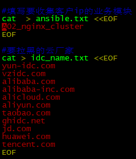
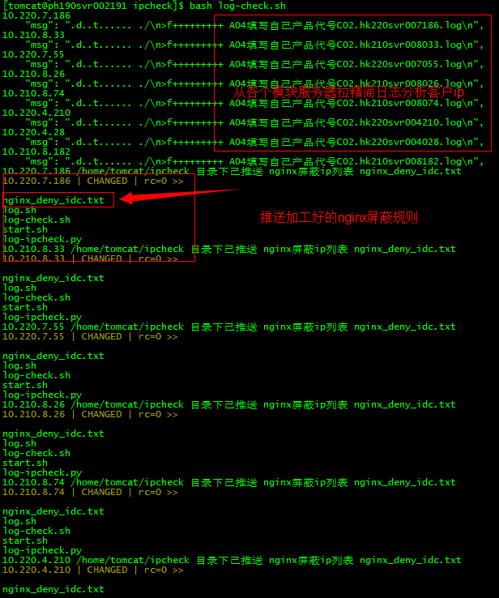

# 屏蔽各个云服务商ip

运行环境 需要 IPV6-COUNTRY.BIN 库文件  需要python3.6  pip3.6

**程序目录结构** 展开源码

```
[tomcat@ph190svr002191 ~]$ pwd
/home/tomcat/ipcheck
[tomcat@ph190svr002191 ~]$ tree . .
├── check
│   ├── log客户真实ip.hk210svr008204.ip #客户真实ip
│   ├── log客户真实ip.hk210svr008204.log #客户真实ip日志
│   └── tmp_ip #临时文件
├── data
│   └── IPV6-COUNTRY.BIN #分析ip来源的库文件
├── ip
│   ├── idc.txt #记录下的各机器来源idc的客户ip
│   ├── nginx_deny_idc.txt #根据idc的ip加工好的nginx屏蔽规则
│   ├── nginx_deny_idc.txt_2023_01_05_15:52:45 #根据idc的ip加工好的nginx屏蔽规则备份
│   ├── nginx_deny_idc.txt.history.all #根据idc的ip加工好的nginx屏蔽规则追加去重备份
│   └── shuju.txt #全部客户ip的来源信息
├── log-check.sh #191机器分析客户ip主程序
├── log-ipcheck.py #分析ip来源(需要 IPV6-COUNTRY.BIN 库 IP2Location (8.9.0))
└── log.sh #推送到客户机运行脚本
```

只需要191 机器/home/tomcat/ipcheck/log-check.sh 修改这里
***
（191拉取分析各个服务器的 真实客户ip然后python3.6 log-ipcheck.py 分析出 客户ip的运营商来源加工出nginx屏蔽规则 nginx_deny_idc.txt 分发到各个机器）
修改确认无误后在191机器的tomcat用户下执行

bash /home/tomcat/ipcheck/log-check.sh***

**/home/tomcat/ipcheck/log-check.sh** 展开源码

```bash
#!/bin/bash
CHECK_MD5='80abb7c0f5d45a9c29e089610a629113' #log.sh升级更改后把md5值填写到这里
CHECK_LOG=`grep -v 'production=' /home/tomcat/ipcheck/log.sh | md5sum | awk '{print $1}'` #log.sh检查md5
#填写要收集客户ip的业务模块
cat > ansible.txt <<EOF
C08_nginx_cluster
EOF
#要拉黑的云厂家
cat > idc_name.txt <<EOF
yun-idc.com
vzidc.com
alibaba.com
alibaba-inc.com
alicloud.com
aliyun.com
taobao.com
ghidc.net
jd.com
huawei.com
tencent.com
EOF
workdir='/home/tomcat/ipcheck'
dir_check='/home/tomcat/ipcheck/check'
dir_ip='/home/tomcat/ipcheck/ip'
if [ ! -d "$workdir" ]; then echo "水土不服" ; exit ;else cd $workdir ; fi
if [ ! -d "$dir_check" ]; then mkdir -p $dir_check ; fi
if [ ! -d "$dir_ip" ]; then mkdir -p $dir_ip ; fi
echo "#检查推送到各个服务器的 log.sh 脚本完整性"
if [ "$CHECK_LOG" = "$CHECK_MD5" ]
then
 echo "/home/tomcat/ipcheck/log.sh 分发脚本未被篡改可继续执行";echo " "
else
 echo "/home/tomcat/ipcheck/log.sh 分发脚本被篡改立刻自动退出";exit
fi
#先清理再收集
rm -f $dir_check/*.log
rm -f $dir_check/*.ip
rm -f $dir_check/tmp_ip

echo "#推送脚本收集日志";echo " "
echo > ansible_ip.txt
for AN in `cat ansible.txt` ;do
ansible $AN -m shell -a "mkdir -p /home/tomcat/ipcheck/" ;echo "$AN #创建远程目录中  ipcheck";echo " "
ansible $AN -m synchronize -a "src=/home/tomcat/ipcheck/log.sh dest=/home/tomcat/ipcheck/ mode=push" | grep SUCCESS ;echo "$AN #执行远程脚本中  log.sh" ;echo " "
ansible $AN -m shell -a "sh /home/tomcat/ipcheck/log.sh" ;echo "$AN #执行远程脚本OK  log.sh" ;echo " "
ansible $AN -m synchronize -a "src=/home/tomcat/ipcheck/check/ dest=$dir_check            mode=pull" | grep '"msg":' ;echo "$AN #收集远程果实中  客户ip" ;echo " "
done
echo "#python 调用IP库生成ip的来源isp信息 shuju.txt 时间比较长耐心等待";echo " "
cat $dir_check/*.ip > $dir_check/tmp_ip
echo "总计收集到 `wc -l check/tmp_ip` 条客户ip";echo " "
echo "按照 10万个 ip来切割文件 分析客户ip";echo " "
echo > $dir_ip/add_ip.txt
split -l 100000 $dir_check/tmp_ip $dir_check/tmp_ip_split_100000_
for i in `ls $dir_check/ | grep tmp_ip_split_100000_`; do
cat $dir_check/$i > $dir_ip/shuju.txt
NUM=`wc -l $dir_check/tmp_ip_split_* | grep total`
echo "还剩余 $NUM 个ip等待分析 时间比较长耐心等待";echo " "
python3.6 log-ipcheck.py | grep -v 'Invalid IP address'
cat $dir_ip/shuju.txt >> $dir_ip/add_ip.txt
rm -f $dir_check/$i
done
echo "分析出客户ip来源信息咯 shuju.txt";echo " "
cat $dir_ip/add_ip.txt > $dir_ip/shuju.txt #文件交换
rm -f $dir_ip/add_ip.txt

echo "#从shuju.txt筛选出云厂家的国内ip";echo " "
for IDC in `cat idc_name.txt`;do
grep ':CN' $dir_ip/shuju.txt | grep $IDC | grep -v mail | awk -F':' '{print $1}' >> $dir_ip/idc.txt
done
echo "#清洗去重筛选出的云厂家ip";echo " "
cat $dir_ip/idc.txt |sort|uniq | grep -v [a-Z] > $dir_ip/nginx_deny_idc.txt
cat $dir_ip/nginx_deny_idc.txt > $dir_ip/idc.txt
sed -i 's/^/&deny /' $dir_ip/nginx_deny_idc.txt
sed -i 's/$/\/32; /' $dir_ip/nginx_deny_idc.txt

echo "#备份去重筛选出的云厂家ip";echo " "
cp $dir_ip/nginx_deny_idc.txt $dir_ip/nginx_deny_idc.txt_`date "+%Y_%m_%d_%H:%M:%S"`
echo "#历史追加去重筛选出的云厂家ip";echo " "
cat $dir_ip/nginx_deny_idc.txt >> $dir_ip/nginx_deny_idc.txt.history.all
cat $dir_ip/nginx_deny_idc.txt.history.all | sort | uniq > $dir_ip/tmp.ip
cat $dir_ip/tmp.ip > $dir_ip/nginx_deny_idc.txt.history.all
rm -f $dir_ip/tmp.ip

for AN in `cat ansible.txt` ;do
echo "$AN #推送筛选加工好的云厂家ip到各业务服务器上";echo " "
ansible $AN -m synchronize -a "src=/home/tomcat/ipcheck/ip/nginx_deny_idc.txt dest=/home/tomcat/ipcheck/ mode=push" | grep '=>' #推要拉黑ip
done
#清理多余文件
rm -f ansible.txt ansible_ip.txt idc_name.txt
```

**/home/tomcat/ipcheck/log.sh** 展开源码

```bash
#!/bin/bash
production="log客户真实ip"
workdir='/usr/local/nginx/logs'
if [ ! -d "$workdir" ]; then echo "水土不服" ; exit ; fi
check='/home/tomcat/ipcheck/check'
if [ ! -d "$check" ]; then mkdir -p $check ;fi

name=`hostname`
for log in `ls /usr/local/nginx/logs/ | grep '.log' | grep -v '.log-' | grep -v 'access.log' | grep -v 'error.log'`;do
echo "$log"
awk -F'[の|,]' '{print $3"=>"$9"=>"$10"=>"$6}' $workdir/$log > $check/1.txt #精简日志
grep -v 'GET=>403' $check/1.txt > $check/2.txt #去除 GET=>403
cat $check/2.txt > $check/$production.$name.$log.log #生成精简日志
rm -f $check/1.txt $check/2.txt #清理
done
cat $check/*.log > $production.$name.log #方便191收集精简日志
rm -f $check/* #清理
mv $production.$name.log $check/
awk -F'=>' '{print $1}' $check/$production.$name.log | grep -v [a-Z] |sort|uniq > $check/$production.$name.ip #加工出客户ip
```

**/home/tomcat/ipcheck/log-ipcheck.py** 展开源码

```python
# -*-coding:utf-8-*-
import os, IP2Location, ipaddress, json
database = IP2Location.IP2Location(os.path.join("data", "IPV6-COUNTRY.BIN"))
def checkIP(ipaddr):
try:
ipaddress.ip_address(ipaddr)
return True
except ValueError:
print('Invalid IP address')
return False
def write(path, content):
with open(path, 'w+') as f:
f.write(content)
res = {}
str_list = []
for line in open("ip/shuju.txt"):
ip = line.strip()
if ip == "":
continue
if checkIP(ip):
rec = database.get_domain(ip)
rec2 = database.get_country_short(ip)
str = "%s:%s:%s\n" % (ip, rec,rec2)
str_list.append(str)
str_content = "".join(str_list)
if len(str_content) > 0:
path = os.path.join(os.getcwd(), 'ip/shuju.txt')
write(path, str_content)
database.close()
```


