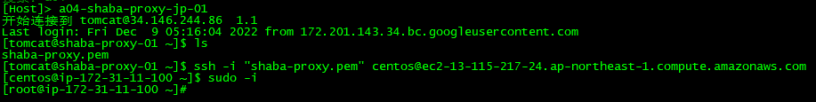
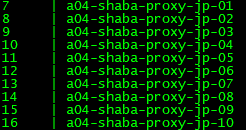

# 沙巴 海外打开 问题排查思路

> GitHub 仓库源文件：[点击打开网页渲染版](https://github.com/ben2023niao/ben-ops-notes/blob/main/doc/md/202304141557-DevOps%20%E4%B8%8E%20SRE%2B%E4%BC%98%E5%8C%96%E6%96%B9%E6%A1%88%2BNginx%2B%E6%97%A5%E5%BF%97%E5%88%86%E6%9E%90-%E6%B2%99%E5%B7%B4%20%E6%B5%B7%E5%A4%96%E6%89%93%E5%BC%80%20%E9%97%AE%E9%A2%98%E6%8E%92%E6%9F%A5%E6%80%9D%E8%B7%AF.md)

| A04域名 | 代理域名 | 节点云 | SLB负载均衡前端IP | SLB负载均衡后端组 | SLB负载均衡后端服务器IP | 异常域名 | 备用域名 |

| --- | --- | --- | --- | --- | --- | --- | --- |

| 运营环境 [dragon00.com](http://dragon00.com) | [baodahao.com](http://baodahao.com) | 谷歌云 东京节点 | 203.0.113.1,203.0.113.1 | a04-shaba-proxy-jp-01 | 203.0.113.1 |  | ks132.vip |

| 测试环境 zlong68.com |  |  |  | a04-shaba-proxy-jp-02 | 203.0.113.1 |  | ks133.vip |

|  |  |  |  | a04-shaba-proxy-jp-03 | 203.0.113.1 |  | [ks168158.com](http://ks168158.com) |

|  |  |  |  | a04-shaba-proxy-jp-04 | 203.0.113.1 |  | [ks168158.net](http://ks168158.net) |

|  |  |  |  | a04-shaba-proxy-jp-05 | 203.0.113.1 |  |  |

|  |  |  |  | a04-shaba-proxy-jp-06 | 203.0.113.1 |  |  |

|  |  |  |  | a04-shaba-proxy-jp-07 | 203.0.113.1 |  |  |

|  |  |  |  | a04-shaba-proxy-jp-08 | 203.0.113.1 |  |  |

|  |  |  |  | a04-shaba-proxy-jp-09 | 203.0.113.1 |  |  |

|  |  |  |  | a04-shaba-proxy-jp-10 | 203.0.113.1 |  |  |

|  |  |  |  |  |  |  |  |

|  | ks113.vip | aws云  东京节点 |  | a04-shaba-proxy-aws-jp-01 | 203.0.113.1 |  |  |

aws云  东京节点 登录方式
[tomcat@shaba-proxy-01 ~]$ ssh -i "shaba-proxy.pem" [[邮箱已脱敏]](mailto:[邮箱已脱敏])

谷歌云 东京节点 登录方式


目前可用节点
aws云  东京 1个  节点
302.ks133.vip
谷歌云 东京 10个 节点
[302.baodahao.com](http://302.baodahao.com)

异常排查思路
到对应节点服务器上请求沙巴接口域名
通就正常，不通就不正常
不正常联系birdben 更换IP 就是
域名异常换备用域名就是
新增节点就开服务器运行make-nginx.sh 就一键部署好新节点服务器了

用户无法访问
mjackma
IP：203.0.113.1
然后
让用户访问 [ip138.com](http://ip138.com) or ip.cn 给用户ip
traceroute 用户ip
就能看见代理服务器到用户网络情况了

根据用户ip 到对应节点服务器上 看nginx日志找沙巴的接口域名
然后
节点服务器上运行
traceroute 沙巴接口域名
就能看见是哪里断掉不通了

然后更具情况（可能临时网络波动）更换服务器ip就是

**make-nginx.sh** 展开源码

```bash
#!/bin/bash
#nginx 编译安装脚本
mkdir -p /usr/local/src/
cd /usr/local/src/
useradd www
yum update -y
yum install openssl openssl-devel zlib zlib-devel gcc gcc-c++ wget zip unzip vim vim-common -y
yum install openssl openssl-devel zlib zlib-devel gcc gcc-c++ wget zip unzip vim vim-common -y
wget https://nginx.org/download/nginx-1.20.2.tar.gz
wget https://github.com/yaoweibin/nginx_upstream_check_module/archive/master.zip
wget -O pcre-8.32.tar.gz https://sourceforge.net/projects/pcre/files/pcre/8.32/pcre-8.32.tar.gz/download --no-check-certificate
wget https://zlib.net/zlib-1.2.13.tar.gz
wget https://ftp.openssl.org/source/old/1.0.2/openssl-1.0.2k.tar.gz --no-check-certificate
tar -xf nginx-1.20.2.tar.gz
tar zxvf pcre-8.32.tar.gz
tar -zxf zlib-1.2.13.tar.gz
tar zxf openssl-1.0.2k.tar.gz
unzip master.zip
unzip nginx_upstream_check_module-master.zip

cd nginx-1.20.2
./configure --user=tomcat --group=tomcat --prefix=/usr/local/nginx --with-http_ssl_module --with-pcre=/usr/local/src/pcre-8.32 --with-zlib=/usr/local/src/zlib-1.2.13 --with-openssl=/usr/local/src/openssl-1.0.2k --with-http_stub_status_module --with-http_realip_module --with-threads --add-module=/usr/local/src/nginx_upstream_check_module-master --with-http_v2_module
make
make install

useradd tomcat
mkdir -p /home/tomcat/.ssh
echo 'ssh-rsa AAAAB3NzaC1yc2EAAAABIwAAAQEAxV6WVONrWBPUNIhw4IrtZSF8F7gUrRlXgZ0CXeAQIFSFXve8qAQ86lIWWDSKjygGfl6FKUoxYzhRzxfhRiKjAwi3BH7d1lKlFwzOBvOPeS57K5znWXPz+E09/Vj1xJ9MHqzl3/Ece0M/2srPtVTgB1Ico8AFi9pPaYZSy3bue36OKVFnC9kVvkriiIe/k/vux5KF/TcXCkc91IVMGCqp8H8NqaJnQWmFB1RYMz9JUe6G9V400iTn9cJmcfS7r5jfT+ZI3K0s6FiCDvQ5LsRNcZhD4uy6YdkG3QBOPOuSwR1sHOcfADyMkWPAXezasI7nfAj7VuuMiqvVt2Ju5A1low== tomcat@jump' > /home/tomcat/.ssh/authorized_keys
chown -R tomcat.tomcat /home/tomcat/

/usr/local/nginx/sbin/nginx -V
/usr/local/nginx/sbin/nginx -t
cd /usr/local/nginx/
rm -rf conf
rm -rf ssl

cat > shaba-nginx-conf.hex << EOF
504b03040a00000000003337de5400000000000000000000000004001c00
73736c2f55540900036249bd620e758f6375780b00010400000000040000
0000504b03040a0000000000631687550000000000000000000000000b00
1c0073736c2f646f6d61696e2f55540900039aff8f639aff8f6375780b00
0104000000000400000000504b030414000000080020408155cd63dff57d
130000b81e000017001c0073736c2f646f6d61696e2f62616f646168616f
2e70656d55540900033b5f88631cfc8f6375780b00010400000000040000
0000a59949d3aad89686e7fc8a9a1337a45518dcc1a607e97b98d128bd20
28ddaf2ffcbe3c9927f36465dd8a32c2d040dced5aef7adecdbffe75bc18
5e94f5ff6279db950599052effb9f82f48936551e75896b1b7022c32030a
d9ca48a7b09e88fdd49df29a3dd274e280ea029d299a67d95422bd200cb0
2601702c03d53baf6aa01101eaf14ca9b13622afe20e62a6d0fda335976f
f22d0e04240ee5c20d847784956d86db6d56f396060811fafae3aa491e26
4c71476f31c7471a137d35c8969ae9617e9d8bed23dd182d09d02117fd46
73b345b722ceb72c0ee237d28d031d49827c9605c5b51c864f31b44c02a2
f03b614a02bb3c1a98d38af9dc87669d571c8d6e79e76f32af3390c61021
e7ca9be6824de3c0f2f516facfb5fdfb9abceb6e831a7ebf882e1f6a8cf7
353ab02cc6b5222b280ae8260aca32ddc83ac590a528f84a0388c83a4fd1
91539cb3f863c13c000899e116f0f9fd0afa63b12dce2cedf918c134e6f6
d5b2d5d66ff90b1ccde8b5912e76a9beabb7f502b64a628bb99054bc9b66
41be69cbc6dea575c36ce4d9cfd8a984e83d7bb7a229b0c0b28b30d1e06c
aefa0966b507a5c4eea336e6f35b6b5a245f718295d09831656ec02cb7c4
798286b11744c798a2583ca20e4e246c6a5b565bb41734adb326b3702adc
924a36326a5e3bc0972e81b355f05d8b65ea553c1241bf84d0799f04526e
a8530853f285a8c32d157ad17c56c41935f66339e6f7a445bec48f5d747a
b6c6fda9aca3107b9b15a9545f3610ac989e180b49e56efb99eab731a50b
d6355f8e14d2a2ad47c443ea60e5f45cf5d53f5f988b2d1f41d988e6b668
effe32a5d0fde5594b9b84b26be1ab21b9a0d01800c4ba28d4d311e62cbc
83fb272a2547e3450e0405e3e8b570e1fd2b7625c2fb0075a72e656e2201
22b4245c907fdd6c11bc50589e3713d359d143f8e6c0f8fd515ef07ab8c0
b7bb1c2f0b571c91682326042ce9f4d95450048506964f90e4fcc233a7c5
62350016c9fabab16598681140245f9788612c4f020b2fb2ec74e482e509
cca2b11aff9550b90cece33b587410a95f370371d32c9e0545b6282ea899
a218998217182b63811d855022d94826696775a3f71f39a176fa9c3a34e7
09dac282488c095e0396cc68b2c8ffd4c031709b8034295adce58fa169e0
2a5a5889e412f8345a670feb9dfd9e915fe13eff9ea1a8e2429667cf6920
0c691b97a9d83651680f2946fe9679be1b870a76bc39cb213f8d2df29f3a
134548f8a3b739c2f5457de86d84db438c518778d02f8dcdbe17d6b28e0d
3eb35cd5bfa34e986351e8a3807a439f9b8a62ad7ecd4ae1c414fd67be3c
c863121416cbc832932e0e0b8289492c0603571c87e679a04e2b27572442
3f180216c527126f6dbe5f784dd19e4259bb232e5faf0000a638b903d89b
e3ebb1ed7cb6d8965c4240864f3e75f7e1140898cb8ecadd0e5fe0eeb2ed
634709d72afaaccc394e9f52ec022a6088d3fc62b4ab94bdc87850bb0dba
f56c7c8ce0290da48aaf5470823da9e688ce5b181c48fd560b6ef4da304c
367a8210e4db39b2828c93ddd2432e4875088ad1de6aeffd727e1fe292fd
36c462b10bb9041a7f2db5e19dd357e435178e1010ccfc22899734d24818
35d0e5d19c24a676ef759d838a07b369e4945bdc8b72866fa5c1221d9bab
8a9d3f3c3c9e37941dda9c1ecba72ca711c80bae87cc179798b327eaaefa
f0b78aaa825901b4a922b6305e8cd74084399d5a099d16c7c02213395bea
2190e0087646d2788f85646ee1a21766ae77f5ba1aaff22d84a11b9ad575
9e76781433470057d81f0b719de6cf081f9520f9374080b70164fcfa805e
a2aa5c85e235df6ee912be1db54250f366bf59455e382b52ae7d2c9773a6
038b57190b70872a334046e937ac454f648821c44ae370606fb579173999
8963376bbce01d4bfe5181e8ab8edc2b6d79210d6efa22e2ed771c89ef1d
3905e1b9be1977ff099d99915c8cacedd5e1a98460dacc0761870c6f5bf7
c54e90d98a8673dc13d530dd54f515ac5e9e7b1eca6c9e587419fa0aa034
bdf9b89d064fe511aba2299b0f2fd815a1927776c9094e713d1337575b7c
4f1cc7484d630ecf9e0d4c32765b3aac1c07c2ef6896f088f0ba0b599db6
d55c1f52832c5aa44b02f9ecc5fe257143dd5e707526b8ee7dbb93ccc960
9c8930f8a8e18d09ba4c1c01ce7615f6fafbdc976e53879aa31fa98361cf
279aad2d8d4eea83f22e2b372c1c69f4cae0f283aab00e1f1b8db7426ba0
3f2f35d8c9e7f46fe88b39789dfb9543fef5cf8cc26b35cb82f5f9835118
f00b8f78078f3017cd9a16f69b0c447e5124abe6d3a3c07ff3090b16c7c6
95f6d0a436ab183d0ac83a11fdfd408a4db3c1b7905b96c481dc8d82b54b
71a5d1ec7e8144f0f5c3956304ee408b436ba8c242f8c215db5772347630
4ba931d40f2a883e327ea0459b3d0eddeada1afaf4280b9f0bf11061fefe
8d1c00d1387e3910e367e420b42fecf803396e076141ff8058daff86589f
ff41ccb2fc8c5889c614df6b7208827528668ad9f38786647e1dd2a045e2
c05a65f7bb623240d320f153251c863bc4fb282b9f691c3d3acc97a027c1
31b5fdd821e797d4627e4bada33a1e9809ac9efdca3395048fbbfd266e03
56aeab6e7b8e3137a95c2c49be38232c32b04102f54c9d5fb927f78166bd
1388797142c6aabae3a05e446d58da95228b9acf0d599a455d37f73dae42
72417ca577d8493f4fb55e10afa7e2dfb52a30cd1b846ba7b92092aa566c
f381d55ba73062c9dea57c3cd53be74d154a48b118b00b5f2d4f4522a398
c66481ed9b2cef5eb7170145851e50729ff070bff6ebb9e8ee087154a987
d6963373f2c7b73979d7338c3fa73d88507aaff55ee89282786a5378e362
1b1a8dee464bc5b9ce2813f3d4aa03dba8929401f2cbfc205b8572f0fb28
d9ba4856a84d85ed3597c886a9a568d8e082ca3ae8b69faf4a7607788c77
7a5058b28299987e7116c2c938ffd2ab547344390f40621cdcc632f35f38
06ea19fe2aefe780b2ee13f1a4860b716def345806d5fa1d64fee0185ed4
00f533c70847241e5875a796dbf275f39d91ac25ab01d17349a1cbd1f685
205c3fab98bea5eca7f47ef285ae23e79b16a04f72581ffe16dbee089c83
cdfd3f82e8a8d559b72cfa13203d771535f127f4e8962f00803ea1aa7664
9bb3f4410dc29f23d2ff23c90ef0d952ee579d8000308e48e4012ba41498
d9f46cc20dfc8a2f6be31cb5fcc4aff70804dad6bdc6c5738282cfdf7577
69f109147481f6a875e402d5b985549323db5e4698ca059b994f38c58fb5
e4a223520540b8632cce78e34ecf123b530e99cb09a686e8b8ebea0ed92f
645edfcc73a134046c2bddbed06429ce0f76781c70f81e39f6b487dc68a6
5ceeb3d1fde621cc141827eaf57cb569e162d031198a107a7f1d2e31e5b7
b2c60a2dc0f6e9ec08fb4599b8fe06f03101be289fceef4235866d1b7846
9b50c39395e754412dc6118d4022e8f59a78177c7b0675d1771716c5b6b5
5fe0db0cbf7a124db77156ebeb5e9cd9484413220ce70a7f99eb1387a6ce
ace8409e8a97fd04bc60516ec73dc870d087244a8b7fff3fc45ee43f5272
7aff6e48effecb56c68fe791d29c89d459d0f461ffebc62edf86b4e2fe6c
487d5f5bf91dd83f0c29db1c91b331d7236af6386c568103cef76f99cb22
430b650770de0ea13b849dd46c62917e137f7ef5bd44f40adfd705afb59d
e3d393f9a331299fb36e5ad51a4c9f86a0432e5dc5f75ddb57bcec719417
9671bca35afc39e8bf0c299387767f949921979a452a335d738b15fad988
069f8b3b58b55afbbc51c3f5c8a066997ff2ddd07f62bcffc97743ff89f1
fe27df0dfd27c6fbd86a46aeffba8dbcf049cfc30a51e073035b5cbf7215
7d683bfaca285907002973e1ad473073964f2b22bdb59a532671a769e5a4
f24361aa2eac43aec56b454185774c7e9fd352bedda7a040ce2f7497dbe6
9249f3a5b5cc73ab2d08789eddc7098ba4abb4469b953f813236f501e159
21bdcd93acf4547bb89a12f7c48667116dd002d606b2bc5f1c3ccacc1445
6d41ecaf49e69b2054869d365c574478a8bf6a69f138afddf878adf145d0
f1eade150502a3d1fba8680a57c44d705970dc14ef57b1eafd91757a74bb
bf892a6299a981a4645acae43c4fecf9761b7066e1e58c28d4e5fc66aec8
1bb6b8d165acc3bfa484cf3a9d8b0f1c5b9c46eadd6f7952f7af087a5f71
4eb46f7c04a3b33f63dc860164951c981cf094b8b9ed56ac77c192396001
a6270e2bf4a1aca05fa46f6daf21862916a1079e8777a7e0d98fce447b85
21451dc5e6d42873f134fd70b5c6215cbc20635a38d9de188d650e772904
c79340a405530752f95bd4e5dc7729e13fe95dd6dfd927d95f5585673920
7ecacf517a8e3a837c1d0fe58a65051a637d79e4df2c32f39373e5400dd2
6f677f08d191cedae17219e1639fc102fdc9f20ae06b04d2622bdac7ad25
0cd7f3a268627f2e3379f8c56edbf18940bff967df437cc79714f448a223
9dff5c7692807e5ba18f2422bd7d74e3bbf430d86794d04f06fba989c562
fec55f6b7ff1d73ff7fee91cfa9bde9958b4bfc5e548a44f6f3907da9fd6
64015114ff28c5908a1d2de3e09796d35f287af9cabeafd51fe972b64879
414e12f46e721d565642b4a48c5f31909e762e536da7abf9bd6b7307dec5
5b727667fffa546a0f848959d8bcb43bdb28ad7e944ad065d4b0264a31c3
174ff64899bdfa44689c5456b6c704f2d2245c7b1e49dbf03b78bbedef13
db27f49ef9b8040cc250c50a92501ac68831b39b0a4bc0684e638010b5db
c4e786888bf6868c35f5708ab38080c7f2508ceb1d294d6937f9d33b50b5
c388d826e25ef2207d066d9fe3fb9bb81f45df8d0856d0c8beb79007f3d8
e7e23ca18e859f37a3bfe99c4bc2b06363766538ea0cad7366cfd55558bb
9857d8c4e0b9abbe29c69b21cf9c599d62f8ee8b7567c0cb2d41f06baacb
4925b24318abbdd789334e41d36127ad0ef311d7c40cdb128b8627e8888e
f023f106dda7dbb0a607723e9db2a04f92a923cfb78689f2f499de887e03
2ad49e5ba1ccb1bd820345278881bb2fa2708a080b902cc9c8228ccffb5a
0a7df43ad59d69b918e39bd54518b0a3f8cda27518d25ac44935a88dd249
95b7a6de4e085b8f49bcb85518b829f6949caa1ce3db998a9bf30417fda9
7d3fc6fec5a789d8813282d4a3d02981bb858f003134f17d4707b180077b
1bd3b5b3793439fbcf1b1581c9b81373776c7f56b354b2d7deedd9343043
429b213296d65c0398774c4d28ae6f235ce496dd06d7b487c249d2778468
aacb858a6a6397b6a1aced2a1a92053b8b5613570841de27993c30dbe3c7
aeb0eecd86afebdecae6154df807f5ffc00ee160039611bbdfb1c30815fe
7025d50b9542045b2cdce5d1f6ef32e6f09dd0df19cfff8bef84fece78fe
5f7c27f477c6f3ef7d274f6adc8726feec3ba1bf1acf222a567607ca371d
452e687d57b3b585ff9ea6cc2f83118759e11cf53cc37c12d26c6be17ff3
d0fcf2fa815807f8b4c8cde56f1ab3fc38d6f77db13c46f60d49ded1b0cf
32061487367ecc7dd41c6251c10fccf07f123fabf05afdaf531c528c283e
f20bfdd0dfcf79efff8416a0f8220bf68b2c0ea12b18a515f6c858e84986
269a9dfc05c52e19f24090ede5c97a493cfbc2b59a570c1ed9de77f79dc3
868b999a4bbeafc8450a6e7bd6f3ce4bc2ea8708cd5c1fbf04b89b432cef
319d7d1dfcf474a7b1b9d7554a739350b116eb5eaab3e42aa2ead8a8a834
180ed7cc2ccaa2f8b420b9dea853692ee56a5f8ea272af5f6ee365911d23
91ec656f5110acd3cc99f0bddbb2d39ae4a28ada751d740396ca59774f21
39485654791180622ce35d6b94be518f6687c72508749b0e83f17edae786
7e6d1b46b76ebe19996334d8db959f78a83c11e8b5017a7b50957e256103
2b3be0b90fe091a2474e7b64debcb9d5f046d2396a57390f3ea5cf9944dc
ee2125c45a34f48587d665bf13eef5bd2bdac50b2b3f26e6b7e9a730a733
03b74e26b5795db2eb2f1a2325f8a173644818c331ea6bb86ca578f06b95
59fa12ebde9140eea8ebb47ebe8fa13b4cbabfa7569e39d8b35558fa1415
727facded57805a9a944b55eaad56a9e2d12e2e8867dbc27e7e0708ac226
e1e91341416d440cab3d4fe25a40a8aeab9aafe074ba91a131c9fbf4022a
85faa1a53879a94001339c9a3aedbc5836a82da6251e0967ed31595b6acd
8870b7ae2d6f9b4e4ca237e9d182bb8f3abd39a348b4c1ab277a0a44b625
ab365ae2aaeea278790c17d6ada1adce6e06ab48d5dbfca8f09398f944d6
86254398119d0ed1380621eabdcfed2e42d7233615b723b8ea3d50cd164a
203b71be8a5e6ed47c70edef2e9f3accc0e5d7471b05c45b7d6d0ee9cac0
7b356e8fb978fa2784639b17f797471bff03db411fb8fbf54840fce548e0
c78900ff0d820503fae5c37107f8d81f26031aaffd865d16a571fd625c01
d6738ea875bfbafb8fb98f30fedbe9ab07e858de9fe5ecdb41b4751c6aef
0857268dfb190c79e6700c8b5283e667f4fad050f4c7c1c4370cfdb5b7bf
3eb1e38007a0cf23bb838ea31295b29ce5e9873c16ca25db11f6a25d4cae
db50c2c62b65eef0c0783c5498d453f859c2595be1334006181a67474f71
99b2f61998f09bc0d1edf9cc923735efd1e5a95fac5322ea8fc523341ca1
f7138c8f1552cdacddce17dac26c183a65bb031281bedf8b58cc5af6ba1a
a7e0b034c355e91829919be3af95ed1a7d832bda689ccf8c95cc92b406a7
6329c802406c2573bce169d3fda13775165fdc7925b927067b9eab3c82f9
7d1e67137fe106adf260e069d1e25c015d486ca72fc7b609d01e1b425bd1
398e3681bbd3f69cfb82c89d5e4e7fe9994e388c6782723eb32b882ddd57
26af9c612c5dde5b8d6a489a0d40b33810fba53cd58f78ebac2d3fbd6e36
cb24658fc2fe3fd4ebff06504b030414000000080028408155999cce3922
050000a806000017001c0073736c2f646f6d61696e2f62616f646168616f
2e6b657955540900034b5f886345fc8f6375780b00010400000000040000
00006595b712ace61284739e4239a582c51328f8f1defb0cb3789665f13c
fd3d527a279c9aa0a7bbaabfbffffe339c28abd65f8ea7462010ffd2c5f4
dfe5df90a9aae2e1aa1c1080c535c3d20e9dcc9e28075c5102c0e739bd3c
9bc6ef41230230ffb97305a7f50ece5c7f95a7bb1e648cd128d2707abcf4
41a1bdd6d8bbdddd806790d8e99c24933d8ed3903beb7ad8deba6fcc4397
f9c090967dca7d941d09e281eb35496ec2e5d1cd2bcc9b1f46cb824f6f1f
d46e0e235a5d38c12baf8c7354e18bb9418b8b040b631b9b619ae68a2864
7cfd54ba8db1edeef46958d6e21dee140c7824b5f2c71955ef8348a163ff
eee0dacc54666b3eb964d109f5ac12a90e0c842430a3d2449fdc8534cbce
d211d4cb7e3a131cfb6aa69122fea6145946bb5eb4eb2765e1eda60633b7
03ac39a19c4939d405f74331f3fd2bd8860f9ccd571256f6ac94f82813ac
21cb655d114573b4a702231864e73ecd7da6d7a2de42f71cf304520317bf
6c25008dc90120f2cd1fb7dddc3c1a9f553f3e61617b146128dc5c491e57
5c9828f4ec7c8c42f08fcb9aee5c86b68437d4c288e075bcd123825fc89b
da341674378b34f4fabd70ebfd69e88a4a58c9d8d02ec2cca088af5441da
0061cd09e27f12d6095a6dbff0495c1cbd5c8afa0dc85fd2c20948e80727
b2d322e9eb2ec67ea35f56bbdb06c2bc45390fc6363e3c080b72068125f3
3cd6a3439bb07001dcacbc8252ca18e6a2996b428dd9a710cf77247c5567
0db3f800631912d3e5e35f0662f5a217e7b0fc91656ab187bf14dbae0923
af886703c8edfb4aab00e6363bebe24d2d7a523a9e348d8bef502a8d60cc
3b84a94ff87abbaf6e5845e5137060bc6f8d561b58c402e653bd7f314261
393eacaece35ae70bf7d65223d1ff944726f882f16da55fbdb9d47afd8b1
e9912a99521e38afb4140895a41d31dcc5c9d6c804b6c42334859718ff58
8ad15359490b8f67bf12a4a495281f5de47e435846103de4ee5e1f4d157b
a9992a5698e813666be5da9c98161599d3a74908a9cc51fc458379be1788
90e8257360df92f3758b892b760c438ec5823aff935cc8e6da9a63ea76d8
d53f30ff5d15d02e8a6e4bddaf6d5d2e85cad39e0551b35c2a7ca9965c19
1f77a8860a102a6f8c6719d253d1e5d1995ce761e56687b98c5b5fe4fdd6
bdca0b314a87a6f76b4b3ebf9af66e107444a56d21e964a1c6bb16079baf
0ffcdefc083886ea53f815af3bbdd671ca4e1b707486f70d14f2c7c7e025
a3deff759973e4fa95c5f517c64498fd319ac246f8bbce55478de7ab88ea
6e710de2979f218a7d87063dfc1dfa9e438660dd25076a23ba4c2d93bdee
16a047c63a0c7567cdb3de48c64016a61a4f160e945344844195afacb6dc
ea8040036ed4f462358caa89cc704e4860f7dd99d25982ef0d7ce177f7e7
7df3ab3f65bf1bb72d190b08708bff8159064ea96f50819ccbfbbbdda7dc
c4c4870a90b09f87aa27b1e4b68b89dbda98456cefa24a52822f6f8e8c67
762d16f614b31510b345200fc0822af6dcea58d46a64d260d51a2bdb26e5
27e31cb4d383c2e881515bcdc5d6d627b0eae57f9219220408eed8090224
9c20c0f2c7a6d49f8034419508f5987e4681c1259c3886227cdaa012fef4
442a82e1b9022148728ee0bd07bbe44d002c94063aedecd50baf9395a6cc
f1dbbcaa85a9be77e24ed5c1ce67e2f9548795f433ae6684cba2f8b39959
25cb7e04fed1b3d082a3528184b698f65a379f5894b1a9c2cbb133fac9b2
9806ab8e85f661d0a6f52dacde341335cdb73fe4e8d2afc55db4d0c54fb6
4ebfdb3da4c79376789ee2233e5eff81fee38e6809ffcfa2ff01504b0304
0a00000000004c16875500000000000000000000000005001c00636f6e66
2f55540900036fff8f636fff8f6375780b00010400000000040000000050
4b03041400000008008d1a7d556c8c1814db020000af0800000c001c0063
6f6e662f6b6f692d77696e55540900037a7a8563d707356375780b000104
00000000040000000075944b6fdb301084effe15040a14ed21801ff10b39
e941b6e92b45db14482f85122b896a5b3224b9815bf4bf77b9c32043c031
e0cb7c4b529cdde1e0e6be68bbb2ffb92d76c6ac9b6a71d21af350d5abe6
a13b198da723f3773030f25b0ce5bf3067e68529f76d037139d5bf17aff7
9b4dd90739312619aafcb2beee766741b6c6a473c8db6ab56afa00928900
ecdd6d8bcdc61c1ae8a7a227a45faedba2aaaba23687322c9d49c9e46849
8582b914b8e37b54618f5c4a4e8f9674cd6d6fee50255f9f8ca92a3d949b
a6dd779d16de376d6ff6d8301dea5f2fba2aefc22de5334d825bde14bbaa
2f36e6ea0244ee99241179fa842b1b96fb9b8e9f293a4789dc3571cfed73
1ef659eadf17d5fb6dd936a6abeeeac0c48964facc06eac51bd4792f4651
dd11372ec3a64e8a71e0abec35b44c1c72963bbe873e32c60e492f208f45
1e917c0d591c753392fb0ebaf869b9a12bc832ad76ca8796d0c559c7e5b7
90c54dcba38539c81652cdbbacefa18baf968718f3974916ec92e45f9053
9179b4d790339153923790a52f3623790b59da6073926bc862b86573435a
7331dd72147690c573c7f201a6e762bae35eb490bde9dc0b789e8be78ee3
d14316cf1d9b883ee762b9e5cefd8189b9f79c77f90dd97bcef7d759d4b9
552cd63b76ed00d95b3fe743208bf58e1bd585b3c57bc76e623a72f1de2d
a3f29bb040ec77bcffa32efe3beeadbcb12b4a990cb85f1b3d049720238d
06930460acd9880207305133197cfb0a72aa416092034c350ad1f11664a6
7d64e200e61a3606780864e07d8b19bc7f0bb2d4a830c1232553efb3c2e0
1d40aa6989f602c8342f0c3e00e49a18061f01ac6686c12700a7a9617081
a6c8a4fbe030f90c30d28e4676a12932ee3e534cbe004c34550cd0137965
7caca26e014c3558d1c30b30d3f789c10f18ece6fa2e32f90eb0d0596610
c745a6d98720ba1140a2af5e741840aa198c2e14be22d38430c12c49927c
2ee32559586435e9cc1e89d3d832790acfbfc17f504b0304140000000800
8d1a7d55ec07eeda98030000150b00000c001c00636f6e662f6b6f692d75
746655540900037a7a8563d707356375780b000104000000000400000000
75955b6f1b371046dff52b063050b440edc81bc95a264500eead716f29ea
b880f212acb494b4b5b46bec258952f4bf77f7fba8b8642a3fc880ce7048
ce99a12617f27657b672c81f65f857d59de4b2e9f77b79a8cbf0b2911f5e
49df6dc231e085949d14b561d8baaebabcac2617b2aa3f5d164dfeb1acb6
925785b4f5c148dded4c23eb5ddee4ebce34ed954864dab2185677a70d6d
8a76c8d19a0fa6c9edae3dd24447b3af9bbe6dcbbc92bde9c62cf27157ae
7792370667282b7bccab21c5ed468e752f9531c5e90e384d377ce64d31ee
f8bdf4adc1b64db97ad657e5ba2e4c506dcbead3b321d1e570d321116a51
b59dc98babc964bc426bbaf7e3b7a7a28c25b90ce5efc94486bf702a9206
61a06379291762faa626507380a90e0056c3914c67911689033d1d800ce8
9b6ad53ebeb4281d51b438a14359147567a17e2e925cab6b0bdb433e5cf3
5893cdc0660ebb7f6886128f253c1a9be206613767c24a062d10b43897ab
b4b992212cf08ef314d6d69b4eb68c4c913075221dc5edae6e3ae999389a
a2085fea5398adad403456601a9eb65ce78f653734cef20de90c74e6d1a7
232d539be606813767036f19b640d8e27cbe5b9b4fc1f50c75bd90aa3f98
a696b6dc5696b352d3b38950ab1f198b5a85a917fb3fd5bab7c9337493b2
0bbe8dbfe3f7f1d44964bba527bb1e6ff6a5c264395100e45a5d11a1ff42
b779ba960cb58fdcfe2b88e64073f720860cfd18bacb3644a8fe60fcbf88
fd148758e5667cd891292c0b1dc6be8e359072d05f441190763312c54091
83f6440950eca003510a9438a822ca805c31f6d548a66099c31e89ae7169
171d292d09c05c9f0d11a5b93ee92cc19b1106ae4fa239905b7cf64e82e1
89dc2ef8cce22774e666fc4044676eadd0f79813842884b8953e12519dfb
247d268ab0ca15dedaf3c460ae05765e9200296fd9da2ee414bafb9d5806
e6f6ca6efc95799af8141eb53fc5cb7b528cdf57ef8126c4002aff8d8b08
f1006affe57a7b478a2154fe039810620cd5dc3f524a0aabda5f9a1142ab
7aee413e586988957ede9f5f93621c55e8513eb029ac2ae5c19f0831924a
fb790931942af2e02f84184b157bf057420ca64a3cf81b214653f9dade50
6a06a92af3e8ef8470aa7db8a4d40c52b56ffc0f424af58dd36906a73af0
8d13c2a9f6c5b0cb3228557eafbca3988c4efdbc7f12d2a95f41775c33a8
d5be832521d5fabf9def08a156fb4d71674f06b7da37c43ecde056fb2d73
f73ab68ba157fbfb9e28fc6abfa79e86f79fc9bf504b0304140000000800
8d1a7d557549e2809b0400001a0e00000c001c00636f6e662f77696e2d75
746655540900037a7a8563d707356375780b000104000000000400000000
8d966b6fdb361486bffb5710085074c0dcda8a2fd23a0c207559b3aedbd0
a403d22f836cd1361799f27459e60efbefa3de43c5261717eb97a07e0ec9
233e87871c5db1bb9d6ad83e3f30f347572dcbd9a62b4bf6a874513d36e3
69309fb26fbf635dbb09fbb06f986a595149048faed8bad26dae34bb95f5
4ae59ae5ba60eff3b52c2addffb7946d2bebe61563371b76ac3aa6a52c86
35cc745f9b29ba46629a5aad5e775aadab42067aabf45faf4d1263b330a5
a79b56e6c5abd168bdcbeb46b6bff5bfba79f6598e43f6f768c4ccbf3060
2c0dc249c4d91b76c51aa5b7a56465f5388ed81f5dd5e6adaab499bb7eb0
f1331b9f22bea8bad5a57884cf299c2f102ecb521d1ad5105b5836a1a9f2
ed56d64496964ccf17390f081110f098a6edea8a7e8f68a0a0290fb2667b
559692728fa636f710b4949b76f8e067528f869d89105dabedee8be1d736
3c3e4d6e137f2e7ad8c6e46cf22f840fdb18207c650a43b644ec269ae5b1
13da6c53b3236477d1ac05b427448c366a66276cebbc9058ce7ce156538c
f1c2e20076988979a157cde10d11b391c9344c2d59e707d5e62513475956
75d7347d5137bbaa6ed9478a0ffaf868886ff679f96c7467179e61e1d930
7d57d752af8f941a02cc76244134f1d6fff8509b5386e92ab3fbdf53ec02
932d6cecaaaa1fcc26ad722a24be045d0e99c93536feb49229b464124ebd
95ee7f261a617464e9cbf82bfa9963d0ec627af729c5090c1736ae2f99f1
a152ba35453614437ea9de4ce9f783633bb8ef4aa7ac13b064f8aa7e3776
c783b434051d6cbcfc60b3ce90f5f272d637a447a02ec4535d14724b6521
a600c3661dcaae19ef95ee9a536622c0228b8b8bdc50d8350a66e114cc29
4851d00c5530bd1084afde52e41c89cd6de45eadebea2c27548818163ba8
d2e0c7338e1a11c3c6bcd8aba2a85afbc92112757338523312f68c45d4fb
74b797ceb21c436717d23f4a8a428d88a146d028fe5f91d0f00c8b2c2f2d
a2282c9ef45afe73a038c129a07f060441088d020ffe4af01af0da837430
e319a07f4a128273c0b97feee8e0c40b50bf8a3ebd25ba04f50bf913411c
68dc00e790ca2e8e00230ffe4010a71af7e4397c4750000a0ffe4830068c
3df89e60029878f0278229a0df68a9fbc438b051e6c15f486902a5dc57fa
812094725fe92d4128e5bed23b8250ca7da5d4e71328e5bed28c2094725f
e93b92964029f795ded994a094fb4a633b164eb9eff4d65248e5bed4dbb7
c36878e5be57f37e2a4e8735815feefbbd2708bfdcf78b06749a019eb9ef
990a3a8167ee7bbeb7db0ad1dc177dcfc9740ad34ffd98ce784e089e85db
9e56846059040efa93101c8b6b0751274d6158b84dab2004bf4f4dd6b642
ea6229ec0ab79f7fa6674a0ab7c26d519f0941ac081d44cd3f85551139e8
7742102ab883e8d24ca1f1a99b122a0941a2881db4270475227110594d21
4eb82f1b6aff29ac89cc410752964df0807295d18b24a3b795ab8c1ecc19
9e51a1ab8c9e81192eccd055d6119a01b9ca3684e640aeb207d2922dc05c
65ad4d6409e62a5bdb71b81143d7997d91661158e4b161242ec4d0f5e61e
c34c20c4f577241403b9fedc23982508713d528166a9f3a2b513db0dc41d
1aba228ff9e89fd1bf504b03041400000008007a34de5434ce5e57ed0300
006f1400000f001c00636f6e662f6d696d652e7479706573555409000347
44bd628690896375780b0001040000000004000000009d98ed72e32a0c86
fff72afc7f8764a7cd993d3bbd1a028a8d630c8b48cc76e7dcfb114ed2d8
310e6c99211fcdfb182181107df1bf2d60f5e7a5a2e621f86de3755715b6
514b2f15c64feff78708c4d26754a49d90a17cf42adcc6549ad7b0add5a1
9424e9946c2dd485e4286d6d7dc1b9b59d12dc2bd36f5b7ee6289cb2fe19
8e4b907ba3bfe5e61d454bd42166c9ca4507df3dacb96f4a9dac6751b51d
577d1958f9e027e4b9971b3cf59bf655c38626c0245c5c65dc826cb97c20
076e374381c9c3ccdac084d1d6f4d03f0bc8a5355e5c5d745910b62f5d0f
1549a74b09cf753e229746d2d83fa6b85787d2454cd2d8670bf9d35b7b6d
3378944cd101f639e41325e9140d4c0953b630483827db524fb7733f07a6
91e56719db38d1113d98de6f0753ece22a6adfe7e8eb5fa0afd7711fd304
e34e34ea0cab70cb5d355007ee1289060b9c1d454b5473c1f6aa6f20ecbe
afa2cdaf902071304e660695462c492b0bdc4da20469d06733aac50aa873
95c88ebe6064122dc9b88fe277d868caf72797dccffaedf46f1aad8da93b
60143ddf6c8eba5b6484e32d5365c88fc5a0f4b73449db018280f5cc13ba
c4d97325e3ea36fb1644d2d360fc2a69cd00ce1a954eb2d6ae9086a3c28d
b1d0d39a3969cad19bda71db28712d1c8c4c1cb12ba47580f43e6a22698b
4924944b6c00fc38e68a8712643c62eef334726d9ec450f00fc6d1b18b8c
72821290345c77b3af2fab717cd6c8df89bd9b3764e207b2637cff9a01b4
c8be64404c2ed6190188aaafc986db2f5f3383e81533aeb5845845e38f4b
34b01f1f633d41214258c9833f125b335621c2f0e7e68adba93827a74705
93c9ca800e0af9590324e8b6ef2c3ba82e7dd4c45f53a8e6475a89ddb3ec
e94e89e325300be95c3969b6ab6ca2942556752653aa5927e8a8d8a768c7
5d2e402e759a1209b2e19e592e8e5459d0e47b7a9bd7a52e6d314226b054
e4014f928d11c781535c0f1dc726490ec9b0a23fd1d679ea2754896c1498
17d9b2344afc3105877fbeff648233016e6d6c494eb3a02be192c307ab7a
f4bc7b6204491264bc5be66aea70bf80ce58b4876c391e454bf44315d496
244a94784678f01428caa97a15a532ac820095ec1276173d414262239491
3a71b816910a0d15e05fa5352aea96babeb9ed2495d96a25d52af4f00825
ab517efcdccc9747945fe1b57d9b92a62ebeeb91744a52a2dc6513c075cc
1d9f93e4a76efc9c231dbfbaeaac2498ed5b6d4baf69a3945ede27b8b6af
f9dbf0a5799c83bb428efcbb9b937f111992eadb3f572ef8af931247aff4
fa65e98e9bf394a46beafa529cb7289da281d2f2b90c25e19cd4bb429284
0f64e95d58f7f503898c63c9ad9663a07e58d0832e319a548fe4f8a960dc
3365f6ff5efe07504b03041400000008008d1a7d5534ce5e57ed0300006f
14000017001c00636f6e662f6d696d652e74797065732e64656661756c74
55540900037a7a8563d707356375780b0001040000000004000000009d98
ed72e32a0c86fff72afc7f8764a7cd993d3bbd1a028a8d630c8b48cc76e7
dcfb114ed2d8310e6c99211fcdfb182181107df1bf2d60f5e7a5a2e621f8
6de3755715b6514b2f15c64feff78708c4d26754a49d90a17cf42adcc654
9ad7b0add5a19424e9946c2dd485e4286d6d7dc1b9b59d12dc2bd36f5b7e
e6289cb2fe198e4b907ba3bfe5e61d454bd42166c9ca4507df3dacb96f4a
9dac6751b51d577d1958f9e027e4b9971b3cf59bf655c38626c0245c5c65
dc826cb97c20076e374381c9c3ccdac084d1d6f4d03f0bc8a5355e5c5d74
5910b62f5d0f1549a74b09cf753e229746d2d83fa6b85787d2454cd2d867
0bf9d35b7b6d3378944cd101f639e41325e9140d4c0953b630483827db52
4fb7733f07a691e56719db38d1113d98de6f0753ece22a6adfe7e8eb5fa0
afd7711fd304e34e34ea0cab70cb5d355007ee1289060b9c1d454b5473c1
f6aa6f20ecbeafa2cdaf902071304e660695462c492b0bdc4da20469d067
33aac50aa87395c88ebe6064122dc9b88fe277d868caf72797dccffaedf4
6f1aad8da93b60143ddf6c8eba5b6484e32d5365c88fc5a0f4b73449db01
8280f5cc13bac4d97325e3ea36fb1644d2d360fc2a69cd00ce1a954eb2d6
ae9086a3c28db1d0d39a3969cad19bda71db28712d1c8c4c1cb12ba47580
f43e6a22698b4924944b6c00fc38e68a8712643c62eef334726d9ec450f0
0fc6d1b18b8c72821290345c77b3af2fab717cd6c8df89bd9b3764e207b2
637cff9a01b4c8be64404c2ed6190188aaafc986db2f5f3383e81533aeb5
845845e38f4b34b01f1f633d41214258c9833f125b335621c2f0e7e68adb
a93827a7470593c9ca800e0af9590324e8b6ef2c3ba82e7dd4c45f53a8e6
475a89ddb3ece94e89e325300be95c3969b6ab6ca2942556752653aa5927
e8a8d8a768c75d2e402e759a1209b2e19e592e8e5459d0e47b7a9bd7a52e
6d314226b054e4014f928d11c781535c0f1dc726490ec9b0a23fd1d679ea
2754896c149817d9b2344afc3105877fbeff648233016e6d6c494eb3a02b
e192c307ab7af4bc7b6204491264bc5be66aea70bf80ce58b4876c391e45
4bf44315d496244a94784678f01428caa97a15a532ac820095ec1276173d
4142622394913a71b816910a0d15e05fa5352aea96babeb9ed2495d96a25
d52af4f00825ab517efcdccc9747945fe1b57d9b92a62ebeeb91744a52a2
dc6513c075cc1d9f93e4a76efc9c231dbfbaeaac2498ed5b6d4baf69a394
5ede27b8b6aff9dbf0a5799c83bb428efcbb9b937f111992eadb3f572ef8
af931247aff4fa65e98e9bf394a46beafa529cb7289da281d2f2b90c25e1
9cd4bb4292840f64e95d58f7f503898c63c9ad9663a07e58d0832e319a54
8fe4f8a960dc3365f6ff5efe07504b03041400000008007a34de54441e40
439f010000ef03000013001c00636f6e662f666173746367695f70617261
6d7355540900034744bd62d707356375780b000104000000000400000000
7d92418f9b301085effc0a4be558babbbde684c01b9036989a495739592c
38c112d8d44cbacdbfaf4342bb09c9fa8284de376fdecc78db72c06aa744
5fdab223e4c79af28d2880a7d9929c9eff6b2fed410c6895de2dbc2b8053
871420561412169f002b1d32a0e82436a69e2111cb8066206093d3c9a332
1aa54681875ede055e68b684e41268a5de61b3f0ae9922e2690e220b5793
07f127c95059d5a3d06537f79af2ac79fa8f9bf2ecad9ae96316ad57c7e6
fe037e6daa7d776cee53803306d7803506674441f94fca45ce19b088bd8c
c420ed6f69456f0d9acab47763145142cf13f087aa913712270079412e9e
df20f603515ba10d0ad9f578984f7819027d0d372275cbe1cf61e45ca265
faf0f4ede95e82823dc36bc8c776f44ee93f0ffef8112ecaa08c9e7b70ba
62404518c7fcc3363a835294756d6fc41ef539e370adef8dbd3bda8bfae7
d1deac3fade263fd69159fd4bfb8c2b3fe747dde1792273931ba3d7c25c7
3b5356d66ef0e3dff772206f7bd5227957d8902090ba7c6b65b035b69281
b3099cd80115cee710a79c466eff10c27adceef7c7c785f717504b030414
00000008008d1a7d55441e40439f010000ef0300001b001c00636f6e662f
666173746367695f706172616d732e64656661756c7455540900037a7a85
63d707356375780b0001040000000004000000007d92418f9b301085effc
0a4be558babbbde684c01b9036989a495739592c38c112d8d44cbacdbfaf
4342bb09c9fa8284de376fdecc78db72c06aa7445fdab223e4c79af28d28
80a7d9929c9eff6b2fed410c6895de2dbc2b8053871420561412169f002b
1d32a0e82436a69e2111cb8066206093d3c9a3321aa54681875ede055e68
b684e41268a5de61b3f0ae9922e2690e220b579307f127c95059d5a3d065
37f79af2ac79fa8f9bf2ecad9ae96316ad57c7e6fe037e6daa7d776cee53
803306d7803506674441f94fca45ce19b088bd8cc420ed6f69456f0d9aca
b47763145142cf13f087aa913712270079412e9edf20f603515ba10d0ad9
f578984f7819027d0d372275cbe1cf61e45ca265faf0f4ede95e82823dc3
6bc8c776f44ee93f0ffef8112ecaa08c9e7b70ba62404518c7fcc3363a83
5294756d6fc41ef539e370adef8dbd3bda8bfae7d1deac3fade263fd6915
9fd4bfb8c2b3fe747dde1792273931ba3d7c25c73b5356d66ef0e3dff772
206f7bd5227957d8902090ba7c6b65b035b69281b3099cd80115cee710a7
9c466eff10c27adceef7c7c785f717504b03041400000008007a34de5441
0f18d5b10100003504000011001c00636f6e662f666173746367692e636f
6e6655540900034744bd62d707356375780b000104000000000400000000
8d92418f9b301085effc0a4be558babbbde684c009489b989a495739592c
38c112d8d44cbacdbfaf4342771392557d4142f3cdcc7b6fbc6dd163b953
a22b6cd11292473ccd40ccd367ba0a9794b8e757a6dcb752a3b0c6a03f02
7d6955874217ad9c79575d7eac29df881c78ba5a90d3f37feda53d881ead
d2bb09c0a94372104b0a098b4f80950ee951b4126b534d9088ad80ae40c0
26a3e38cd2683c2e8a876ebad40838650b482e8146ea1dd633ef9a39db31
5a3130ff63c0a867cdd37fdca8676fd5a43e66d17a795cee1d78b7fd5380
3306d7c031a7099153fe93729171062c62cf03d14bfb5b5ad15983a634cd
5d197994d0b3037e5fd6f286e20420cbc9c5f36bc4ae276a2bb44121db0e
0f53871721d097702352170e9f87919b122dd287a76f4ff714e46c0e2f21
1fd6d13ba5ff3cf8c3473829bd327a3a83d325032ac238e61fd2680d4a51
5495bd217ba8cf1887ebfaced8bbd65ef43f5b7bb3ff18c5c7fe63149ff4
bfb8c273fde9fabc2f244b32627473f84a8e77a6acac9cf1c3dfb7a227af
7bd520795358932090ba786d64b035b694811b13b862079438f5214e398d
5cfe10c27a48f7fbe3e3ccfb0b504b03041400000008008d1a7d55410f18
d5b10100003504000019001c00636f6e662f666173746367692e636f6e66
2e64656661756c7455540900037a7a8563d707356375780b000104000000
0004000000008d92418f9b301085effc0a4be558babbbde684c009489b98
9a495739592c38c112d8d44cbacdbfaf4342771392557d4142f3cdcc7b6f
bc6dd163b953a22b6cd11292473ccd40ccd367ba0a9794b8e757a6dcb752
a3b0c6a03f027d6955874217ad9c79575d7eac29df881c78ba5a90d3f37f
eda53d881eadd2bb09c0a94372104b0a098b4f80950ee951b4126b534d90
88ad80ae40c026a3e38cd2683c2e8a876ebad40838650b482e8146ea1dd6
33ef9a39db315a3130ff63c0a867cdd37fdca8676fd5a43e66d17a795cee
1d78b7fd53803306d7c031a7099153fe93729171062c62cf03d14bfb5b5a
d15983a634cd5d197994d0b3037e5fd6f286e20420cbc9c5f36bc4ae276a
2bb44121db0e0f53871721d097702352170e9f87919b122dd287a76f4ff7
14e46c0e2f211fd6d13ba5ff3cf8c3473829bd327a3a83d325032ac238e6
1fd2680d4a515495bd217ba8cf1887ebfaced8bbd65ef43f5b7bb3ff18c5
c7fe63149ff4bfb8c273fde9fabc2f244b32627473f84a8e77a6acac9cf1
c3dfb7a227af7bd520795358932090ba786d64b035b694811b13b8620794
38f5214e398d5cfe10c27a48f7fbe3e3ccfb0b504b03041400000008007a
34de5488e4fb140c0100009802000011001c00636f6e662f75777367695f
706172616d7355540900034744bd62d707356375780b0001040000000004
000000007590c16e83301044eff90a1ff88b9c10b80129606a964a39ad10
b8801430354b2bfebe21882a9832e737bb33731a7f86aac13e3779cbd87b
c6e50d5390617c618b9caf51990907324d579d4f1b5cf28721058c3804c2
5f70a31e8681b05554ebd2327822061e03c22de1ebfd4277a43a429a7a75
805f797c81608bdf5557517d3efd9f2893215b1fac8946d358f71317020c
e337c1fee494ba18dbf9c11ef7859745731e2904d8b8d19a2c3ee5f2834b
4ca400e189eb931f94f956067ba34917fa7e3068ea053c5a167286a256ad
bd4c0090a46c23a726ea07d67c62a70955dbd3b45f2712c0d1f57df9b24e
ab49615e966617e6492742824df7da1c957da5d7b28774ec46dca6bb7c6e
fb0b504b03041400000008008d1a7d5588e4fb140c010000980200001900
1c00636f6e662f75777367695f706172616d732e64656661756c74555409
00037a7a8563d707356375780b0001040000000004000000007590c16e83
301044eff90a1ff88b9c10b80129606a964a39ad10b8801430354b2bfebe
21882a9832e737bb33731a7f86aac13e3779cbd87bc6e50d5390617c618b
9caf51990907324d579d4f1b5cf28721058c3804c25f70a31e8681b05554
ebd2327822061e03c22de1ebfd4277a43a429a7a75805f797c81608bdf55
57517d3efd9f2893215b1fac8946d358f71317020ce337c1fee494ba18db
f9c11ef7859745731e2904d8b8d19a2c3ee5f2834b4ca400e189eb931f94
f956067ba34917fa7e3068ea053c5a167286a256adbd4c0090a46c23a726
ea07d67c62a70955dbd3b45f2712c0d1f57df9b24eab49615e966617e649
2742824df7da1c957da5d7b28774ec46dca6bb7c6efb0b504b0304140000
0008007a34de54b026243e030100007c02000010001c00636f6e662f7363
67695f706172616d7355540900034744bd62d707356375780b0001040000
0000040000000075d1416e83301005d07d4ec1820b749d55045688543035
43a5ac4608dc801463d70c95b87d430a3476d3593fd9ffcfec86fad2a1a9
6ca58240b0b7921580298384c7c13ca1959fa31c0895a45637fbdd335f8a
53b0cce647dbb9f846c5190b10a7ecb8e21bb5130e64bbfee2ea8867c032
4038e76cd5b5ee49f6843419b9df393ce65199cefe374ad8e87a54b3ff13
65d38273f0b5d59a5c5e44c7addf322f9e60e29d09cc05071ef1d7fb8383
b45fd2a2b19a74adafcf375744094b7f0a8643dd4a255d9700e485fb75d8
129921e83eb0d78452199abc6508967260788863f17016a54962d534d64f
72c73917e063a3adbf89a5e7235e7bfe87b343ca7cdc5773d16f504b0304
1400000008008d1a7d55b026243e030100007c02000018001c00636f6e66
2f736367695f706172616d732e64656661756c7455540900037a7a8563d7
07356375780b00010400000000040000000075d1416e83301005d07d4ec1
820b749d5504568854303543a5ac4608dc801463d70c95b87d430a3476d3
593fd9ffcfec86fad2a1a96ca58240b0b7921580298384c7c13ca1959fa3
1c0895a45637fbdd335f8a53b0cce647dbb9f846c5190b10a7ecb8e21bb5
130e64bbfee2ea8867c0324038e76cd5b5ee49f6843419b9df393ce65199
cefe374ad8e87a54b3ff1365d38273f0b5d59a5c5e44c7addf322f9e60e2
9d09cc05071ef1d7fb8383b45fd2a2b19a74adafcf375744094b7f0a8643
dd4a255d9700e485fb75d8129921e83eb0d78452199abc65089672607888
63f17016a54962d534d64f72c73917e063a3adbf89a5e7235e7bfe87b343
ca7cdc5773d16f504b03041400000008008d1a7d559af2c4d1c503000060
0a000017001c00636f6e662f6e67696e782e636f6e662e64656661756c74
55540900037a7a8563d707356375780b000104000000000400000000bd56
516fdb36107ef7afb8c606fc52cb4a6a6f998d3d145ddb18480b63c99ed6
4160a4934d442239924aec0de96fef91a26cc98ed36d0f53e048e21d3f7e
f7ddf1a85ebf32a80184bc93d976de7b94fa1e75a2b44cd1183400e7f35e
af8f5a4b9d14720540ffccd8bf47f4387fc1e6502d4ff1651f2e72e99650
3c83707917b1e26213d128197bf880c21af8bbe7cc81632a85c0d472291c
cbf86232ef3d91ebda5a151cb9488b2ac3805af21223bb5568e6de9a61ce
aac2266e08802955f09439b8b14c2dda91b11a5949ab3be73e714a72a94b
6609897101301c682ca5c5846599861134af5ed0df079696a3885356fc01
6764fbb34263cf6058c3c1d1351c18cb6c6560e03291dc6d2d9ac450d834
dbc59468cc51a37e0922783a06095bd1dcb366f2c6917f643ac3cc3d9d0d
9bb858ea12dd4a4d3d50e7c6051a1c894996f3a21113a4a855ecdb542542
aacaac77e3b5e11e51b1823f60e2a490150917d7739eb1fc306da6adfee2
aa0543a13c909e75427d717063518497cb80b8f74c042bd18542c2afa5b1
01c643a76ba60d5ab897fc72a4db962315dcd4e884147589d6b502e31635
776929291c58dbb298770c5c64b809b7c899f78f7bc7a716a77acf28ca23
c0249e74533da691a85e643f0334665cd39e6854f310e0200c5809768de0
8a8ca77e0cc6d3b8a6b287d83db55787691cd3ef827e6fe847547633e7c7
8afcbcb7fe136dda2103f59dcdd6f35c5e2dc1a49a2beba9bf552ca5d13a
f95caca840e0fce2c728a6bff3d965fc4c04fd1da3aff025526b3568d1f1
bbc7af46311ae35959351b8f77a07b86fd2e45e7fe0cc30fccd8771f178d
f42798fe14c7ff8d6bd0aeb9ba1a7a8f9c08a42bdec4d35df3846fa72869
d993909a950037ef7e5d2c6f930f8bebf79fdf7e7a4f6510e21f348ef5bb
df830750dd5edc4536a7b4ce506ca1de854e62aaa9f0e23a91790d3c0f85
313490c9b42a5dbb744ab530e898482b6de091db35f843859ca5c0ef6461
fc85563b4c82e703ac283a84ddcd9d3cb51ba3436f4d05f0c0b5ad5801ae
9340655c25947c033287c572f41a9c447463220325b51ddd318399239bf3
55a53d8bde9e5dbfd3063d97833ed8a4f8d86624c942abd12eb96c3b75fa
65e3e4a2e38cea278411f9d7a6377becc3ceb73b888eb6f7cef2ddded7af
356c2a208c5dddde2e6f02cf7f21c664f2068c294e857a7834d41ea64852
d496e7ee232094a91b8814b6391ef825f7b80d7ef4740848df4f86944a52
dfbbdc201d4098cd6e6eae67e787a88df3ee489c964704b9a2945072ae16
1faf66afd8e7dfaeaf67af3efd323d8052fe53210951ef66ed8fe6ff2b8f
4fbd6f504b03040a0000000000381687550000000000000000000000000b
001c00636f6e662f76686f73742f55540900034bff8f634cff8f6375780b
000104000000000400000000504b03041400000008005d538155205a7f85
580100005104000018001c00636f6e662f76686f73742f62616f64616861
6f2e636f6e665554090003728188637681886375780b0001040000000004
00000000ad53dd6f8230107fe7af680c0feab256a659ccccdef7bcd7399b
5aced1acb44d5b8d66717ffb0a7ec040e24c063c1cc7fd3eeeae38b01bb0
5f113a5e52380f0a4d47b3666a321923e764957725942a96035a329db28c
69cc758e86b8fe5a03384939582f5682330f658eac9d2552732689fa106a
4b42114975ce8422671603dd2cf413767f630985158b05a765b08fa6b8bc
d18649913e3f8edc2c2a88bcd00a11540d46ac503fceb4f3e87b8816fdb7
c51cbfdf0de6b81dc5831acc814771ce3ccfa85b2f0f96509c5446f6ffa8
70a0a7165261817b341e3de0383ce34eb9a6b35fcab41d5d51fe28ce429c
dc2eda33a6c0badeb5ce5660c3d27a99f7c63d11c25932bd6769828f78ac
c0f72e09975ca5bd13b4edbcc219abb73b1a3034039606c197622d37215e
8f562f36d0c285335dff9db46a569c775a0b8c641c7250beb3f872afcc88
8e2f27601bd09430ccb9c340ebd3de47d10f504b0304140000000800aa53
8155afa3decb9a0000001201000017001c00636f6e662f76686f73742f62
616f646168616f2e6d61705554090003ff8188630382886375780b000104
0000000004000000006dcecb0ac2301005d07dbf228b2c6ca5a95b1fe887
8886b18d24d03c4c26088a7ebbad355ac5d90df77266343842bd38451190
47af08a11ab096fc2c0ee49a916eeec5be9a6c5647e50346dfaeb7505e66
e59c95bb69ce0a4a684a96cffa2dd3bfe68b748072648e9c8e17a6e97156
e49d382c5f5e7401bd00cd25a2e3adad019535896eac06653838f539d017
c3a2ea7f1fe2bfcfbfa374ed01504b030414000000080086538155280703
a1880100003f0300001c001c00636f6e662f76686f73742f3330322e6261
6f646168616f2e636f6e665554090003bc8188631aff8f6375780b000104
0000000004000000009552c16ee230103d375f314839b45b1143800a05f5
80282a2bc11ecaee69db5a261988d5c48e3c862d5dd16fafa1d034b49576
6dc9b6c66fde1b3f0fa159a1f9ebc17e64922c2a68b75b4094f5dee2b4c3
7125728456230c66422722153a88755ea2e24ca2b23c178f7ca6933527f9
84db78abd1788772c43c4663e55cc6c222b0251996e958644c2da47a640e
c0129d0ba9d89b4e815f33f0075cff1b8b0356590889a456dcca1cf5d242
e748a530daea5867043fc7d355f3750d0e7bd8836a4db248d1100c0757a3
61fd66daaff787d366d8ad5f0f26f5e9a81f762ea2d1f7eb5154133f7e8d
c7516d72d5896a378376547309c7ca38778eef8d3f306b55a20c92cedc25
7483dd8495c8647279d1a012b335c4ba070283f29301e41c4efd5cd838e5
7f7006cfdfe0fef4f7fd6d70777e761b7c3cf967956c420bfb6cd70b9c96
b3579fc16f723fe47eabd4df78273bad5493fd3f99239183421854e92bf0
856b4f6e309106630ba9b505458c7d566af0817a1f28844ddf5b6c97466d
3bfe88bce79d6cbc8df702504b0304140000000800a0167d55e90e754041
060000a30b00000f001c00636f6e662f6e67696e782e636f6e6655540900
030b7485638690896375780b0001040000000004000000008d56db521349
18bee729ba842aaab68a9c9644dcbc80deac5c78b7b53535241d98653233
ce8183965501212440425cc570082741405d4210c590033ccc4ecf4cae7c
85fd7b3a214191952290e9fefeeffb4ffdf7181a56d1f8f838fd84bbc665
7514ab9ca2ca11ac695843817017565559e5447918790d4df58a728417bd
d2b0204dc0f761cdebee7be8befb2ddca50851e41de355af6a480ce881a5
2b725514e282ce49724c10310a0583bf0641640c4bbaf6b40b2143c3082b
b22886e1a1691291250947744196b496c1b3aeae115d57103541489022a2
11c5282ec4b1479f54b01646ddc87a3d6756cfacf43b72b24c7219b39c65
2bf649956c2e582bdba434e3ec1cba0c511ce30d51e7a831e2154514223c
15f4ca111deb7d9aae623e4e491bd515a7b8d749e4da77b75cb0568ecdf2
7bb35cb50e77c846de5a04e0ded7da22593a36ab6f4929d998cdd8f562d3
b785244925c9f919a92ddbaf0edbb0b925527a01249d607b6d86ec65ac8d
6952d9679ad79c26279b66257bffd1a3416bbb4c2e9f7fa3ef5cae36e616
9de20529aeb11898f766b9625660779da4ceaccf538034cfb748e904e220
f597d71256780fb6e679daca9f99f54bf01738ed838cf5fa9cd496a8e1c5
02d99f268543ebe38e554833df07ef0fdad963f2e6395801e677da0f6e8e
326625e51cec5a9b39080c76aca33d060162ebf392739022ab874ef1b291
a71ccc11f0cbacad91b98a9d2d99e505a75eb7dfe7c9d2eebf8969372391
115ed5b08e0c3dd63700d56a065a7b6d6f4fb9000d4b51b7ef6409b6492d
4172c78d0f2bd6728a0998b56de7e2254d9d1b510bceb2087f2101523302
92db774acfc1d91688ccd5ade592b5f11618c04546484b7a7c0e85b1568b
8dc41aa9bca2792b5e40dac107babb3f6d6d1668cc6078b9eeec2c36033b
4a33b0bd3b65afaf3c78d898cb389fb660872db35e0126c83190c9b118ad
00b4cef9a9b3b3c38ca0e3edfa0bbb5a78e07d48f666ec5cb291d882ee01
64633563d6b3f669d5ae6e41fe1933a4d13a3db46620f435e61759bfb0d3
73d6ca85bd5781925947bba45cb6e6e7a1f2d0e5d6ab7364a572a0dd2a40
376fe8b22045f1446786edf522a92f93541e4e1bab28f53e976a24a659b0
562143e677a0ded433b76664f6b4913fa2b4dd6e614501060417e727b821
393ac969c2138c02c1503cecca8e62acf0a23086391d26806ce828e4f3d1
fa2f5f3a979b56f6ad73360bcd05bf8dfc27aa9d5936eb1928a27df077b3
2fd4311834121fc71a37c26b23dc901119c5fa9510d389f30aeaa1738733
94619587e3ded39e4d576b4f3b270a6aae3282de5e84583cb2d65c8249e6
666ef889a0b033cb8aeaaed2c5ce4cd267925db06bef58935d81b8b82071
229686f511e41f05bc554890d212c3360fcfde01acb42d868c580cab1aea
47fe10b56058bbf692243f92c50e6a3760488f064122bfc7d7c6a65356e1
9fafb514ab99dfe3a7b94d67ec0fc7ac7d20c3da634388063c41e7f80b1b
1a40f0b5966eb347e4b8029e8f61116e9b2be6a3b45d3970412c3bcd6577
10b59ba47442be7cb4ab4b647196e43ee87842f78ee871914e9374020e03
745763e30d9d1ae50c489364862457cd4a92ba095fcaf3245b8571478751
6d8d8eac7cb1f166851ea47a920e2977d12c27a0d7c779556a75b9ebb77b
cd205753117941ba766b4cf4fdc58ff15a4415149d61229a761d1117c36d
32b82e27699d59b0ec867c224b1845547e5c842bba67489000c3a9382eeb
98e3a35115f97df1f6105bcdc1007f30c8da1de6101c6a687792586d1412
cefe14cbbd4b0f57351793d538af233e42ef79d4fb470f3d379c7bb7ffd9
ecf0090a82a8a3384abfa19e4ee9d683415f1f187e44d6747407361e1b58
d3efa0de2e74e34f6f8fa6f3baa14148f4240f4dea70e4608652639748c5
d09658bd85a109a4e21c3f0ca677c0d650d825ed3a7807b59f55ac29f0e6
c066036a39e83ef586afbd3e7cf78203873be61da391797ff1d087ebf8d6
0e8c05b6d1d244bc2fd0e7523487417bc6a0802fe009f57beef93d777dbf
0df8c2dfeefbfd418f3fe4f3f8fbe1e3bf423cfb8140df98a07c2fd24912
ba49a5ed45e8ee8f35fa7f56e3de8d1afe014f20f8abc77f0ffefbfa0182
86f8c8a8a1dcae766bca82ff97b280ff3657c00d70e73b57bed1f20742c0
7317f8423feb749f01c7e9c6140df47b02fd301afb6ff42b40d5a8d20de9
615a5dff01504b03040a0000000000ca4a81550c89e83606000000060000
0009001c00636f6e662f312e736855540900034c7288635372886375780b
000104000000000400000000737a2024310a504b01021e030a0000000000
3337de54000000000000000000000000040018000000000000001000ed41
0000000073736c2f55540500036249bd6275780b00010400000000040000
0000504b01021e030a000000000063168755000000000000000000000000
0b0018000000000000001000ed413e00000073736c2f646f6d61696e2f55
540500039aff8f6375780b000104000000000400000000504b01021e0314
000000080020408155cd63dff57d130000b81e0000170018000000000001
000000a4818300000073736c2f646f6d61696e2f62616f646168616f2e70
656d55540500033b5f886375780b000104000000000400000000504b0102
1e0314000000080028408155999cce3922050000a8060000170018000000
000001000000a4815114000073736c2f646f6d61696e2f62616f64616861
6f2e6b657955540500034b5f886375780b00010400000000040000000050
4b01021e030a00000000004c168755000000000000000000000000050018
000000000000001000ed41c4190000636f6e662f55540500036fff8f6375
780b000104000000000400000000504b01021e031400000008008d1a7d55
6c8c1814db020000af0800000c0018000000000001000000a481031a0000
636f6e662f6b6f692d77696e55540500037a7a856375780b000104000000
000400000000504b01021e031400000008008d1a7d55ec07eeda98030000
150b00000c0018000000000001000000a481241d0000636f6e662f6b6f69
2d75746655540500037a7a856375780b000104000000000400000000504b
01021e031400000008008d1a7d557549e2809b0400001a0e00000c001800
0000000001000000a48102210000636f6e662f77696e2d75746655540500
037a7a856375780b000104000000000400000000504b01021e0314000000
08007a34de5434ce5e57ed0300006f1400000f0018000000000001000000
a481e3250000636f6e662f6d696d652e747970657355540500034744bd62
75780b000104000000000400000000504b01021e031400000008008d1a7d
5534ce5e57ed0300006f140000170018000000000001000000a481192a00
00636f6e662f6d696d652e74797065732e64656661756c7455540500037a
7a856375780b000104000000000400000000504b01021e03140000000800
7a34de54441e40439f010000ef030000130018000000000001000000a481
572e0000636f6e662f666173746367695f706172616d7355540500034744
bd6275780b000104000000000400000000504b01021e031400000008008d
1a7d55441e40439f010000ef0300001b0018000000000001000000a48143
300000636f6e662f666173746367695f706172616d732e64656661756c74
55540500037a7a856375780b000104000000000400000000504b01021e03
1400000008007a34de54410f18d5b1010000350400001100180000000000
01000000a48137320000636f6e662f666173746367692e636f6e66555405
00034744bd6275780b000104000000000400000000504b01021e03140000
0008008d1a7d55410f18d5b1010000350400001900180000000000010000
00a48133340000636f6e662f666173746367692e636f6e662e6465666175
6c7455540500037a7a856375780b000104000000000400000000504b0102
1e031400000008007a34de5488e4fb140c01000098020000110018000000
000001000000a48137360000636f6e662f75777367695f706172616d7355
540500034744bd6275780b000104000000000400000000504b01021e0314
00000008008d1a7d5588e4fb140c01000098020000190018000000000001
000000a4818e370000636f6e662f75777367695f706172616d732e646566
61756c7455540500037a7a856375780b000104000000000400000000504b
01021e031400000008007a34de54b026243e030100007c02000010001800
0000000001000000a481ed380000636f6e662f736367695f706172616d73
55540500034744bd6275780b000104000000000400000000504b01021e03
1400000008008d1a7d55b026243e030100007c0200001800180000000000
01000000a4813a3a0000636f6e662f736367695f706172616d732e646566
61756c7455540500037a7a856375780b000104000000000400000000504b
01021e031400000008008d1a7d559af2c4d1c5030000600a000017001800
0000000001000000a4818f3b0000636f6e662f6e67696e782e636f6e662e
64656661756c7455540500037a7a856375780b0001040000000004000000
00504b01021e030a0000000000381687550000000000000000000000000b
0018000000000000001000ed41a53f0000636f6e662f76686f73742f5554
0500034bff8f6375780b000104000000000400000000504b01021e031400
000008005d538155205a7f85580100005104000018001800000000000100
0000a481ea3f0000636f6e662f76686f73742f62616f646168616f2e636f
6e6655540500037281886375780b000104000000000400000000504b0102
1e03140000000800aa538155afa3decb9a00000012010000170018000000
000001000000a48194410000636f6e662f76686f73742f62616f64616861
6f2e6d61705554050003ff81886375780b00010400000000040000000050
4b01021e0314000000080086538155280703a1880100003f0300001c0018
000000000001000000a4817f420000636f6e662f76686f73742f3330322e
62616f646168616f2e636f6e665554050003bc81886375780b0001040000
00000400000000504b01021e03140000000800a0167d55e90e7540410600
00a30b00000f0018000000000001000000a4815d440000636f6e662f6e67
696e782e636f6e6655540500030b74856375780b00010400000000040000
0000504b01021e030a0000000000ca4a81550c89e8360600000006000000
090018000000000001000000a481e74a0000636f6e662f312e7368555405
00034c72886375780b000104000000000400000000504b05060000000019
00190091080000304b00000000
EOF

xxd -r -p shaba-nginx-conf.hex > shaba-nginx-conf.zip

unzip shaba-nginx-conf.zip

/usr/local/nginx/sbin/nginx -t
/usr/local/nginx/sbin/nginx
```

新开服务器运行初始化脚本后
/usr/local/nginx/ssl/doman/   证书放置目录
/usr/local/nginx/conf/vhost/   配置目录（复制粘贴再改改域名就是）

沙巴那边屏蔽了海外地区

需求
要在被屏蔽的地区内打开沙巴站

实现

用户访问逻辑
                                                                                       _glaxy_344a78_/_extra_/getYsbGameList                                                               _glaxy_344a78_/_extra_/getYsbGameList
访问主站 =》 运营环境 [dragon00.com](http://dragon00.com) =》 登录后 =》 点击沙巴体育 USDT / CNY =》 访问 代理域名 [baodahao.com](http://baodahao.com) =》nginx拼接 302.[baodahao.com](http://baodahao.com)/[i9u0oa.wl5688.com](https://i9u0oa_wl5688_com.baodahao.com/(S(xideqseTV0T8ynjhjxqmz2vjatd5rp5tbpajheS3lHk1b5So19V81cBk-wwZZ))/NewIndex/GetAppConfig?TZone=8&_=1669974999284)/xxxxx/ =》 nginx 302处理成 [https://i9u0oa_wl5688_com.baodahao.com/](https://i9u0oa_wl5688_com.baodahao.com/(S(xideqseTV0T8ynjhjxqmz2vjatd5rp5tbpajheS3lHk1b5So19V81cBk-wwZZ))/NewIndex/GetAppConfig?TZone=8&_=1669974999284)xxxx/ =》

进入A04
/_glaxy_344a78_/_extra_/getYsbGameList
/_glaxy_344a78_/game/queryGames
/_glaxy_344a78_/customer/getBalance
/_glaxy_344a78_/game/inGame

进入沙巴=USDT
/sport/shaba?platformCurrency=USDT
<https://i9u0oa_wl5688_com.baodahao.com/(S(xideqseTV0T8ynjhjxqmz2vjatd5rp5tbpajheS3lHk1b5So19V81cBk-wwZZ))/NewIndex/GetAppConfig?TZone=8&_=1669974999284>
/NewIndex/GetLabel
/login_checkin.aspx
/LoginCheckin/Index
<https://beacon.mlytics.com/mqcajnfm-realwave.json>
/GquIboemfs.aspx
/JSResourceApi/GetJSResource?lang=cs
/licensee/GetLicAutoBookieGroupId

进入沙巴=CNY
sport/shaba?platformCurrency=CNY
<https://c5j2oa_win1165_com.baodahao.com/(S(xideqseTG4J0cvj2xm2krqlvrym30welxksm3eS3lHk1b5So19V81cBk-wwZZ))/NewIndex/GetAppConfig?TZone=8&_=1669975326736>
/NewIndex/GetLabel
/login_checkin.aspx
/LoginCheckin/Index
<https://beacon.mlytics.com/mqcajnfm-realwave.json>
/GquIboemfs.aspx
/JSResourceApi/GetJSResource?lang=cs
/licensee/GetLicAutoBookieGroupId

/_glaxy_344a78_/game/queryGames
/_glaxy_344a78_/_extra_/getYsbGameList
/_glaxy_344a78_/_extra_/getYsbGameList/_glaxy_344a78_/_extra_/getYsbGameList/_glaxy_344a78_/_extra_/getYsbGameList/_glaxy_344a78_/_extra_/getYsbGameList

/_glaxy_344a78_/_extra_/getYsbGameList
