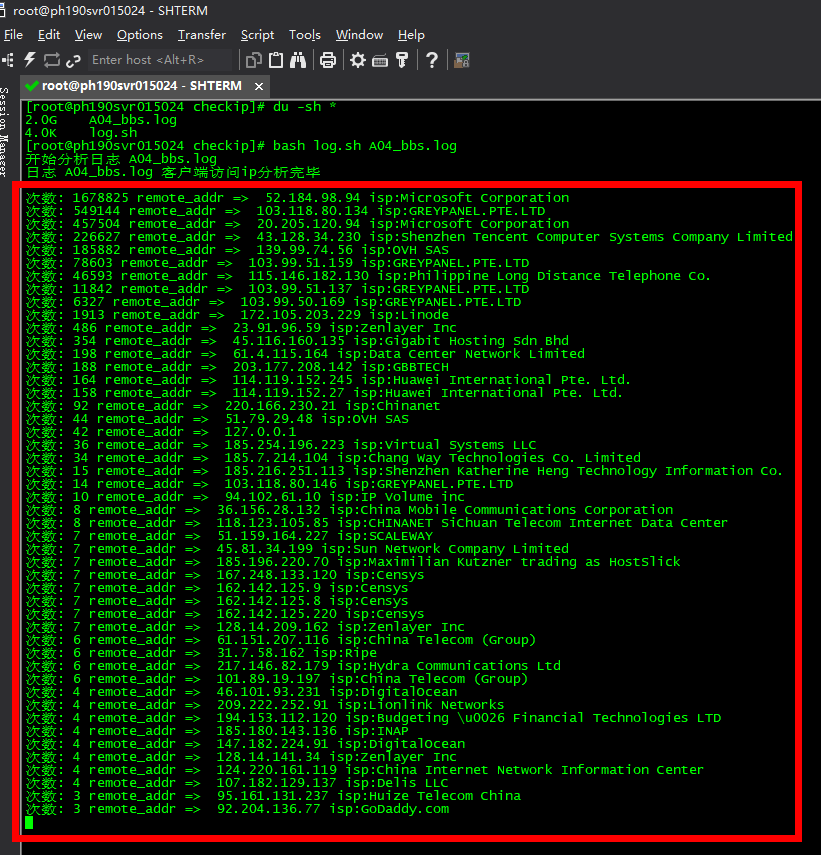

# 脚本分析 客户isp（防止来源国内机房的访问）



**REDME**

```
#服务器要有python 环境  并且能访问 ip-api.com
bash log.sh A04_bbs.log
```

**log.sh**

```bash
#!/bin/bash
echo "开始分析日志 $1" ; echo > .check.log ; split -l 50000 "$1" sp_nginx_log_
cat > .nginx-log.py <<EOF
#encoding:utf-8
with open('sp_nginx_log.log', 'r') as f:
    for line in (f.readlines()):
        line = line.strip()
        remote_addr = line.split('の')[2] #客户端地址
        print("remote_addr => ",remote_addr)
EOF
for log in `ls | grep 'sp_nginx_log_'`
do
 i=`ls | grep sp_nginx_log_ | wc -l`
 space48="                                                "
 str=""
 bgcolor=43
 percentstr=$(printf "%3s" $i)
 totalstr="${space48}${percentstr}${space48}"
 leadingstr="${totalstr:0:$i}"
 trailingstr="${totalstr:$i}"
 echo "正在分析日志 $1 ..."
 printf "\e[?25l"
 printf "\r\e[30;47m${leadingstr}\e[37;40m${trailingstr}\e[0m"
 mv $log sp_nginx_log.log
 python .nginx-log.py >> .check.log
 rm -f sp_nginx_log.log
 clear
done
echo "日志 $1 客户端访问ip分析完毕"
echo " "
cat .check.log | sort -rn | uniq -c | sort -rn | grep remote_addr | sed "s/(//g" | sed "s/)//g" | sed "s/'//g" | sed "s/,//g" > .tmp
cat .tmp | grep -v '1 remote_addr =>' | grep -v '2 remote_addr =>' | grep -v '3 remote_addr =>' | while read line #排除 1-3 次访问的
do ip=`echo ${line} | awk '{print $4}'`
 curl -s http://ip-api.com/json/$ip?lang=zh-CN | sed "s/{//g" | sed "s/}//g" | sed "s/\"//g" > .ip-api
 cat .ip-api | awk -F',' '{print $1}' > .status
 cat .ip-api | awk -F',' '{print $2}' > .country
 cat .ip-api | awk -F',' '{print $3}' > .countryCode
 cat .ip-api | awk -F',' '{print $4}' > .region
 cat .ip-api | awk -F',' '{print $5}' > .regionName
 cat .ip-api | awk -F',' '{print $6}' > .city
 cat .ip-api | awk -F',' '{print $7}' > .zDC02ode
 cat .ip-api | awk -F',' '{print $8}' > .lat
 cat .ip-api | awk -F',' '{print $9}' > .lon
 cat .ip-api | awk -F',' '{print $10}' > .timezone
 cat .ip-api | awk -F',' '{print $11}' > .isp
 cat .ip-api | awk -F',' '{print $12}' > .org
 cat .ip-api | awk -F',' '{print $13}' > .as
 cat .ip-api | awk -F',' '{print $14}' > .query
 echo "次数: ${line} `cat .isp` " ; done
```
