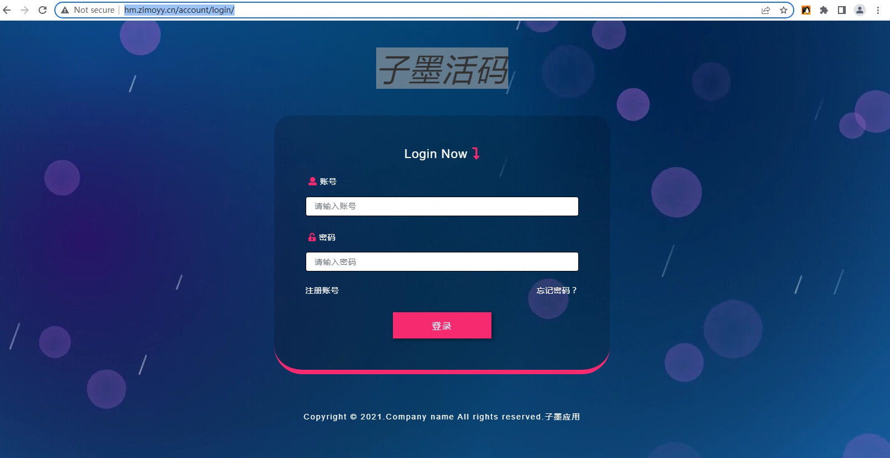
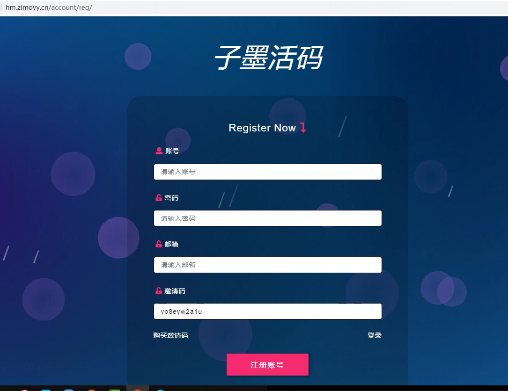
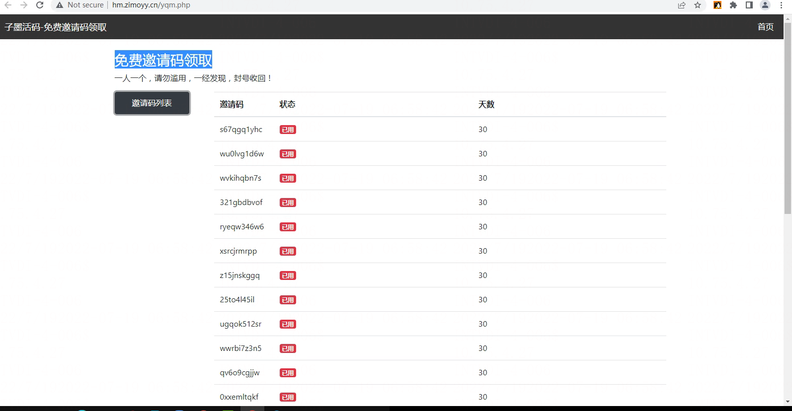
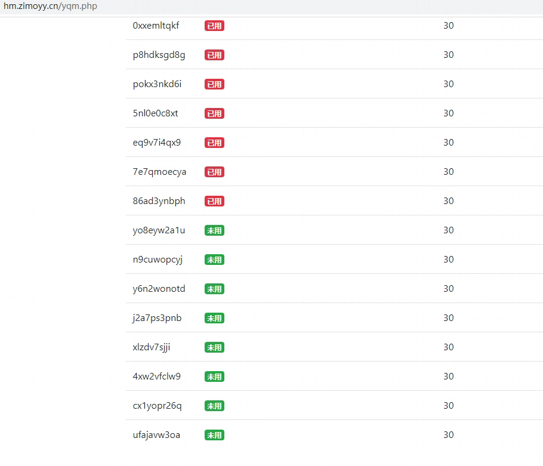

# 子墨活码

> GitHub 仓库源文件：[点击打开网页渲染版](https://github.com/ben2023niao/ben-ops-notes/blob/main/doc/md/202304141557-DevOps%20%E4%B8%8E%20SRE%2B%E4%BC%98%E5%8C%96%E6%96%B9%E6%A1%88%2BPHP%2B%E7%9F%A5%E8%AF%86%E7%AC%94%E8%AE%B0-%E5%AD%90%E5%A2%A8%E6%B4%BB%E7%A0%81.md)

子墨活码系统，可以生成微信群活码，客服活码，活动码等活码二维码，为社群营销裂变提供助力！

群活码，解决超过200人无法扫码入群与群码7天失效难题！支持微信和企业微信群码，多码自动切换、随时修改，对外宣传入口二维码不变。

客服码，保持对外宣传入口二维码不变，随时可更换微信号，防止微信号出问题后无法添加。

---

活码系统地址：[http://hm.zimoyy.cn](http://hm.zimoyy.cn/)
免费邀请码，需要的自取：<http://hm.zimoyy.cn/yqm.php>
客服微信：691618012

<http://hm.zimoyy.cn/account/login/>

<http://hm.zimoyy.cn/account/reg/>

## 免费邀请码领取
