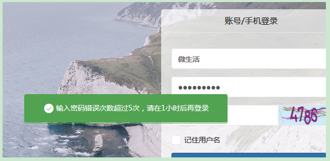
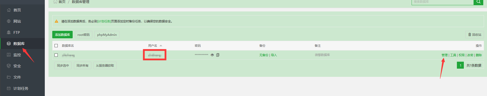
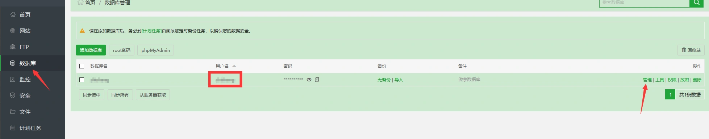
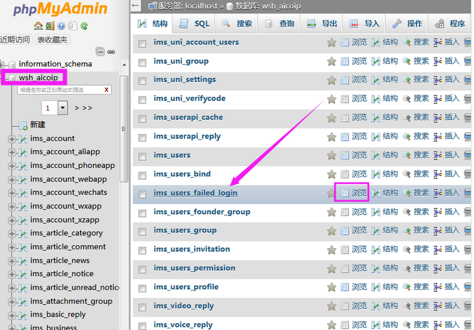
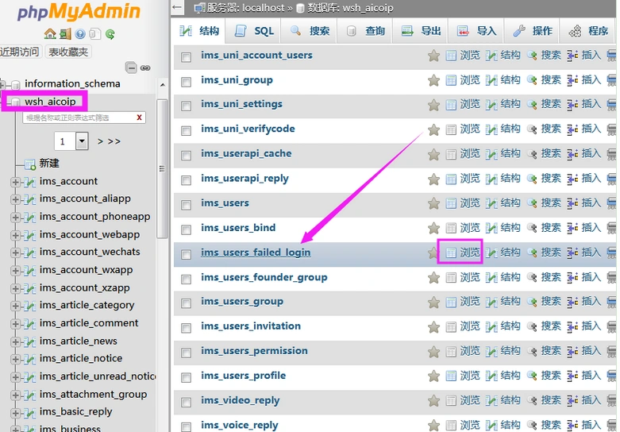
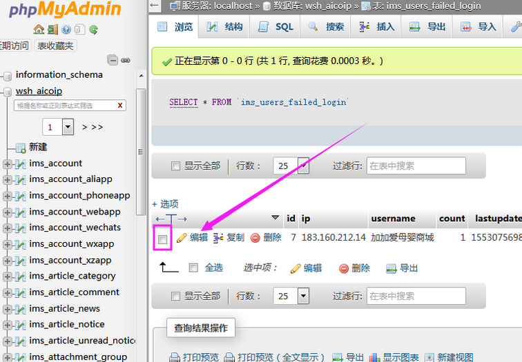
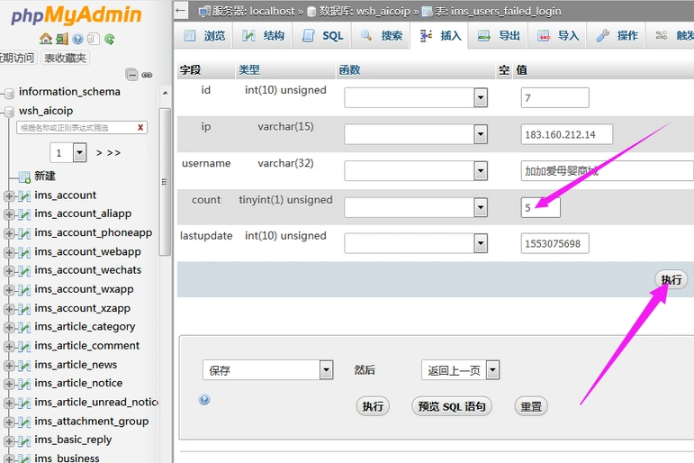

# 解决微擎“输入密码错误次数超过5次，请在1小时后再登录”

> GitHub 仓库源文件：[点击打开网页渲染版](https://github.com/ben2023niao/ben-ops-notes/blob/main/doc/md/202304141557-DevOps%20%E4%B8%8E%20SRE%2B%E4%BC%98%E5%8C%96%E6%96%B9%E6%A1%88%2BPHP%2B%E7%9F%A5%E8%AF%86%E7%AC%94%E8%AE%B0-%E8%A7%A3%E5%86%B3%E5%BE%AE%E6%93%8E%E2%80%9C%E8%BE%93%E5%85%A5%E5%AF%86%E7%A0%81%E9%94%99%E8%AF%AF%E6%AC%A1%E6%95%B0%E8%B6%85%E8%BF%875%E6%AC%A1%EF%BC%8C%E8%AF%B7%E5%9C%A81%E5%B0%8F%E6%97%B6%E5%90%8E%E5%86%8D%E7%99%BB%E5%BD%95%E2%80%9D.md)

## **今天一客户，他的微擎后台登录密码超过5次错误就提示：“输入密码错误次数超过5次，请在1小时后再登录”，**

如图：

---

**解决方法：**
利用phpmyadmin登录数据库，数据库中找到ims_users_failed_login表把count中的5改成1，然后就可以登录了。

---

## 第一步：进入宝塔面板，找到对应的数据库。

1. 如果最开始我配置好给你们之后，你们没有修改微擎登录的用户名的话，那数据库的用户名和你登录微擎的用户名是对应的。
2. 找到数据库后，点击**管理**

---

## 第二步：在数据库中，先在左边找到对应的管理员账号，然后找到这一个，然后点击**浏览**。

小技巧：直接按键盘的组合键：CTRL+F。就可以直接搜索：ims_users_failed_login

---

## 第三步：点击浏览之后，进入会进入这个，**先勾选**，然后点击**编辑**。

---

## 第四步：把这个 **5** , 改成 **1**，然后点击执行，这样就行了。
