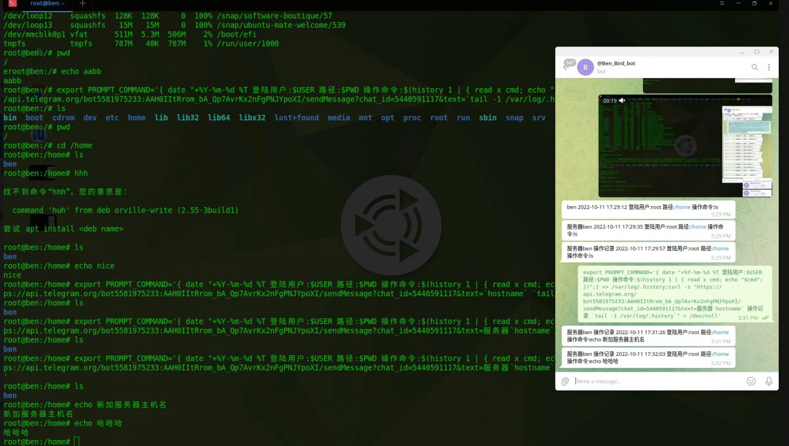
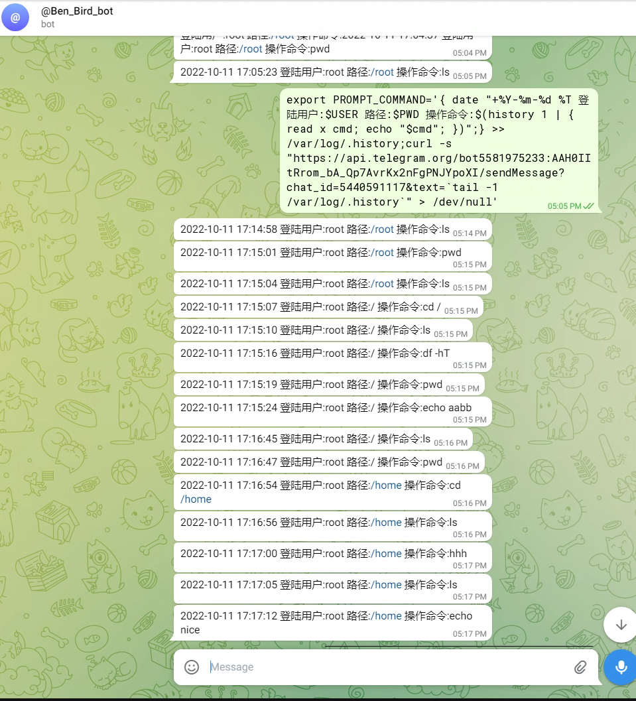

# 时时监控命令行操作 文件变化 登录行为 加密切片备份到飞机群

> GitHub 仓库源文件：[点击打开网页渲染版](https://github.com/ben2023niao/ben-ops-notes/blob/main/doc/md/202304141557-DevOps%20%E4%B8%8E%20SRE%2B%E4%BC%98%E5%8C%96%E6%96%B9%E6%A1%88%2BRedis%2BMySQL-%E6%97%B6%E6%97%B6%E7%9B%91%E6%8E%A7%E5%91%BD%E4%BB%A4%E8%A1%8C%E6%93%8D%E4%BD%9C%20%E6%96%87%E4%BB%B6%E5%8F%98%E5%8C%96%20%E7%99%BB%E5%BD%95%E8%A1%8C%E4%B8%BA%20%E5%8A%A0%E5%AF%86%E5%88%87%E7%89%87%E5%A4%87%E4%BB%BD%E5%88%B0%E9%A3%9E%E6%9C%BA%E7%BE%A4.md)



**check_cron.sh 定时任务监控脚本** 展开源码

```bash
#!/bin/bash
API="https://api.telegram.org/bot5581975233:AAH0IItRrom_bA_Qp7AvrKx2nFgPNJYpoXI" GID="chat_id=-848933756" #飞机机器人群ID
MSG="${API}/sendMessage?${GID}&text=" #发送文本方法
SF="$API/sendDocument?$GID -F document=@" #发送文件方法
NOW=$(date | awk -F' ' '{print $2" "$3}')

grep "$NOW" /var/log/cron > tomcat.log

grep '/web/A06/bbs/WebRoot/data/attachment/ /backup/attachment/' tomcat.log || echo '/web/A06/bbs/WebRoot/data/attachment/ /backup/attachment/ 今日没有执行备份'
grep '/web/A06/bbs/WebRoot/data/attachment/ /backup/attachment/' tomcat.log || curl -s $MAG"/web/A06/bbs/WebRoot/data/attachment/ /backup/attachment/ 今日没有执行备份" >/dev/null

grep 'web/A06/bbs/WebRoot/data/uc_server/ /backup/uc_server/' tomcat.log || echo 'web/A06/bbs/WebRoot/data/uc_server/ /backup/uc_server/    今日没有执行备份'
grep 'web/A06/bbs/WebRoot/data/uc_server/ /backup/uc_server/' tomcat.log || curl -s $MSG"web/A06/bbs/WebRoot/data/uc_server/ /backup/uc_server/    今日没有执行备份" >/dev/null
```

**ssh_history_telegram.sh 命令行操作时时报警到飞机群** 展开源码

```
#添加进 /etc/profile 然后 source /etc/profile 就生效了
export PROMPT_COMMAND='{ date "+%Y-%m-%d %T 登陆用户:$USER 路径:$PWD 操作命令:$(history 1 | { read x cmd; echo "$cmd"; })";} >> /var/log/.history;curl -s "https://api.telegram.org/bot5581975233:AAH0IItRrom_bA_Qp7AvrKx2nFgPNJYpoXI/sendMessage?chat_id=-848933756&text=服务器`hostname` 操作记录 `tail -1 /var/log/.history`" > /dev/null'
```

**ssh_history.sh 命令行记录到本地** 展开源码

```
#添加进 /etc/profile 然后 source /etc/profile 就生效了
export PROMPT_COMMAND='{ date "+%Y-%m-%d %T 登陆用户:$USER 路径:$PWD 操作命令:$(history 1 | { read x cmd; echo "$cmd"; })";} >> /var/log/.history'
```

**ssh_telegram.sh 用户ssh 登录报警到飞机群** 展开源码

```bash
#!/bin/bash
cat > /etc/ssh/sshrc << "EOF"
#编辑 /etc/ssh/sshrc 放入以下代码
USER=$(whoami)
HOSTNAME=$(hostname)
NOW=$(date '+%Y%m%d_%H_%M_%S')

CONTENT="$USER 登录到主机 $HOSTNAME 时间 $NOW. 触发监控"

RES=$(curl -X POST \
-F "chat_id=-848933756" \
-F "text=${CONTENT}" \
-o /dev/null --silent \
-w %{http_code} \
"https://api.telegram.org/bot5581975233:AAH0IItRrom_bA_Qp7AvrKx2nFgPNJYpoXI/sendMessage")
#每次登陆 SSH 后 Telegram Bot 都会发送一条通知给你
EOF

source /etc/ssh/sshrc
```

**check_file_change_telegram.sh 监控文件变动报警到飞机群** 展开源码

```bash
#!/bin/bash
API="https://api.telegram.org/bot5581975233:AAH0IItRrom_bA_Qp7AvrKx2nFgPNJYpoXI" GID="chat_id=-848933756" #飞机机器人群ID
MSG="${API}/sendMessage?${GID}&text=" #发送文本方法
SF="$API/sendDocument?$GID -F document=@" #发送文件方法

if type inotifywait >/dev/null 2>&1;then
echo ' inotifywait  ok'
else
echo 'no  inotifywait'
yum install inotify-tools -y
fi

echo 8192000 > /proc/sys/fs/inotify/max_user_watches
#yum install inotify-tools
#inotifywait -mrq --timefmt '%y/%m/%d %H:%M' --format '%T %w%f %e' --event delete,modify,create,attrib \
inotifywait -mrq --timefmt '%y/%m/%d %H:%M' --format '%T %w%f %e' --event delete,create \
/backup/ \
/bin/ \
/boot/ \
/data/ \
/domain/ \
/etc/ \
/home/ \
/lib/ \
/lib64/ \
/log/ \
/media/ \
/mnt/ \
/opt/ \
/root/ \
/sbin/ \
/soft/ \
/srv/ \
/tmp/ \
/usr/ \
/var/ \
/web/ |\
while read date time file event
do
text=$(echo "$HOSTNAME++$IP+文件++$file++监控到++$event++变动++时间++$date-$time++@ben_niao" | \
grep -v '/web/A06/bbs_new/WebRoot/data/attachment/image/' |\
grep -v '/data/mysql/' |\
grep -v '/var/tmp/' |\
grep -v '/var/log/audit/audit.log' |\
grep -v '/usr/local/openresty/nginx/logs/' |\
grep -v '/web/A04/bbs_vue/WebRoot/data/log/' |\
grep -v '/var/lib/' |\
grep -v '/var/log/redis/redis.log' |\
grep -v '/var/log/messages' |\
grep -v '/var/log/cron' |\
grep -v 'pki/nssdb/dbTemp' |\
grep -v '/web/A04/bbs_vue/WebRoot/data/template/' |\
grep -v '/web/A04/bbs_vue/WebRoot/de_fun_immwa_mod_core.php' |\
grep -v '/backup/backup/' |\
grep -v '/backup/attachment/image/' |\
grep -v '/web/A04/bbs_vue/WebRoot/data/sysdata/cache_domain.php' |\
grep -v '/tmp/MY' |\
grep -v '/tmp/cpu' |\
grep -v '/opt/threat_sonar/' |\
grep -v '/var/log/sa/' |\
grep -v '/var/cache/' |\
grep -v '/usr/local/bash/backups' |\
grep -v '/var/log/.history' |\
grep -v '/usr/local/bash/check_file_change.sh.log')

case $event in
MODIFY|CREATE|MOVE|MODIFY,ISDIR|CREATE,ISDIR|MODIFY,ISDIR|MOVED_FROM|MOVED_FROM,ISDIR|DELETE|DELETE,ISDIR)
echo "$text"
if [ "$text" ] ; then curl -s $MSG"$text" ; echo "$text" ; fi
#if [ "$text" ] ; then echo "$text" ; fi
;;
*)
if [ "$text" ] ; then echo "不匹配 $text" ; fi
;;
esac
done

#启动监控脚本命令 nohup bash /usr/local/bash/check_file_change_telegram.sh >> /usr/local/bash/check_file_change_telegram.sh.log &
#查看监控日志 tail -f check_file_change_telegram.sh.log
#结束监控脚本命令 ps -ef | grep check_file_change_telegram.sh | grep -v grep | awk '{print $2}' | xargs kill -9
```

**check_file_change.sh 监控文件变动到本地** 展开源码

```bash
#!/bin/bash
API="https://api.telegram.org/bot5581975233:AAH0IItRrom_bA_Qp7AvrKx2nFgPNJYpoXI" GID="chat_id=-848933756" #飞机机器人群ID
MSG="${API}/sendMessage?${GID}&text=" #发送文本方法
SF="$API/sendDocument?$GID -F document=@" #发送文件方法

if type inotifywait >/dev/null 2>&1;then
echo ' inotifywait  ok'
else
echo 'no  inotifywait'
yum install inotify-tools -y
fi

echo 8192000 > /proc/sys/fs/inotify/max_user_watches
#yum install inotify-tools
inotifywait -mrq --timefmt '%y/%m/%d %H:%M' --format '%T %w%f %e' --event delete,modify,create,attrib \
/backup/ \
/bin/ \
/boot/ \
/data/ \
/domain/ \
/etc/ \
/home/ \
/lib/ \
/lib64/ \
/log/ \
/media/ \
/mnt/ \
/opt/ \
/root/ \
/sbin/ \
/soft/ \
/srv/ \
/tmp/ \
/usr/ \
/var/ \
/web/ |\
while read date time file event
do
text=$(echo "$HOSTNAME++$IP+文件++$file++监控到++$event++变动++时间++$date-$time++@ben_niao" | \
grep -v '/web/A06/bbs_new/WebRoot/data/attachment/image/' |\
grep -v '/data/mysql/' |\
grep -v '/var/tmp/' |\
grep -v '/var/log/audit/audit.log' |\
grep -v '/usr/local/openresty/nginx/logs/' |\
grep -v '/web/A04/bbs_vue/WebRoot/data/log/' |\
grep -v '/var/lib/' |\
grep -v '/var/log/redis/redis.log' |\
grep -v '/var/log/messages' |\
grep -v '/var/log/cron' |\
grep -v 'pki/nssdb/dbTemp' |\
grep -v '/web/A04/bbs_vue/WebRoot/data/template/' |\
grep -v '/web/A04/bbs_vue/WebRoot/de_fun_immwa_mod_core.php' |\
grep -v '/backup/backup/' |\
grep -v '/backup/attachment/image/' |\
grep -v '/web/A04/bbs_vue/WebRoot/data/sysdata/cache_domain.php' |\
grep -v '/tmp/MY' |\
grep -v '/tmp/cpu' |\
grep -v '/opt/threat_sonar/' |\
grep -v '/var/log/sa/' |\
grep -v '/var/cache/' |\
grep -v '/usr/local/bash/backups' |\
grep -v '/var/log/.history' |\
grep -v '/usr/local/bash/check_file_change.sh.log')

case $event in
MODIFY|CREATE|MOVE|MODIFY,ISDIR|CREATE,ISDIR|MODIFY,ISDIR|MOVED_FROM|MOVED_FROM,ISDIR|DELETE|DELETE,ISDIR)
echo "$text"
#if [ "$text" ] ; then curl -s $MSG"$text" ; echo "$text" ; fi
if [ "$text" ] ; then echo "$text" ; fi
;;
*)
if [ "$text" ] ; then echo "不匹配 $text" ; fi
;;
esac
done

#启动监控脚本命令 nohup bash /usr/local/bash/check_file_change.sh >> /usr/local/bash/check_file_change.sh.log &
#查看监控日志 tail -f check_file_change.sh.log
#结束监控脚本命令 ps -ef | grep check_file_change.sh | grep -v grep | awk '{print $2}' | xargs kill -9
```

**back_to_telegram.sh 加密切片备份到飞机群** 展开源码

```bash
#!/bin/bash
API="https://api.telegram.org/bot5581975233:AAH0IItRrom_bA_Qp7AvrKx2nFgPNJYpoXI" GID="chat_id=-848933756" #飞机机器人群ID
MSG="${API}/sendMessage?${GID}&text=" #发送文本方法
SF="$API/sendDocument?$GID -F document=@" #发送文件方法
NOW=`date '+%Y%m%d_%H_%M_%S'`
randomid=$(cat /proc/sys/kernel/random/uuid) #系统随机函数
passwd=[已脱敏] $randomid | awk -F'-' '{print "benniao"$2$0$2$2}') #一级动态解压密码

mkdir -p /usr/local/bash/backups ; cd /usr/local/bash/backups #创建备份目录
########################################################################################################################
zip -q -r -P $passwd $HOSTNAME.btc.$NOW /web/A06/bbs_new/WebRoot/data/attachment/ /web/A06/bbs_new/WebRoot/data/uc_server/ #备份的文件夹
#zip -q -r -P $passwd $HOSTNAME.btc.$NOW  /web/A06/bbs_new/WebRoot/data/uc_server/  #备份的文件夹
########################################################################################################################

mkdir -p /usr/local/bash/backups/telegram
mv $HOSTNAME.btc.$NOW /usr/local/bash/backups/telegram
cd /usr/local/bash/backups/telegram
split -b 30m $HOSTNAME.btc.$NOW "btc_区块加密备份_$randomid" #大文件切片
mv $HOSTNAME.btc.$NOW /usr/local/bash/backups/
for s in `ls /usr/local/bash/backups/telegram/` ; do #发送加密备份切片到飞机
 curl -s $SF"/usr/local/bash/backups/telegram/$s"
 rm -f /usr/local/bash/backups/telegram/$s
done
 echo "$s 一级动态解压密码是 $passwd" > /usr/local/bash/backups/$HOSTNAME.btc.$NOW.txt #输出切片解密密码
#curl -s $MSG"$HOSTNAME.btc.$NOW++加密分割备份到飞机群成功++解压密码 $passwd @ben_niao"                    #备份到飞机成功通知
curl -s $MSG"$HOSTNAME.btc.$NOW++加密分割备份到飞机群成功++解压密码联系 @ben_niao" #备份到飞机成功通知
```
