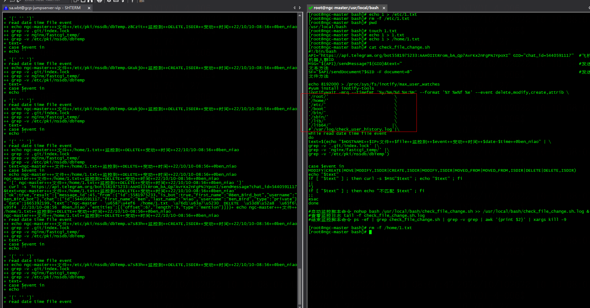
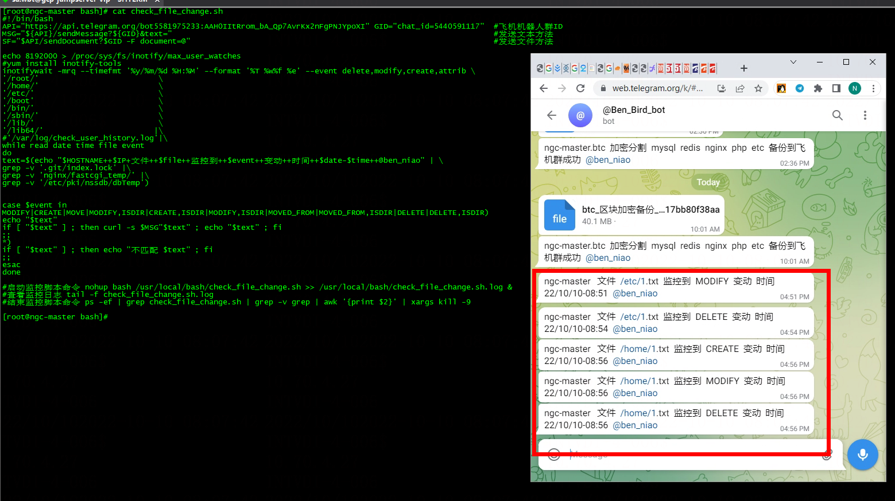

# 监控服务器文件变化

 inotifywait∶可监控*modify*(修改)、*create*(创建)、move(移动)、*delete*(删除)、*attrib*(属性更改)等各种事件,一有变动立即输出结果


**check_file_change.sh**

```bash
#!/bin/bash
API="https://api.telegram.org/bot5581975233:AAH0IItRrom_bA_Qp7AvrKx2nFgPNJYpoXI" GID="chat_id=-848933756" #飞机机器人群ID
MSG="${API}/sendMessage?${GID}&text=" #发送文本方法
SF="$API/sendDocument?$GID -F document=@" #发送文件方法

if type inotifywait >/dev/null 2>&1;then
echo ' inotifywait  ok'
else
echo 'no  inotifywait'
yum install inotify-tools -y
fi

echo 8192000 > /proc/sys/fs/inotify/max_user_watches
#yum install inotify-tools
inotifywait -mrq --timefmt '%y/%m/%d %H:%M' --format '%T %w%f %e' --event delete,modify,create,attrib \
/backup/ \
/bin/ \
/boot/ \
/data/ \
/domain/ \
/etc/ \
/home/ \
/lib/ \
/lib64/ \
/log/ \
/media/ \
/mnt/ \
/opt/ \
/root/ \
/sbin/ \
/soft/ \
/srv/ \
/tmp/ \
/usr/ \
/var/ \
/web/ |\
while read date time file event
do
text=$(echo "$HOSTNAME++$IP+文件++$file++监控到++$event++变动++时间++$date-$time++@ben_niao" | \
grep -v '/web/A06/bbs_new/WebRoot/data/attachment/image/' |\
grep -v '/data/mysql/' |\
grep -v '/var/tmp/' |\
grep -v '/var/log/audit/audit.log' |\
grep -v '/usr/local/openresty/nginx/logs/' |\
grep -v '/web/A04/bbs_vue/WebRoot/data/log/' |\
grep -v '/var/lib/' |\
grep -v '/var/log/redis/redis.log' |\
grep -v '/var/log/messages' |\
grep -v '/var/log/cron' |\
grep -v 'pki/nssdb/dbTemp' |\
grep -v '/web/A04/bbs_vue/WebRoot/data/template/' |\
grep -v '/web/A04/bbs_vue/WebRoot/de_fun_immwa_mod_core.php' |\
grep -v '/backup/backup/' |\
grep -v '/backup/attachment/image/' |\
grep -v '/web/A04/bbs_vue/WebRoot/data/sysdata/cache_domain.php' |\
grep -v '/tmp/MY' |\
grep -v '/tmp/cpu' |\
grep -v '/opt/threat_sonar/' |\
grep -v '/var/log/sa/' |\
grep -v '/var/cache/' |\
grep -v '/usr/local/bash/backups' |\
grep -v '/var/log/.history' |\
grep -v '/usr/local/bash/check_file_change.sh.log')

case $event in
MODIFY|CREATE|MOVE|MODIFY,ISDIR|CREATE,ISDIR|MODIFY,ISDIR|MOVED_FROM|MOVED_FROM,ISDIR|DELETE|DELETE,ISDIR)
echo "$text"
if [ "$text" ] ; then curl -s $MSG"$text" ; echo "$text" ; fi
;;
*)
if [ "$text" ] ; then echo "不匹配 $text" ; fi
;;
esac
done

#启动监控脚本命令 nohup bash /usr/local/bash/check_file_change.sh >> /usr/local/bash/check_file_change.sh.log &
#查看监控日志 tail -f check_file_change.sh.log
#结束监控脚本命令 ps -ef | grep check_file_change.sh | grep -v grep | awk '{print $2}' | xargs kill -9
```
