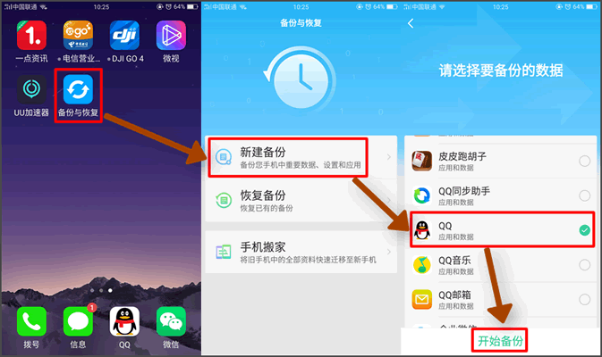
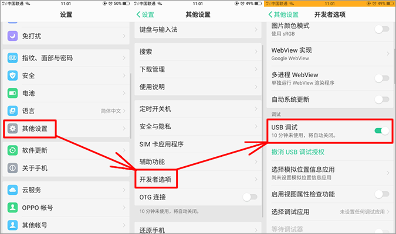
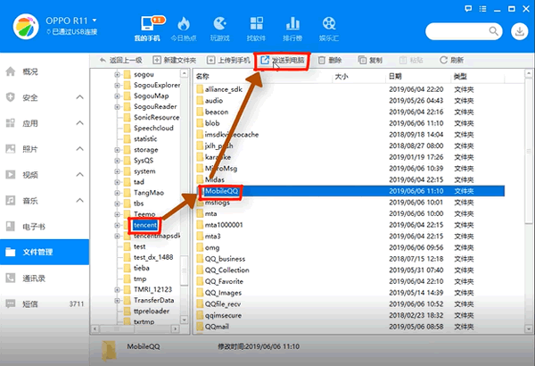
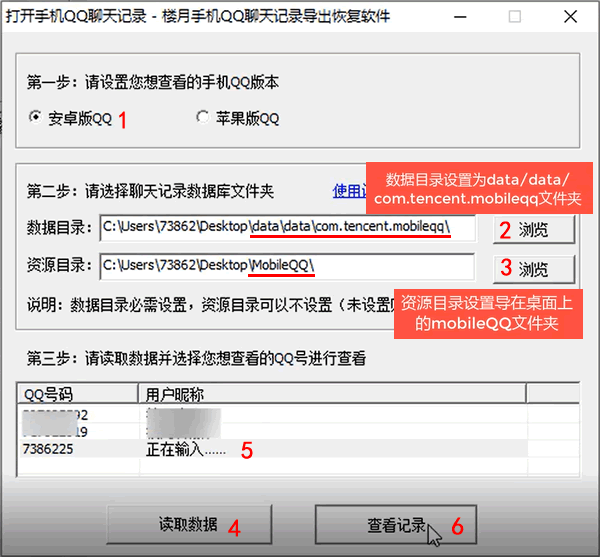
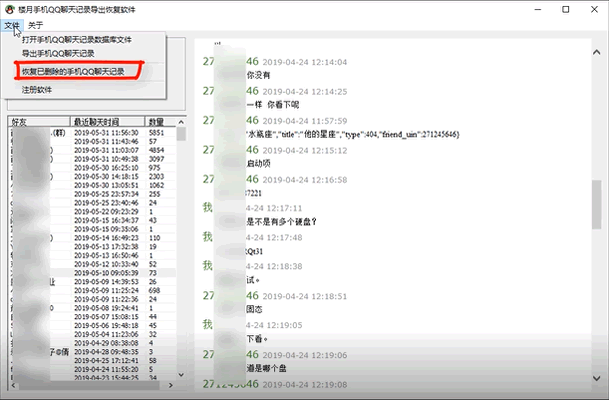

# OPPO手机QQ聊天记录如何导出电脑查看【免ROOT】

> GitHub 仓库源文件：[点击打开网页渲染版](https://github.com/ben2023niao/ben-ops-notes/blob/main/doc/md/202304141557-DevOps%20%E4%B8%8E%20SRE%2B%E4%BC%98%E5%8C%96%E6%96%B9%E6%A1%88%2B%E5%A4%87%E4%BB%BD%E6%81%A2%E5%A4%8D%2B%E7%9F%A5%E8%AF%86%E7%AC%94%E8%AE%B0-OPPO%E6%89%8B%E6%9C%BAQQ%E8%81%8A%E5%A4%A9%E8%AE%B0%E5%BD%95%E5%A6%82%E4%BD%95%E5%AF%BC%E5%87%BA%E7%94%B5%E8%84%91%E6%9F%A5%E7%9C%8B%E3%80%90%E5%85%8DROOT%E3%80%91.md)

很多QQ用户想把自己OPPO手机QQ聊天记录导出到电脑上进行查看或打印，却不知道如何操作，其实操作方法并不难，并且不需要对手机进行ROOT，具体操作步骤如下 ：

**OPPO手机QQ聊天记录导出到电脑视频教程：<https://louyue.com/video/oppoqq.mp4>**

1，打开OPPO手机，进入到手机自带的“备份与恢复”应用程序，新建备份，选择我们需要的QQ进行备份。
说明：如果手机上安装有“手机搬家”软件的话，需要先将“手机搬家”软件卸载，再运行“备份与恢复”软件。如果不删除“手机搬家”的话，会导致无法备份手机QQ聊天记录。

2，进入手机设置，其它设置，开发员选项，将里面的USB调试功能打开，再将手机通过数据线连接到电脑上。

3，接下来到电脑上运行360手机助手软件（可在百度上搜索下载），进入文件管理/Backup/App，将这里面刚才我们通过手机备份好的com.tencent.mobileqq.tar文件发送到电脑上并将其解压。

4，同样再通过360手机助手，进入文件管理，找到Tencent文件夹，将这里面的MobileQQ文件夹发送到电脑上。
注：如果此文件夹过大可能会发送失败，如果发送失败可到手机上的文件管理app中将这个文件夹进行压缩后再发送到电脑，再在电脑上进行解压即可。

5，到电脑上运行楼月手机QQ聊天记录导出恢复软件（[点击此处下载](https://louyue.com/down/louyueshoujiqq.rar)），在打开的设置窗口中设置为安卓版QQ，再将数据目录设置为从com.tencent.mobileqq.tar文件解压出来的data/data/com.tencent.mobileqq文件夹。而资源目录则设置从Tencent文件夹中导出的MobileQQ文件夹即可。设置好后再点读取数据按钮，再到上面用户列表中选择要查看的QQ号点击查看记录按钮即可查看到所有QQ内容。

6，最后如果还想要将删除过的QQ聊天记录恢复回来的话，只需要再点击文件，恢复已删除的QQ聊天记录菜单，再等待其恢复完成即可。
说明：数据恢复并不能保证100%恢复所有删除的内容，恢复几率在0%-100%之间均有可能，请知悉。

