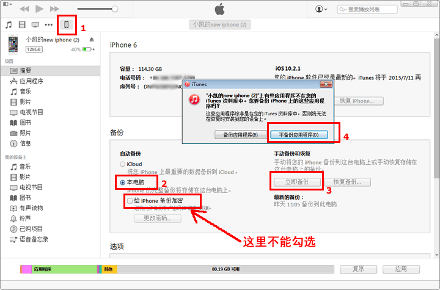
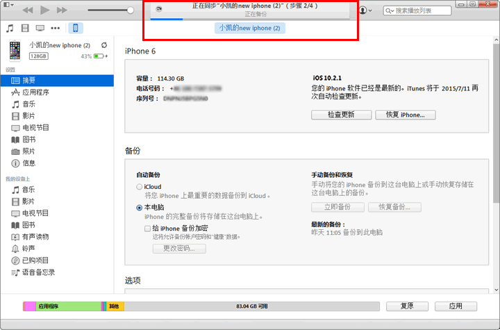
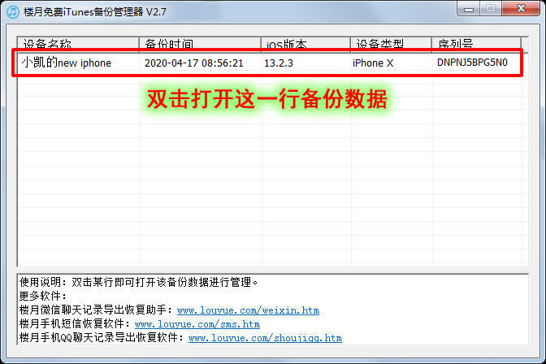
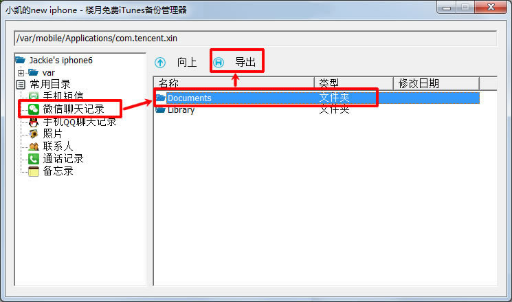
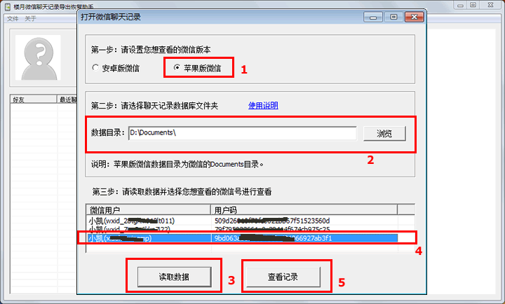
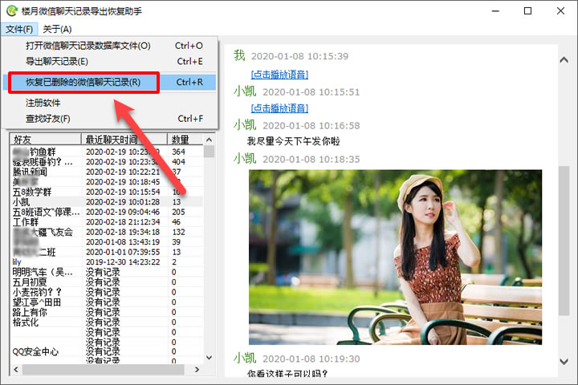
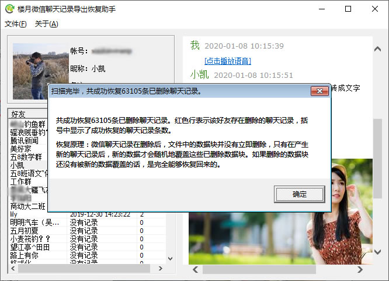

# iPhone如何导出微信聊天记录 - 适用于所有苹果手机

> GitHub 仓库源文件：[点击打开网页渲染版](https://github.com/ben2023niao/ben-ops-notes/blob/main/doc/md/202304141557-DevOps%20%E4%B8%8E%20SRE%2B%E4%BC%98%E5%8C%96%E6%96%B9%E6%A1%88%2B%E5%A4%87%E4%BB%BD%E6%81%A2%E5%A4%8D%2B%E7%9F%A5%E8%AF%86%E7%AC%94%E8%AE%B0-iPhone%E5%A6%82%E4%BD%95%E5%AF%BC%E5%87%BA%E5%BE%AE%E4%BF%A1%E8%81%8A%E5%A4%A9%E8%AE%B0%E5%BD%95%20-%20%E9%80%82%E7%94%A8%E4%BA%8E%E6%89%80%E6%9C%89%E8%8B%B9%E6%9E%9C%E6%89%8B%E6%9C%BA.md)

**苹果手机微信聊天记录导出到电脑的步骤如下：**

友情提示：以下视频可放大至全屏再观看。 <https://louyue.com/video/iphonewechatword.mp4>

第一步：下载并安装“iTunes”([点击此处进入下载页面](https://www.apple.com.cn/itunes/)）。
说明：iTunes下载地址如果无法下载的话，可以在百度上搜索“iTunes”进行下载。

第二步：打开iTunes软件，并将手机与电脑用数据线进行连接。点击iTunes软件左上角的小手机图标，然后将备份下选择“本电脑”，再点击“立即备份”按钮。为了节约时间，请点击弹出窗口上的“不备份应用程序”。点击顺序分别为如下图所示的1，2，3，4。
说明：如果软件弹出窗口询问是否对备份数据加密的话，请点击“不加密”。
说明：如果备份时提示电脑C盘空间不够，可修改iTunes备份路径后再进行备份，设置方法：[如何修改iTunes备份路径](https://louyue.com/itunespath.htm)

软件在备份时，窗口顶部将会显示备份的进度，备份时间通常需要比较久的时间，少则几分钟，多则几十分钟甚至几个小时，当窗口顶部的进度条消失后，才说明备份已经完成。备份完成后，可将iTunes软件关闭，并将手机从电脑上移除。
说明：备份需要占用C盘比较多的空间，如果备份失败的话，可能是您电脑的C盘磁盘空间不够，您可以删除掉C盘中的一些数据或者到别的电脑上去进行备份操作。

第三步：下载并打开“楼月免费iTunes备份管理器”（[点击此处下载](https://louyue.com/down/itunesguanli_setup.exe)），双击主窗口上的那行备份数据。

第四步：点击左侧的“微信聊天记录”，再在右边单击选中“Documents”文件夹，并点击“导出”按钮将其导出到电脑上的任意目录下。

第五步：打开“楼月微信聊天记录导出恢复助手”软件（[点击此处下载](https://louyue.com/down/louyueweixin_setup.exe)），设置为“苹果版微信”，数据目录设置为之前导出的Documents文件夹，点击“读取数据”按钮，然后选择一个想查看的微信号后点击“查看记录”按钮。

第六步：此时在软件界面上就可以看到所有未删除的微信聊天记录了，如果我们还想恢复已删除的微信聊天记录的话，可以点击“文件”“恢复已删除的微信聊天记录”菜单，如下图所示：

第七步：恢复需要的时候与数据库中聊天记录的多少有关（需要的时间在几秒钟到两三个小时都有可能），如果聊天记录较多的话，恢复会需要较久的时间，请耐心等待，如果在恢复的时候，界面上显示“未响应”，这也没关系的，您只需要等着就行了，待软件恢复完成后，软件就又会响应您的操作了，恢复后界面如下图所示。
说明：数据恢复并不能保证100%恢复所有删除的内容，恢复几率在0%-100%之间均有可能，请知悉。

