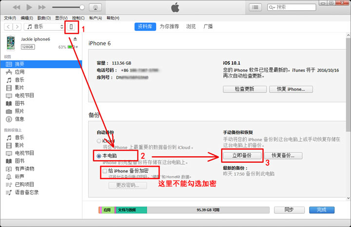
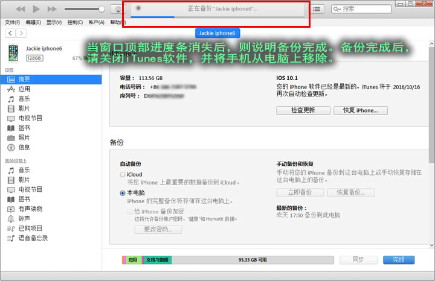
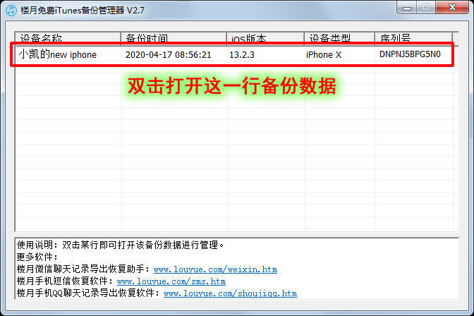
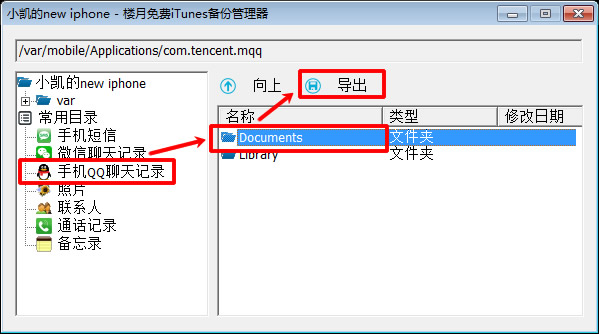
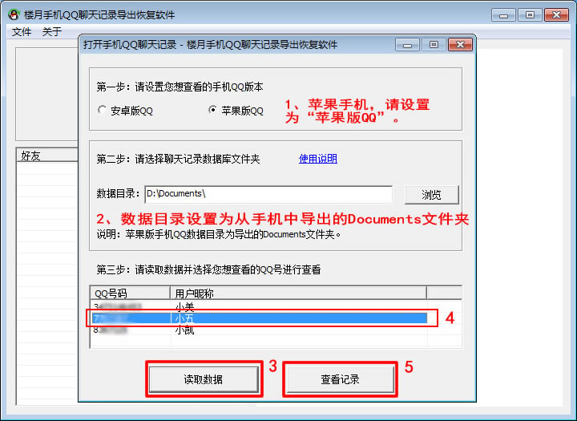
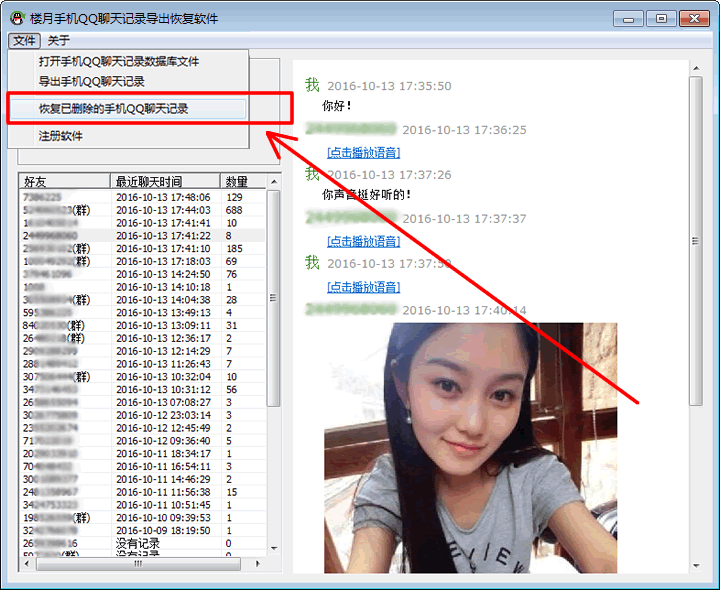
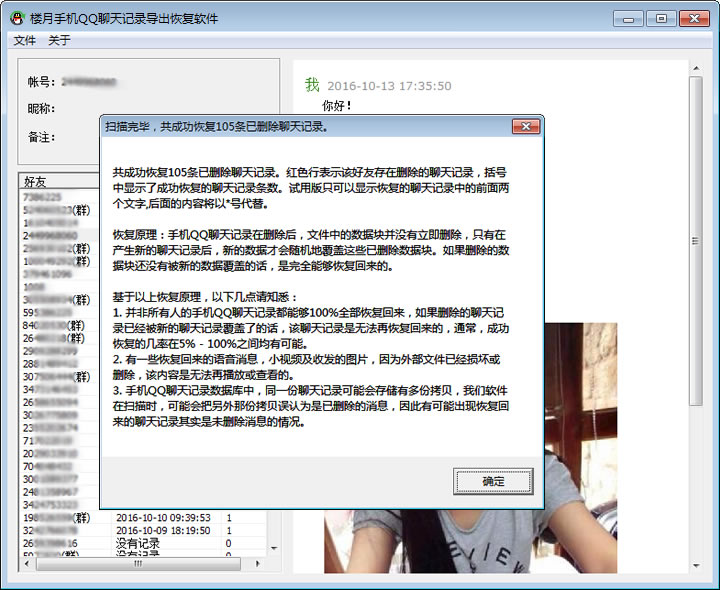

# iphone手机QQ聊天记录恢复

楼月手机QQ聊天记录导出恢复软件下载地址：[本地下载1](https://louyue.com/down/louyueshoujiqq.rar)

本软件能够在电脑上查看苹果手机中登陆过的手机QQ号码与好友的QQ聊天记录，还可以在电脑上尝试恢复自己手机中不小心删除的聊天内容，支持所有iPhone手机，也支持所有iPad平板电脑，支持几乎所有版本的iOS系统。

**苹果手机QQ聊天记录导出查看及恢复方法：<https://louyue.com/video/iphoneqqword.mp4>**

1，将苹果手机连接到电脑上，并打开电脑上的iTunes软件（[点击此处进入iTunes软件下载页面](https://www.apple.com.cn/itunes/)），接着点击iTunes软件左上角的小手机图标后，选择“本电脑”，再点击“立即备份”按钮。
说明1：如果iTunes弹出窗口询问是否备份应用程序的话，请点击“不备份应用程序”，如果询问是否对备份数据加密的话，请点击“不加密”。
说明2：如果备份时提示电脑C盘空间不够，可修改iTunes备份路径后再进行备份，设置方法：[如何修改iTunes备份路径](https://louyue.com/itunespath.htm)

2，苹果手机数据备份需要一定的时间，请耐心等待。当窗口顶部进度条消失后，则说明备份完成。备份完成后，请关闭iTunes软件，并把苹果手机从电脑上移除。

3，打开电脑上的“楼月免费iTunes备份管理器”软件（[点击此处下载](https://louyue.com/down/itunesguanli_setup.exe)），双击打开主窗口上看到的刚备份下来的数据。

4，点击左侧的“手机QQ聊天记录”，然后将右边面板中的“Documents”文件夹导出到电脑上任意目录下。

5，打开“楼月手机QQ聊天记录导出恢复软件”（可在本网页顶部的下载地址1处进行下载），QQ版本设置为“苹果版QQ”，数据目录设置为前面导出的Documents文件夹。接下来点击“读取数据”按钮，软件会对数据目录中的所有文件进行分析，然后将所有在该手机上登陆过的QQ号码及用户昵称显示在上方的列表中，我们选择一个想查看及恢复QQ聊天记录的QQ号码后，点击“查看记录”按钮。

6，此时，软件界面上就可以查看到与所有好友的QQ聊天记录了，我们接着点击“恢复已删除的手机QQ聊天记录”菜单对删除的数据进行恢复。
说明：左侧好友列表中，如果QQ号码后面加了“（群）”字样，则说明该号码为QQ群号码。

7，稍等一段时间后，苹果手机上以前删除的QQ聊天记录就被成功恢复了。
说明：数据恢复并不能保证100%恢复所有删除的内容，恢复几率在0%-100%之间均有可能，请知悉。

