# 华为手机QQ聊天记录如何导出电脑查看【免ROOT】,含文字语音等

很多人想把华为手机QQ聊天记录导出到电脑上进行查看或长期保存，其实方法并不难，您只需要按照以下视频教程或图文教程的步骤进行操作，就可以在免ROOT的情况下导出华为手机QQ消息中的所有文字，语音等聊天内容。

**华为手机QQ聊天记录导出到电脑视频教程：<https://louyue.com/video/huaweiqq.mp4>**

1，打开华为手机系统自带的备份app，按下图所示点击“备份”，“内部存储”，再点击进入“应用”列表（并非勾选“应用”）。
说明：如果备份app中找不到“内部存储”项的话，说明该手机上安装的是9.0及以后的新版备份软件，需要先在手机中将其卸载，然后安装8.0版的备份软件（可在手机上打开本网页，再[点击此处下载华为备份8.0软件](https://louyue.com/down/huaweibeifen8.0.apk)）。

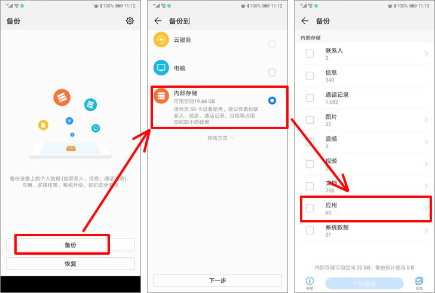

2，在弹出的应用列表窗口中勾选上“QQ”并点击“开始备份”按钮，然后在弹出的设置密码界面不要输入任何密码，直接点击“跳过”按钮。

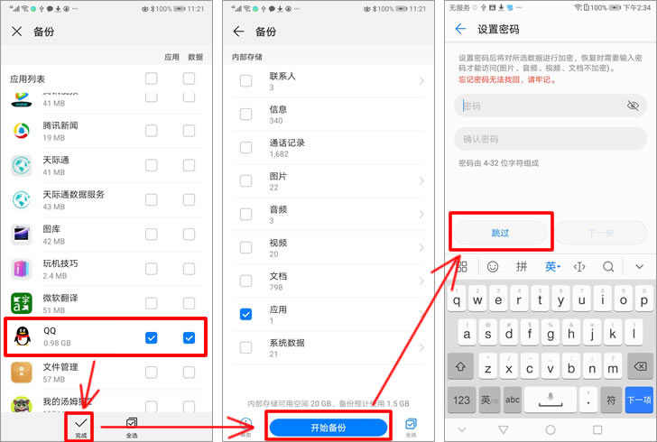

3，备份结束后，接下来将华为手机用数据线连接到电脑上，进入手机盘符下的“Huawei/Backup/backupFiles/备份时间”文件夹，可看到刚才备份下来的com.tencent.mobileqq.db文件，将其复制并粘贴到电脑上任意文件夹下。

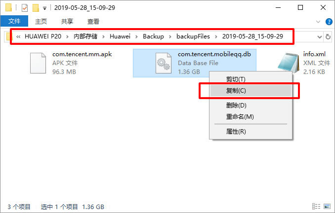

4，在电脑上安装并运行楼月安卓手机备份文件提取器（[点击此处下载](https://louyue.com/down/androidtiqu_setup.exe)），备份文件设置为刚才从手机盘符中复制到电脑上的com.tencent.mobileqq.db文件，然后设置一个输出目录（下图中我将其设置为提取到电脑桌面上），最后点击“开始提取”按钮，提取可能需要比较久的时间，请耐心等待其提取结束。
说明：开始提取前，软件会提示是否只提取有用数据，为了减少提取所需时间，请点击“是”按钮。

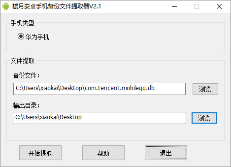

5，再次进入手机盘符下的tencent文件夹，并将该目录下的MobileQQ文件夹复制到电脑上。
说明1：复制后，不能关闭tencent文件夹，否则会导致粘贴失败，或丢失语音消息文件。
说明2：如果手机QQ聊天记录中的数据特别多，导致MobileQQ文件夹特别大，始终无法成功粘贴到电脑上的话，则请先到手机中打开“文件管理”app，进入tencent目录，对MobileQQ压缩后，再将压缩文件复制到电脑上并解压，这样就不会有文件丢失（详细操作步骤见本网页上的视频教程）。

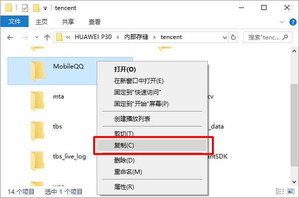

6，在电脑上下载并打开楼月手机QQ聊天记录导出恢复软件（[点击此处下载](https://louyue.com/down/louyueshoujiqq.rar)），手机QQ版本设置为“安卓版QQ”，数据目录设置为从楼月安卓手机备份文件提取器中提取出来的data/data/com.tencent.mobileqq目录，资源目录则设置为从手机盘符下的tencent文件夹中复制出来的MobileQQ文件夹。点击“读取数据”按钮，并选择一个想导出手机QQ聊天记录的QQ号，最后点击“查看记录”按钮。

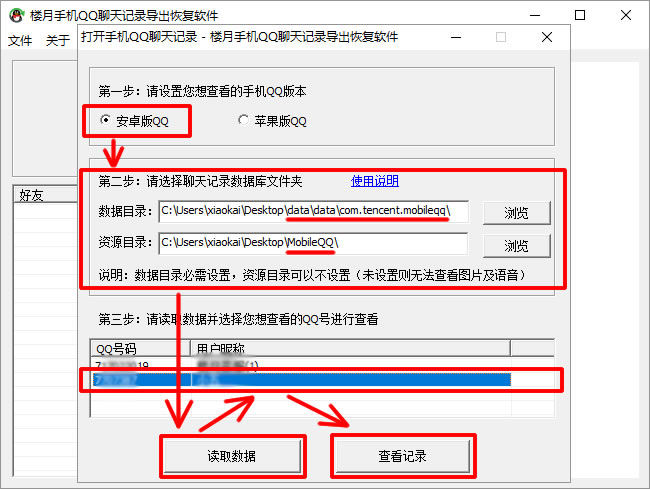

7，用鼠标选中要导出的手机QQ聊天记录（也可按Ctrl+A全选与该好友的全部聊天记录），再按Ctrl+C进行复制。

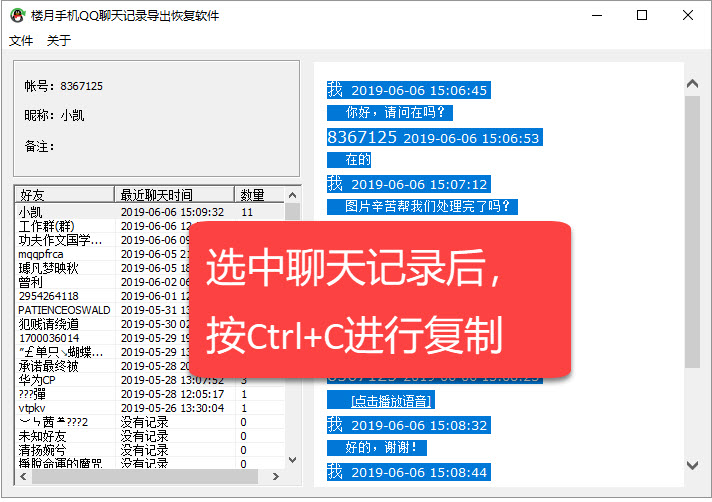

8，新建一个Word文档，并将复制的手机QQ聊天记录粘贴到Word文档里面就可以了。如果有需要的话，可以在Word文档中对其进行编辑（如删除不需要的QQ聊天记录），再用打印机对其进行打印。

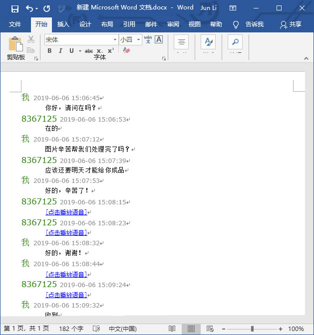

9，另外也可以点击软件界面上的“文件”，“导出手机QQ聊天记录”菜单，来批量导出手机QQ聊天记录中的所有文字，语音消息等。

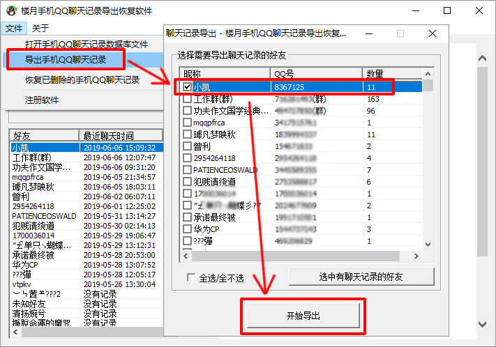

10，导出的聊天记录为htm网页格式，双击后即可使用电脑上的默认浏览器将其打开（如360浏览器，Google Chrome浏览器），在上面可以直接查看与某好友的所有手机QQ聊天记录，也可直接在上面播放收发的手机QQ语音消息。

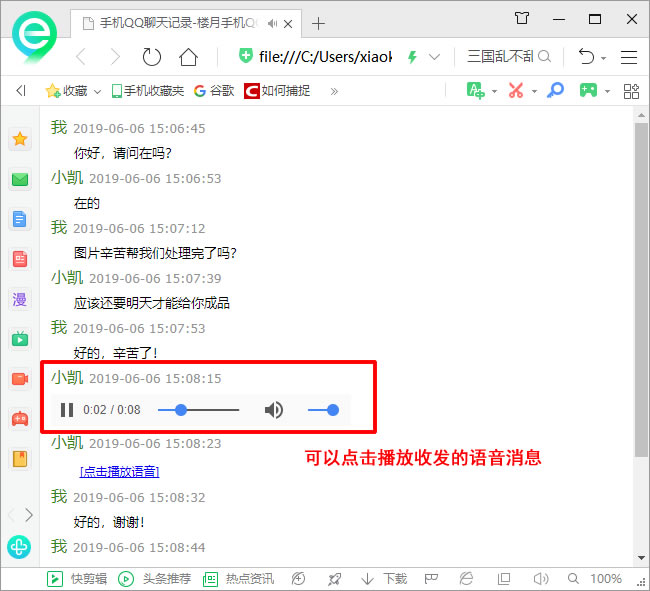

11，在导出目录下的voice文件夹中，会看到华为手机QQ语音消息导出为了wav格式外部文件，音频文件以聊天时的日期时间进行命名，因此自动按聊天先后顺序进行了排序。
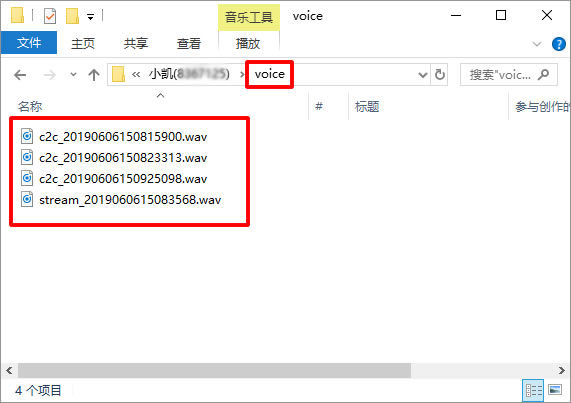
