# 华为手机微信聊天记录导出电脑(免ROOT)

> GitHub 仓库源文件：[点击打开网页渲染版](https://github.com/ben2023niao/ben-ops-notes/blob/main/doc/md/202304141557-DevOps%20%E4%B8%8E%20SRE%2B%E4%BC%98%E5%8C%96%E6%96%B9%E6%A1%88%2B%E5%A4%87%E4%BB%BD%E6%81%A2%E5%A4%8D%2B%E7%9F%A5%E8%AF%86%E7%AC%94%E8%AE%B0-%E5%8D%8E%E4%B8%BA%E6%89%8B%E6%9C%BA%E5%BE%AE%E4%BF%A1%E8%81%8A%E5%A4%A9%E8%AE%B0%E5%BD%95%E5%AF%BC%E5%87%BA%E7%94%B5%E8%84%91%28%E5%85%8DROOT%29.md)

## 华为手机微信聊天记录如何导出到电脑,免ROOT,含文字图片语音消息

本教程将教您如何导出自己华为手机中的微信聊天记录，可将聊天内容导出到Word文档中打印，也可将所有文字，图片，语音消息，视频，转发的记录，及收发的文件快速批量导出到任意文件夹中。

 **华为手机微信聊天记录导出到电脑视频教程：<https://louyue.com/video/huaweiwechat.mp4>

1，把华为手机连接到电脑上，手机上弹出窗口询问USB的用途，需要选择“传输文件”。**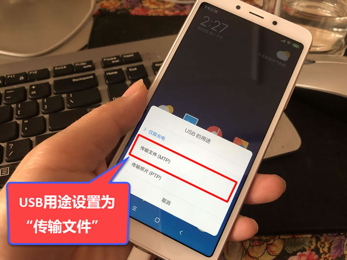

2，在电脑上安装并运行“华为手机助手”软件（下载地址：[官方下载](https://consumer.huawei.com/cn/support/hisuite/)），按提示输入手机上显示的验证码进行连接。
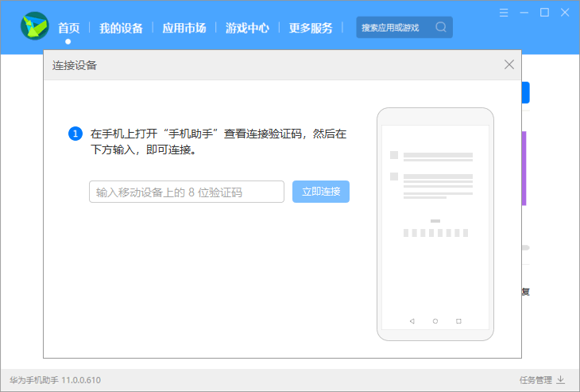

3，连接成功后点击左下方的“数据备份”。

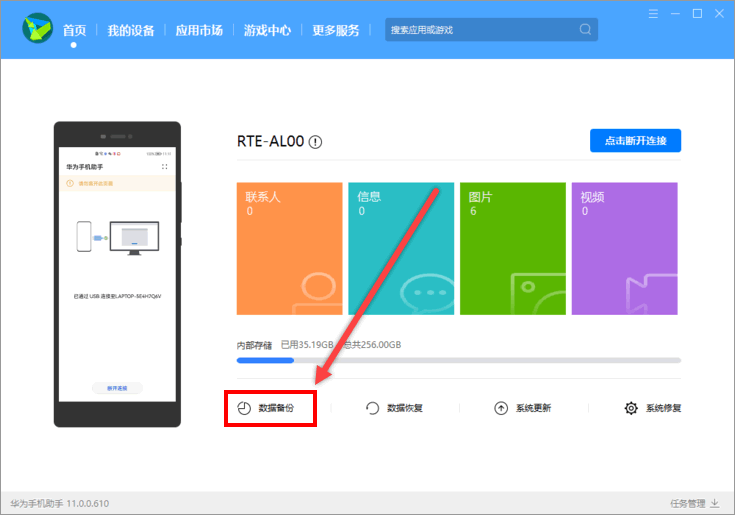

4，记住上方的备份路径，也可点击后方的修改按钮来修改该备份路径，接着点击下方的“应用及数据”。

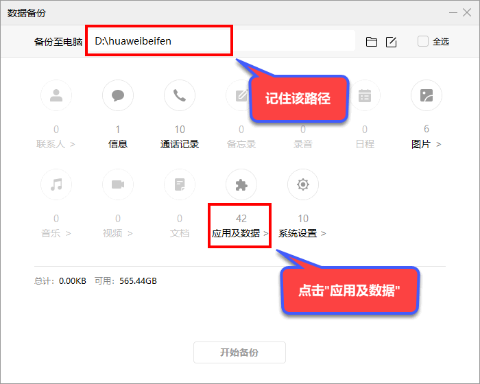

5，勾选上微信后方的两个复选框，再点击“确定”按钮。

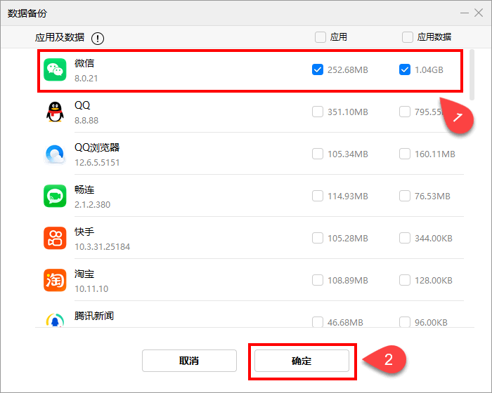

6，点击“开始备份”按钮，然后软件会提示建议使用微信，QQ官方工具备份，我们可以不用管它，待其倒计时结束后，点击“知道了”即可。

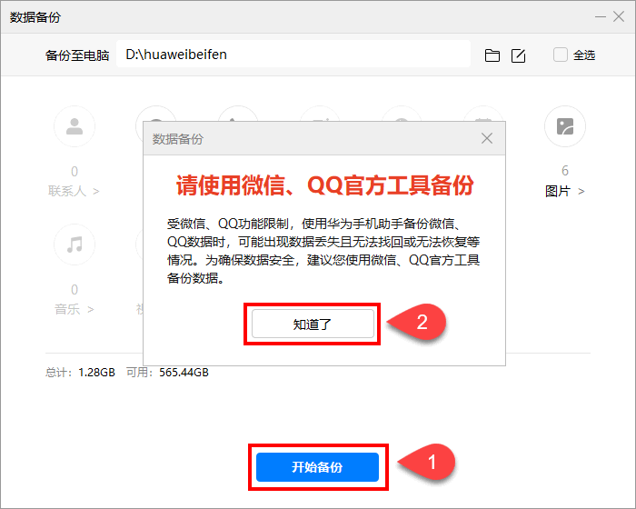

7，接着设置一个备份的密码，您需要记住这个密码，因为在后面的步骤中，还需要再输入该密码对备份数据解密。耐心等待备份结束后，即可将华为手机助手软件关闭。

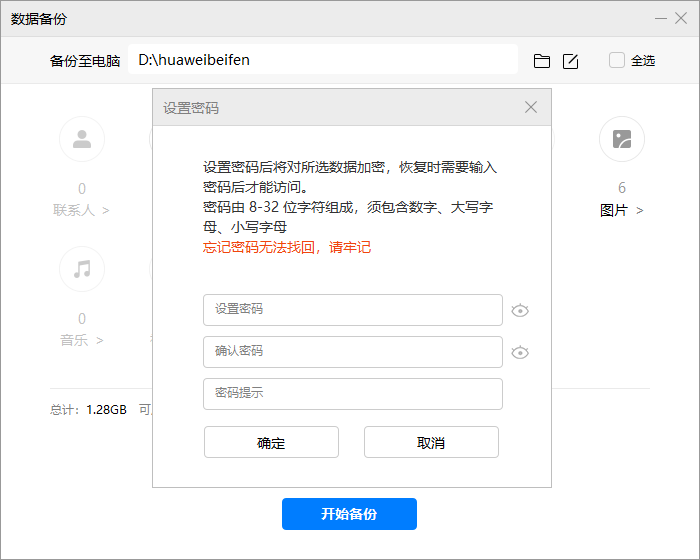

8，在电脑上安装并运行“楼月安卓手机备份文件提取器”（下载地址：[本地下载1](https://louyue.com/down/androidtiqu_setup.exe)），手机类型设置为“新款华为手机（备份已加密）”，备份路径设置为刚才备份好的手机数据所在路径，输出目录则设置一个保存输出文件的路径，备份密码则设置为之前备份时设置的密码，设置好后点击“开始提取”按钮，待其提取结束后，将该软件关闭。
说明1：如果提取时出现错误信息，是因为微信中聊天记录太多，导致提取时内存不足引起的，你只需要给电脑C盘或D盘设置4096MB - 8192MB的虚拟内存，然后重启电脑即可正常提取，具体设置方法请[点击此处进行查看](https://louyue.com/vm.htm)。
说明2：请尽量在Win8, Win10, Win11电脑上使用该软件，该软件对XP系统及Win7系统不是很兼容。

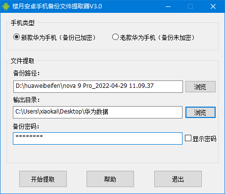

9，进入输出目录下的storage文件夹，全选所有后缀为tar的文件，然后右击后点击“解压到当前文件夹”。
说明：可能您电脑上的tar文件会比下图多，注意一定要选中所有的tar文件，如果文件夹窗口右边有滚动条的话，可以选中第1个tar文件，然后按住键盘上的Shift键，将滚动条拖动到最底部，再选中最后一个tar文件，这样，就全选了所有tar文件了。

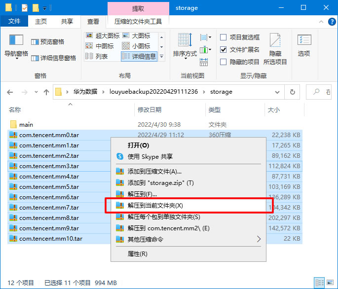

10，进入手机所在盘符（此时手机还必需连接在电脑上），将手机内部存储下的Android\data\[com.tencent.mm](http://com.tencent.mm)文件夹里的MicroMsg文件夹也复制到电脑上来。
说明1：如果只需要导出微信聊天记录中的文字和图片，不需要导出收发的语音消息，视频，及收发的文件的话，这一步可以不操作。
说明2：如果该MicroMsg文件夹特别大的话，也可在手机上的“文件管理”app中，对该文件夹进行压缩后再导出到电脑上来。
说明3：在louyuebackup*******文件夹下，有MicroMsg0.tar，MicroMsg1.tar……文件，也可全选这些tar文件，将其解压，如果解压后，在该目录下产生了Android\data\[com.tencent.mm](http://com.tencent.mm)\MicroMsg文件夹的话，则说明华为备份助手已经将资源目录MicroMsg也备份到电脑上来了，只需要解压获取即可，不需要再手工到手机盘符中去复制了。
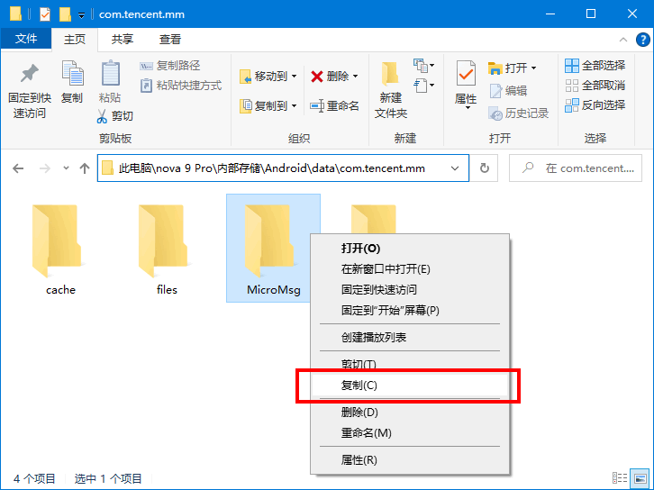

11，安装并运行“楼月微信聊天记录导出恢复助手”（下载地址：[本地下载1](https://louyue.com/down/louyueweixin_setup.exe)），微信版本设置为“安卓版微信”，数据目录设置为第9步解压后所得文件夹中的MicroMsg文件夹，资源目录则设置为第10步中复制出来的MicroMsg文件夹（如果第10步没有操作的话，此处可以不设置资源目录），点击“读取数据”按钮后，上方会显示一个或多个微信号，选择自己想查看的微信号后点击“查看记录”按钮。

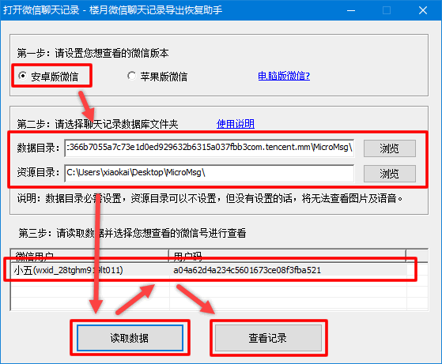

12，现在就可以在界面上查看华为手机上与所有好友及群聊中的聊天记录了。
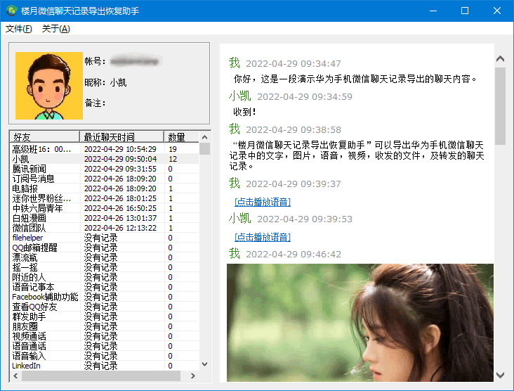

13，可在软件界面上，用鼠标选中要导出的记录，再按Ctrl+C复制，再粘贴到Word文档中，如果有需要的话，可以在Word文档中对聊天记录进行编辑或打印。

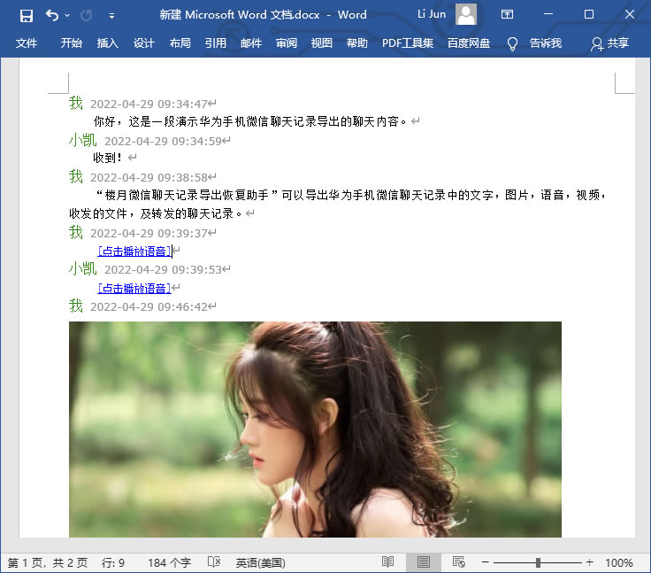

14，也可以点击“文件”，“导出聊天记录”菜单，勾选上一个或多个好友（或群聊），然后可以将聊天记录快速批量导出来。

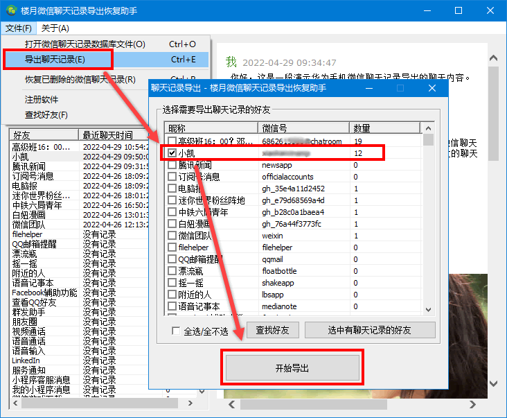

15，导出目录下的文件结构如下图所示，其中files中保存了所有收发的文件，images中保存了所有收发的图片，video中保存了所有收发的视频，voice文件夹中则保存了所有收发的语音消息，msg.htm中则可以查看到所有这些导出的聊天记录。

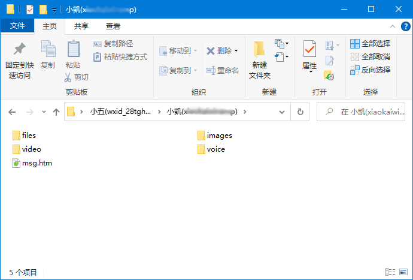

16，双击打开msg.htm，可以看到聊天记录中的所有内容，包括文字，图片，语音，视频，其中语音及视频也可以直接在这个页面上点击进行播放。

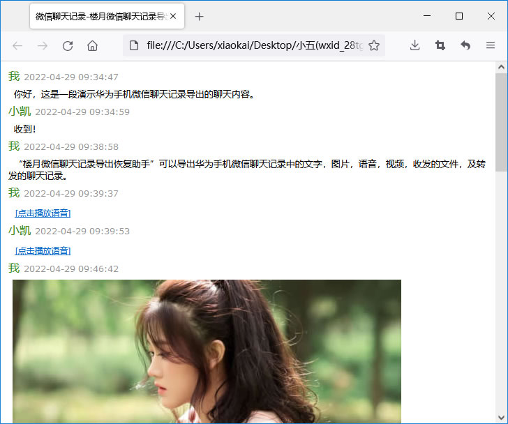

上就是华为手机微信聊天记录如何导出的全过程。
