# 安卓手机微信聊天记录怎么导出到电脑：迁移到iPhone再导出

> GitHub 仓库源文件：[点击打开网页渲染版](https://github.com/ben2023niao/ben-ops-notes/blob/main/doc/md/202304141557-DevOps%20%E4%B8%8E%20SRE%2B%E4%BC%98%E5%8C%96%E6%96%B9%E6%A1%88%2B%E5%A4%87%E4%BB%BD%E6%81%A2%E5%A4%8D%2B%E7%9F%A5%E8%AF%86%E7%AC%94%E8%AE%B0-%E5%AE%89%E5%8D%93%E6%89%8B%E6%9C%BA%E5%BE%AE%E4%BF%A1%E8%81%8A%E5%A4%A9%E8%AE%B0%E5%BD%95%E6%80%8E%E4%B9%88%E5%AF%BC%E5%87%BA%E5%88%B0%E7%94%B5%E8%84%91%EF%BC%9A%E8%BF%81%E7%A7%BB%E5%88%B0iPhone%E5%86%8D%E5%AF%BC%E5%87%BA.md)

安卓手机品牌众多，不同安卓手机微信聊天记录导出到电脑的方法完全不一样，不同品牌的安卓手机，有不同的导出方法。以下是国内流行的四种安卓手机微信聊天记录的导出方法：
1, [华为手机微信聊天记录导出电脑(免ROOT)](https://louyue.com/huaweiwechat.htm)
2, [OPPO手机微信聊天记录导出电脑(免ROOT)](https://louyue.com/oppowechat.htm)
3, [vivo手机微信聊天记录导出电脑(免ROOT)](https://louyue.com/vivowechat.htm)
4, [小米手机微信聊天记录导出电脑(免ROOT)](https://louyue.com/xiaomiwechat.htm)

除了以上四种方法可直接将微信聊天记录导出到电脑外，还可将安卓手机微信聊天记录先迁移到苹果手机，然后再进行导出，具体方法如下：

**视频教程：<https://louyue.com/video/androidwechat-iphone-pc.mp4>**

1，在安卓手机上打开微信，并按下图所示进入聊天记录备份与迁移界面。
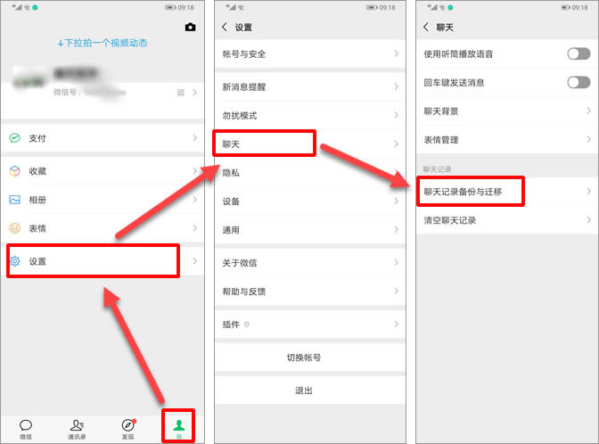

2，然后选择要迁移聊天记录的好友，除了一个一个选择好友外，也可以点击“全选”来选择所有好友，选择好友后，点击完成，会看到一个二维码界面。
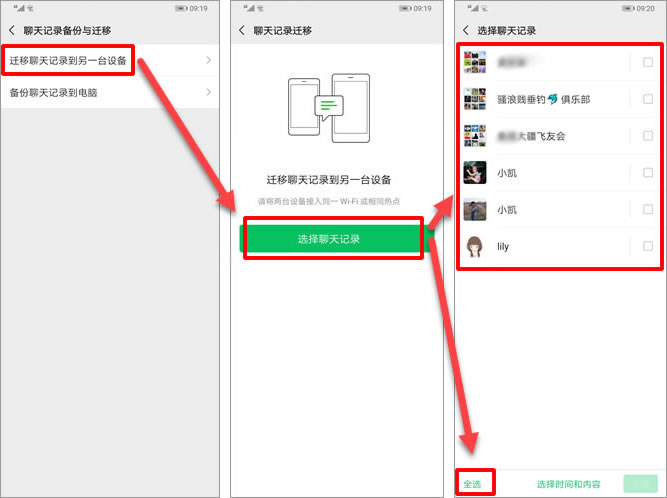

3，接下来在苹果手机上打开微信，并在苹果手机上登陆要迁移微信聊天记录的微信号（即前面安卓手机上登陆的微信号）。
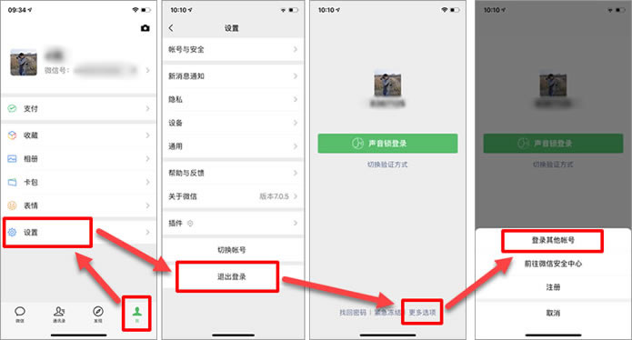

4，在苹果手机微信上，使用扫一扫功能，对之前安卓手机上显示的二维码进行扫码，并按提示操作，将安卓手机上的微信聊天记录全部迁移到苹果手机上。
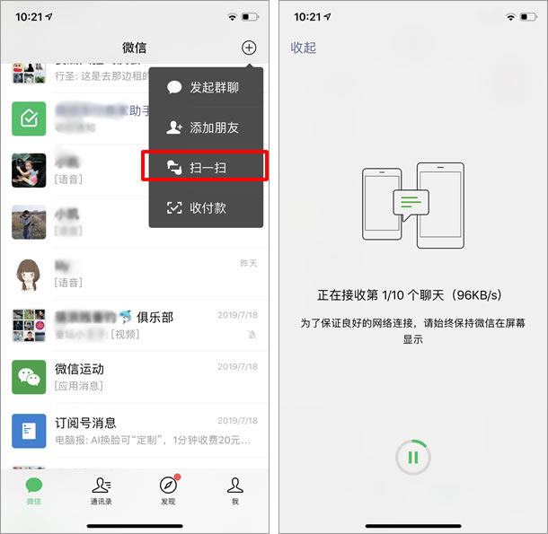

5，迁移结束后，接下来把苹果手机连接到电脑上。
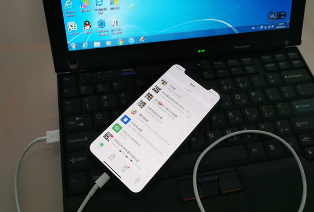

6，在电脑上使用iTunes软件对苹果手机数据进行备份（[点击此处进入iTunes下载页面](https://www.apple.com.cn/itunes/)），操作如下图所示。
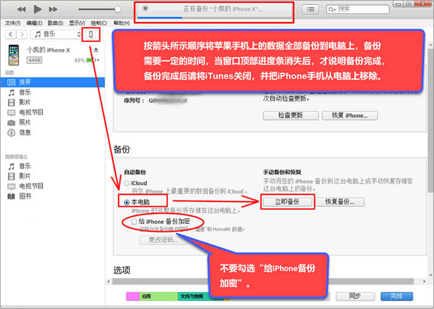

7，备份完成后，使用楼月免费iTunes备份管理器（[点击此处下载](https://louyue.com/down/itunesguanli_setup.exe)），把备份数据中存储了微信聊天记录的Documents文件夹进行导出。
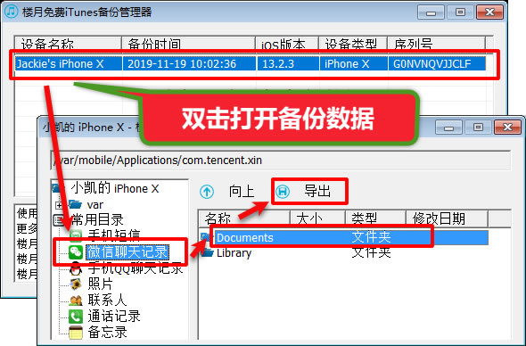

8，最后，通过楼月微信聊天记录导出恢复助手（[点击此处下载](https://louyue.com/down/louyueweixin_setup.exe)），对Documents文件夹中的微信数据进行读取。
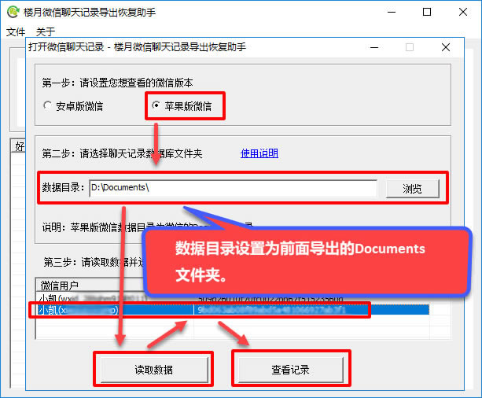

9，用鼠标选择要导出到电脑上的微信聊天记录，按Ctrl+C进行复制。
说明1：有的手机导出聊天记录后，在下图左边好友列表中，会看到所有好友的聊天记录数量显示全部为0，但点击该好友后右边却可以看到是有聊天记录的，因此聊天记录数量显示为0并不影响查看聊天记录。如果很介意的话，也可将安卓手机微信聊天记录迁移到苹果手机后，在苹果手机上与该好友任意发送一条消息，这样再导出后，在下图所示界面上就不会显示数量为0了。
说明2：如果好友太多，也可通过点击“文件”，“查找好友”，然后通过输入好友微信号或昵称进行搜索，来快速定位到该好友。
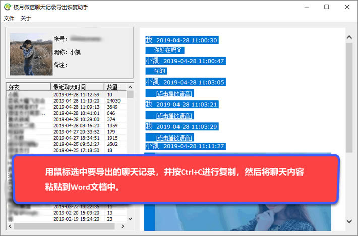

10，再粘贴到Word文档中即可。
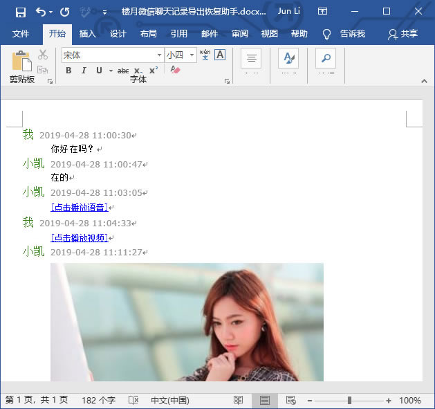

11，Word文档中只能保存文字，和图片，语音消息及视频是无法播放的，要对所有这些消息进行导出的话，可通过导出聊天记录功能，导出后，不但可以查看文字，图片；语音消息及小视频都可以直接播放。
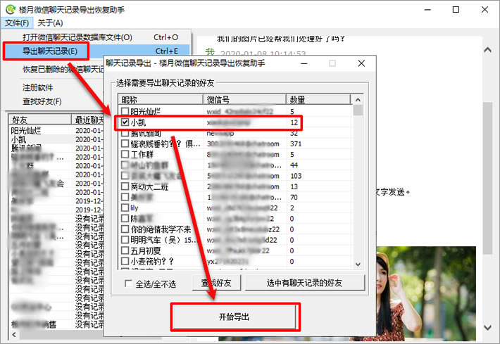

您也可以点击以下链接了解更多关于导出安卓手机微信聊天记录到电脑的方法：[安卓手机微信聊天记录如何导出到电脑](https://louyue.com/awx.htm)
