# 小米手机QQ聊天记录如何导出到电脑Word文档查看：免Root

> GitHub 仓库源文件：[点击打开网页渲染版](https://github.com/ben2023niao/ben-ops-notes/blob/main/doc/md/202304141557-DevOps%20%E4%B8%8E%20SRE%2B%E4%BC%98%E5%8C%96%E6%96%B9%E6%A1%88%2B%E5%A4%87%E4%BB%BD%E6%81%A2%E5%A4%8D%2B%E7%9F%A5%E8%AF%86%E7%AC%94%E8%AE%B0-%E5%B0%8F%E7%B1%B3%E6%89%8B%E6%9C%BAQQ%E8%81%8A%E5%A4%A9%E8%AE%B0%E5%BD%95%E5%A6%82%E4%BD%95%E5%AF%BC%E5%87%BA%E5%88%B0%E7%94%B5%E8%84%91Word%E6%96%87%E6%A1%A3%E6%9F%A5%E7%9C%8B%EF%BC%9A%E5%85%8DRoot.md)

小米手机QQ聊天记录可通过手机系统自带的备份功能，导出到电脑上（手机无需Root），与好友的文字聊天记录可导出到电脑上的Word文档中，语音消息则可导出为wav格式外部音频文件。

**小米手机QQ聊天记录导出电脑视频教程：<https://louyue.com/video/xiaomiqq.mp4>**

1，打开小米手机系统上的“设置”，点击“更多设置”，“备份和重置”。
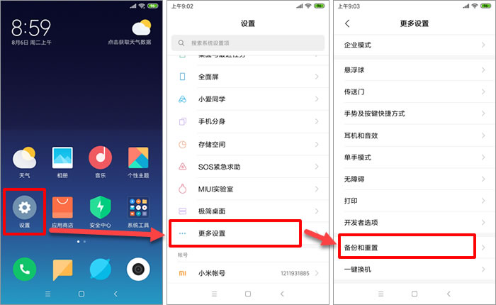

2，点击“本地备份”，按提示输入锁屏密码后，点击“下一步”，最后点击“新建备份”按钮。
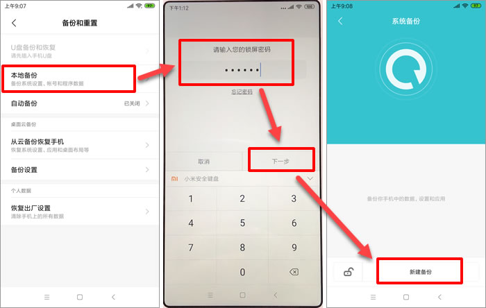

3，默认已经勾选了所有“系统数据“及“软件程序”，将其取消选择，再点击软件程序右边的小箭头，仅勾选上“QQ”后，开始对其进行备份。
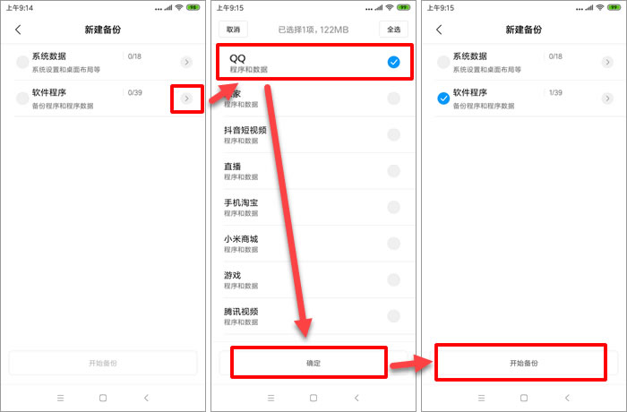

4，备份结束后，将小米手机用数据线连接到电脑USB口上，手机会弹出窗口询问USB的用途，请选择“传输文件”，如果设置为默认的“仅限充电”的话，将无法在电脑上读取手机中的文件（在电脑上进入手机所在盘符后，会看不到任何文件）。
说明：如果不小心设置错了USB用途的话，可用手指从屏幕顶端往下滑动，再次修改USB用途。
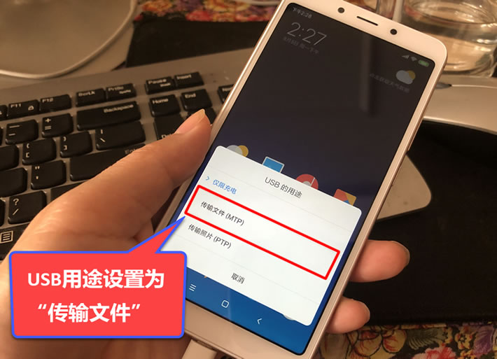

5，进入手机所在盘符下的“MIUI/backup/AllBackup/备份日期时间”目录，将该目录下的QQ(com.tencent.mobileqq).bak文件复制到电脑上。注意：复制后，手机盘符所在窗口不能关闭，只能最小化，如果关闭的话，会导致粘贴失败。
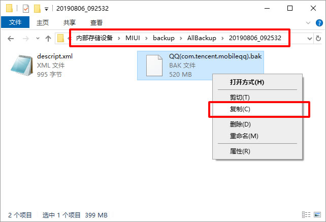

6，右击刚复制出来的“QQ(com.tencent.mobileqq).bak”文件，然后使用7-zip软件打开该压缩包。
说明：如果电脑上没有安装7-zip软件的话，需要先进行安装，7-zip是免费软件，可以在网上任意下载站进行下载。
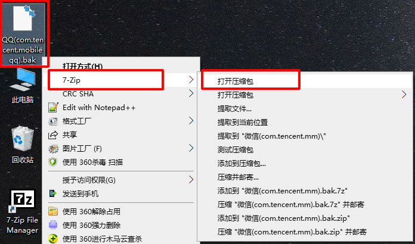

7，双击进入“apps”目录，将里面的com.tencent.mobileqq文件夹提取到电脑上。
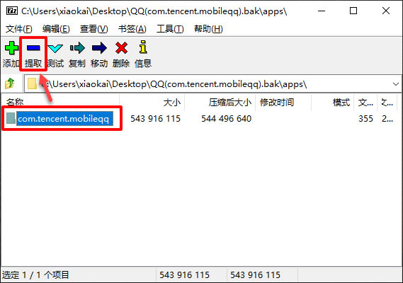

8，进入刚提取出来的com.tencent.mobileqq文件夹，将“db”文件夹重命名为“databases”，再将“f”文件夹重命名为“files”。
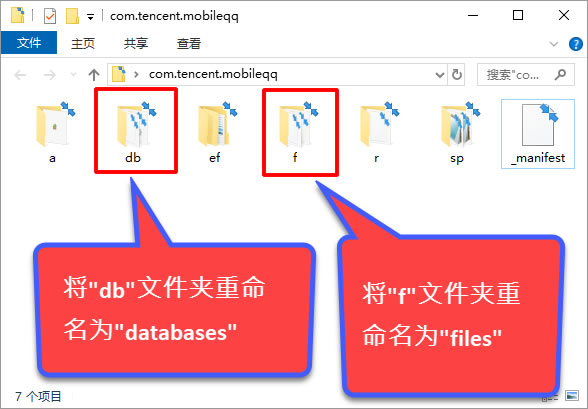

9，重命名后，文件夹结构将如下图所示。
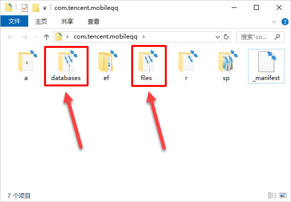

10，再次回到手机上进行操作，打开手机上的“文件管理”，点击右上角的“手机”，进入tencent目录，长按选中该目录下的MobileQQ文件夹后，对其进行压缩。
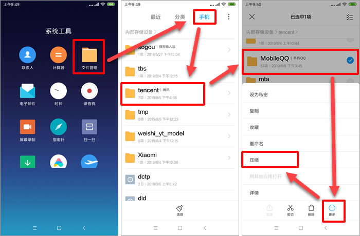

11，在电脑上进入小米手机所在盘符，将tencent目录下的MobileQQ.zip复制到电脑上，并将其解压到当前文件夹。
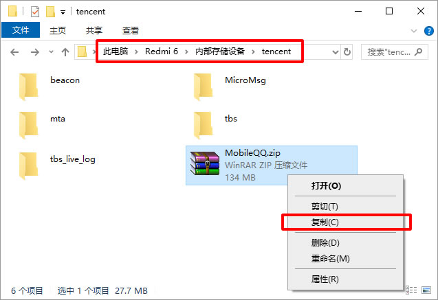

12，最后打开楼月手机QQ聊天记录导出恢复软件，手机QQ版本设置为“安卓版QQ”，数据目录设置为从7-zip软件中提取出来的“com.tencent.mobileqq”文件夹，资源目录设置为解压得到的MobileQQ文件夹，最后点击“读取数据”按钮，选择想查看的QQ号后，点击查看记录按钮。
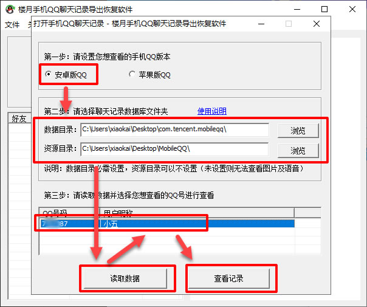

13，现在就可以在电脑上查看小米手机QQ聊天记录了，用鼠标选中要导出的聊天内容，再按Ctrl+C进行复制。
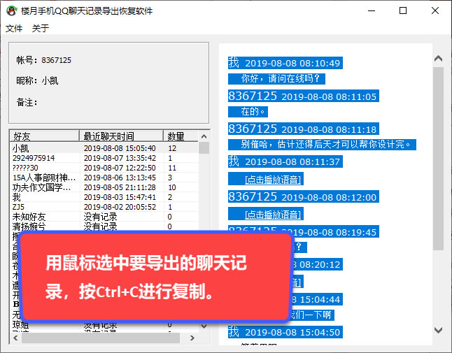

14，然后将复制的内容粘贴到Word文档中就可以了。
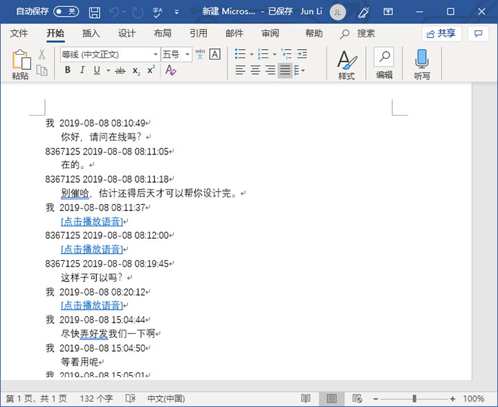

15，另外，也可以通过软件的手机QQ聊天记录导出功能，来导出小米手机QQ聊天记录中的所有文字，语音等消息。
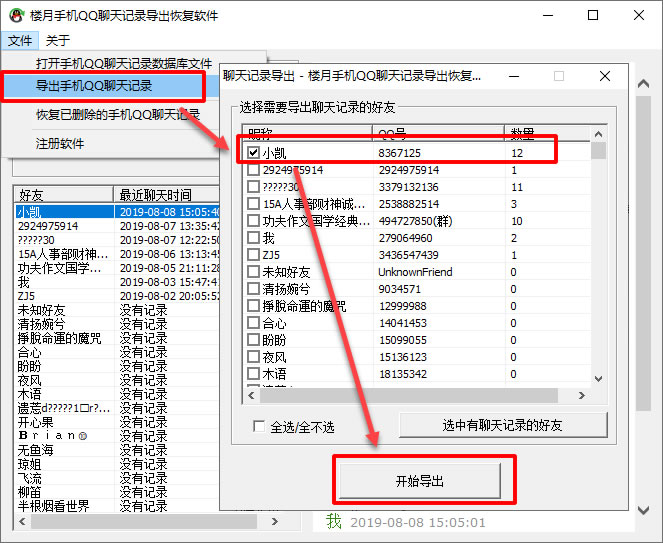
