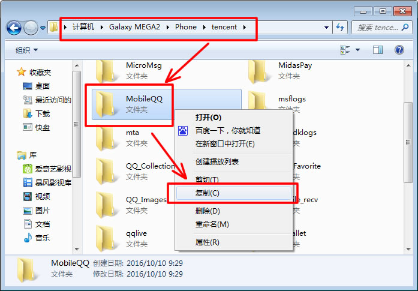
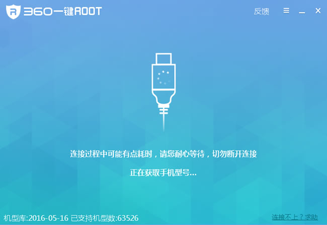
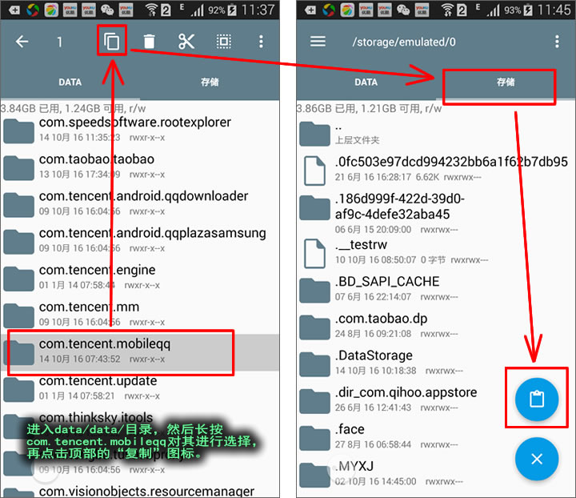
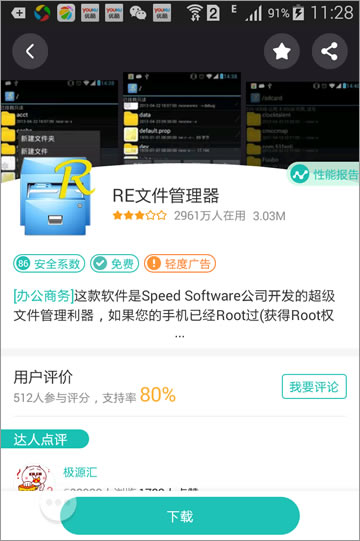
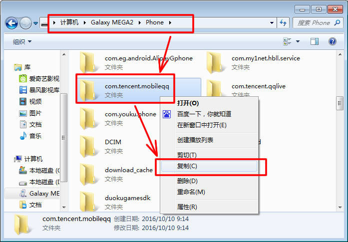
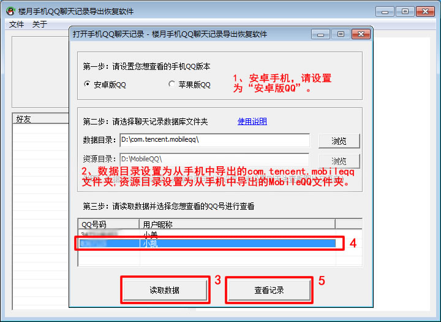
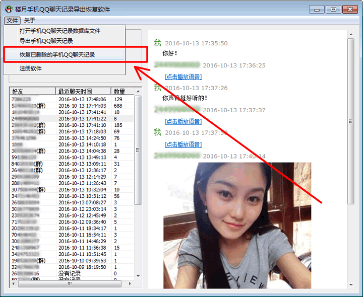
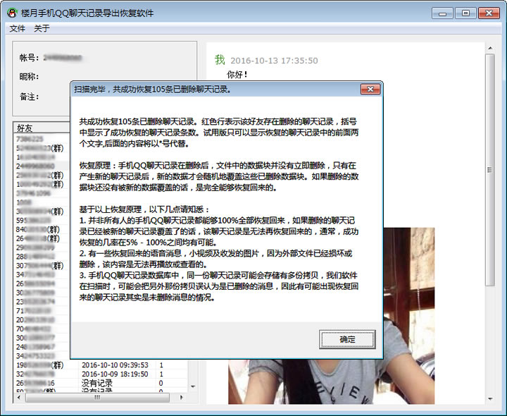

# 支持所有安卓手机，含三星，华为，联想，小米，OPPO，VIVO，酷派，HTC等

> GitHub 仓库源文件：[点击打开网页渲染版](https://github.com/ben2023niao/ben-ops-notes/blob/main/doc/md/202304141557-DevOps%20%E4%B8%8E%20SRE%2B%E4%BC%98%E5%8C%96%E6%96%B9%E6%A1%88%2B%E5%A4%87%E4%BB%BD%E6%81%A2%E5%A4%8D%2B%E7%9F%A5%E8%AF%86%E7%AC%94%E8%AE%B0-%E6%94%AF%E6%8C%81%E6%89%80%E6%9C%89%E5%AE%89%E5%8D%93%E6%89%8B%E6%9C%BA%EF%BC%8C%E5%90%AB%E4%B8%89%E6%98%9F%EF%BC%8C%E5%8D%8E%E4%B8%BA%EF%BC%8C%E8%81%94%E6%83%B3%EF%BC%8C%E5%B0%8F%E7%B1%B3%EF%BC%8COPPO%EF%BC%8CVIVO%EF%BC%8C%E9%85%B7%E6%B4%BE%EF%BC%8CHTC%E7%AD%89.md)

安卓手机。安卓手机QQ聊天记录在哪个文件夹，如何导出查看并恢复已删除内容
楼月手机QQ聊天记录导出恢复软件下载地址：[本地下载1](https://louyue.com/down/louyueshoujiqq.rar)

本软件能够导出并查看自己安卓手机中登陆过的手机QQ号码与所有好友的QQ聊天记录，并尝试恢复手机中以前删除的聊天内容，支持所有安卓手机，含三星，华为，联想，小米，OPPO，VIVO，酷派，HTC等所有安卓手机。

**安卓手机QQ聊天记录导出查看及恢复方法：**

1，将安卓手机连接到电脑上，进入手机所在盘符下的tencent文件夹，然后将该目录下的MobileQQ文件夹复制并粘贴到电脑上的任意文件夹中。该文件夹中保存了安卓手机QQ聊天时收发的语音消息，图片及视频等内容。
说明：如果将手机连接到电脑后，找不到手机盘符的话，请[点击此处链接了解通过新的方法将手机QQ聊天记录导出到电脑](https://louyue.com/aqq.htm)。

2，接下来我们需要对安卓手机进行root，否则我们将无法把安卓手机QQ聊天记录的数据库文件夹导出到电脑上。我们可以下载360一键root软件对手机进行root。
如果您不愿意对手机进行Root，则请点击以下链接，了解免Root方案：
1：[华为手机免ROOT导出手机QQ聊天记录](https://louyue.com/huaweiqq.htm)
2：[OPPO手机免ROOT导出手机QQ聊天记录](https://louyue.com/oppoqq.htm)
3：[小米手机免ROOT导出手机QQ聊天记录](https://louyue.com/xiaomiqq.htm)

3，然后我们需要在安卓手机上安装“RE文件管理器”app，可在任意手机市场（如360手机助手）或直接在手机百度上搜索下载。

4，打开手机上的“RE文件管理器”，进入“data/data/”目录，然后找到并长按com.tencent.mobileqq文件夹，再点击顶部的复制图标。接着切换到“存储”选项卡，再点击右下角的“复制到此”图标。
说明：如果RE管理器上没有“存储”选项卡的话，可以在RE管理器中返回到根目录，并进入到sdcard文件夹，再点击“复制到此”图标即可。

5，再次将手机连接到电脑上，打开手机所在盘符，然后将手机盘符根目录下的com.tencent.mobileqq文件夹复制并粘贴到电脑上的任意文件夹中。
说明：复制过程中，可能会提示“无法访问 XXXX 文件名、目录名或卷标语法不正确”，请直接点击“确定”按钮，忽略该提示即可。

6，打开“楼月手机QQ聊天记录导出恢复软件”（可在本网页顶部的下载地址1处进行下载），第一步中的QQ版本设置为“安卓版QQ”，数据目录设置为前面第5步中导出到电脑上的com.tencent.mobileqq文件夹，资源目录则设置为第1步中导出到电脑上的MobileQQ文件夹。接下来点击“读取数据”按钮，然后选择一个想查看及恢复手机QQ聊天记录的QQ号码后，点击“查看记录”按钮。

7，此时，软件界面上就可以查看到该安卓手机上与所有好友及所有群聊的QQ聊天记录了，我们接着点击“恢复已删除的手机QQ聊天记录”菜单对删除的QQ聊天内容进行恢复。

8，稍等一段时间后，安卓手机上删除的手机QQ聊天记录就被成功恢复了。
说明：数据恢复不能保证可以100%恢复所有删除内容，请知悉。

