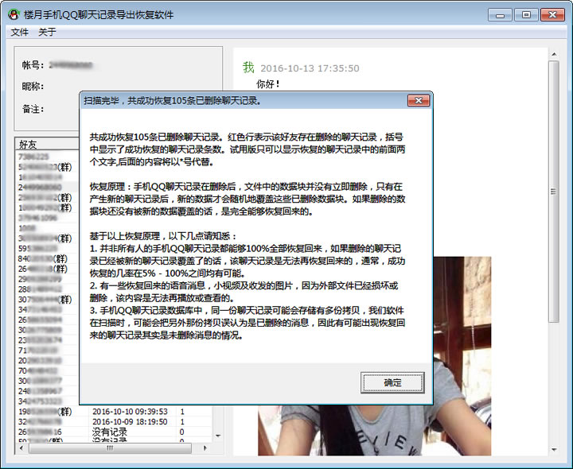
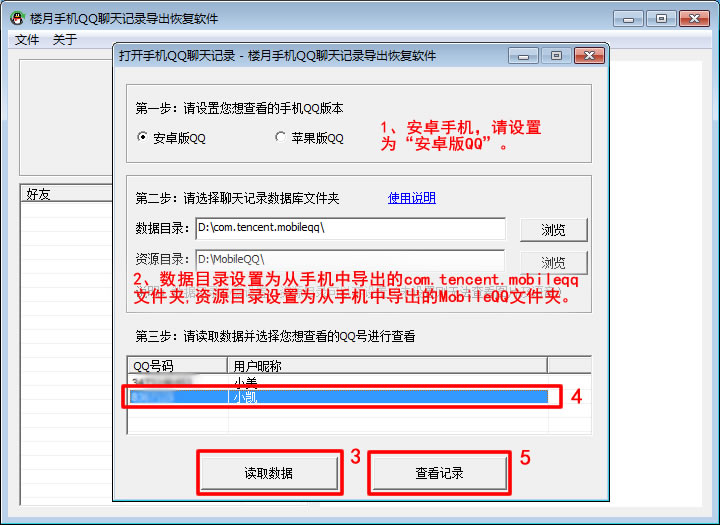
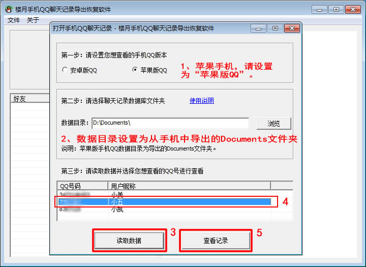
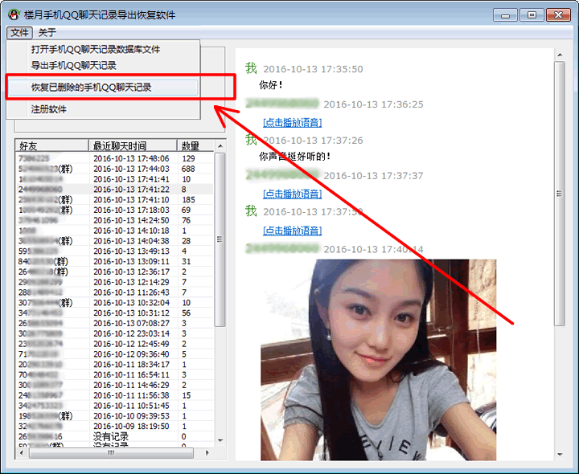

# 被封QQ恢复客户数据方案

[下载地址：本地下载1](https://louyue.com/down/louyueshoujiqq.rar)  <https://louyue.com/down/louyueshoujiqq.rar>

本软件是一款导出查看及恢复手机QQ聊天记录的软件，支持几乎所有型号的苹果手机及安卓手机。您只需要将手机QQ聊天记录所在的文件夹从手机上导出到电脑硬盘上，然后即可使用本软件打开进行查看并恢复。不但能够查看与所有好友的文字聊天记录及收发的图片，还可在软件界面上播放与好友收发的语音消息，小视频等聊天内容。关于如何将手机QQ聊天记录数据库文件夹从手机导出到电脑上的方法，请查看本网页下方提供的链接。查看并恢复手机QQ聊天记录后，软件界面如下所示：

手机QQ聊天记录导出查看及恢复步骤：

1，首先，请将手机QQ聊天记录从手机里面导出到电脑上来。详细操作步骤可点击下方链接进行了解。
       安卓手机：[如何导出查看及恢复安卓手机QQ聊天记录](https://louyue.com/androidshoujiqq.htm)
                           1, [华为手机QQ聊天记录导出电脑(免ROOT)](https://louyue.com/huaweiqq.htm)
                           2, [OPPO手机QQ聊天记录导出电脑(免ROOT)](https://louyue.com/oppoqq.htm)
                           3, [小米手机QQ聊天记录导出电脑(免ROOT)](https://louyue.com/xiaomiqq.htm)
       苹果手机：[如何导出查看及恢复苹果手机QQ聊天记录](https://louyue.com/iphoneshoujiqq.htm)

2， 打开“楼月手机QQ聊天记录导出恢复软件”，根据自己手机型号设置好QQ版本，然后设置好数据目录（及资源目录），接着点击“读取数据”按钮，然后软件会将目标文件夹中曾经登陆过的QQ号码读取出来，选择一个想查看及恢复QQ聊天记录的QQ号后点击查看按钮即可。
安卓及苹果手机请分别按下面两张图片中12345的顺序进行设置并点击。
安卓手机QQ设置界面如下所示：

苹果手机QQ设置界面如下所示：

3，此时在软件界面上就可以查看到与所有好友的QQ聊天记录了，我们接着点击“文件”“恢复已删除的手机QQ聊天记录”菜单。

4，稍等一会后，自己手机上不小心删除的QQ聊天记录就被成功恢复了，如下图所示：
说明：数据恢复并不能保证100%恢复所有删除的内容，恢复几率在0%-100%之间均有可能，请知悉。

