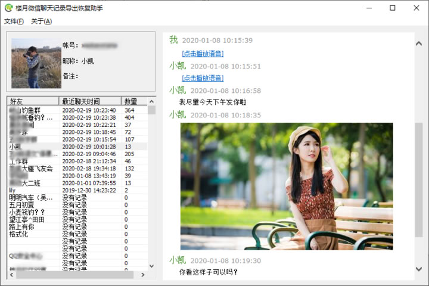
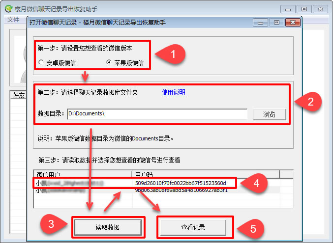
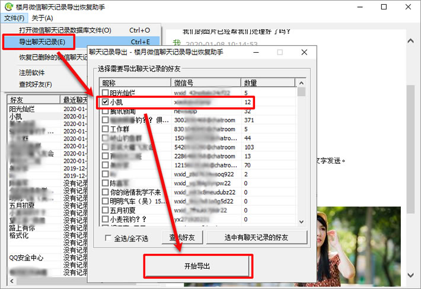

# 被封微信恢复客户数据方案

## 如何导出及恢复微信聊天记录 - 楼月微信聊天记录导出恢复助手

[下载地址：本地下载1](https://louyue.com/down/louyueweixin_setup.exe)  <https://louyue.com/down/louyueweixin_setup.exe>

本软件是一款协助导出及恢复微信聊天记录的软件。能够导出几乎所有智能手机（包括安卓系统及苹果系统）上的微信聊天记录。您只需将微信聊天记录文件夹导出到电脑上来，然后即可使用本软件打开进行查看（软件还能够尝试恢复自己苹果手机上不小心删除的微信聊天记录）。能够查看里面的文字，语音，图片及小视频等所有聊天内容。关于如何将微信聊天记录数据文件夹导出到电脑上来的方法，请查看本网页下方的链接。查看微信聊天记录时，界面如下图所示，因涉及隐私，所以将部份信息进行了模糊处理。

软件使用步骤：

1， 将微信聊天记录从手机里面拷贝到电脑上来。详细步骤可点击下方链接进行了解。
       安卓手机：  1, [华为手机微信聊天记录导出电脑(免ROOT)](https://louyue.com/huaweiwechat.htm)
                           2, [OPPO手机微信聊天记录导出电脑(免ROOT)](https://louyue.com/oppowechat.htm)
                           3, [vivo手机微信聊天记录导出电脑(免ROOT)](https://louyue.com/vivowechat.htm)
                           4, [小米手机微信聊天记录导出电脑(免ROOT)](https://louyue.com/xiaomiwechat.htm)

                          也可查看以下关于安卓手机微信聊天记录免ROOT导出电脑的通用方案，适用于所有安卓手机。
                           1，[安卓手机微信聊天记录先迁移到苹果手机再导出到电脑](https://louyue.com/androidwechat-iphone-pc.htm)
                           2，[通过VMOS软件导出安卓手机微信聊天记录](https://louyue.com/androidwechat-vmos-pc.htm)

       苹果手机：[如何导出苹果手机微信聊天记录](https://louyue.com/ios-weixin.htm)   [视频教程](https://louyue.com/support/weixin/weixin.htm)

2， 打开“楼月微信聊天记录导出恢复助手”软件，选择微信版本，然后设置好相应目录，点击“读取数据”按钮，然后软件会将目标文件夹中的微信号读取出来，点击想查看的微信号后再点击查看按钮即可。
苹果手机：数据目录设置为导出来的Documents文件夹。
安卓手机：数据目录设置为导出来的数据MicroMsg文件夹，资源目录设置为导出来的资源MicroMsg文件夹。

3，您也可以将微信聊天记录导出为html文件，这样下次查看时，您不打开本软件也可以进行查看了。要导出为外部文件的话，请点击“文件”->“导出聊天记录”菜单。然后选择想导出聊天记录的微信好友进行导出即可。界面如下所示：

