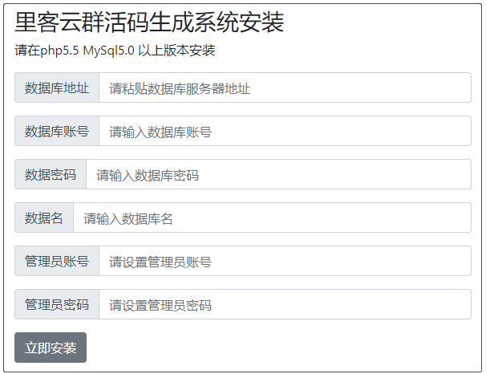

# 开源免费微信群二维码活码工具源码–WeChat-Group-HuoMa

<https://zhuanlan.zhihu.com/p/270317560>

微信群二维码活码工具，生成微信群活码，随时可以切换二维码！微信官方群二维码有效期是7天，过期后无法扫码进群，或者是群人数满200人就无法扫码进群，如果我们在推广的时候，群满人或者过期了，别人还想进群，我们将会失去很多推广效果，所以有了群活码，可以在不更换链接和二维码的前提下，切换扫码后显示的内容，灵活变换！

版本v5.1.0

github：[https:](https://link.zhihu.com/?target=https://github.com/likeyun/WeChat-Group-HuoMa)<https://github.com/likeyun/WeChat-Group-HuoMa>

## 功能总览

`1、创建微信群活码、可添加群主微信二维码、可统计二维码访问量`
`2、微信群二维码达到峰值可以自动切换备用二维码`
`3、创建微信群活码可以选择落地页域名`
`4、创建渠道二维码，可以创建文本类型和链接类型`
`5、渠道二维码，可以随时变更文本内容或链接`
`6、支持注册用户，使用邀请码注册`
`7、有便捷的用户管理面板，邀请码面板`
`8、可以创建个人微信活码`
`9、可以创建活动码`示例：[点击查看](http://www.likeyunba.com/huoma/activehm.php?activeid=38588)

本次更新与前4个版本不兼容，所以需要重新安装，安装前请到你的数据库把原来的数据表做好备份，以便安装完成后，恢复原有的数据，备份后，需要删除之前的所有数据表，否则安装不能成功！

## 安装步骤

`1、把所有代码上传到服务器`
`2、访问install文件夹安装`
`例如、<http://www.abc.com/huoma/install>`

只需要输入数据库和管理员相关信息，即可快速安装，如果安装失败，请检查数据库配置是否填写正确，如果您的服务器没有创建文件的权限，请在安装前给予777权限。

