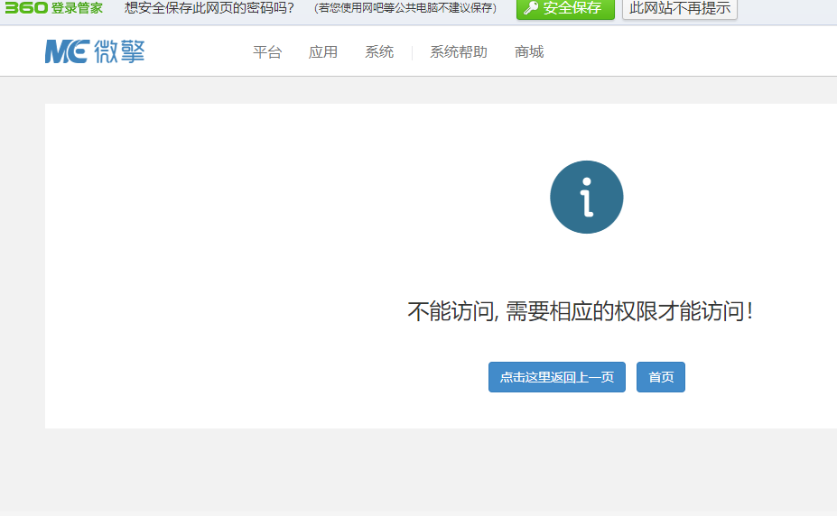
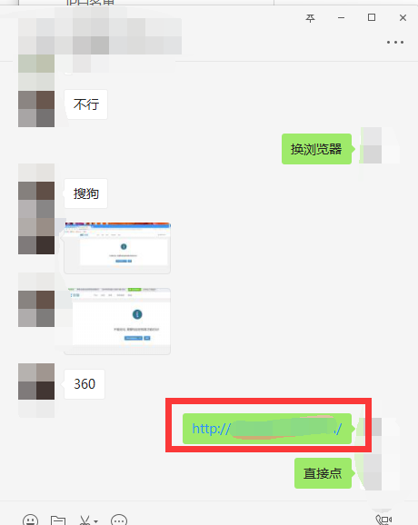

# 不能访问，需要相应的权限才能访问

> GitHub 仓库源文件：[点击打开网页渲染版](https://github.com/ben2023niao/ben-ops-notes/blob/main/doc/md/202304141557-DevOps%20%E4%B8%8E%20SRE%2B%E4%BC%98%E5%8C%96%E6%96%B9%E6%A1%88%2B%E6%9D%83%E9%99%90%E7%AE%A1%E7%90%86%2B%E7%9F%A5%E8%AF%86%E7%AC%94%E8%AE%B0-%E4%B8%8D%E8%83%BD%E8%AE%BF%E9%97%AE%EF%BC%8C%E9%9C%80%E8%A6%81%E7%9B%B8%E5%BA%94%E7%9A%84%E6%9D%83%E9%99%90%E6%89%8D%E8%83%BD%E8%AE%BF%E9%97%AE.md)

## 解决方法

---

出现这种情况，换浏览器重新登录，或者直接在电脑版微信点击链接

换了几个还不行，在手机上登录试一下，如果手机可以，电脑不行，就清理一下浏览器缓存，不知道的请[百度](https://www.baidu.com/)
如果以上都不行，请联系我们
