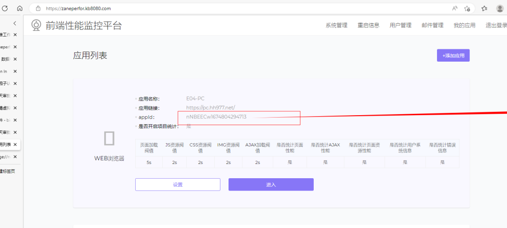
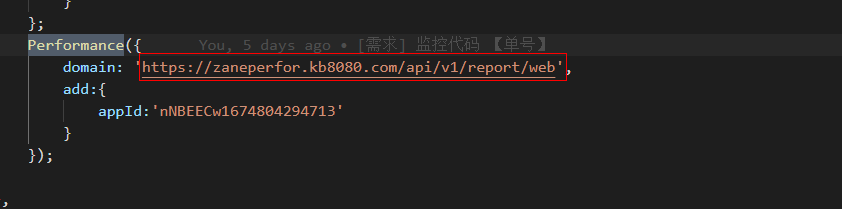

# zaneperfor前端监控接入

<https://github.com/wangweianger/web-report-sdk>

## USE Vue



### web-report 是一款浏览器端页面性能，ajax, fetch ,错误信息，资源性能上报SDK，资源小巧，性能强悍

### 上报sdk有五种

> - 一 ：所有类型通用的上报SDK 即：web-report-default.js
> - 二 ：针对于使用Jquery ajax的上报SDK 即：web-report-jquery.js
> - 三 ：针对于使用Axios ajax的上报SDK 即：web-report-axios.js
> - 四 ：针对于使用Fetch ajax的上报SDK 即：web-report-fetch.js
> - 五 ：针对于业务代码手动触发的上报SDK 即：web-report-none.js

- 通用版本适合所有上报情况
- 至于四种sdk的选择可酌情选择。通常来说专库专用会更好，因此使用jquery的推荐第二种，使用fetch的推荐第三种,使用Axios的推荐第三种，其他情况使用通用版本
- web-report-sdk 只做页面性，错误信息，资源信息，ajax信息等上报，让你不用关心浏览器上报部分，是一个比较完整和健全的数据上报插件。
- 在此基础上你可以开发任何自己需要的性能上报系统。

### web-report SDK主要上报以下性能信息

> - url 上报页面地址
> - preUrl 来访上一页面URL
> - performance 页面性能数据详情，字段含义详情请参考后面内容
> - errorList 页面错误信息详情，包含js,img,ajax,fetch等所有错误信息，字段含义详情请参考后面内容
> - resoruceList 页面性能数据详情，当前页面所有资源性能详情信息，字段含义详情请参考后面内容
> - markUv 统计uv标识
> - markUser 从用户进入网站开始标识，直到用户离开销毁，可以用来做用户漏斗分析
> - time 当前上报时间
> - screenwidth 屏幕宽度
> - screenheight 屏幕高度
> - isFristIn 是否是某次会话的第一次进入
> - type 上报类型 1:页面级性能上报 2:页面ajax性能上报 3：页面内错误信息上报

### 浏览器页面直接引用资源方式：

> - 1、下载 dist/web-report-default.min.js 到本地
> - 2、使用script标签引入到html的头部（备注：放到所有js资源之前）
> - 3、使用performance函数进行数据的监听上报

```html
<html>
<head>
 <meta charset="UTF-8">
 <title>performance test</title>
 <script src="../dist/web-report-default.min.js"></script>
 <script>
 Performance({
 domain:'http://some.com/api', //Your API address
 })
 </script>
</head>
```

### npm引入方式

```python
npm install web-report --save
import {
 Performance,
 axiosReport,
 defaultReport,
 fetchReport,
 jqueryReport,
 noneReport
} from 'web-report'
```

### webpack 使用

```
npm install web-report --save
```

```python
//New performance.js file
//The contents are as follows
import { Performance } from 'web-report'
Performance({
 domain:'http://some.com/api'
})
```

```
//Change webpack configuration
entry: {
 //add performance entry
 'performance':path.resolve(__dirname, '../src/performance.js'),
},
//change htmlWebpackPlugin config like this
//Attention to dependence
new htmlWebpackPlugin({
 ...
 chunks: ['vendors','performance','main'],
 chunksSortMode: 'manual',
}),
```

### none JDK使用方法

- none JDK在程序中使用 window.ReportData();来触发上报
- 在多页面中可加载插件后调用 window.ReportData() 方法直接上报。
- 在vue中可如此使用：

```python
router.afterEach((to, from, next) => {
 if(from.name){
 try{ window.ReportData(); }catch(e){}
 }else{
 addEventListener("load",function(){
 try{ window.ReportData(); }catch(e){}
 },false);
 }
})
```

- 在react中也可以使用 withRouter 对路由跳转后进行统一上报。

### 以下我根据此SDK开发的一款完整版本前端性能监控系统

<https://github.com/wangweianger/zanePerfor>

### SDK npm 地址

<https://www.npmjs.com/package/web-report>

### 注意事项

- jquery和axios JDK需要放在jquery 或 axios之后，不然ajax错误性信息无法采集

### 单页面程序上报处理

- 增加每次会话的第一次进入标识：isFristIn，客观的统计用户第一次进入页面性能数据
- 单页面应用程序路由切换时根据页面是否有ajax请求进行性能的上报
- 也可以自行使用none类型jdk配合路由钩子进行上报

### 上报参数type值说明（重要）

- type = 1: 页面级别性能数据上报，即页面加载|路由切换时页面性能数据的上报
- type = 2: 页面已加载完毕，当进行某些操作请求了ajax信息时，对ajax性能数据的上报（如果ajax报错则上报错误信息）
- type = 3: 页面已加载完毕，当进行某些操作报错时，对错误信息的上报

### 参数说明

> - 同时传入 domain和传入的function ，function优先级更高，也就是说function会执行
> - domain ：上报api接口
> - outtime ：上报延迟时间，保证异步数据的加载 （默认：300ms）
> - isPage ：是否上报页面性能数据 （默认：true）
> - isResource ：是否上报页面资源性能数据 （默认：true）
> - isError ：是否上报页面错误信息数据 （默认：true）
> - isAjax ：是否上报ajax信息 （默认：true）
> - add ：附带参数 （值为json object 例如：{APPID:'123456789'}）
> - filterUrl ：不需要上报的ajax请求 （例如开发模式下的livereload链接）
> - fn ：自定义上报函数，上报方式可以用ajax可以用fetch (非必填：默认使用fetch,如果使用ajax则必须参数 report:'report-data'，如果是fetch则必须参数：type:'report-data')

- 案例

```
1、最简单最常用的上报
Performance({
 domain:'http://some.com/api' //你的api地址
})
2、加add参数上报
Performance({
 domain:'http://some.com/api' //你的api地址
 add:{
 appId:'123456789'
 }
})
3、自己写fetch fn上报
Performance({},data=>{
 fetch('http://some.com/api',{
 type:'POST',
 report:'report-data',
 headers: {'Content-Type': 'application/json'},
 body:JSON.stringify(data)
 }).then((data)=>{})
})
4、自己写AJAX fn上报
Performance({},data=>{
 $.ajax({
 type:'POST',
 report:'report-data',
 contentType: 'application/json',
 data:{
 data:data
 },
 success:data=>{}
 })
})
5、完整版本的上报案例
Performance({
 domain:'http://some.com/api',
 outtime:500,
 isPage:true,
 isAjax:true,
 isResource:true,
 isError:true,
 add:{
 appId:'123456789'
 },
 filterUrl:['http://localhost:35729/livereload.js?snipver=1']
})
```

### 对外方法：

一：addError ：此方法向插件中自定义上报错误信息，vue,react，try{}catch 的报错信息均可采用此方法上报 案例：

```
let message = 'js add error'
let col = 20
let line = 20
let resourceUrl = 'http://www.xxx.com/01.js'

Performance.addError({
      msg:message,
      col:col,
      line:line,
      resourceUrl:resourceUrl
})
```

二：addData ：上报时自定义的数据 案例：

```
Performance.addData((data)=>{
  data.name = 'wangwei'
  data.some = {
    name:'wangwie',
    age:20
  }
})
```

## USE Vue

If you use the Vue framework, you can do it like this.

- 1、Introduce Performance
- 2、Copy the following code

```python
import { Performance } from 'web-report'
Vue.config.errorHandler = function (err, vm, info) {
 let { message, stack } = err;
 // Processing error
 let resourceUrl,col,line;
 let errs = stack.match(/\(.+?\)/)
 if(errs&&errs.length) errs = errs[0]
 errs=errs.replace(/\w.+js/g,$1=>{resourceUrl=$1;return '';})
 errs=errs.split(':')
 if(errs&&errs.length>1)line=parseInt(errs[1]||0);col=parseInt(errs[2]||0)
 // Fixed parameters
 // Call the Performance.addError method
 Performance.addError({
 msg:message,
 col:col,
 line:line,
 resourceUrl:resourceUrl
 })
}
```

## USE React

If you use the React framework, you can do it like this.

- 1、Introduce Performance
- 2、Error Handling in React 16. If you don't know Error Handling.Go to the official website to understand <https://reactjs.org/blog/2017/07/26/error-handling-in-react-16.html> react16之后提供Error Handling处理报错机制，父组件新增componentDidCatch钩子函数，父组件只能监听子组件的异常信息

```python
//Top reference
import { Performance } from 'web-report'
//Parent component listens for subcomponent error information
componentDidCatch(error, info) {
 let {message,stack} = error
 // Processing error
 let resourceUrl,col,line;
 let errs = stack.match(/\(.+?\)/)
 if(errs&&errs.length) errs = errs[0]
 errs=errs.replace(/\w.+js/g,$1=>{resourceUrl=$1;return '';})
 errs=errs.split(':')
 if(errs&&errs.length>1)line=parseInt(errs[1]||0);col=parseInt(errs[2]||0)
 // Fixed parameters
 // Call the Performance.addError method
 Performance.addError({
 msg:message,
 col:col,
 line:line,
 resourceUrl:resourceUrl
 })
}
```

## Runing

```
git clone https://github.com/wangweianger/web-report-sdk.git
npm install

//Development
npm run dev

//product
npm run build

//test page
http://localhost:8080/test/
```

## Return parameter description

| parameter name | describe | explain |

| --- | --- | --- |

| url | 上报页面地址 |  |

| markUv | 统计uv标识 |  |

| markUser | 用户标识 | 可用来做UV统计，和用户行为漏斗分析 |

| isFristIn | 是否是每次会话的第一次渲染 | 可以用来做首屏渲染性能统计分类 |

| type | 上报类型 | 1:页面级性能上报 2:页面ajax性能上报 3：页面内错误信息上报 |

| screenwidth | 屏幕宽度 |  |

| screenheight | 屏幕高度 |  |

| preUrl | 上一页面 |  |

|  |  |  |

| errorList | 错误资源列表信息 |  |

| ->t | 资源时间 |  |

| ->n | 资源类型 | resource，js，ajax，fetch,other |

| ->msg | 错误信息 |  |

| ->method | 资源请求方式 | GET，POST |

| ->data->resourceUrl | 请求资源路径 |  |

| ->data->col | js错误行 |  |

| ->data->line | js错误列 |  |

| ->data->status | ajax错误状态 |  |

| ->data->text | ajax错误信息 |  |

|  |  |  |

| performance | 页面资源性能数据(单位均为毫秒) |  |

| ->dnst | DNS解析时间 |  |

| ->tcpt | TCP建立时间 |  |

| ->wit | 白屏时间 |  |

| ->domt | dom渲染完成时间 |  |

| ->lodt | 页面onload时间 |  |

| ->radt | 页面准备时间 |  |

| ->rdit | 页面重定向时间 |  |

| ->uodt | unload时间 |  |

| ->reqt | request请求耗时 |  |

| ->andt | 页面解析dom耗时 |  |

|  |  |  |

| resoruceList | 页面资源性能数据 |  |

| ->decodedBodySize | 资源返回数据大小 |  |

| ->duration | 资源耗时 |  |

| ->method | 请求方式 | GET,POST |

| ->name | 请求资源路径 |  |

| ->nextHopProtocol | http协议版本 |  |

| ->type | 请求资源类型 | script，img，fetchrequest，xmlhttprequest，other |

```
```
