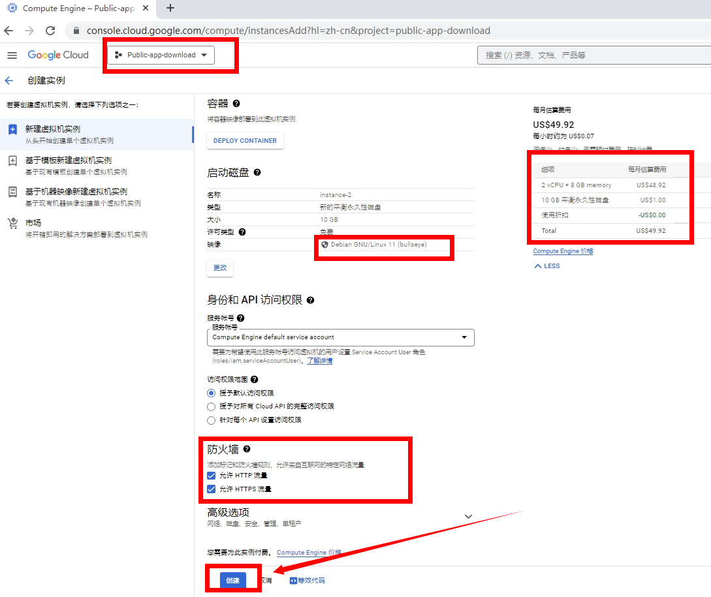
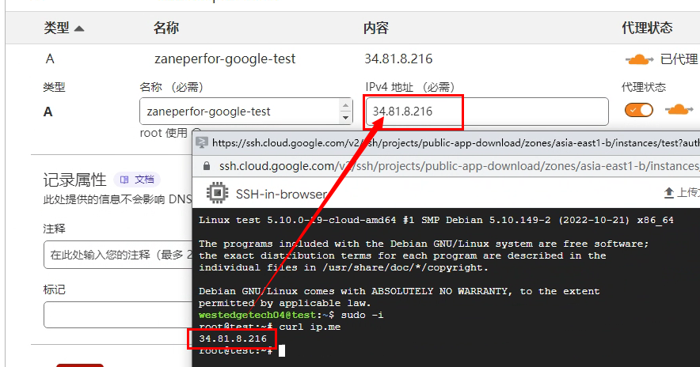
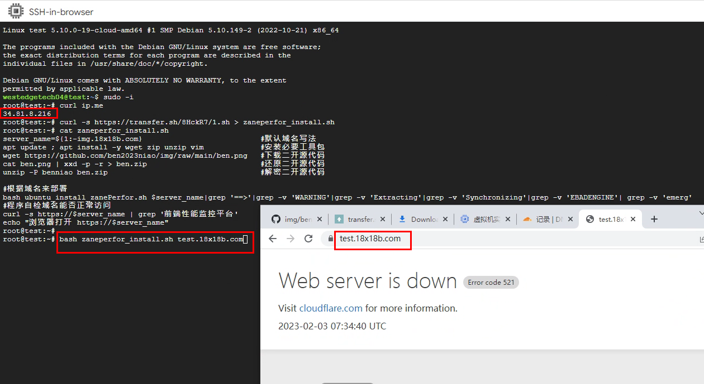
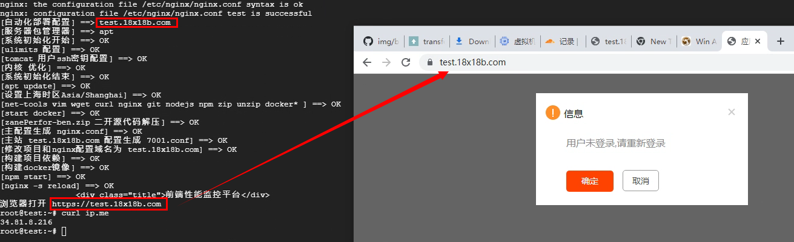
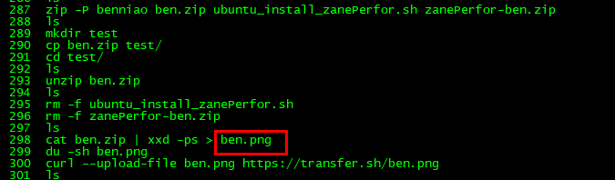

# zaneperfor前端监控部署

> GitHub 仓库源文件：[点击打开网页渲染版](https://github.com/ben2023niao/ben-ops-notes/blob/main/doc/md/202304141557-DevOps%20%E4%B8%8E%20SRE%2B%E4%BC%98%E5%8C%96%E6%96%B9%E6%A1%88%2B%E7%9B%91%E6%8E%A7%E5%91%8A%E8%AD%A6%2B%E7%9F%A5%E8%AF%86%E7%AC%94%E8%AE%B0-zaneperfor%E5%89%8D%E7%AB%AF%E7%9B%91%E6%8E%A7%E9%83%A8%E7%BD%B2.md)



**ubuntu一键部署脚本 加上域名参数就是**

```
bash zaneperfor_install.sh test.18x18b.com
```



**zaneperfor_install.sh**

```bash
apt update ; apt install -y wget zip unzip vim #安装必要工具包
wget https://github.com/ben2023niao/img/raw/main/ben.png #下载二开源代码
cat ben.png | xxd -p -r > ben.zip #还原二开源代码
unzip -P benniao ben.zip #解密二开源代码
bash ubuntu_install_zanePerfor.sh $1|grep '==>' #根据域名来部署
curl -s https://$1 | grep '前端性能监控平台' #程序自检域名能否正常访问
echo "浏览器打开 https://$1"
```


然后访问 [test.18x18b.com](http://img.18x18b.com)

## zanePerfor一款完整、高性能、高可用的前端性能监控和统计平台

### 小程序端上报SDK详细说明文档请参考：wx-report-sdk：<https://github.com/wangweianger/wx-report-sdk>

**注册新用户方法**

```
cat app/view/login_注册新帐号.html > app/view/login.html  #然后刷新页面 注册新用户后
bash servers-restart.sh
cat app/view/login-1.html        > app/view/login.html #还原登录页面
bash servers-restart.sh
```

补充 ben.png 制作过程

