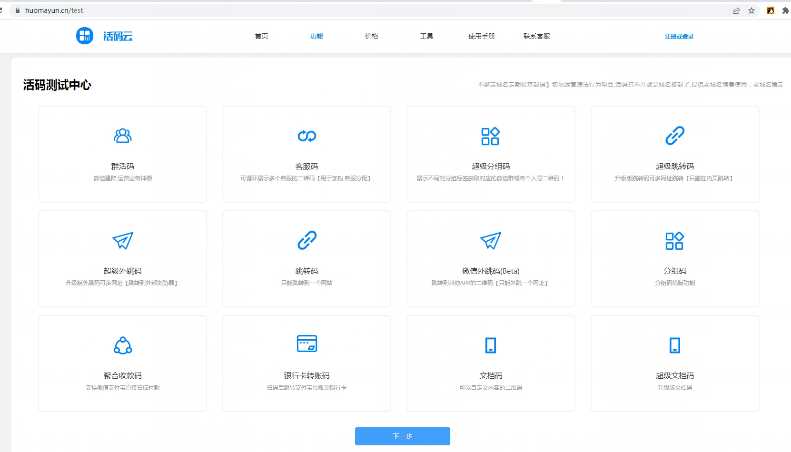
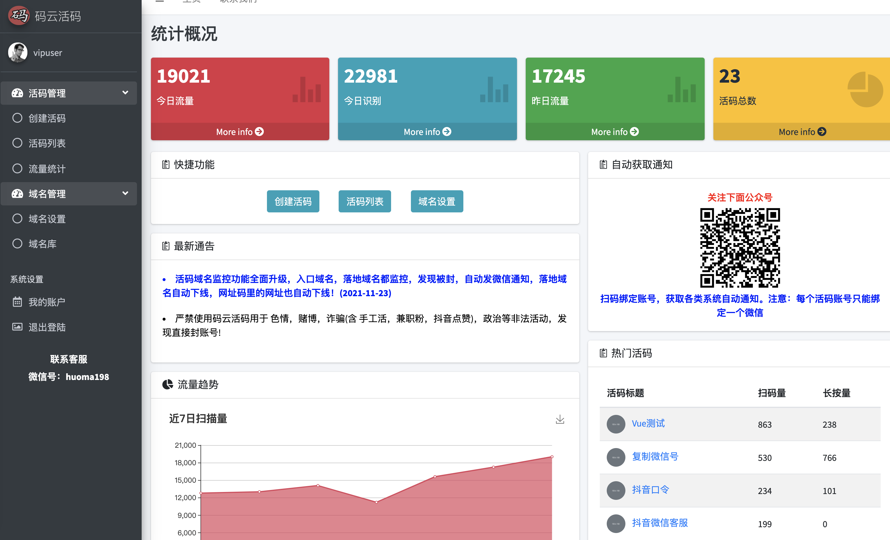
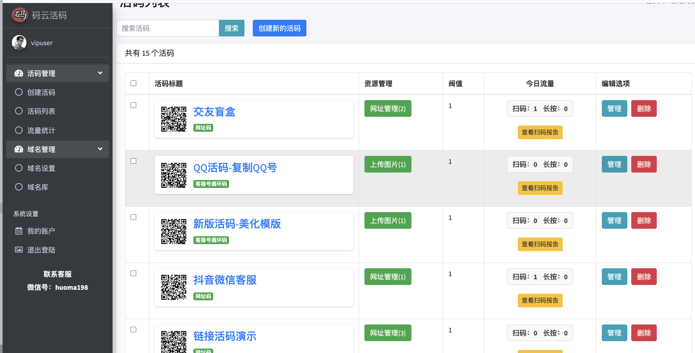
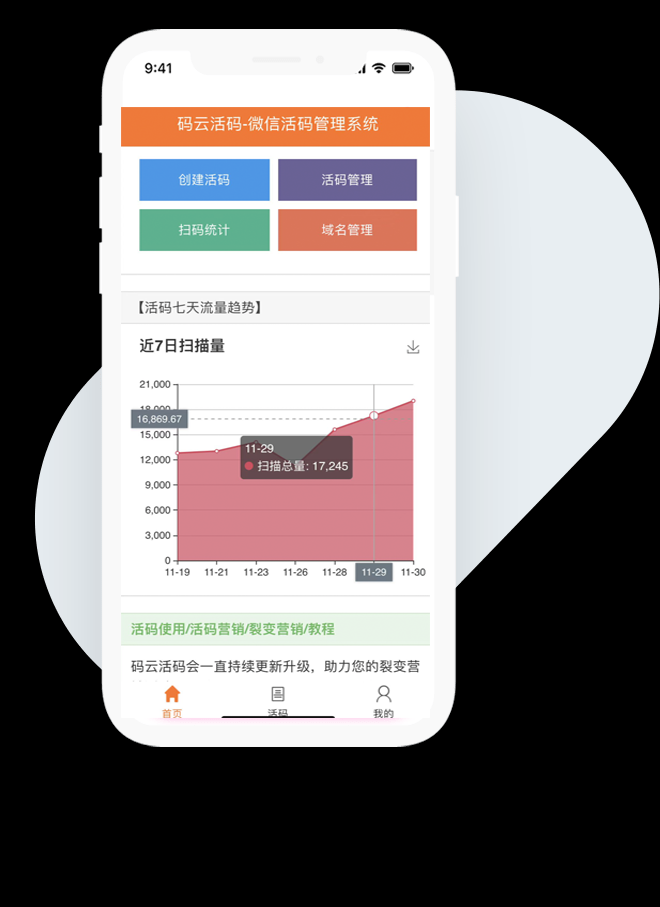
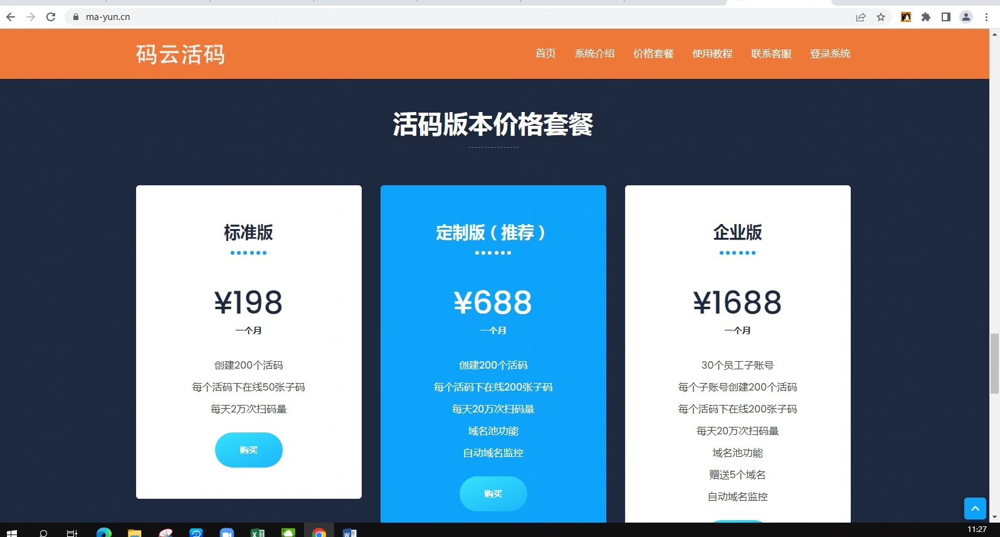
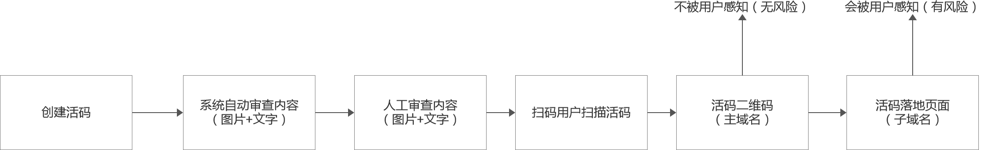

# 活码系统方案(用技术驱动用户增长)

> GitHub 仓库源文件：[点击打开网页渲染版](https://github.com/ben2023niao/ben-ops-notes/blob/main/doc/md/202304141557-DevOps%20%E4%B8%8E%20SRE%2B%E4%BC%98%E5%8C%96%E6%96%B9%E6%A1%88%2B%E7%9B%91%E6%8E%A7%E5%91%8A%E8%AD%A6%2B%E7%9F%A5%E8%AF%86%E7%AC%94%E8%AE%B0-%E6%B4%BB%E7%A0%81%E7%B3%BB%E7%BB%9F%E6%96%B9%E6%A1%88%28%E7%94%A8%E6%8A%80%E6%9C%AF%E9%A9%B1%E5%8A%A8%E7%94%A8%E6%88%B7%E5%A2%9E%E9%95%BF%29.md)

活码的原理就是通过扫描活码后，看到一个你自己的真实二维码，而这个二维码可以在后台随意更换，或者按照一定规则自动切换的形式。

商业活码（实现微信 QQ防红）
<http://www.huomaqun.com/>

<https://www.huomayun.cn/>

<https://www.ma-yun.cn/>

## **全自动活码状态监控**

根据多年的运营经验，我们提供了很多安全措施，能有效降低裂变过程中被屏蔽的发现。

我们也提供域名监控功能，有异常情况自动下线，自动发送微信通知

<https://www.getool.cn/>

## 域名防封说明

Getool系统默认采用防封模式+严格的内容审查，大大降低域名被封的风险

具体操作流程大致如下

1，商家创建活码的时候，系统实时检测子码图片+相应文案是否违规，如果违规，将无法上传至系统；
2，商家创建好之后，平台会不定期审阅活码内容，如发现违规，将下架活码；
3，域名结构采用主域名+子域名的跳转方式，活码二维码使用主域名，处于绝对安全的状态，落地页面采用子域名，用户扫码之后从主域名，跳转到子域名展示内容，就算被举报封域名，也只是损失子域名，活码主域名可以跳转到其他子域名渲染活动，活码主域名是安全的，不影响扫码
——
目前每个用户注册即享受防封模式，无需购买域名。后续根据业务增长，会更新自定义域名功能，自由搭配，便不会受到平台其他用户活动的污染。
