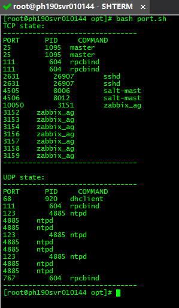

# 监控服务器进程和端口

> GitHub 仓库源文件：[点击打开网页渲染版](https://github.com/ben2023niao/ben-ops-notes/blob/main/doc/md/202304141557-DevOps%20%E4%B8%8E%20SRE%2B%E4%BC%98%E5%8C%96%E6%96%B9%E6%A1%88%2B%E7%9B%91%E6%8E%A7%E5%91%8A%E8%AD%A6%2B%E7%9F%A5%E8%AF%86%E7%AC%94%E8%AE%B0-%E7%9B%91%E6%8E%A7%E6%9C%8D%E5%8A%A1%E5%99%A8%E8%BF%9B%E7%A8%8B%E5%92%8C%E7%AB%AF%E5%8F%A3.md)

监控当前服务器使用的端口，PID，程序名称等；可以用于发现是否有不常用的端口被侦听，进而判断是否被黑客“搞”了；



**port.sh**

```
#tcp part
port1=`netstat -an|grep LISTEN|egrep "203.0.113.1|:::"|awk '/^tcp/ {print $4}'|awk -F: '{print $2$4}'|sort -n`
echo "TCP state:"
echo "--------------------------------"
echo "PORT      PID     COMMAND"
for a in $port1
do
b=`lsof -n -i:$a|grep TCP|grep LISTEN|grep IPv4|awk '{printf("%d\t%s\n"),$2,$1}'`
echo "$a $b"
done
echo "--------------------------------"
#udp part
echo ""
port2=`netstat -an|grep udp|awk '{print $4}'|awk -F: '{print $2}'|sed '/^$/d'|sort -n`
echo "UDP state:"
echo "--------------------------------"
echo "PORT      PID     COMMAND"
for a in $port2
do
b=`lsof -n -i:$a|grep UDP|grep IPv4|awk '{printf("%d\t%s\n"),$2,$1}'`
if [ -n "$b" ];then
echo "$a $b"
fi
done
echo "--------------------------------"
exit 0
```
