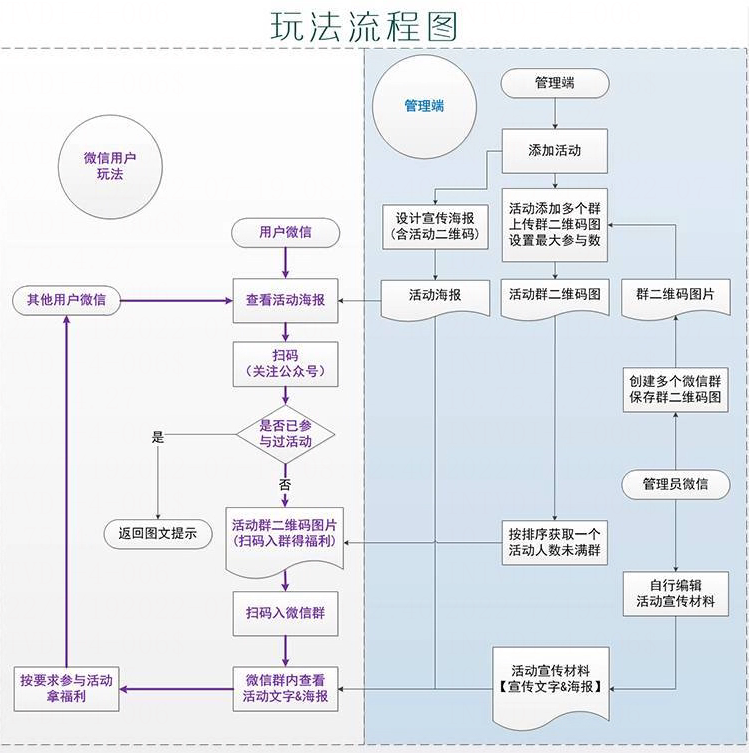
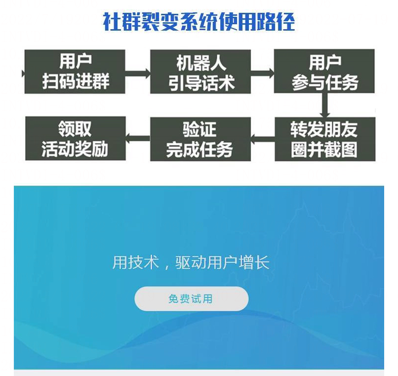
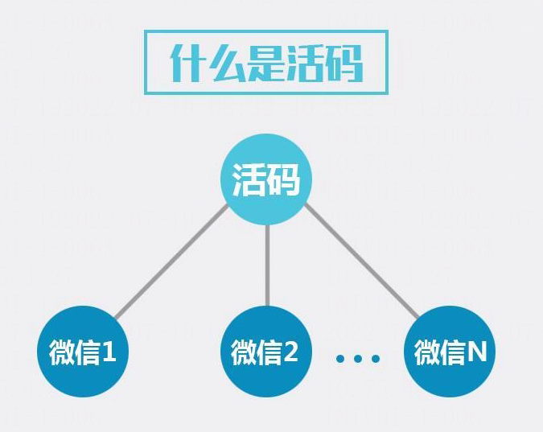
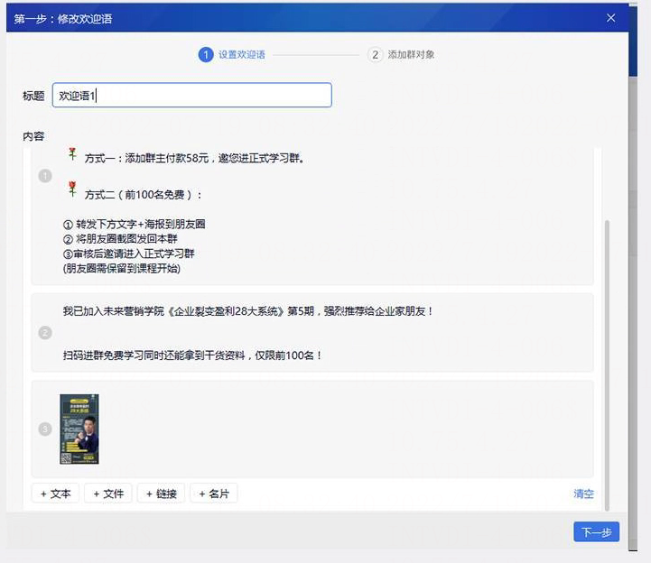

# 1 活码玩法简介

> GitHub 仓库源文件：[点击打开网页渲染版](https://github.com/ben2023niao/ben-ops-notes/blob/main/doc/md/202304141557-DevOps%20%E4%B8%8E%20SRE%2B%E4%BC%98%E5%8C%96%E6%96%B9%E6%A1%88%2B%E7%9F%A5%E8%AF%86%E7%AC%94%E8%AE%B0-1%20%E6%B4%BB%E7%A0%81%E7%8E%A9%E6%B3%95%E7%AE%80%E4%BB%8B.md)

