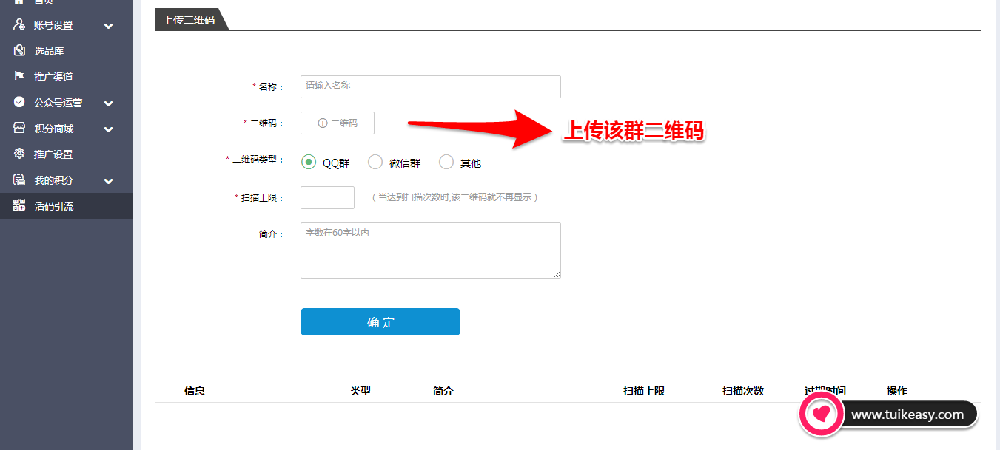

# 3 活码引流突破微信/QQ群限制

> GitHub 仓库源文件：[点击打开网页渲染版](https://github.com/ben2023niao/ben-ops-notes/blob/main/doc/md/202304141557-DevOps%20%E4%B8%8E%20SRE%2B%E4%BC%98%E5%8C%96%E6%96%B9%E6%A1%88%2B%E7%9F%A5%E8%AF%86%E7%AC%94%E8%AE%B0-3%20%E6%B4%BB%E7%A0%81%E5%BC%95%E6%B5%81%E7%AA%81%E7%A0%B4%E5%BE%AE%E4%BF%A1-QQ%E7%BE%A4%E9%99%90%E5%88%B6.md)

## 活码引流

扫码进群，微信群的二维码扫码上限是100人，QQ群扫码上限数量为该群最大人数。
该群扫满上限后自动切换到下一个微信群或者qq群，突破群员限制门槛引流。

- **新建活码**

活码外层图例

