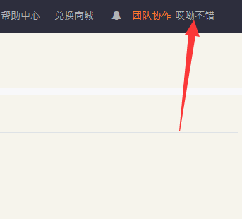
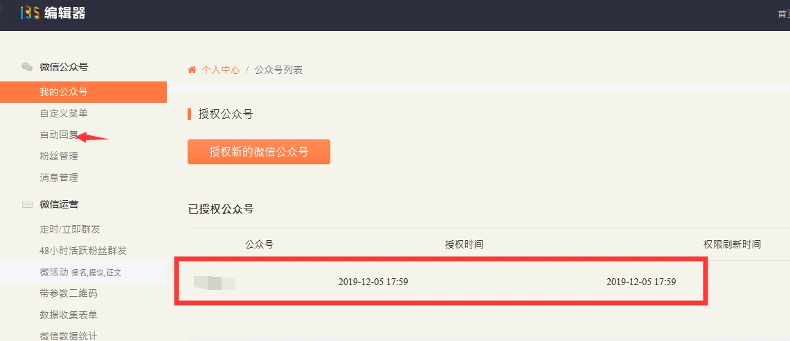
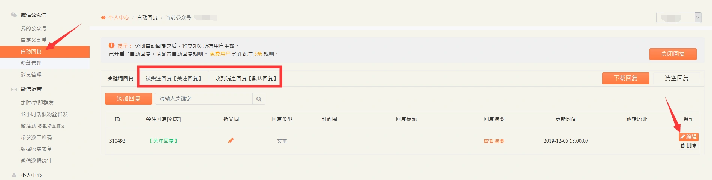

# 不认证公众号文字修改教程

> GitHub 仓库源文件：[点击打开网页渲染版](https://github.com/ben2023niao/ben-ops-notes/blob/main/doc/md/202304141557-DevOps%20%E4%B8%8E%20SRE%2B%E4%BC%98%E5%8C%96%E6%96%B9%E6%A1%88%2B%E7%9F%A5%E8%AF%86%E7%AC%94%E8%AE%B0-%E4%B8%8D%E8%AE%A4%E8%AF%81%E5%85%AC%E4%BC%97%E5%8F%B7%E6%96%87%E5%AD%97%E4%BF%AE%E6%94%B9%E6%95%99%E7%A8%8B.md)

## **注意事项**

**不认证公众号在135编辑器改文字**

---

## 不认证的公众号文字添加/修改教程 [点击播放](http://jiaoc.jd69.top/weiqing/不认证公众号.mp4)

## 135编辑器链接：[链接](http://www.135plat.com/wx_auto_replies/mine)

---

登录上135编辑器，点击右上角的用户名。

授权了公众号后，点击自动回复，已经授权了的，看下公众号名字和你要设置的公众号名字是不是一个，不是的话就重新授权。

修改这两个，点击编辑，改完后点提交，然后再重复这一步，修改另一个回复

