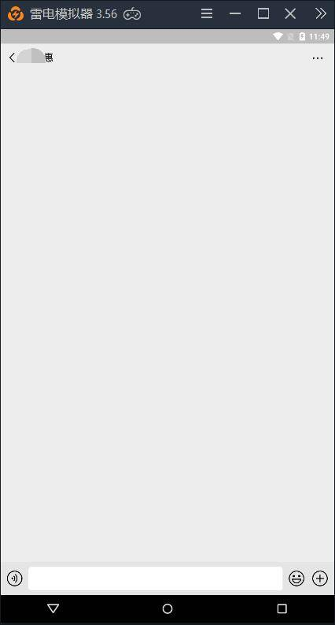
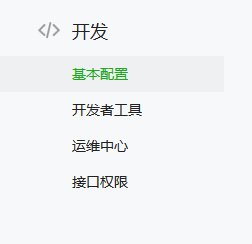
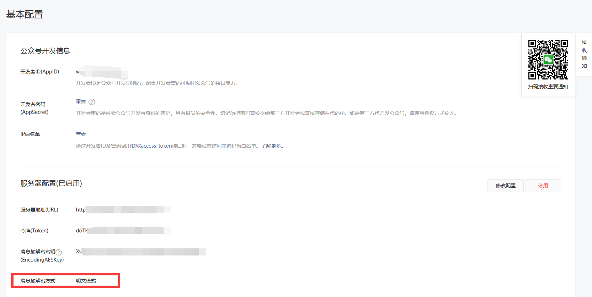
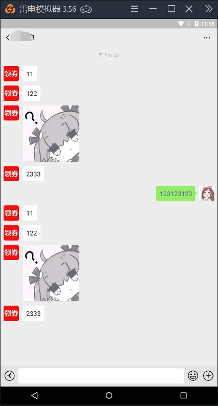
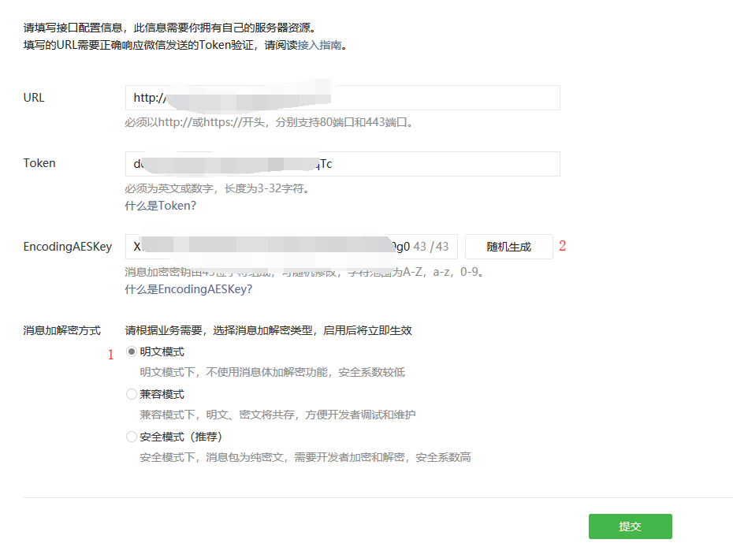
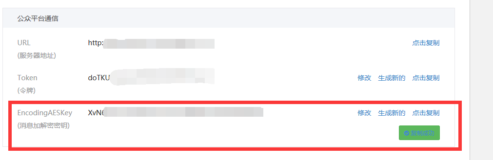

# 公众号的所有设置都是正确的却不回复消息

> GitHub 仓库源文件：[点击打开网页渲染版](https://github.com/ben2023niao/ben-ops-notes/blob/main/doc/md/202304141557-DevOps%20%E4%B8%8E%20SRE%2B%E4%BC%98%E5%8C%96%E6%96%B9%E6%A1%88%2B%E7%9F%A5%E8%AF%86%E7%AC%94%E8%AE%B0-%E5%85%AC%E4%BC%97%E5%8F%B7%E7%9A%84%E6%89%80%E6%9C%89%E8%AE%BE%E7%BD%AE%E9%83%BD%E6%98%AF%E6%AD%A3%E7%A1%AE%E7%9A%84%E5%8D%B4%E4%B8%8D%E5%9B%9E%E5%A4%8D%E6%B6%88%E6%81%AF.md)

## 解决方式：

1：检查所有设置，确定所有东西都设置正确，确定之后，百度搜索 **微信公众号**，登录之后，找到左边的基本配置，点击进入

2：看一下**消息加解密方式**是否为**明文模式**，不是的就修改成明文模式即可回复

## 注意

修改不了明文模式的，就先点击明文模式，然后点击随机生成，再提交，提交完去微擎后台找到这个密钥，在把它复制到上面的那里，再点提交，然后启用就行

