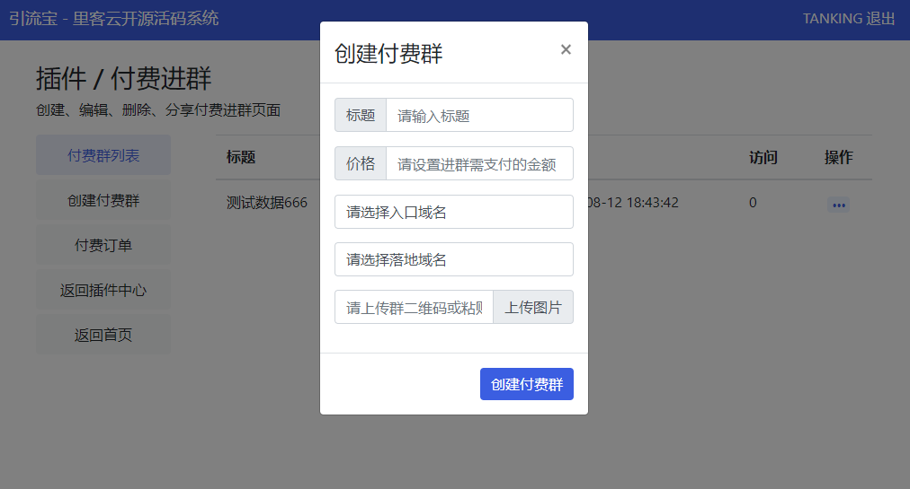
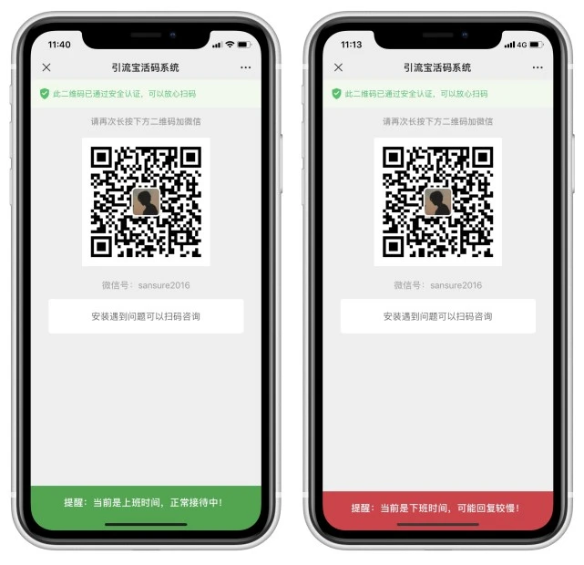

# 官网

> GitHub 仓库源文件：[点击打开网页渲染版](https://github.com/ben2023niao/ben-ops-notes/blob/main/doc/md/202304141557-DevOps%20%E4%B8%8E%20SRE%2B%E4%BC%98%E5%8C%96%E6%96%B9%E6%A1%88%2B%E7%9F%A5%E8%AF%86%E7%AC%94%E8%AE%B0-%E5%AE%98%E7%BD%91.md)

<http://www.likeyunba.com/hm/>
无法再GitHub下载的可以访问国内的网盘下载： <https://likeyun.lanzout.com/io1bH01uim1i>
<https://github.com/likeyun/liKeYun_Huoma>

