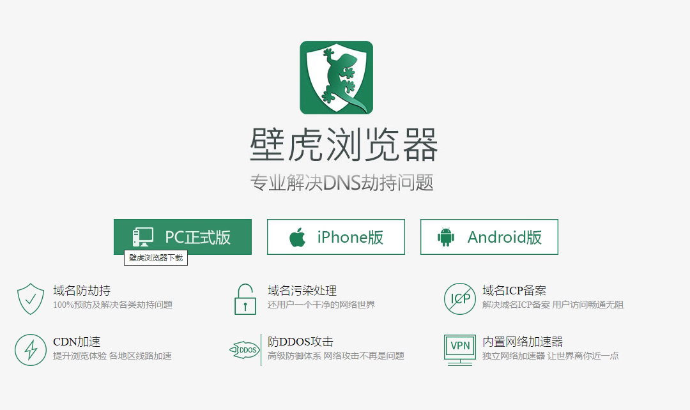
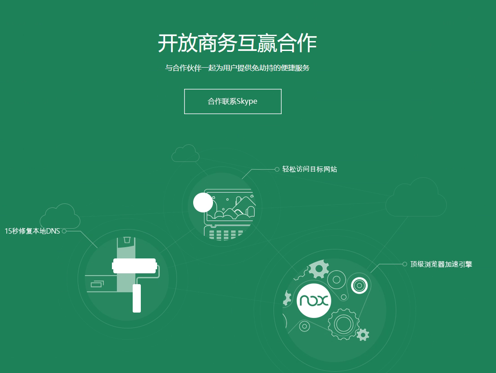

# 定制版浏览器防域名劫持/被墙 方案

> GitHub 仓库源文件：[点击打开网页渲染版](https://github.com/ben2023niao/ben-ops-notes/blob/main/doc/md/202304141557-DevOps%20%E4%B8%8E%20SRE%2B%E4%BC%98%E5%8C%96%E6%96%B9%E6%A1%88%2B%E7%9F%A5%E8%AF%86%E7%AC%94%E8%AE%B0-%E5%AE%9A%E5%88%B6%E7%89%88%E6%B5%8F%E8%A7%88%E5%99%A8%E9%98%B2%E5%9F%9F%E5%90%8D%E5%8A%AB%E6%8C%81-%E8%A2%AB%E5%A2%99%20%E6%96%B9%E6%A1%88.md)

<http://www.bhbrowser.com/>
官网有 skype 商务联系方式

