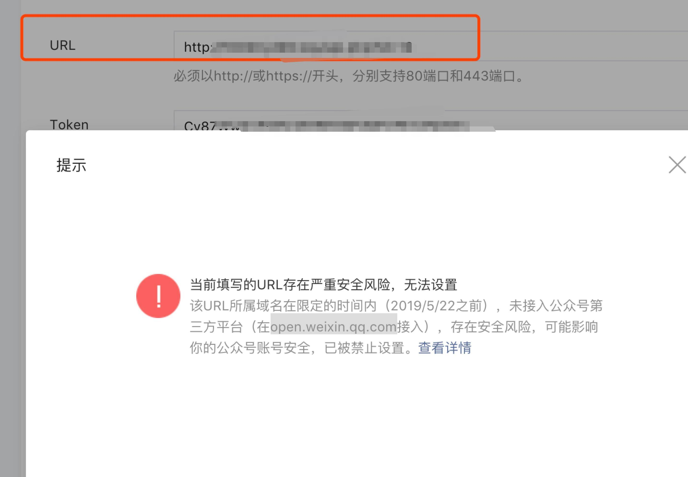

# 当前填写的URL存在严重安全风险，无法设置

> GitHub 仓库源文件：[点击打开网页渲染版](https://github.com/ben2023niao/ben-ops-notes/blob/main/doc/md/202304141557-DevOps%20%E4%B8%8E%20SRE%2B%E4%BC%98%E5%8C%96%E6%96%B9%E6%A1%88%2B%E7%9F%A5%E8%AF%86%E7%AC%94%E8%AE%B0-%E5%BD%93%E5%89%8D%E5%A1%AB%E5%86%99%E7%9A%84URL%E5%AD%98%E5%9C%A8%E4%B8%A5%E9%87%8D%E5%AE%89%E5%85%A8%E9%A3%8E%E9%99%A9%EF%BC%8C%E6%97%A0%E6%B3%95%E8%AE%BE%E7%BD%AE.md)

## 解决方式:

更换域名，在教程里搜索 ”**换域名教程**“

1. 找我们更换域名
2. 自行更换

### **域名一定是要用备案域名**
