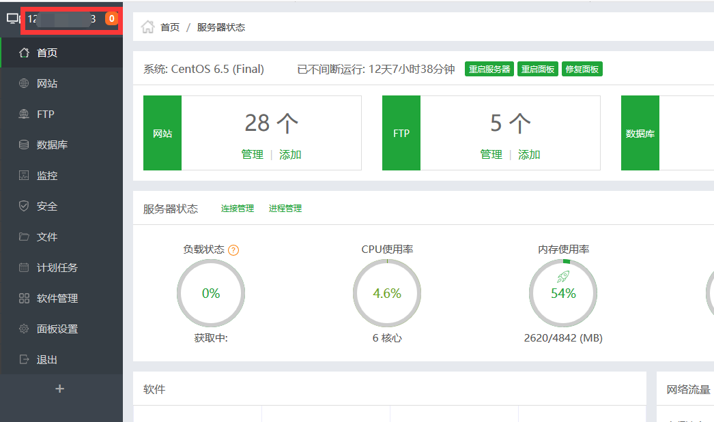
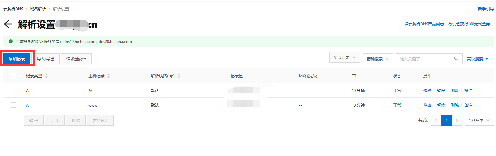
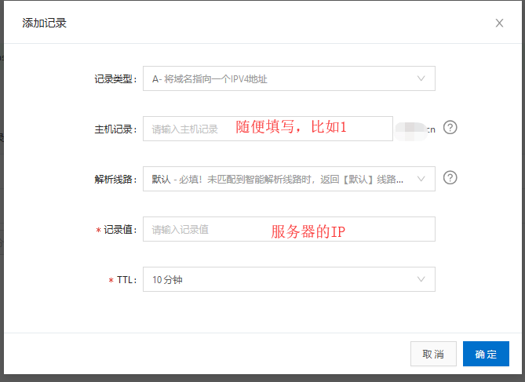
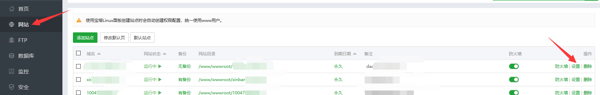
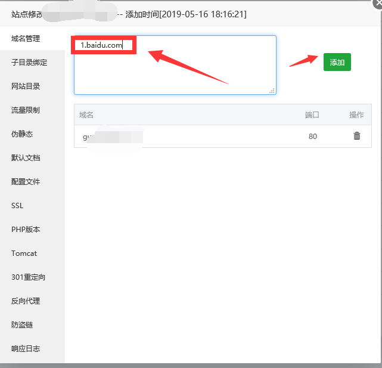
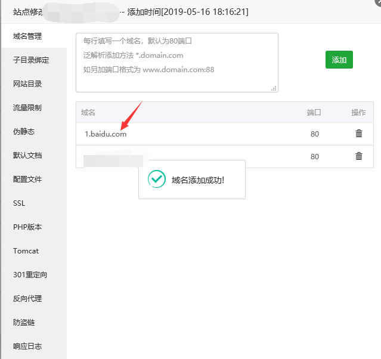

# 换域名教程

> GitHub 仓库源文件：[点击打开网页渲染版](https://github.com/ben2023niao/ben-ops-notes/blob/main/doc/md/202304141557-DevOps%20%E4%B8%8E%20SRE%2B%E4%BC%98%E5%8C%96%E6%96%B9%E6%A1%88%2B%E7%9F%A5%E8%AF%86%E7%AC%94%E8%AE%B0-%E6%8D%A2%E5%9F%9F%E5%90%8D%E6%95%99%E7%A8%8B.md)

## **注意事项：服务器如果是大陆的，域名必须要备案**

### 不管你的域名是腾讯云的还是其他乱七八糟的，它们解析的步骤都大同小异，自己举一反三多研究研究

---

### 第一步：解析域名，以下以阿里云举例

### 登录阿里云找到自己的域名，点右边解析

---

### 第二步：找到要解析的IP，以宝塔面板为例

### 右上角就是这个服务器的IP

---

### 第三步；解析域名

### 复制服务器的IP地址，回到阿里云，点击添加记录

---

### 第四步：在弹出的窗口填资料

### 记录类型：选择 A

### 主机记录：随便填写（比如填 1）

### 解析线路:默认

### 记录值：刚刚复制的服务器的IP

### TTL：默认

### 随后点击 确定

### 解析之后，完整的域名如下格式

### 主机记录+一级域名

### 比如我的域名是 [baidu.com](http://baidu.com/)

### 那我的刚刚解析的域名就是： [1.baidu.com](http://1.baidu.com/)

## (此域名虽然能点开，但和我们没任何关系，因为它出现的任何问题概不负责)

---

### 第五步：回到宝塔面板

### 选择要更换域名的那一条域名，点击右边的设置

---

### 第六步：在弹出的窗口填写刚刚解析的域名

### 点击添加

---

### 第七步：添加之后，点击刚刚加入的域名，能够访问就说明成功了
