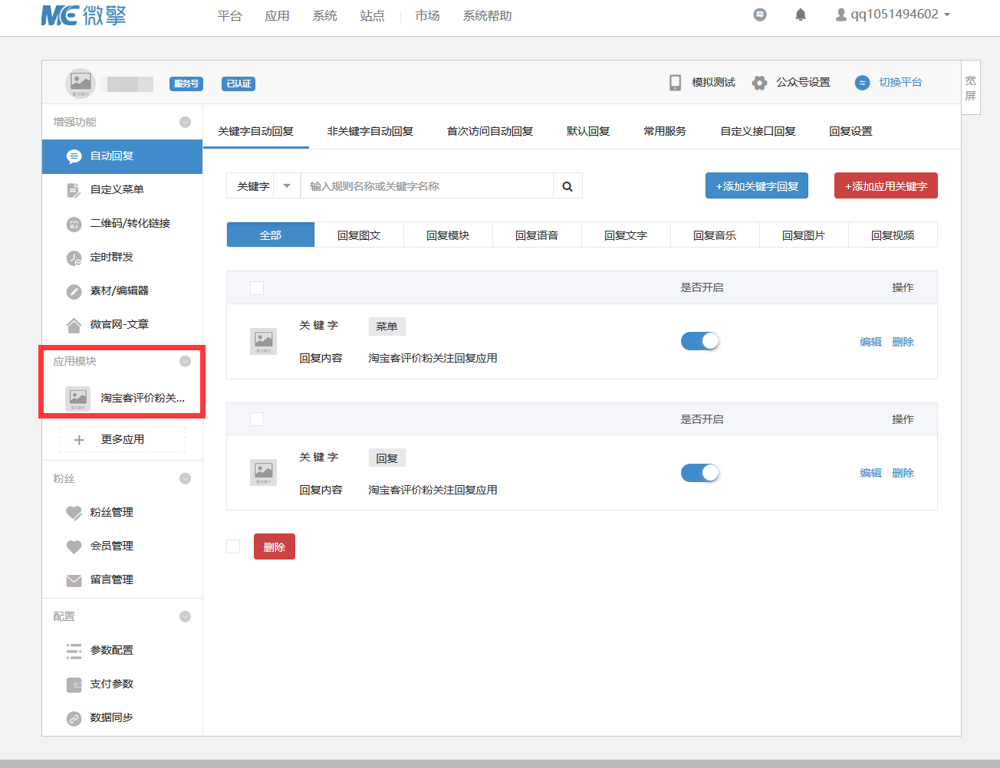
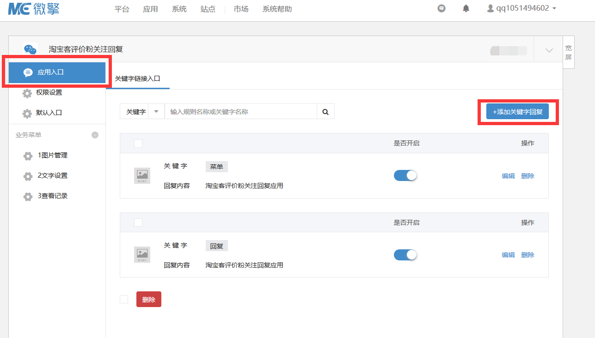
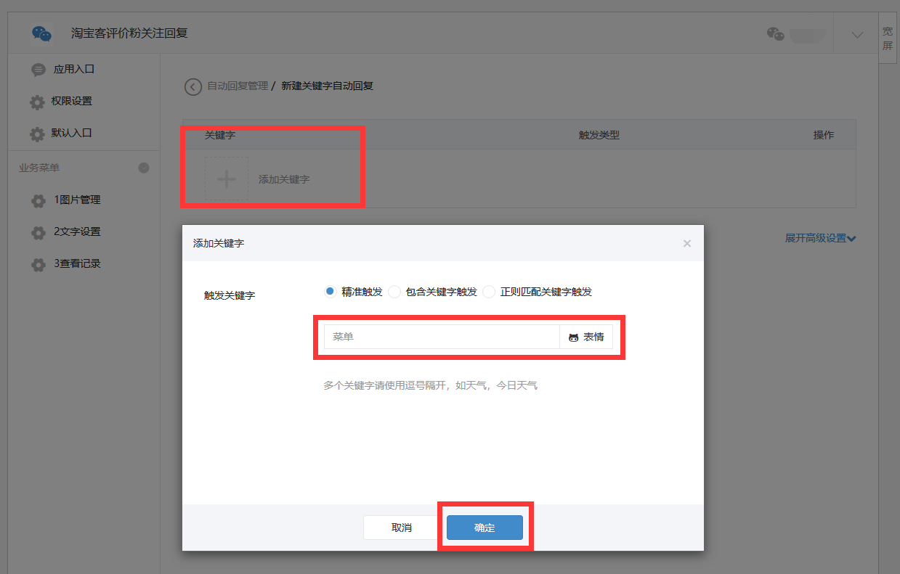
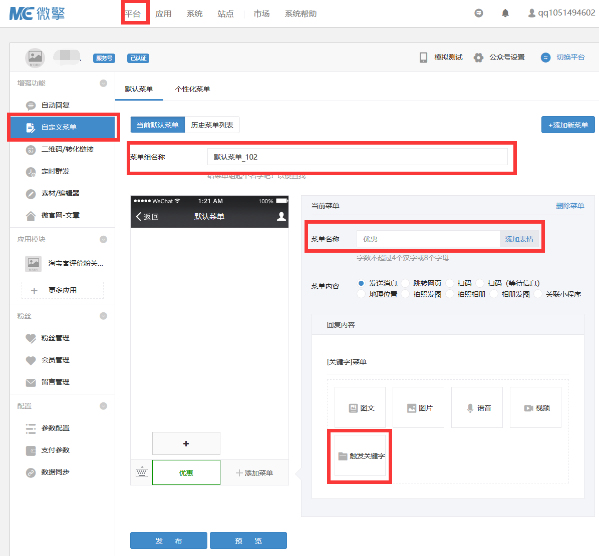
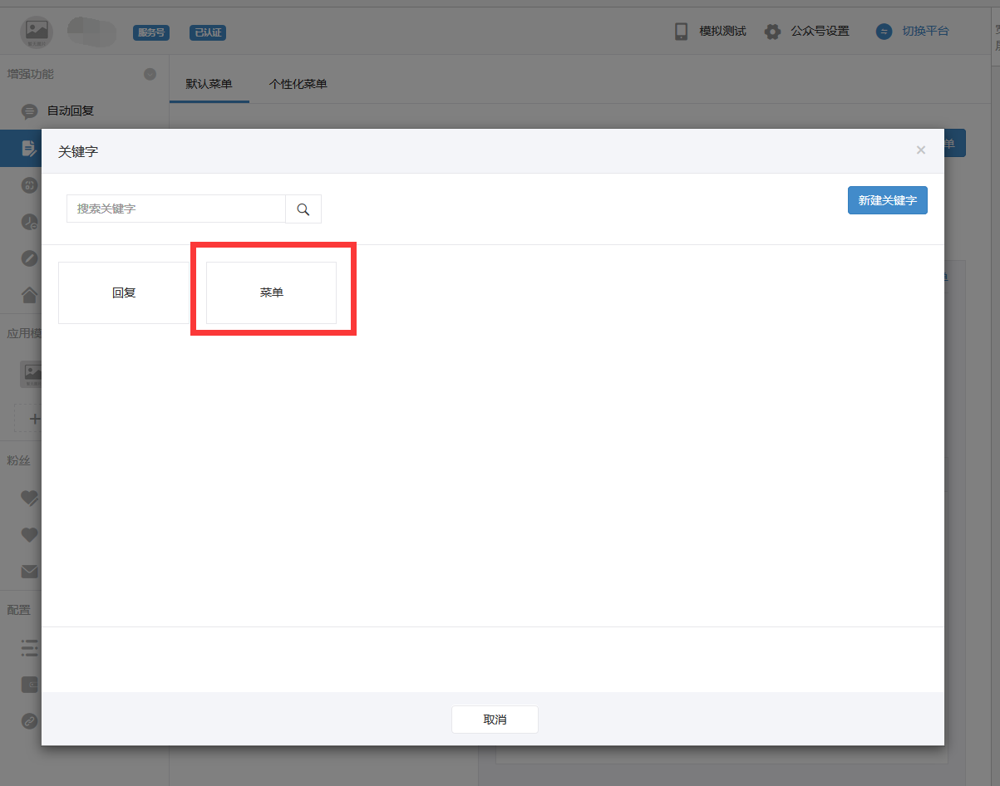

# 旧版微擎自定义菜单设置

## 设置公众号自定义菜单教程

## 没有认证的公众号不能设置

第一步，点击进入活码模块

第二步，点击应用入口，点击添加关键字回复

第三步，点击添加关键字，输入框里输入 "菜单" (随便什么字都可以)，点击确定，再点击发布

第四步，点击上方平台按钮，点击自定义菜单，输入菜单组名称，输入菜单名称，点击触发关键字，选择我们刚刚设置的关键字，在再点击发布

这样就设置好了
