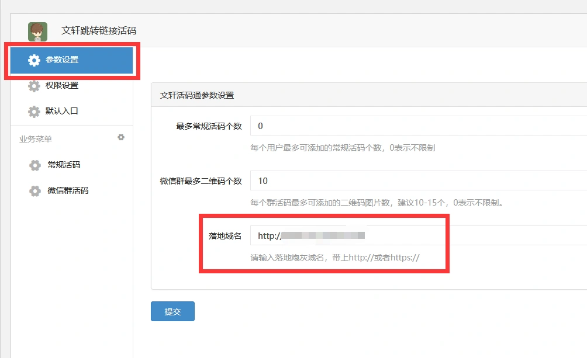

# 炮灰域名修改教程

> GitHub 仓库源文件：[点击打开网页渲染版](https://github.com/ben2023niao/ben-ops-notes/blob/main/doc/md/202304141557-DevOps%20%E4%B8%8E%20SRE%2B%E4%BC%98%E5%8C%96%E6%96%B9%E6%A1%88%2B%E7%9F%A5%E8%AF%86%E7%AC%94%E8%AE%B0-%E7%82%AE%E7%81%B0%E5%9F%9F%E5%90%8D%E4%BF%AE%E6%94%B9%E6%95%99%E7%A8%8B.md)

**域名可联系我们另外购买**

---

1. 有了域名之后联系我们要服务器IP，然后解析到我们的服务器
（在我们这购买的域名除外，我们负责直接解析过来）
2. 解析之后，如下设置，最后点提交

