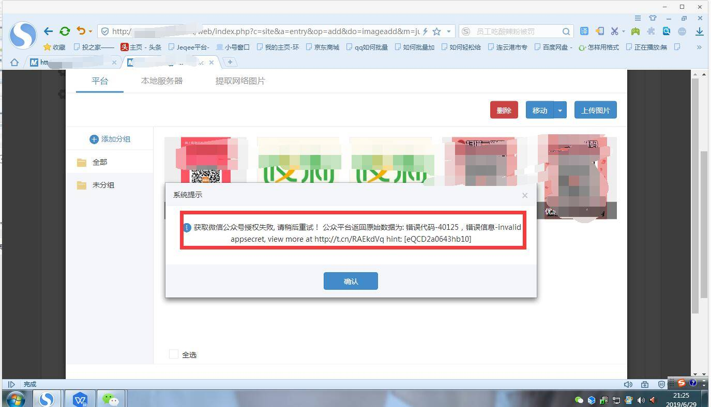
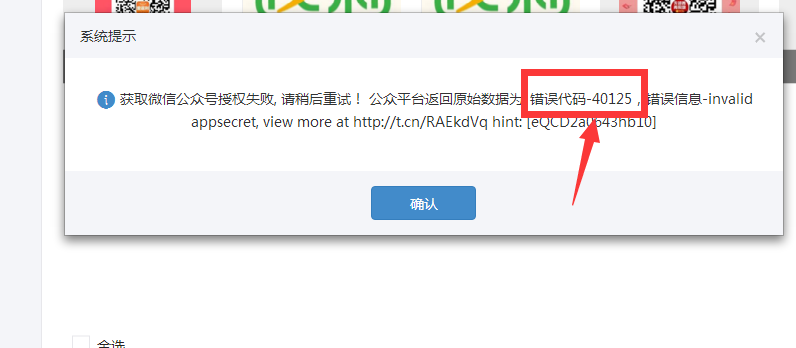
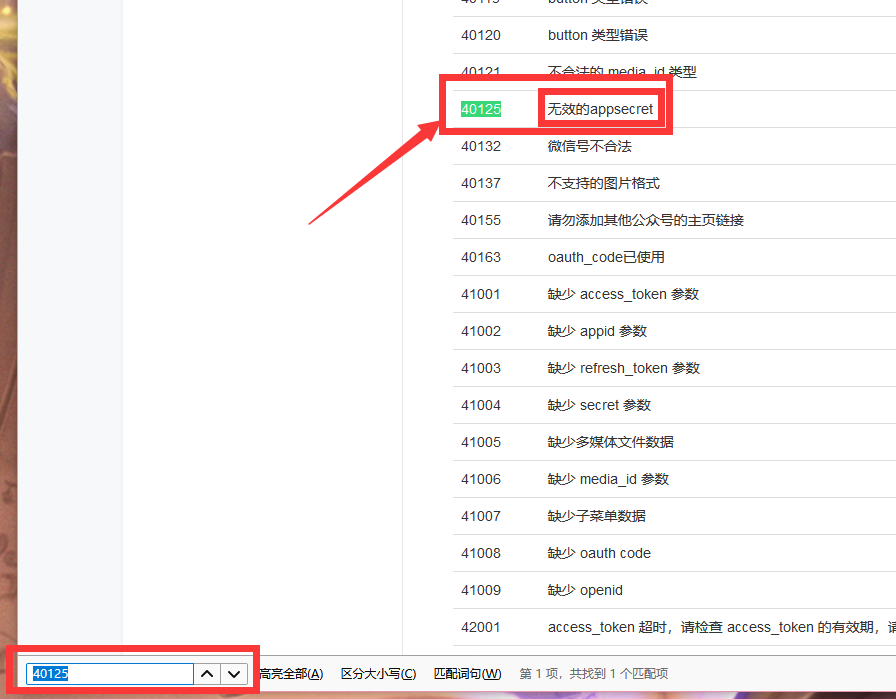
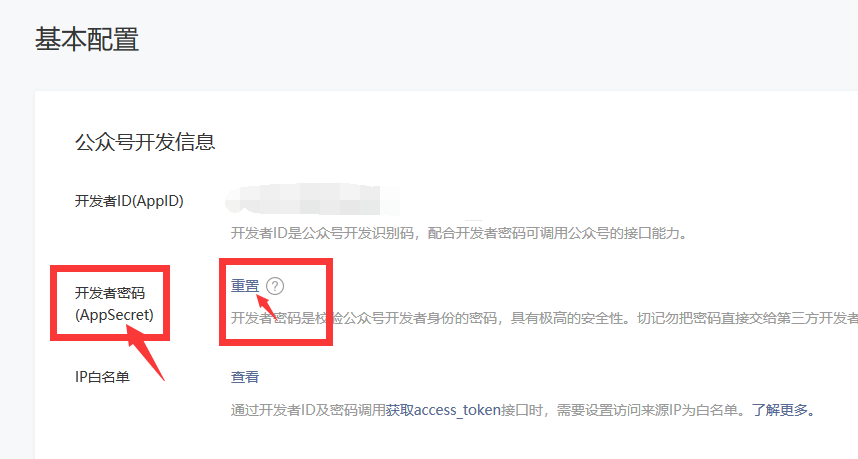
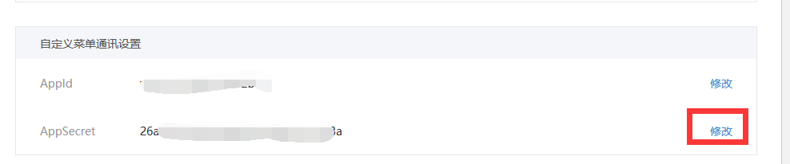

# 获取公众号授权失败，请稍后再试

添加图片的时候出现这个提示

## 注意观察系统返回的错误代码

## 复制代码到 **[微信公众平台技术文档](https://mp.weixin.qq.com/wiki?t=resource/res_main&id=mp1433747234)**(点击跳转)，按下键盘>>>>Ctrl+F 打开浏览器查找页面，粘贴那一串数字，比如：错误代码-40125，就粘贴40152，会自动跳到这代码

## 这里可以看到是因为**开发者密钥错误**导致不能上传图片，点击旁边的重置就行了

## 把重置的密码复制到微擎后台的公众号设置那里修改一下就行了

## 

## 遇见有报错误代码的，都可复制到公众平台技术文档那里查找是什么原因，按照提示的原因修改就行了。
