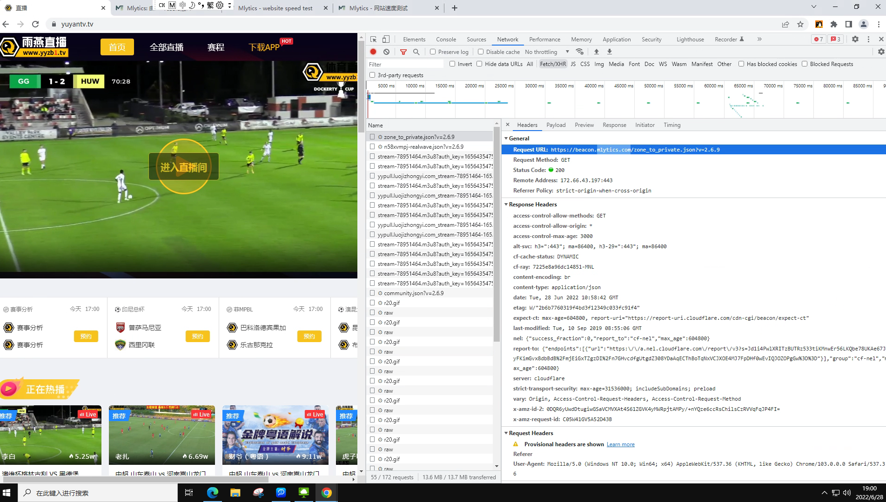
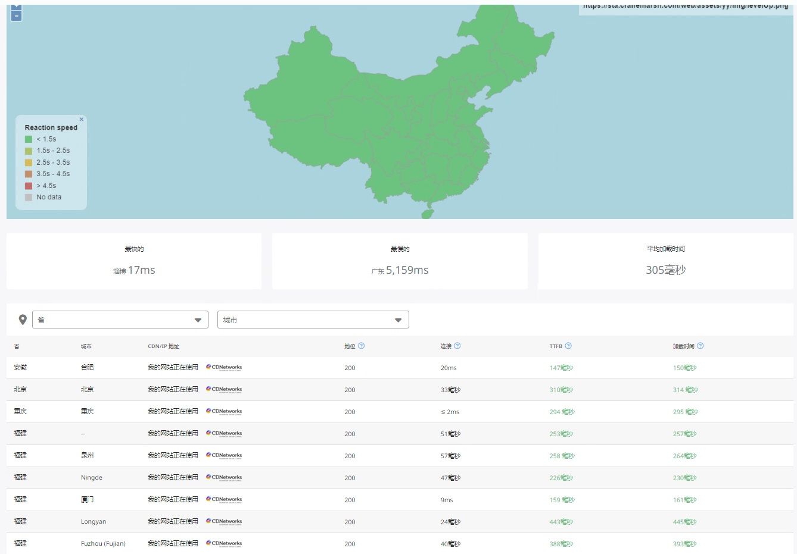
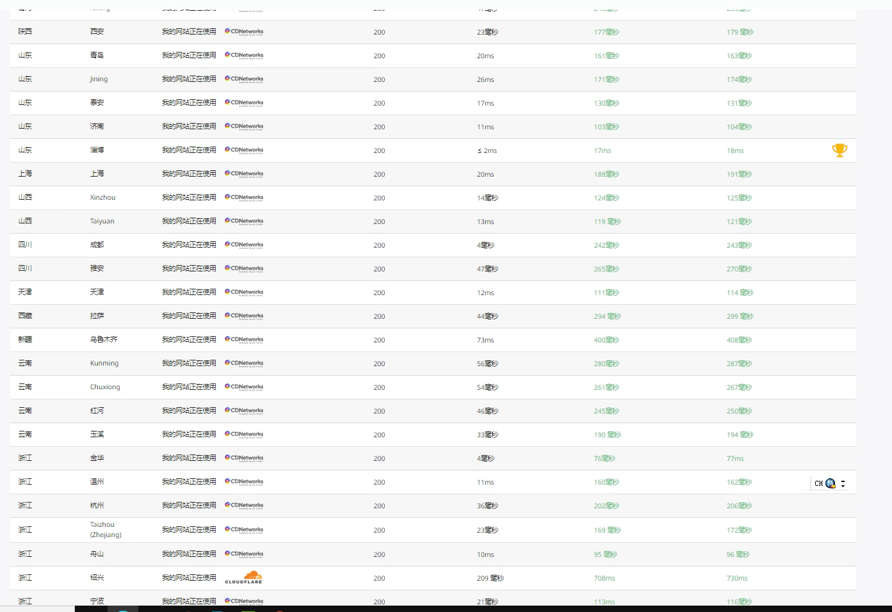

# 融合 CDN 解决方案

[融合 CDN https://www.mlytics.com/zh/](https://www.mlytics.com/zh/)

案列项目<https://yuyantv.tv/>
测速链接 <https://sta.cranemarsh.com/web/assets/yy/img/levelUp.png>
测速网站 <https://hubble.mlytics.com/>    最低延迟 18ms

