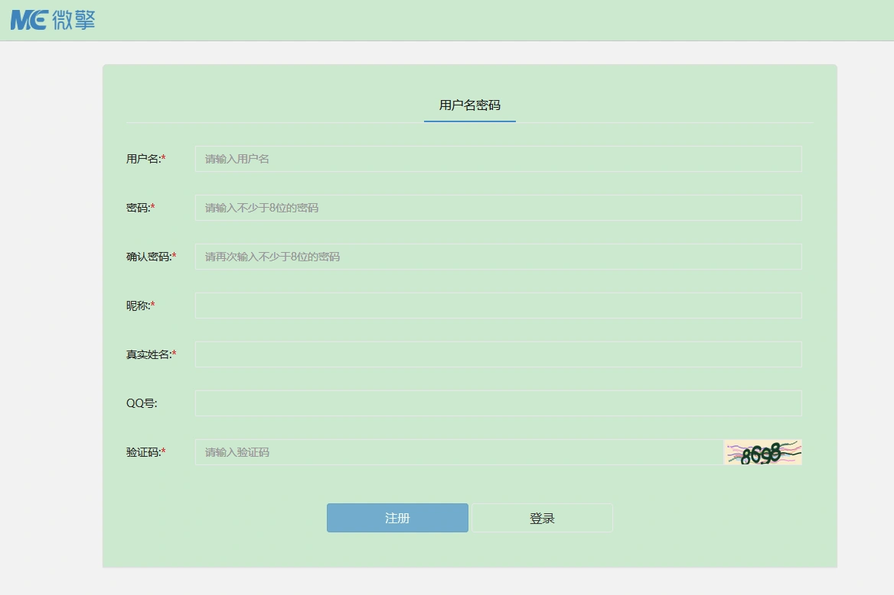
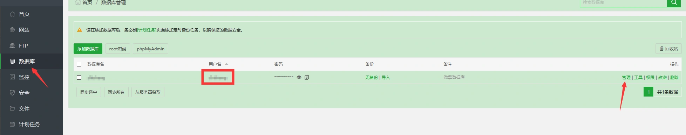
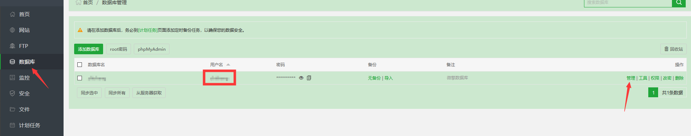
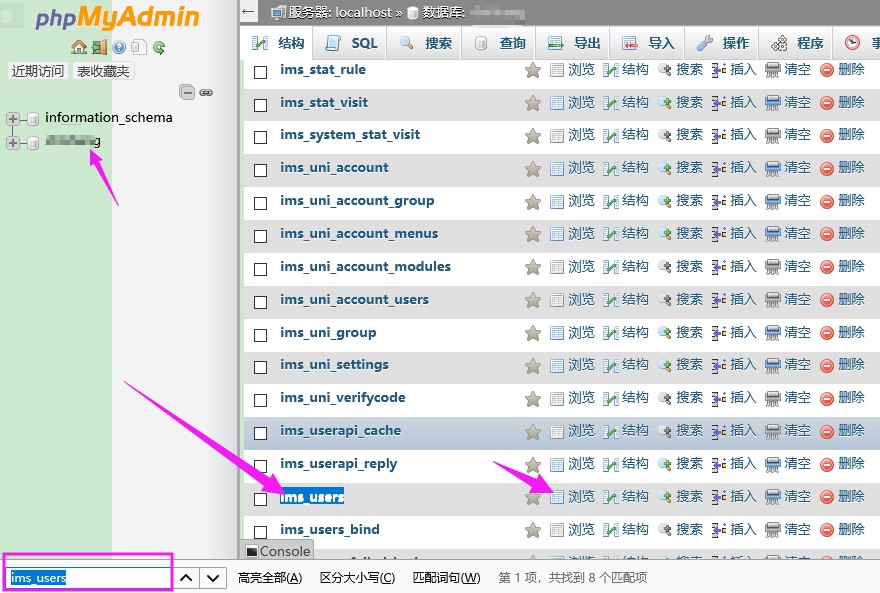
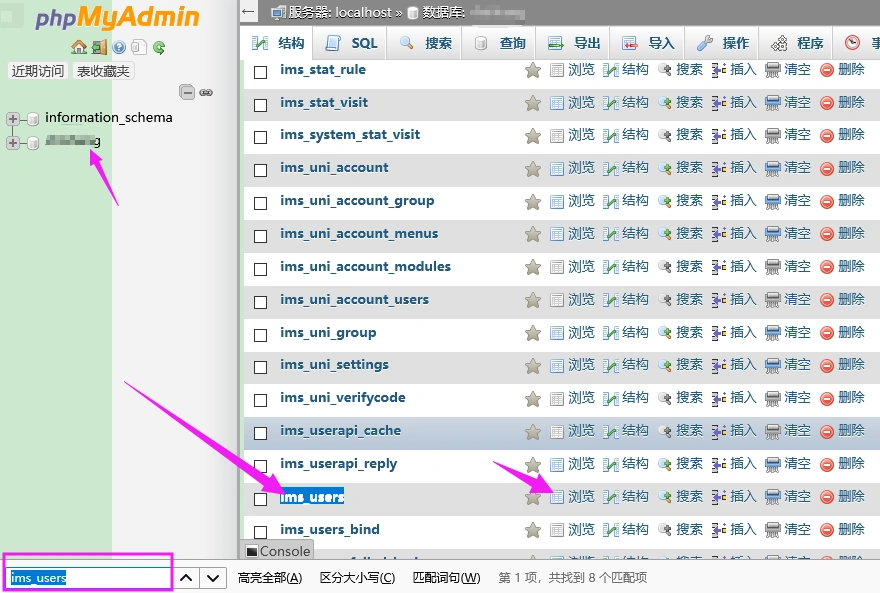
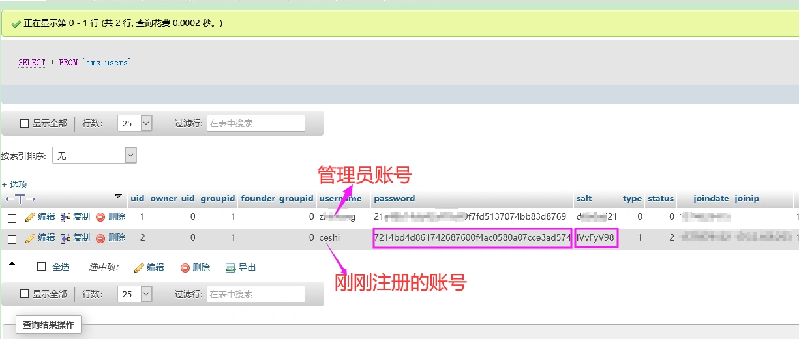

# 解决微擎管理员后台密码忘了登不上去找回方法！

## **今天一客户，他的微擎后台自己改了密码之后，又忘记了，下面是解决办法。**

### **第一步：打开你的微擎注册页面，注册一个账号。**

---

### 第二步：进入宝塔面板，找到对应的数据库。

1. 如果最开始我配置好给你们之后，你们没有修改微擎登录的用户名的话，那数据库的用户名和你登录微擎的用户名是对应的。
2. 找到数据库后，点击**管理**

---

### 第三步：在数据库中，先在左边找到对应的管理员账号，然后找到这一个，然后点击**浏览**。

小技巧：直接按键盘的组合键：CTRL+F。就可以直接搜索：ims_users

---

### 第四步：找到你刚刚注册的账号信息，复制你新注册会员的字段password和salt里面的内容到你的管理员账号里面，这样你就可以用刚刚设置的密码登陆你的管理员账号了。

提示：**直接双击就能编辑
**
