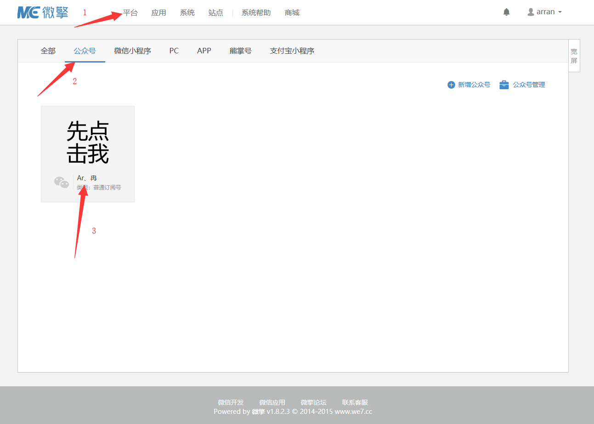
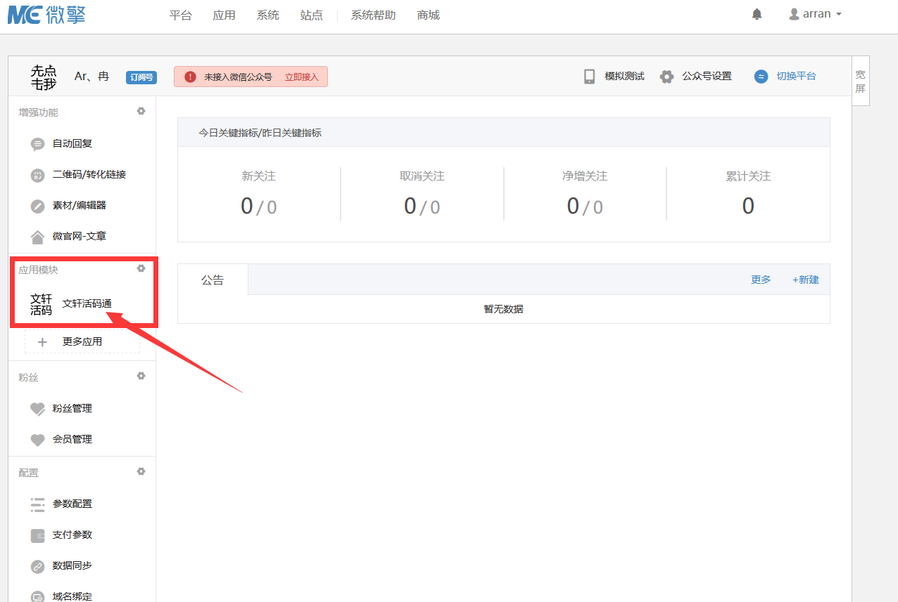
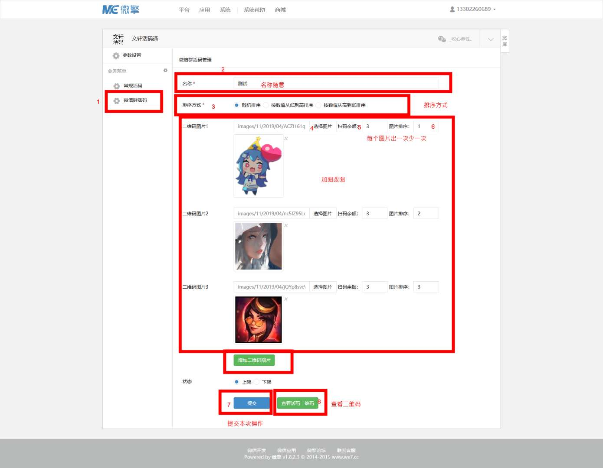

# 链接活码设置教程

> GitHub 仓库源文件：[点击打开网页渲染版](https://github.com/ben2023niao/ben-ops-notes/blob/main/doc/md/202304141557-DevOps%20%E4%B8%8E%20SRE%2B%E4%BC%98%E5%8C%96%E6%96%B9%E6%A1%88%2B%E7%9F%A5%E8%AF%86%E7%AC%94%E8%AE%B0-%E9%93%BE%E6%8E%A5%E6%B4%BB%E7%A0%81%E8%AE%BE%E7%BD%AE%E6%95%99%E7%A8%8B.md)

**微擎系统里面先要有个空的公众号，不会设置就[点击查看](https://www.kancloud.cn/qq1051494602/huoma/1172997)**

## **一般我们都已经设置好了不用操作这一步，直接往下看。**

## **一般我们都已经设置好了不用操作这一步，直接往下看。**

## **一般我们都已经设置好了不用操作这一步，直接往下看。**

---

## **基本操作流程**

### 1.登录微擎后台后点击顺序：

#### 平台 → 公众号 → 已经设置好的公众号

#### 2. 进入公众号后点击“文轩活码通”

#### 3. 进入模块后点击“微信群活码”

##### 参数设置如下：

#### **名称：**

随意填写

#### **排序方式：**

三种模式按自己需求选择

#### **二维码图片：**

点击选择图片 → 点击上传图片 → 上传好图片之后点击刚刚上传的图片

#### **扫码余额**：

代表这个图片出现一次，就少一次，数值变为0的时候图片就不会出现了

#### **图片排序：**

代表这个图片的顺序

#### **增加二维码：**

点击一下可以新增一个放图片的位置

#### **提交：**

提交当前设置

#### **查看活码二维码：**

**点击之后出现一个集合版的二维码，这个二维码随你放哪里都行，扫描之后出现你添加的图片二维码**

---

#### **注意：**

如果觉得软件里面的二维码生成出来的尺寸不合适，可以 [点击](http://tool.chinaz.com/qrcode) 这个网站先去解码，获取到链接后，然后把这个链接在刚刚那个地方点生成 ，生成时候可以改尺寸，多尝试几个合适的尺寸
