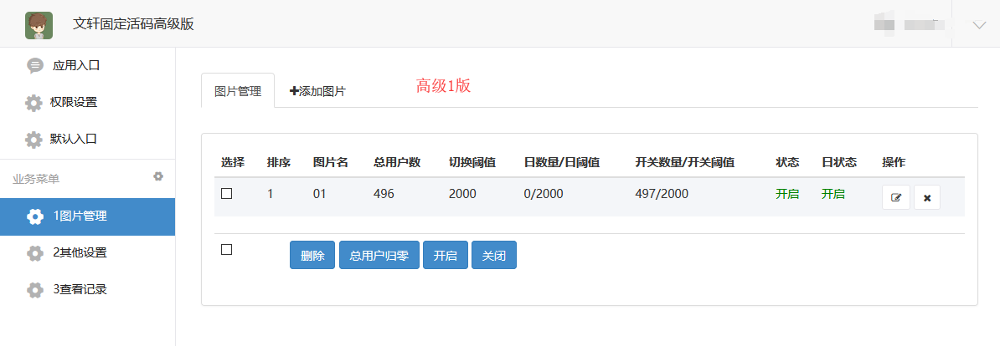
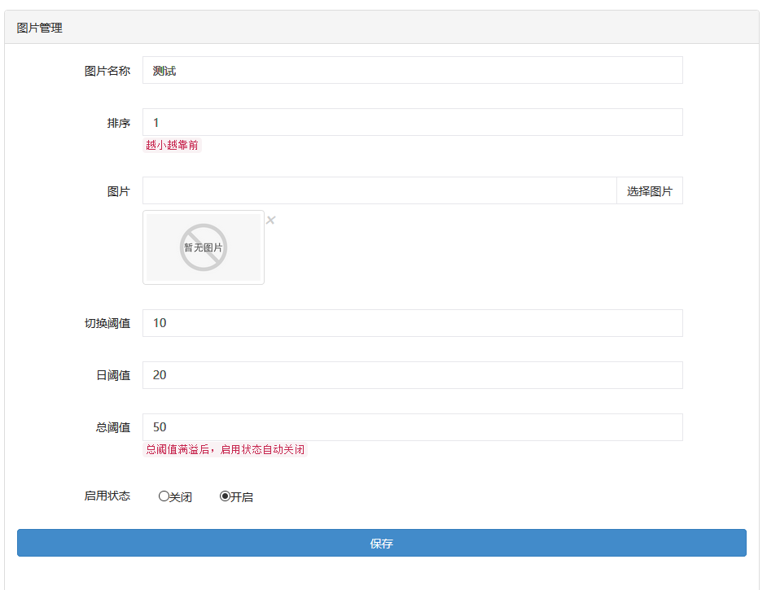
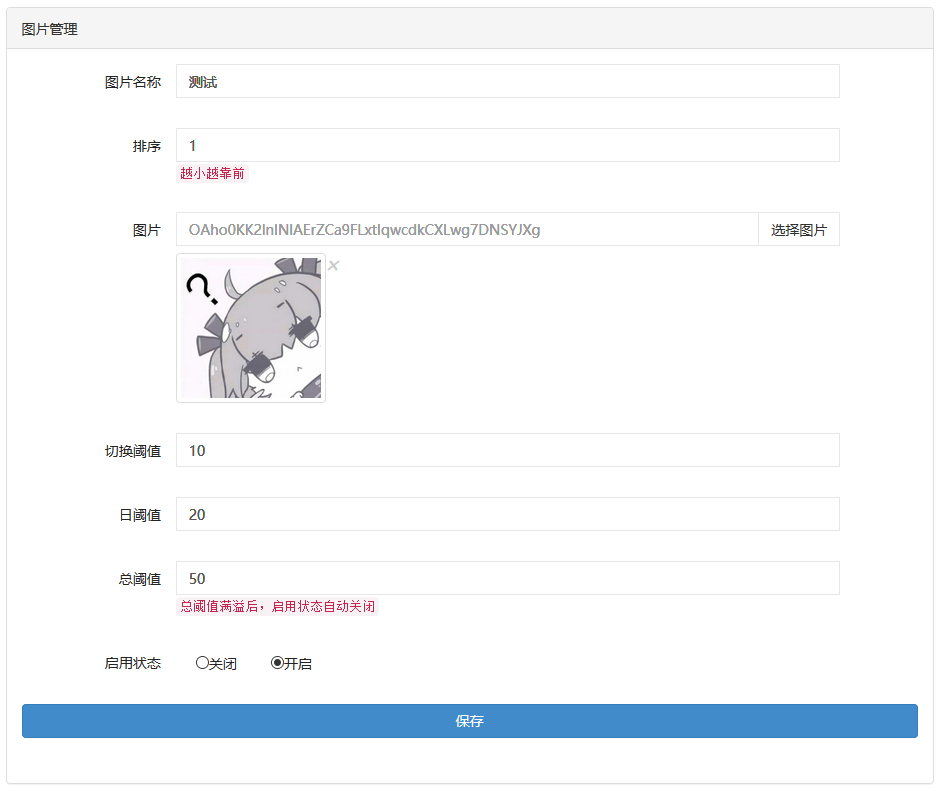

# 高级1版微擎教程

> GitHub 仓库源文件：[点击打开网页渲染版](https://github.com/ben2023niao/ben-ops-notes/blob/main/doc/md/202304141557-DevOps%20%E4%B8%8E%20SRE%2B%E4%BC%98%E5%8C%96%E6%96%B9%E6%A1%88%2B%E7%9F%A5%E8%AF%86%E7%AC%94%E8%AE%B0-%E9%AB%98%E7%BA%A71%E7%89%88%E5%BE%AE%E6%93%8E%E6%95%99%E7%A8%8B.md)

## 高级1版微擎教程

## [点击播放](http://jiaoc.jd69.top/weiqing/新版微擎教程.mp4)

自定义菜单设置教程：[链接](https://www.kancloud.cn/qq1051494602/huoma/1096578)
图片内存建议在200kb以内，超过的建议压缩
压缩工具网站[链接](http://www.secaibi.com/tools/)
点击“链接“打开

---

特别注意，像这张图片那样是没有设置图片，公众号就不会回复图片

这种才是设置好了图片，参数设置好直接保存

