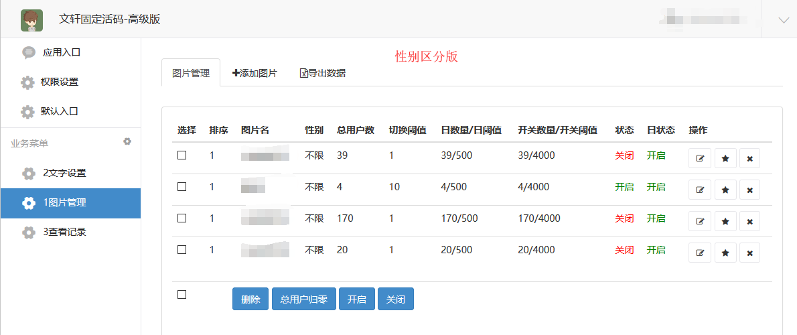
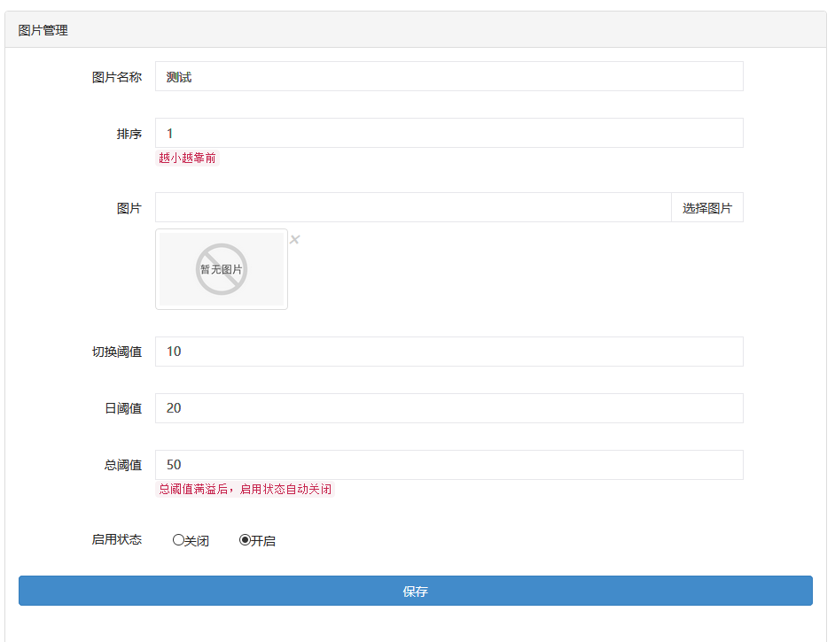
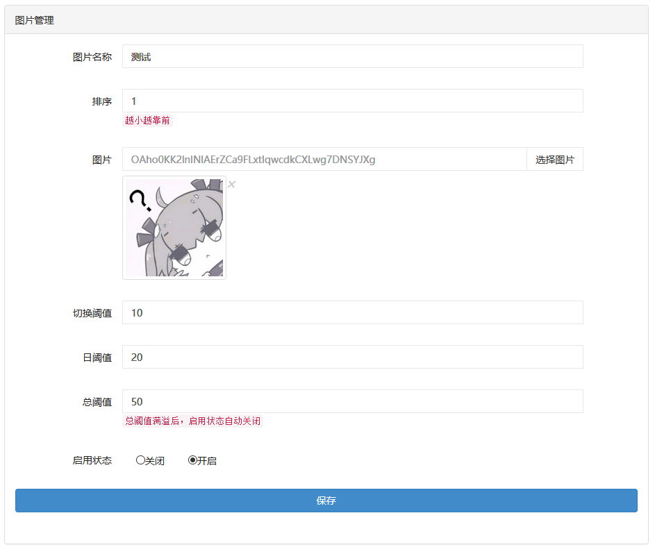

# 高级2男女性别版微擎教程

## 高级2男女性别版微擎教程

## [点击播放](http://jiaoc.jd69.top/weiqing/高级版本性别区分.mp4)

自定义菜单设置教程：[链接](https://www.kancloud.cn/qq1051494602/huoma/1096578)
图片内存建议在200kb以内，超过的建议压缩
压缩工具网站[链接](http://www.secaibi.com/tools/)
点击“链接“打开

---

特别注意，像这张图片那样是没有设置图片，公众号就不会回复图片

这种才是设置好了图片，参数设置好直接保存

