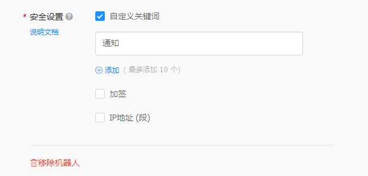

# SPUG-使用常见问题

> GitHub 仓库源文件：[点击打开网页渲染版](https://github.com/ben2023niao/ben-ops-notes/blob/main/doc/md/202304141557-DevOps%20%E4%B8%8E%20SRE%2B%E9%AB%98%E6%95%88%E8%BF%90%E7%BB%B4%2BDocker%2BNginx-SPUG-%E4%BD%BF%E7%94%A8%E5%B8%B8%E8%A7%81%E9%97%AE%E9%A2%98.md)

## 使用常见问题

### 使用 nohup 启动后台进程页面一直在转圈不会结束？

在 [批量执行](https://spug.cc/docs/batch-exec/) 或 [发布配置](https://spug.cc/docs/deploy-config/) 等的执行脚本中以 `nohup` 或 `&` 的方式启动后台子进程时需要 把命令的标准输出重定向至 `/dev/null`，例如以下启动 `Tomcat` 的命令：

```
cd web/WEB-INF/
nohup ./startup.sh &
```

把上述命令改为：

```
cd web/WEB-INF/
nohup ./startup.sh > /dev/null &
```

#### 能否使用自己的密钥对？

可以，`v2.3.0` 版本开始已支持上传自定义密钥对，可以在 `系统管理 \ 系统设置 \ 密钥设置` 中，自行上传密钥。

#### 新建常规发布申请 git clone 错误

`Spug` 无法提供交互式的输入账户密码登录git仓库的能力，如果是公开的仓库 `http/https/ssh` 任何一种协议都可以，但如果是私有仓库推荐使用 `ssh` 协议配置密钥来访问。`http/https` 协议则需要在带上用户名和密码，例如 `<https://example.invalid/repository 如果账户名中包含了 `@` 符号，则需要替换成 `%40`。特别要注意的是，如果你是通过docker方式部署的则需要确保在容器内可以访问仓库，而不是在宿主机上。

#### 主机 Console 或执行发布页面无内容

这种情况大部分都是 `Websocket` 连接建立失败了，一般出现在部署时自己加了一层 nginx 之类的代理工具，这些代理工具默认无法处理 `Weboscket` 请求， 这就需要你配置其支持转发 `Websocket` 请求，下边给个 `Nginx` 的例子，这里假设你用 docker 部署的 `Spug`, 映射了宿主机的 8000 端口：

```nginx
server {
 listen 80;
 server_name xxx.xxx.xxx;

 location / {
 proxy_pass http://203.0.113.1:8000;
 proxy_set_header X-Forwarded-For $proxy_add_x_forwarded_for;
 }

 location ^~ /api/ws/ {
 proxy_pass http://203.0.113.1:8000;
 proxy_http_version 1.1;
 proxy_set_header Upgrade $http_upgrade;
 proxy_set_header Connection "Upgrade";
 proxy_set_header X-Forwarded-For $proxy_add_x_forwarded_for;
 }
 error_page 404 /index.html;
}
```

#### 文件管理器上传文件报错 413 Request Entity Too Large

文件上传大小受 `Nginx` 的 `client_max_body_size` 影响，请修该值至合适的大小，参考以下配置：

docker 方式部署配置文件位于容器内的 `/etc/nginx/nginx.conf`, 可以在容器外部编辑后通过 `docker cp` 至容器内，也可以在容器内执行 `vi` 在容器内直接修改，最后别忘了重启容器。

```nginx
server {
 listen 80;
 server_name xxx.xxx.xxx;
 client_max_body_size 100m;
 ...
}
```

#### 钉钉收不到通知？

钉钉机器人安全设置中 **IP地址** 添加部署 `Spug` 的服务器的公网地址，或者使用 **自定义关键词** 填写 `通知`，如下图

