# 苹果自动化构建发布

> GitHub 仓库源文件：[点击打开网页渲染版](https://github.com/ben2023niao/ben-ops-notes/blob/main/doc/md/202304141557-DevOps%20%E4%B8%8E%20SRE%2B%E9%AB%98%E6%95%88%E8%BF%90%E7%BB%B4%2BLinux%2BDNS-%E8%8B%B9%E6%9E%9C%E8%87%AA%E5%8A%A8%E5%8C%96%E6%9E%84%E5%BB%BA%E5%8F%91%E5%B8%83.md)

docker run 苹果系统 然后做自动化 xcode 打包发布苹果 app

```bash
#docker run 苹果操作系统笔记
##################################
#linux安装环境
# ARCH
sudo pacman -S qemu libvirt dnsmasq virt-manager bridge-utils flex bison iptables-nft edk2-ovmf
# UBUNTU DEBIAN
sudo apt install qemu qemu-kvm libvirt-clients libvirt-daemon-system bridge-utils virt-manager libguestfs-tools
# CENTOS RHEL FEDORA
sudo yum install libvirt qemu-kvm
##################################
#自启动 libvirt 和加载 kvm 内核模块
sudo systemctl enable --now libvirtd
sudo systemctl enable --now virtlogd
echo 1 | sudo tee /sys/module/kvm/parameters/ignore_msrs
sudo modprobe kvm
##################################
#docker run 苹果操作系统
sudo docker run -it \
--device /dev/kvm \
-p 50922:10022 \
-v /tmp/.X11-unix:/tmp/.X11-unix \
-e "DISPLAY=${DISPLAY:-:0.0}" \
-e GENERATE_UNIQUE=true \
-e MASTER_PLIST_URL=https://raw.githubusercontent.com/sickcodes/osx-serial-generator/master/config-custom.plist \
sickcodes/docker-osx:big-sur
#然后在弹出的界面安装初始化 mac 系统
##################################
#重启docker版mac系统
sudo docker ps -a

# xxx 为对应的CONTAINER ID
sudo docker start -ai xxxxx
##################################
#移植Docker版mac镜像
#在docker目录找到对应的镜像文件，然后备份这个文件
sudo find /var/lib/docker -size +10G | grep mac_hdd_ng.img
#使用naked启动，同时附上备份的文件，添加参数-e RAM=6，这个表示虚拟系统使用的内存大小，可以根据自己的硬件环境选择合适的大小
sudo docker run -it \
--device /dev/kvm \
-p 50922:10022 \
-v "${PWD}/mac_hdd_ng.img:/image" \
-v /tmp/.X11-unix:/tmp/.X11-unix \
-e "DISPLAY=${DISPLAY:-:0.0}" \
-e "NOPICKER=false" \
-e RAM=6 \
sickcodes/docker-osx:naked
```

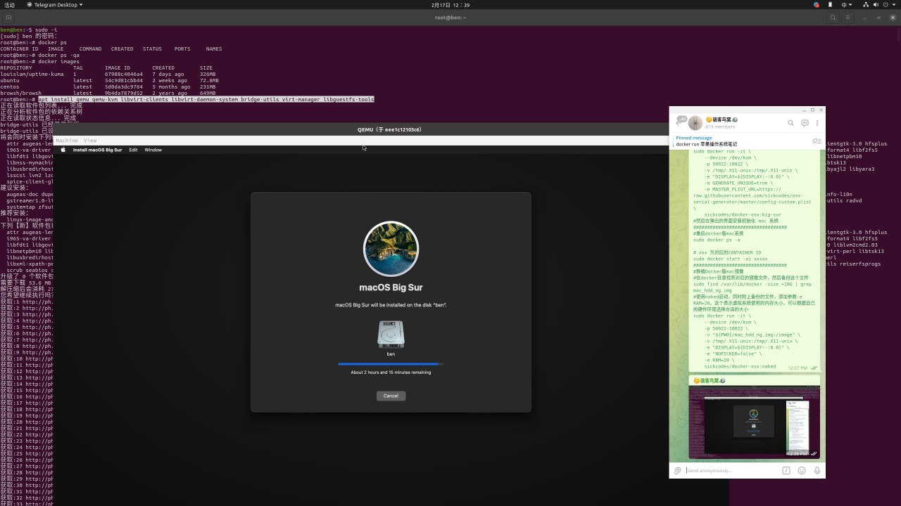

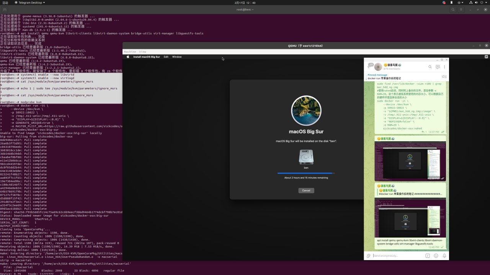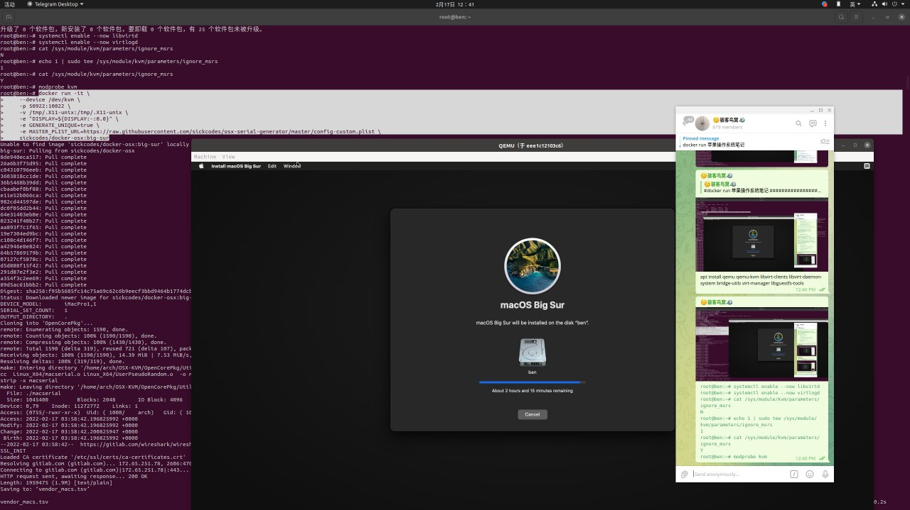


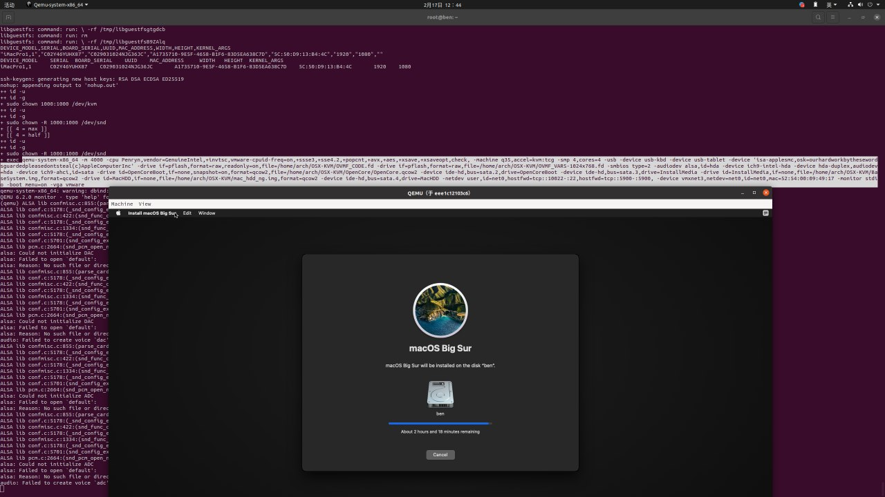
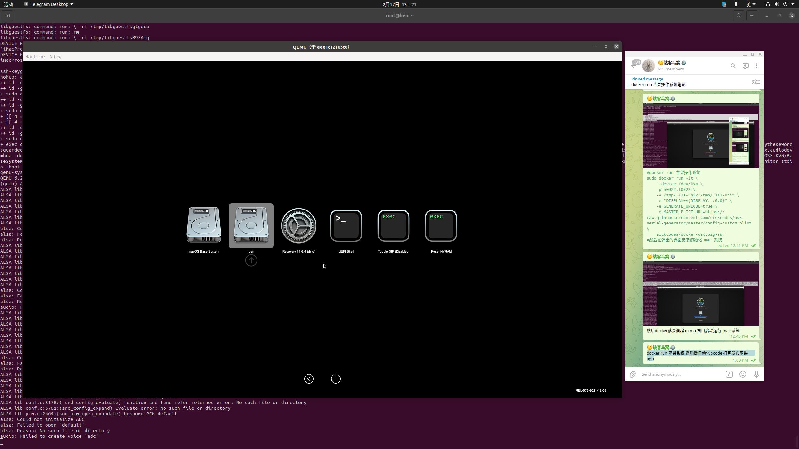
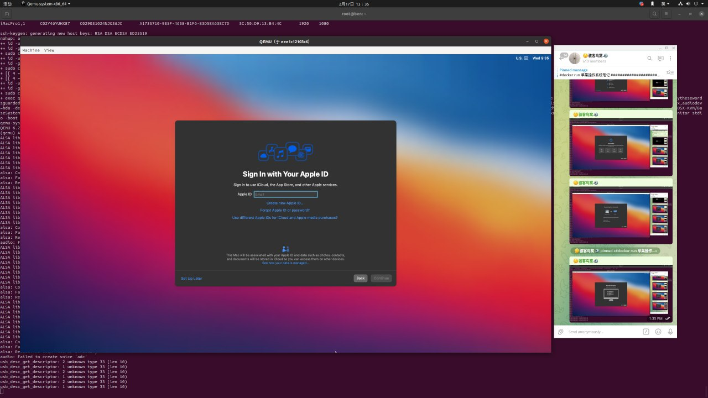
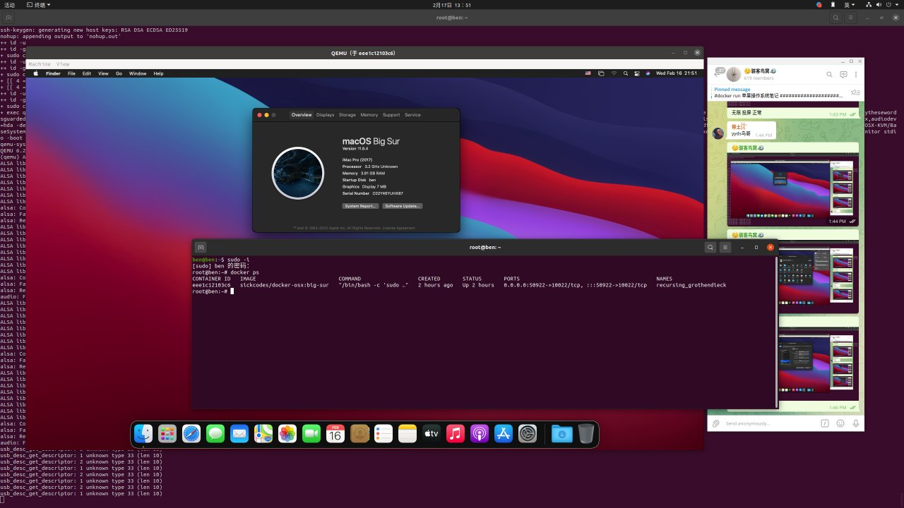
迁移 docker 版 mac 系统
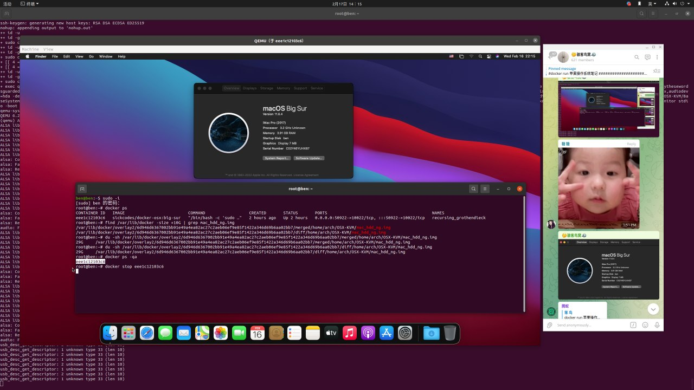
docker stop eee1c12103c6
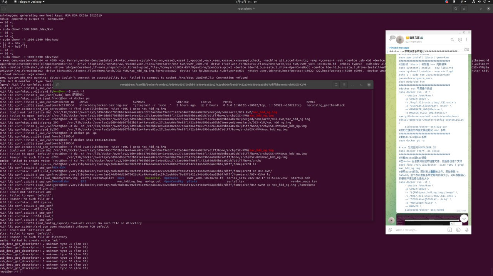
备份 mac_hdd_ng.img
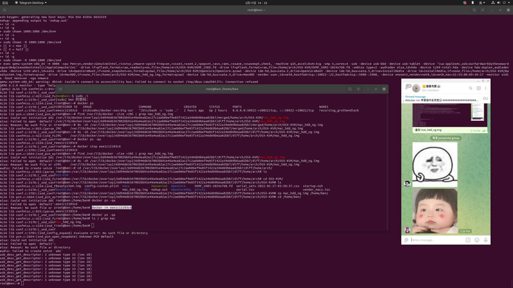
docker rm eee1c12103c6
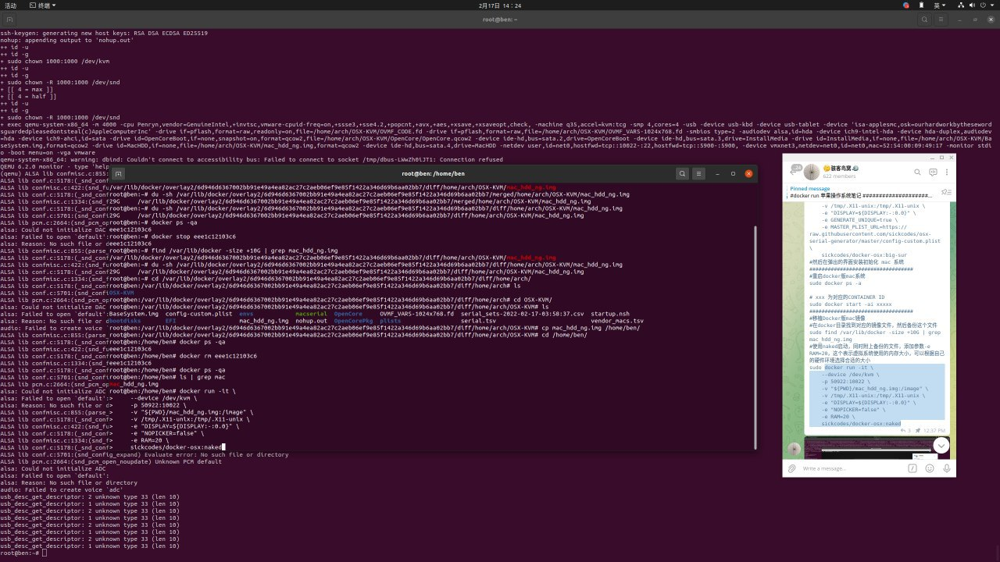
docker启动迁移的mac备份
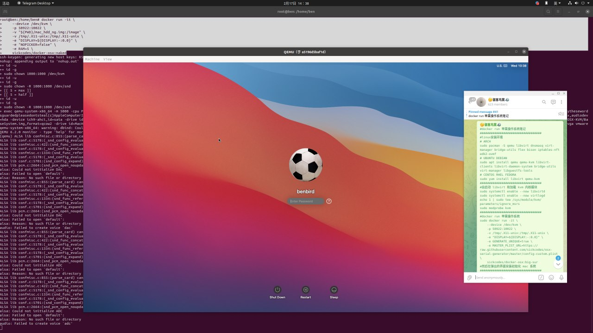
完美迁移docker 版 mac
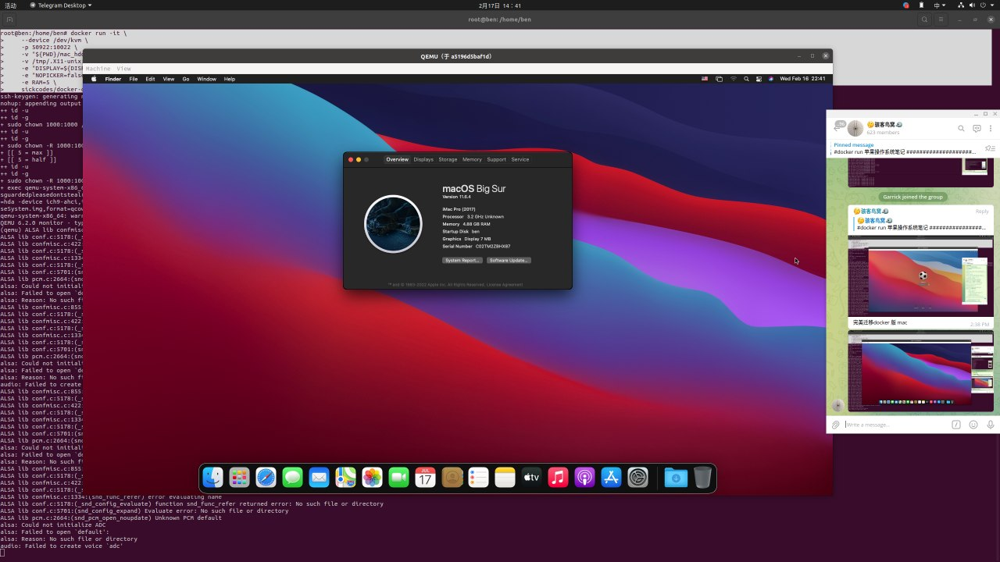
迁移启动的mac镜像 /home/ben/mac_hdd_ng.img
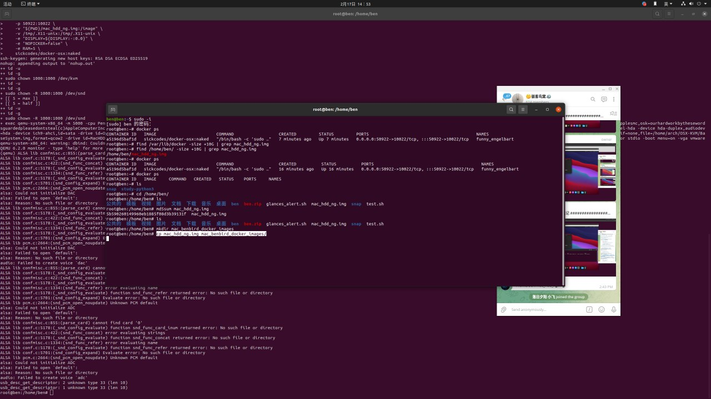
备份压缩 mac_hdd_ng.img 镜像 ，随身携带的 docker 版 mac
