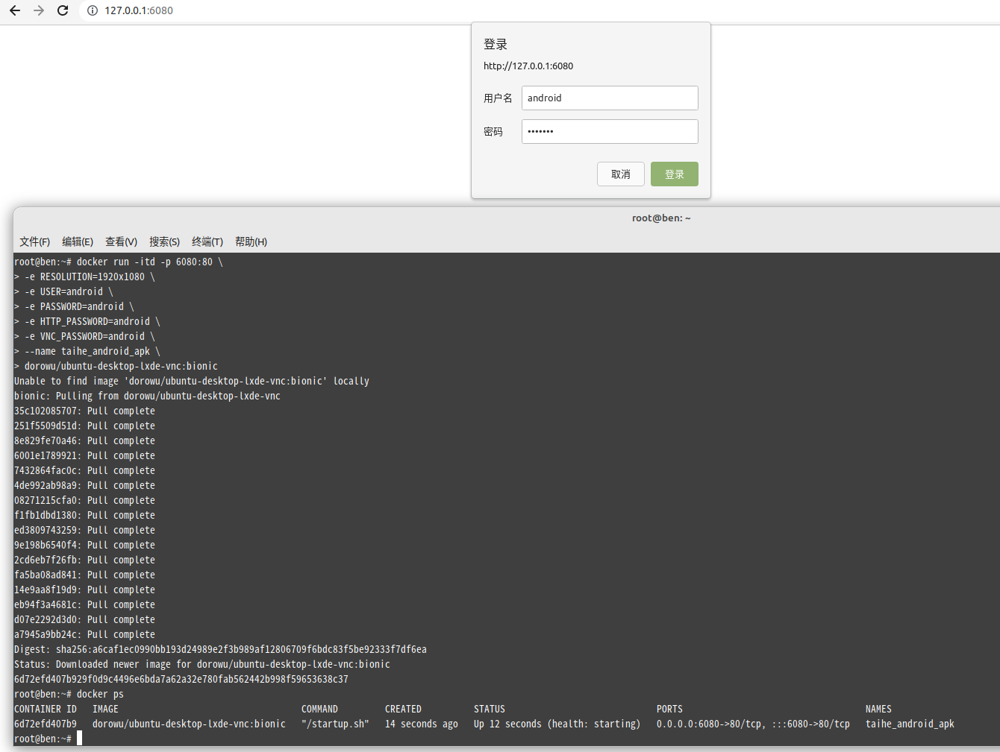
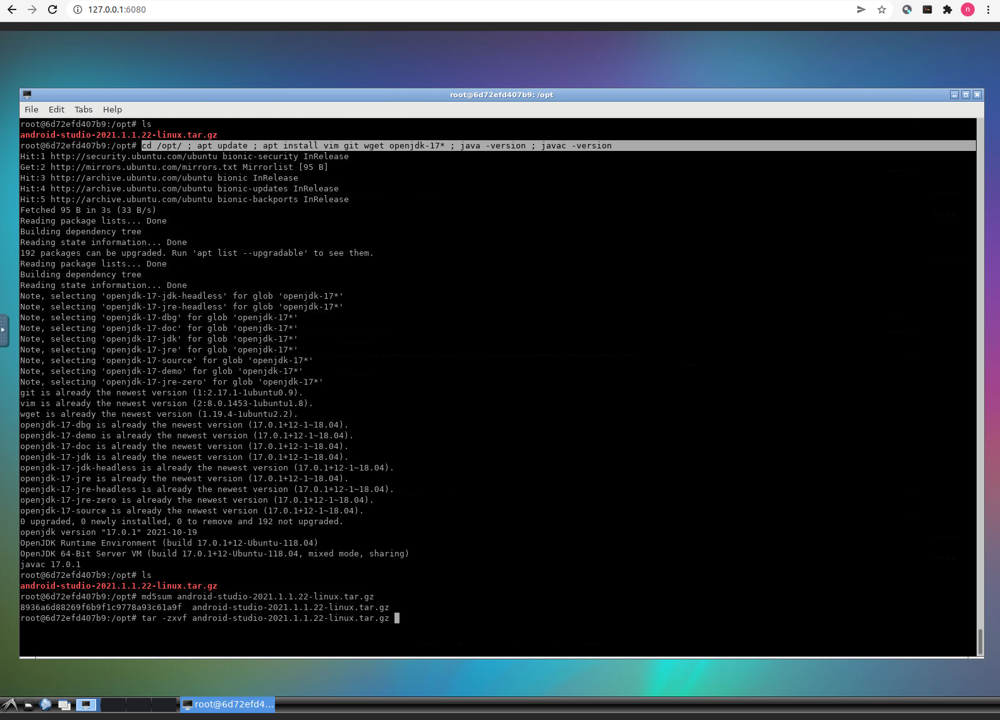
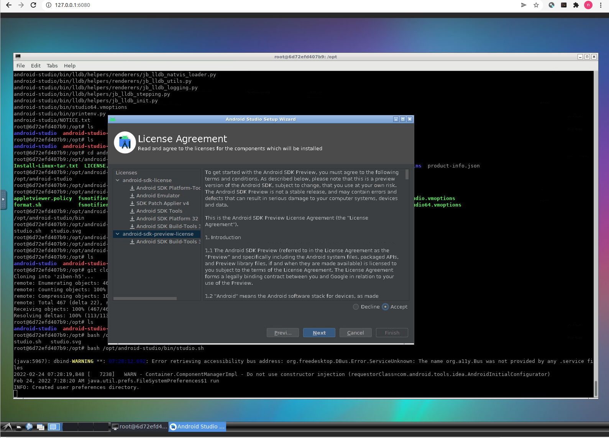
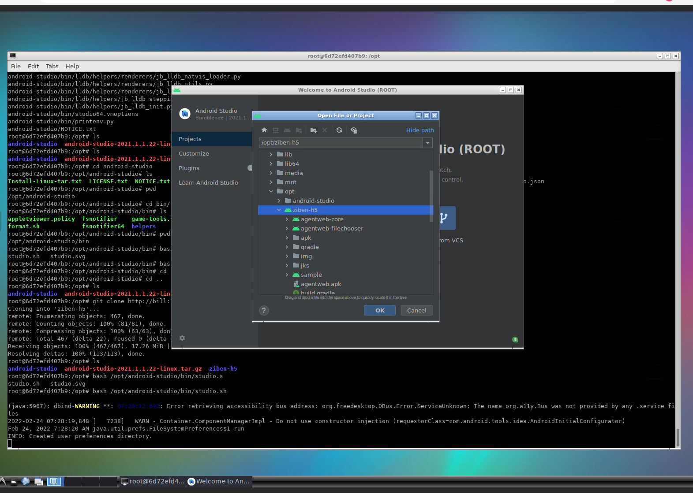
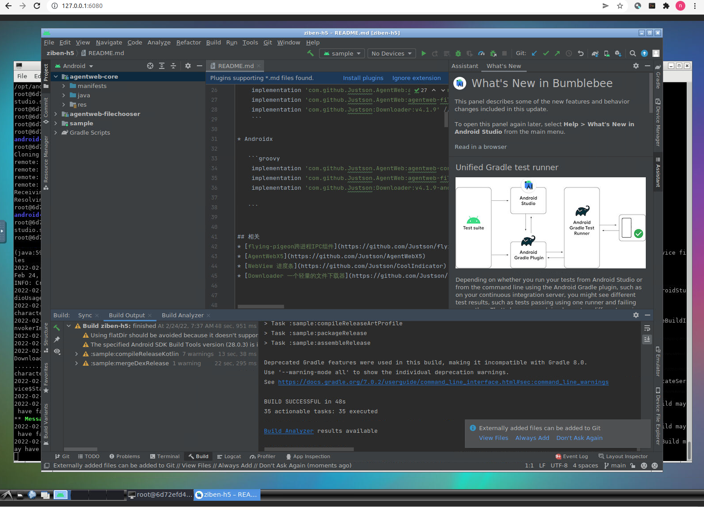
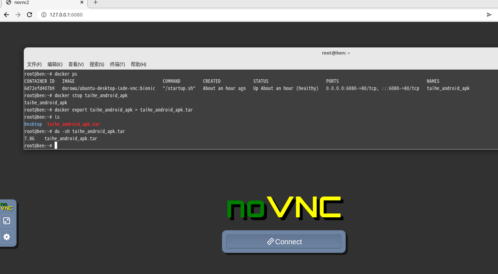
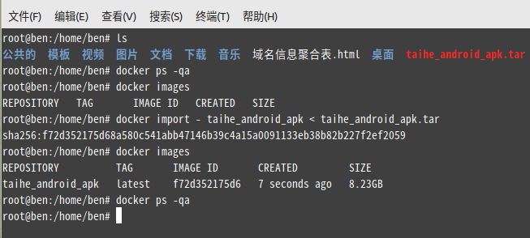

# Docker 安卓自动化构建发布

```bash
docker run -itd -p 6080:80 \
-e RESOLUTION=1920x1080 \
-e USER=android \
-e PASSWORD=[已脱敏] \
-e HTTP_PASSWORD=android \
-e VNC_PASSWORD=android \
-v /opt/ziben:/opt/ \
--name taihe_android_apk \
dorowu/ubuntu-desktop-lxde-vnc:bionic

以上代码默认拉取最新版的镜像latest版本，默认为最新版ubuntu20.04，当然也可以拉取其它版本的镜像，比如：
docker pull dorowu/docker-ubuntu-vnc-desktop:focal # 拉取Ubuntu 20.04 (latest)
docker pull dorowu/docker-ubuntu-vnc-desktop: focal-lxqt: # 拉取Ubuntu 20.04 LXQt
docker pull dorowu/docker-ubuntu-vnc-desktop: bionic: # 拉取Ubuntu 18.04
docker pull dorowu/docker-ubuntu-vnc-desktop: bionic-lxqt: # 拉取Ubuntu 18.04 LXQt
docker pull dorowu/docker-ubuntu-vnc-desktop: xenial: # 拉取Ubuntu 16.04 (deprecated)
docker pull dorowu/docker-ubuntu-vnc-desktop: trusty: # 拉取Ubuntu 14.04 (deprecated)
```




```bash
#上传 android-studio-2021.1.1.22-linux.tar.gz 安装 jdk环境
cd /opt ; apt update ; apt -y install wget git vim openjdk-17* ; java -version ; javac -version
#解压安装 android-studio
tar -zvxf android-studio-2021.1.1.22-linux.tar.gz
bash /opt/android-studio/bin/studio.sh
```





导出docker


```bash
docker export taihe_android_apk > taihe_android_apk.tar
```

新服务器导入镜像


```bash
docker import - taihe_android_apk < taihe_android_apk.tar

启动镜像
docker run -itd -p 6080:80 -e RESOLUTION=1920x1080 -e USER=android -e PASSWORD=[已脱敏] -e HTTP_PASSWORD=android -e VNC_PASSWORD=android --name taihe_android_apk taihe_android_apk /bin/bash
```
