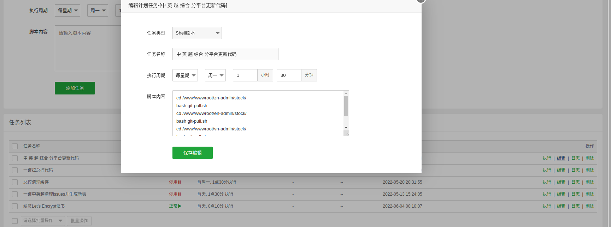

# PHP-laravel自动化构建发布



```bash
#!/bin/bash
cd /www/wwwroot/zn-admin/stock/
bash git-pull.sh
cd /www/wwwroot/en-admin/stock/
bash git-pull.sh
cd /www/wwwroot/vn-admin/stock/
bash git-pull.sh
cd /www/wwwroot/zh-admin/stock/
bash git-pull.sh
```

## git-pull.sh 脚本内容

## git fetch --all ; git reset --hard origin/pingan_zk ; git pull ; git log -1
