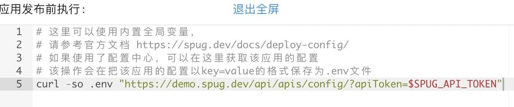

# API文档

## 介绍

配置中心提供了开放的接口用于获取应用在某环境下的配置。

## 规则

应用的配置将从以下途径获取并进行组合：

- 该应用在指定环境下的 `公共` 和 `私有` 配置
- 所依赖的应用的 `公共` 配置
- 所依赖的服务的配置
- 根据指定的环境，仅读取指定环境的以上配置

## 获取方式

配置的获取需要通过调接口的形式来获取，根据需要传的参数又分以下两种途径

### 在发布配置的钩子内获取

- 请求地址：`/api/apis/config/`
- 请求方法： `GET`
- 请求参数：

| 参数名 | 类型 | 必填 | 默认值 | 示例 | 说明 |

| --- | --- | --- | --- | --- | --- |

| apiToken | string | 是 |  | $SPUG_API_TOKEN | 固定值，`Spug` 内置的全局变量，仅可在发布配置的钩子中引用 |

| format | string | 否 | kv | json | 返回的格式，目前支持 `kv` 、`env` 和 `json` 三种格式，分别对应 `key = value` 、 `key=value` 和 `{"key": "value"}`，其中 `env` 为 v2.3.8 新增 |

| noPrefix | string | 否 |  | 1 | v2.3.8 新增，默认返回的 `key` 会增加应用或服务的标示作为前缀来确保不会出现同名的 `key` 造成配置的意外覆盖问题，如果不需要这一特性可以传该参数来禁用这一默认行为 |

- 使用示例

以下截图即在 `应用发布前` 中调用了获取配置的接口，将会把该应用该环境下的配置保存在 `.env` 文件中。



### 独立使用

- 请求地址：`/api/apis/config/`
- 请求方法： `GET`
- 请求参数：

| 参数名 | 类型 | 必填 | 默认值 | 示例 | 说明 |

| --- | --- | --- | --- | --- | --- |

| apiKey | string | 是 |  | JLV8IGO0DhoxcM7I | 调用接口的访问凭据，在 `Spug` 系统管理/系统设置/开放服务设置 中配置，请勿泄露给他人 |

| app | string | 是 |  | order | 指定要获取其配置的应用的标识符（创建应用时设置的该标识符，请在应用管理或应用配置页面查看应用的标识符） |

| env | string | 是 |  | dev | 指定获取应用所在环境的标识符（创建环境时设置的该标识符，请在 配置中心/环境管理页面查看环境标识符） |

| format | string | 否 | kv | json | 返回的格式，目前支持 `kv` 、`env` 和 `json` 三种格式，分别对应 `key = value` 、 `key=value` 和 `{"key": "value"}`，其中 `env` 为 v2.3.8 新增 |

| noPrefix | string | 否 |  | 1 | v2.3.8 新增，默认返回的 `key` 会增加应用或服务的标示作为前缀来确保不会出现同名的 `key` 造成配置的意外覆盖问题，如果不需要这一特性可以传该参数来禁用这一默认行为 |

- 使用示例1

```bash
curl "https://demo.spug.dev/api/apis/config/?apiKey=[已脱敏]"
```

输出如下

```
db_order_database = order
db_order_host = 203.0.113.1
db_order_password = 123456
db_order_port = 3306
db_order_username = root
order_app_debug = true
order_cache_driver = file
order_url = http://test-order.internal.com
redis_host = 203.0.113.1
redis_password = 123456
```

- 使用示例2

```bash
curl "https://demo.spug.dev/api/apis/config/?apiKey=[已脱敏]"
```

输出如下

```
app_debug = true
cache_driver = file
database = order
host = 203.0.113.1
password = [已脱敏]
port = 3306
url = http://test-order.internal.com
username = root
```

#### 说明

可以通过对比发现，在 `noPrefix` 模式下，服务 `订单主库`（标识符 db_order）的配置 `host` 和 `password` 被服务 `Redis服务`（标识符 redis）覆盖了，所以最终的配置意外丢失了2个。
