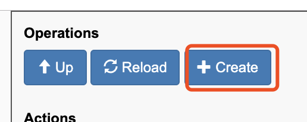
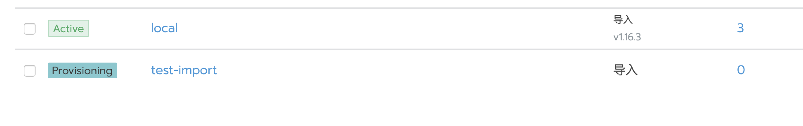

# 脚本创建导入集群

## 1. Rancher UI 获取创建集群参数

1. 访问`Rancher_URL/v3/clusters/`，单击右上角“Create”，创建导入集群：

2. 在参数填写页面中，修改以下参数:

	- `dockerRootDir` 默认为`/var/lib/docker`,如果 dockerroot 路径有修改，需要修改此配置路径；
	- `enableClusterAlerting`(可选) 根据需要选择是否默认开启集群告警；
	- `enableClusterMonitoring`(可选) 根据需要选择是否默认开启集群监控；
	- `name`(必填) 设置集群名称，名称具有唯一性，不能与现有集群名称相同；

	3.配置好参数后单击`Show Request`；
	4.在弹出的窗口中，复制`API Request`中`HTTP Request:`的`{}`中的内容，此内容即为创建的集群的 API 参数；

	 展开源码

```bash
	#!/bin/bash
	api_url='https://xxx.rancher.com/v3/clusters'
	api_token='token-vrdkx:mvnrxxxxxxxxxnxzfx4h2gjkdtzzv97sw7brz66454'
	cluster_name='test-import'

	create_cluster_data()
	{
	 cat <<EOF
	{
	    "aliyunEngineConfig": null,
	    "amazonElasticContainerServiceConfig": null,
	    "answers": null,
	    "azureKubernetesServiceConfig": null,
	    "baiduEngineConfig": null,
	    "dockerRootDir": "/var/lib/docker",
	    "enableClusterAlerting": true,
	    "enableClusterMonitoring": true,
	    "googleKubernetesEngineConfig": null,
	    "huaweiEngineConfig": null,
	    "localClusterAuthEndpoint": null,
	    "name": "test-import",
	    "rancherKubernetesEngineConfig": null,
	    "tencentEngineConfig": null,
	    "windowsPreferedCluster": false
	}
	EOF
	}

	curl -k -X POST \
	 -H "Authorization: Bearer ${api_token}" \
	 -H "Content-Type: application/json" \
	 -d "$(create_cluster_data)" $api_url/v3/clusters
```

	## 2. 创建集群

		1. 保存以上代码为脚本文件，修改前三行的变量与配置中的参数（比如：dockerRootDir ），最后执行脚本。
		2. 脚本执行完成后，集群状态如下所示，其状态为`Provisioning;`

		

		## 3. 创建注册命令

		复制并保存以下内容为脚本文件，修改前三行`api_url`、`token`、`cluster_name`，然后执行脚本。

		 展开源码

```bash
		#!/bin/bash
		api_url='https://xxx.domain.com'
		api_token='token-5zgl2:tcj5nvfq67rf55r7xxxxxxxxxxx429xrwd4zx'
		cluster_name=''
		# 获取集群ID
		cluster_ID=$( curl -s -k -H "Authorization: Bearer ${api_token}" $api_url/v3/clusters | jq -r ".data[] | select(.name == \"$cluster_name\") | .id" )
		# 生成注册命令
		create_token_data()
		{
		cat <<EOF
		{
		"clusterId": "$cluster_ID"
		}
		EOF
		}

		curl -k -X POST \
		 -H "Authorization: Bearer ${api_token}" \
		 -H 'Accept: application/json' \
		 -H 'Content-Type: application/json' \
		 -d "$(create_token_data)" $api_url/v3/clusterregistrationtokens
```

		## 4. 获取主机注册命令

		复制并保存以下内容为脚本文件，修改前三行`api_url`、`token`、`cluster_name`，然后执行脚本。

		 展开源码

```bash
		#!/bin/bash
		api_url='https://xxx.domain.com'
		api_token='token-5zgl2:tcj5nvfq67rf55r7xxxxxxxxxxx429xrwd4zx'
		cluster_name=''
		cluster_ID=$( curl -s -k -H "Authorization: Bearer ${api_token}" $api_url/v3/clusters | jq -r ".data[] | select(.name == \"$cluster_name\") | .id" )
		# nodeCommand
		curl -s -k -H "Authorization: Bearer ${api_token}" $api_url/v3/clusters/${cluster_ID}/clusterregistrationtokens | jq -r .data[].nodeCommand

		# command
		curl -s -k -H "Authorization: Bearer ${api_token}" $api_url/v3/clusters/${cluster_ID}/clusterregistrationtokens | jq -r .data[].command
```
