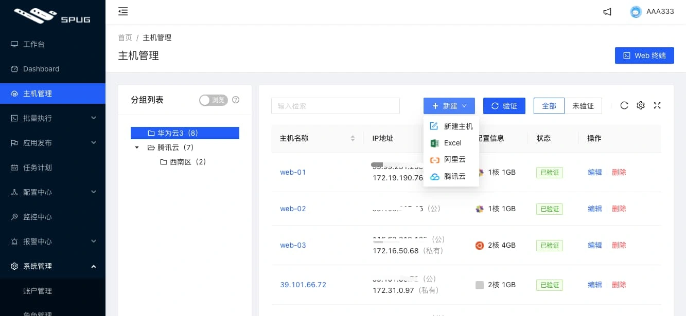
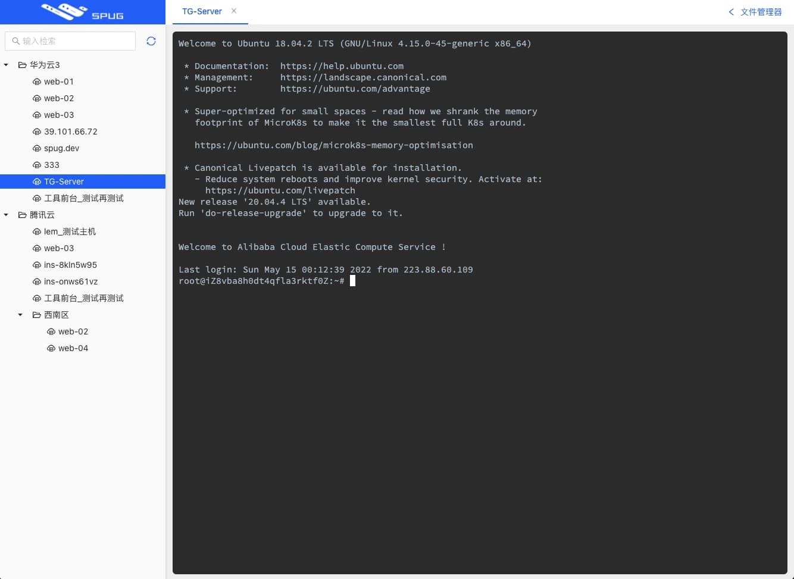
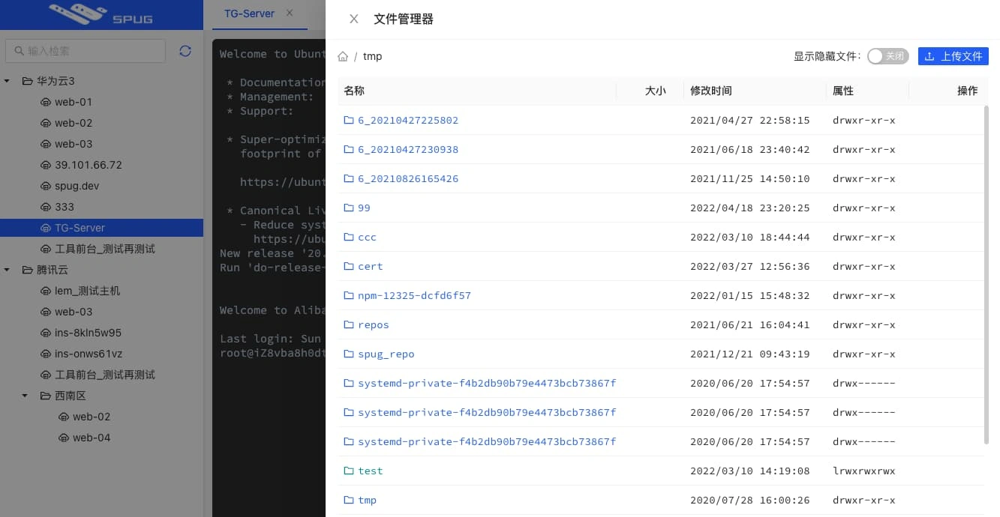
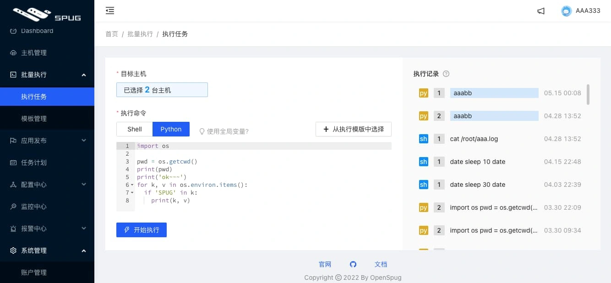
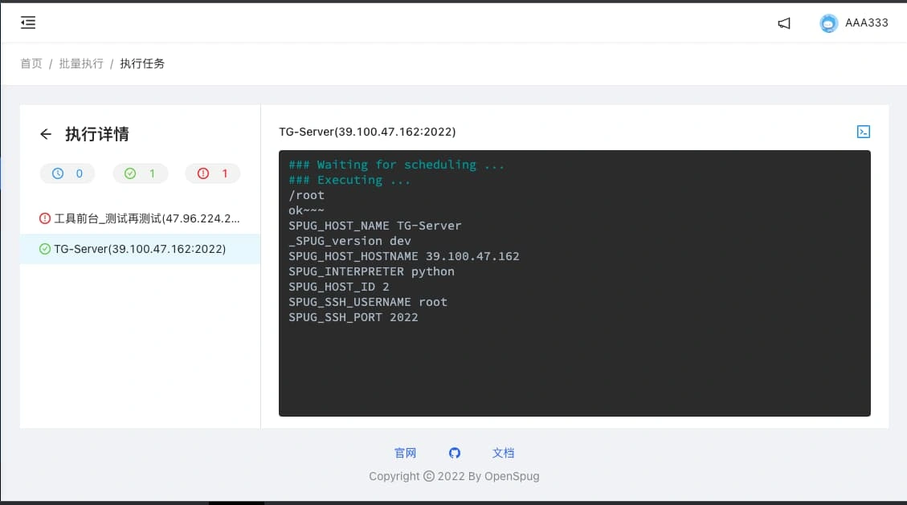
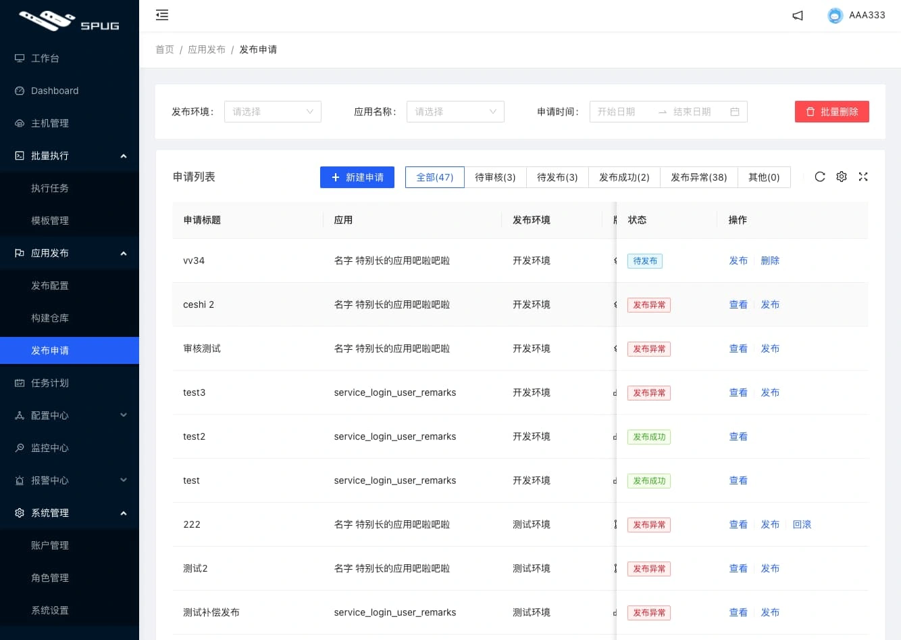
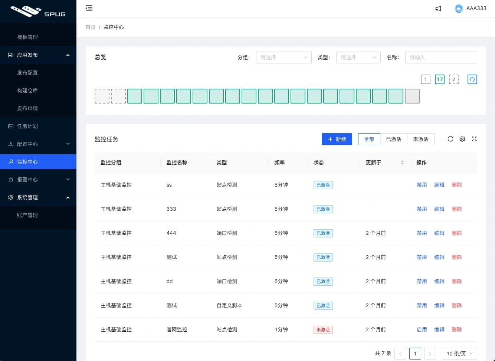
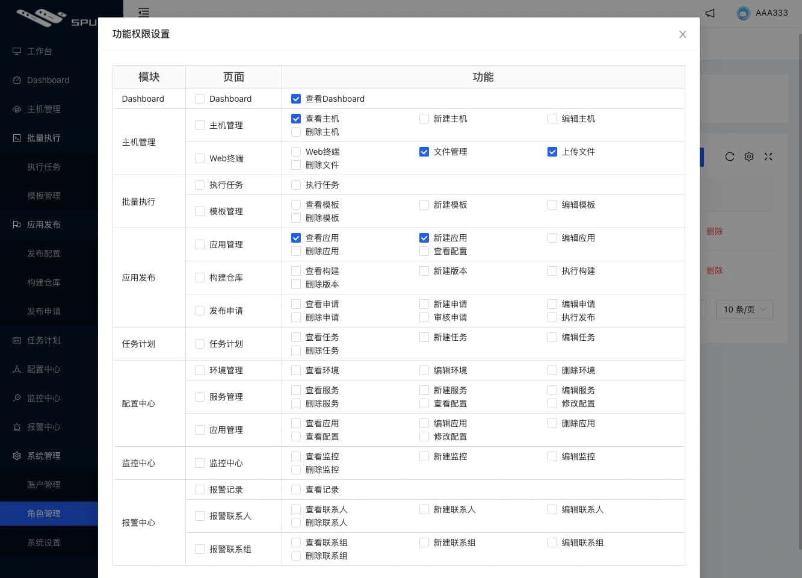

# spug-运维平台

> GitHub 仓库源文件：[点击打开网页渲染版](https://github.com/ben2023niao/ben-ops-notes/blob/main/doc/md/202304141557-DevOps%20%E4%B8%8E%20SRE%2B%E9%AB%98%E6%95%88%E8%BF%90%E7%BB%B4%2B%E6%9D%83%E9%99%90%E7%AE%A1%E7%90%86%2B%E7%9B%91%E6%8E%A7%E5%91%8A%E8%AD%A6-spug-%E8%BF%90%E7%BB%B4%E5%B9%B3%E5%8F%B0.md)

## 介绍

`Spug` 面向中小型企业设计的轻量级无 Agent 的自动化运维平台，整合了主机管理、主机批量执行、主机在线终端、文件在线上传下载、应用发布部署、在线任务计划、配置中心、监控、报警等一系列功能。

### 特性

- 批量执行: 主机命令在线批量执行
- 在线终端: 主机支持浏览器在线终端登录
- 文件管理: 主机文件在线上传下载
- 任务计划: 灵活的在线任务计划
- 发布部署: 支持自定义发布部署流程
- 配置中心: 支持 KV、文本、json 等格式的配置
- 监控中心: 支持站点、端口、进程、自定义等监控
- 报警中心: 支持短信、邮件、钉钉、微信等报警方式
- 优雅美观: 基于 Ant Design 的 UI 界面
- 开源免费: 前后端代码完全开源

#### 主机管理

##### 主机在线终端

##### 文件在线上传下载

##### 主机批量执行

##### 应用发布

##### 监控报警

##### 角色权限
